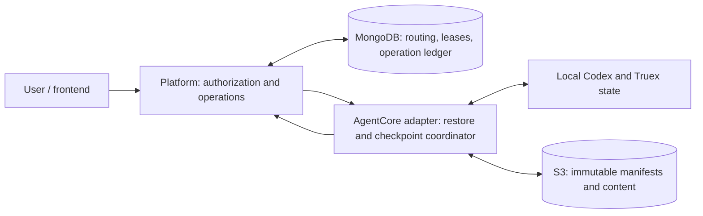
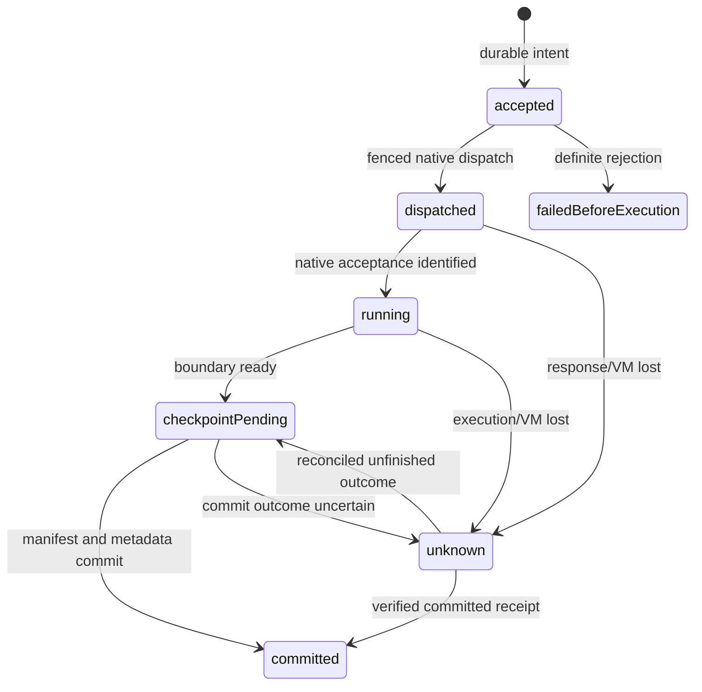

# Development specification: durable Codex conversations on AWS AgentCore

**Status:** engineering handoff; proposed implementation, not deployed.
**Date:** 2026-10-03.
**Application baseline:** `deploy`, commit `a36c820`.
**Codex baseline:** pinned revision `c1382380de69521303b416720a52f42d51af6248`.
**Scope:** production durability, recovery, concurrency, isolation and scale for
Truex's self-hosted Codex app-server running inside AgentCore.

This is the consolidated specification for the architecture, tradeoffs and
failure cases discussed in the engineering conversation. It supersedes
`docs/AGENTCORE_PERSISTENCE_PLAN.md` as the development handoff. Existing code
behavior is identified separately from required or proposed behavior. No
application, Codex or AWS configuration changes have been implemented by this
document. Requirements marked **MUST** are acceptance conditions; proposed
settings and latency targets require measurements before production sign-off.

### Navigation

- [Guarantees and limits](#3-guarantees-invariants-and-deliberate-limits)
- [Identity and isolation](#4-identity-isolation-and-durable-ownership)
- [State inventory](#5-native-state-inventory-and-restore-layout)
- [Infrastructure](#6-storage-and-infrastructure)
- [Schemas and contracts](#7-durable-schemas-and-internal-contracts)
- [Ownership and dispatch](#8-lease-fencing-and-dispatch-protocol)
- [Recovery](#10-cold-startup-and-recovery)
- [Codex boundary decision](#11-snapshot-barrier-and-codex-changes)
- [Commit protocol](#12-checkpoint-publication-protocol)
- [External effects and budgets](#13-events-outbox-accounting-and-external-effects)
- [Scale and limits](#14-scalability-performance-and-resource-limits)
- [Failure matrix](#15-failure-and-breaking-case-matrix)
- [Tradeoffs](#19-tradeoffs-and-alternatives)
- [Implementation stages](#20-implementation-work-packages)
- [Release tests](#21-validation-and-release-acceptance)
- [Migration and runbooks](#22-migration-rollout-and-rollback)
- [Outstanding decisions](#24-decisions-required-before-implementation-sign-off)

## 1. Problem and architectural decision

Local execution on `main` assumes the runtime's disk persists. `deploy` adds
AgentCore transport and lazy startup but retains native filesystem state.
Replacement compute may have an empty disk even when invoked using the same
runtime session ID. MongoDB's visible conversation transcript does not contain
everything needed to resume a Codex thread faithfully.

**Use S3 object storage for durable native checkpoints, the existing durable
MongoDB deployment for coordination, and local AgentCore storage as a working
copy.** Preserve the native thread identity and restore its state before
calling normal `thread/resume`.

Managed AgentCore session storage at `/mnt/state` can mitigate ordinary
stop/resume loss and cache the working copy. It is optional to the correctness
of the S3 recovery protocol; production MUST recover from a completely empty
disk. MongoDB need only be reachable from the platform. AgentCore talks to a
scoped internal control API rather than receiving unrestricted database access.

The checkpoint unit is a **runtime family**: the original root, its forks and
helpers, their lineage, native databases, Truex metadata and owned files. This
matches current forks sharing `agentCoreSessionId`. A UI conversation alone
is not the correct whole-directory snapshot boundary.



S3 is the durable bulk store, not a filesystem mounted underneath live SQLite.
Do not replace Codex's history with replay of visible MongoDB messages. Do not
share one unmodified `CODEX_HOME` between unrelated sessions on EFS. AgentCore
Memory may be evaluated separately for knowledge retrieval; it is not a
substitute for the native continuation state defined here.

## 2. Verified repository behavior

References are tied to the baseline above; line numbers may move during work.

| Location                                                          | Verified behavior                                                    | Required change                                                        |
| ----------------------------------------------------------------- | -------------------------------------------------------------------- | ---------------------------------------------------------------------- |
| `Dockerfile:82`; `agent-core/src/index.ts:28`                     | Business home is `/mnt/state/codex/business-v1`                      | Restore and validate ownership before opening it                       |
| `agent-core/src/agentcore-services.ts`                            | Starts services on first invocation                                  | Insert authenticated family binding and recovery before launch         |
| `agent-core/src/agentcore.ts`                                     | Does not bind startup to the AWS session header                      | Bind and validate the runtime identity on every invocation             |
| `platform/src/service.ts:1096`                                    | Native creation precedes Session insertion                           | Persist family and operation intent first                              |
| `platform/src/service.ts:1832`                                    | Native fork precedes Session insertion; copies runtime routing       | Reconcile lost/partial fork results within the same family             |
| `platform/src/runtime-transport.ts`                               | Stable runtime session routing; SDK `maxAttempts: 1`                 | Retain no blind mutation retries until operation reconciliation exists |
| `agent-core/src/business-runtime.ts:213`                          | Marker determines tenant, cwd and capabilities                       | Include markers and preserve stable paths                              |
| `agent-core/src/business-runtime.ts:217`; resume caller at `:393` | Missing marker raises `LEGACY_SESSION`                               | Restore before classifying this as legacy/missing                      |
| `agent-core/src/manager.ts:563`                                   | Cold resume uses Codex thread ID                                     | Continue using native resume after restore                             |
| `agent-core/src/manager.ts:606`; `platform/src/service.ts:1279`   | Missing history becomes `THREAD_LOST`, then permanently dead         | Make recovery and classification separate stages                       |
| `agent-core/src/manager.ts:1323`                                  | Adapter records written to local disk before ingestion               | Include records; gate authoritative terminal publication on commit     |
| `platform/src/service.ts:1622`                                    | Polls records, persists, then acknowledges/deletes                   | Add durable generation provenance and idempotent reconciliation        |
| `platform/src/service.ts:1657`                                    | Every two seconds scans eligible sessions and invokes their runtimes | Replace historical runtime polling with due-work scheduling            |
| `agent-core/src/client.ts:293`                                    | `stop()` sends SIGTERM without awaiting exit                         | Do not use as a snapshot barrier                                       |
| `agent-core/src/index.ts:67`; smoke script                        | Writability/startup checks only                                      | Add storage readiness and real cold-recovery acceptance                |

The vendored Codex revision matches `codex.lock.json`. Inspection found:

- `core/src/tasks/mod.rs:816-841`: terminal notification precedes final flush;
  flush errors can be logged without failing the completion.
- `core/src/session/mod.rs:3717`: rollout append failures are logged.
- `rollout/src/recorder.rs`: file flush is not proof of remote durability.
- `state/src/sqlite.rs:278`: SQLite is configured with WAL and NORMAL sync.
- `app-server/src/lib.rs:728`: stdio mode disables the graceful signal handler;
  stdio EOF/drain behavior requires a pinned-binary experiment.
- `thread-store/src/local/rollout_lineage.rs`: fork/helper histories may depend
  on source rollouts recursively, including `history_base` references.
- Experimental history/path resume is stripped by Truex. The pinned `history`
  field is marked unstable and does not represent all native thread state.

No committed infrastructure provisions the `/mnt/state` mount. This does not
prove the live AWS runtime lacks one: its actual configuration is unverified.
The image creates a writable directory even without persistent storage.

## 3. Guarantees, invariants and deliberate limits

### 3.1 Required invariants

| ID  | Invariant                                                                                                                                  |
| --- | ------------------------------------------------------------------------------------------------------------------------------------------ |
| I01 | A durably committed operation is recoverable from its committed manifest on an empty disk, subject to the configured storage failure model |
| I02 | `accepted`, `runtime finished` and `durably committed` are distinct states                                                                 |
| I03 | Native completion or local writability alone never implies durable completion                                                              |
| I04 | Recovery preserves recorded native thread IDs and lineage; it never silently substitutes a new empty thread                                |
| I05 | Only the current fenced writer may mutate a family or publish its next generation                                                          |
| I06 | Generation publication compares writer epoch, valid lease, parent generation and lifecycle state atomically                                |
| I07 | A published generation references only complete, immutable, verified objects                                                               |
| I08 | Snapshot boundaries cover every native and Truex writer, including automatic work                                                          |
| I09 | Retries reuse operation identity; the same ID with different input is rejected                                                             |
| I10 | Unknown external effects are reconciled rather than automatically replayed                                                                 |
| I11 | Tenant/family authorization is checked independently of caller-supplied IDs                                                                |
| I12 | Restores validate contents before promotion and before starting Codex                                                                      |
| I13 | Deletion, permission revocation and consumed budgets cannot be undone by restoring an older native checkpoint                              |
| I14 | Retention/GC cannot remove anything referenced by retained or in-progress checkpoints                                                      |
| I15 | Independent families scale without a global mutation lock or periodic wakeup of every historical VM                                        |

### 3.2 Recovery objectives

Baseline release guarantees **committed-boundary recovery**, not uninterrupted
process execution and not zero loss of a running turn. Uncommitted output may
be visible provisionally and may require correction after a crash. Running
processes, sockets, raw RPC IDs and external transactions do not survive.

RPO for acknowledged committed native state is zero within the chosen durable
S3/MongoDB failure model. RPO for work since the last commit is the uncommitted
interval. RTO includes detection, ownership acquisition, VM startup, download,
verification, native startup and reconciliation; no bound is certified yet.

Regional disaster recovery requires coordinated MongoDB and S3 backups and a
separate measured RPO/RTO. Ordinary checkpointing does not promise survival of
whole-region loss, operator deletion, compromised credentials or disabled KMS
keys. Approved recovery to an older generation MUST disclose resulting loss.

### 3.3 Non-goals

- Replacing Codex with the Agents SDK or another harness.
- Changing the inference provider or requiring OpenAI-managed conversations.
- Guaranteeing exactly-once SAP/external effects without connector support.
- Migrating arbitrary local conversations automatically during a server switch.
- Cross-tenant deduplication or shared mutable history files.
- Claiming a faithful resume from visible user/assistant text alone.

## 4. Identity, isolation and durable ownership

| Identity           | Meaning                                | Persistence                                                 |
| ------------------ | -------------------------------------- | ----------------------------------------------------------- |
| `tenantId`         | Authorized tenant boundary             | Server-resolved; never trusted from body alone              |
| `sessionId`        | UI conversation ID                     | One per root/fork exposed to the user                       |
| `threadId`         | Native Codex thread ID                 | Retained across recovery                                    |
| `familyId`         | Durable state/ownership unit           | Stable across compute replacement and runtime revisions     |
| `runtimeSessionId` | AWS invocation affinity                | Stable during normal recovery; explicitly mapped if changed |
| `writerId`         | One VM/process incarnation             | Newly generated on startup                                  |
| `writerEpoch`      | Monotonically increasing fencing value | Database-issued; never reset/reused                         |
| `operationId`      | One logical action                     | Stable across retries and recovery                          |
| `generationId`     | One immutable checkpoint               | Globally unique within family; never overwritten            |
| `streamEpoch`      | One event stream incarnation           | Changes when local sequence numbering restarts              |

Initially use existing `agentCoreSessionId` as the family seed. Preserve a
separate mapping so migration to another runtime ARN/session does not change
the durable identity. Do not conflate Codex's own session-tree identifiers with
AWS session IDs. Attach a runtime mapping version to reject stale routing.

Bind startup using `X-Amzn-Bedrock-AgentCore-Runtime-Session-Id` plus a
platform-authenticated scoped context. Verify tenant, family, runtime ARN and
mapping version against the control plane. Header identity alone does not
authorize access to an arbitrary family. Reject identity changes within one
live process. Health/schema probe sessions MUST be unable to acquire a user
family or create user-state checkpoints.

One AgentCore microVM/family can keep the existing absolute home path because
its filesystem is isolated. If a runtime ever hosts unrelated families, give
each an isolated process/home or checkpoint the entire explicit shard. Never
restore a per-conversation whole-home snapshot over other active families.
Direct local HTTP mode remains outside server checkpointing until this
isolation is implemented.

## 5. Native state inventory and restore layout

Snapshot the family-owned business home and any explicitly declared external
state roots. Maintain a versioned inventory per Codex revision. Unknown files
MUST be classified before a revision is admitted; a loose glob that silently
drops new native state is insufficient.

| State                                                                        | Treatment                                                                                                   |
| ---------------------------------------------------------------------------- | ----------------------------------------------------------------------------------------------------------- |
| Active/archived rollout JSONL                                                | Preserve exact native bytes and ordering, including terminal, compaction, context and dynamic-tool metadata |
| Fork/helper/ancestor rollouts                                                | Preserve recursive closure; verify every lineage dependency                                                 |
| Native SQLite state/history/goals/queue/memory databases present for the pin | Preserve consistently; classify authoritative vs reproducible explicitly                                    |
| `business-threads/<threadId>.json`                                           | Preserve tenant, stable cwd, tool flags, skills and helper settings                                         |
| `business-workspaces/<tenant>/<uuid>/`                                       | Preserve uploads, generated documents, visuals, workspace content and metadata                              |
| `adapter-records/<threadId>/`                                                | Preserve unacknowledged outbox records with stable event identity                                           |
| Standalone auth/provider/MCP tokens                                          | Regenerate when possible; never use historical tokens as current authority                                  |
| Scratch/cache/log state                                                      | Explicit policy; exclude only after demonstrating it is unnecessary for recovery                            |
| In-memory RPC requests, timers, subscriptions, processes                     | Recreate or classify interrupted; never serialize as valid live handles                                     |

Known database names in the pin include `state_5.sqlite`,
`thread_history_1.sqlite`, `goals_1.sqlite`, `queue_1.sqlite` and applicable
memory databases. This list is evidence, not a substitute for the inventory.

`AGENT_WORKSPACE=/mnt/state/workspace` is not the active business workspace
root today. Actual business workspaces are below the business home. Preserve
original absolute paths embedded in markers and native state. Changing paths
requires a tested migration rather than unverified string replacement.

Handle partial tool writes explicitly. Atomic file replacement should stage,
flush/close as appropriate, then rename; metadata and binary pairs must reach
one coherent boundary. Temporary files are not promoted as valid documents.
Avoid deleting `tmp/` during an active script or between capture phases.

Preserve native context semantics, not just UI rendering. Recovery tests MUST
inspect subsequent model input to verify earlier tool results and compaction
context, and separately verify byte hashes of files and native database state.

## 6. Storage and infrastructure

### 6.1 Working storage and AWS constraints

For microVMs, AWS currently documents managed session storage as preview,
surviving stop/resume but resetting after 14 idle days or a runtime version
update. EFS/S3 Files are shared mounts requiring VPC networking. Mounts become
available at invocation. Managed storage limits include 1 GB, depth 200 and
approximately 100,000–200,000 files. It lacks hard links, FIFOs and Unix sockets.
Validate SQLite and tool filesystem operations on the actual mount. See
[AWS filesystem configuration](https://docs.aws.amazon.com/bedrock-agentcore/latest/devguide/runtime-filesystem-configurations.html)
and [quotas](https://docs.aws.amazon.com/bedrock-agentcore/latest/devguide/bedrock-agentcore-limits.html).

Example configuration fragment, merged into the actual deployment definition:

```json
{
  "filesystemConfigurations": [
    { "sessionStorage": { "mountPath": "/mnt/state" } }
  ]
}
```

Discover compute type, region availability and existing settings first. Back
up surviving native state before any update that may reset the mount. Managed
storage is an optimization, not a reason to skip durable commits. If omitted,
ephemeral working storage is valid only with the same empty-disk recovery
protocol. A claimed managed mount MUST be verified; an image directory must
not silently impersonate it.

MicroVM lifecycle defaults are 15 minutes idle and eight hours maximum
lifetime. Busy health can prevent idle expiry but does not remove the hard
lifetime. Shutdown time is bounded and cannot carry the durability guarantee.
See [AWS lifecycle settings](https://docs.aws.amazon.com/bedrock-agentcore/latest/devguide/runtime-lifecycle-settings.html).

### 6.2 Durable object store

Use ordinary S3 object APIs, with immutable object keys and manifests. S3
Files synchronization is a different surface and is not the commit protocol.
S3's per-object strong consistency does not make a multi-object upload plus
MongoDB pointer update atomic. [S3 consistency documentation](https://docs.aws.amazon.com/AmazonS3/latest/userguide/Welcome.html)

Suggested layout:

```text
runtime-state/v1/<tenantId>/<familyId>/
  objects/<sha256>
  manifests/<generationId>.json
  staging/<writerEpoch>/<uploadId>/...   # optional temporary uploads
```

Deduplicate within one family initially. Tenant-wide deduplication requires a
separate authorization/GC review; cross-tenant deduplication is excluded.
Digests are not permission checks. Use checksums and lengths, not S3 ETags, as
the content identity; multipart uploads must follow the same verification.
Enforce create-only conditional writes for content and manifests. On an
existing-key conflict, verify length/checksum and reuse only an identical
object. Never overwrite a referenced key. Separate transfer permissions from
GC deletion permissions; bucket versioning alone does not enforce immutability.
Avoid LIST-based discovery of the current generation: MongoDB owns its exact
manifest key and checksum.

Provision infrastructure as code: bucket, encryption/KMS policy, versioning
decision, network access, constrained IAM, multipart cleanup, retention, alarms
and documented restore access. Keep current restore generations in an
immediately readable storage class. Cold archival requires an explicit slower
recovery workflow. Configure maximum object/manifest size and aggregate bytes.

### 6.3 MongoDB control plane

Require a production replica-set/sharded deployment with verified durable
writes. Explicitly configure majority write concern, journaling as supported,
bounded write timeout and primary/majority-consistent recovery reads. Test
stepdown and partitions; do not infer durability from the package's defaults.
A write-concern timeout may occur after a write applied and must be resolved
by reading its identity, not by assuming failure. [MongoDB write concern](https://www.mongodb.com/docs/manual/reference/write-concern/)

Use a majority-committed transaction for generation pointer, operation results
and checkpoint metadata in the baseline control plane. Create/fork commit also
publishes or finalizes the application Session/native-thread mapping in that
transaction, or through a durable outbox whose reconciliation is specified.
An acknowledged new conversation cannot depend on a subsequent best-effort
Session insert. Commit also establishes an indexed due-delivery marker/outbox
entry atomically, so a crash before sending a notification cannot strand a
committed result. Transactions must not contain S3 transfers. Keep large file
manifests in S3 and bounded result references in MongoDB. Test driver
retry/unknown-commit-result behavior.
[MongoDB transactions](https://www.mongodb.com/docs/manual/core/transactions/)

If existing MongoDB cannot meet these guarantees, upgrade it or adopt DynamoDB
for this control plane. Do not add a second database without demonstrating a
requirement. The coordination protocol remains the same.

## 7. Durable schemas and internal contracts

Schemas below are proposed, not existing API types. Use versioned validation,
typed domain errors and explicit nullability. Encode epochs/revisions using a
lossless integer representation, such as BSON Long with decimal-string wire
encoding; do not overflow JavaScript's safe integer range.

### 7.1 Collections

```text
runtimeFamilies:
  tenantId, familyId, schemaVersion,
  runtimeArn, runtimeSessionId, runtimeMappingVersion,
  lifecycle: provisioning | active | draining | deleted | recoveryRequired,
  revision, fencingEpoch, committedGenerationId?, committedManifestKey?, manifestSha256?,
  writer: { writerId, epoch, leaseExpiresAt }?,
  nativeRevision, policyVersion, createdAt, updatedAt, deletionEpoch?

runtimeOperations:
  tenantId, familyId, operationId, kind, requestDigest, actorId,
  sessionId?, threadId?, parentThreadId?, clientId?, nativeTurnId?,
  state: accepted | dispatched | running | checkpointPending |
         committed | failedBeforeExecution | unknown,
  nativeOutcome: pending | succeeded | failed | interrupted | cancelled | unknown,
  writerEpoch?, committedGenerationId?, resultRef?,
  cancellationState?, sideEffectState?, acceptedAt, updatedAt

runtimeCheckpoints:
  tenantId, familyId, generationId, parentGenerationId?, writerEpoch,
  state: preparing | committed | abandoned,
  manifestKey, manifestSha256, snapshotSchemaVersion, codexRevision,
  operationSetRef, bytes, files, createdAt, committedAt?, gcPinExpiresAt?, gcPinOwner?

runtimeActionReceipts:
  tenantId, familyId, actionId, operationId, requestDigest,
  connectorId, currentScopeVersion, writerEpoch,
  state: prepared | dispatched | confirmed | unknown,
  externalIdempotencyKey?, externalReceiptRef?, accountingRef?
```

Family membership belongs in separately indexed session/thread records; do not
grow an unbounded `threadIds` array in the family document. Delete operations
need a distinct scope: thread vs whole family. Current Session status can
remain a projection; it must not be the ownership authority.

Place control collections in the existing tenant database using the platform's
tenant context, or choose an explicitly tenant-scoped shared database with
equivalent authorization on every query. Specify the choice in implementation
and preserve existing catalog/membership behavior. Transaction boundaries must
match the deployed topology and chosen collection placement.

Unique indexes: `(tenantId, familyId)`,
`(tenantId, familyId, operationId)`,
`(tenantId, familyId, generationId)` and scoped `actionId`. Index due operations,
pending outbox delivery and committed checkpoints for bounded reconciliation.
Do not TTL-delete leases, operation identities or deletion tombstones in ways
that permit recreation or duplicate execution. Operation retention MUST cover
supported retry/recovery periods; expired identities return an explicit error.
Retain compact identity/digest tombstones beyond result retention, or issue
authenticated server IDs with an enforceable acceptance horizon. Once an
arbitrary client ID is fully forgotten, the server cannot distinguish it from
a new ID; do not purge it and then claim expired retries remain detectable.

### 7.2 S3 manifest

```text
schemaVersion, tenantId, familyId, generationId, parentGenerationId?,
writerEpoch, codexRevision, appRevision, protocolRevision, policyVersion,
capturedAt, barrierId, stableHomePath,
threadInventoryRef, operationResultsRef, outboxRef, accountingWatermark,
files: [{ relativePath, kind, mode, logicalBytes, sha256,
          objects: [{ key, sha256, storedBytes, logicalBytes, offset }] }],
lineageDependencies, totalLogicalBytes, totalStoredBytes, fileCount
```

Bound manifests; paginate large inventories through immutable indexed chunks.
Files form a complete logical snapshot, even when content objects are reused.
Represent deletion by absence from the new complete inventory; never apply a
delta without its validated base. Include native database backup method and
integrity-validation results. Capture ordering without trusting wall-clock
timestamps for generation precedence.

### 7.3 Proposed private control API

| Operation            | Required semantics                                                                                 |
| -------------------- | -------------------------------------------------------------------------------------------------- |
| `family/resolve`     | Validate runtime/tenant mapping; return lifecycle, committed pointer and compatibility information |
| `writer/acquire`     | Atomically assign new epoch to one authorized writer after valid takeover conditions               |
| `writer/renew`       | Extend current writer lease using database/server time                                             |
| `operation/accept`   | Persist intent and request digest; return existing result/state on matching retry                  |
| `operation/read`     | Resolve ambiguous execution/response outcomes                                                      |
| `checkpoint/prepare` | Reserve unique generation and pin reused objects/base; return scoped upload authorization          |
| `checkpoint/commit`  | Verify manifest/object inventory, then atomic fenced publication and operation updates             |
| `checkpoint/read`    | Read exact committed generation and resolve lost commit responses                                  |
| `writer/release`     | Release matching writer without resetting epoch                                                    |
| `family/delete`      | Tombstone, fence and schedule scoped cleanup                                                       |

These names describe private service methods, not upstream Codex RPCs or
currently exposed AgentCore invocation routes. Any new external HTTP route
must be separately authenticated and validated; preserve the existing
invocation allowlist. Bulk content transfers go directly to S3, not through
JSON invocation envelopes or the platform API.

## 8. Lease, fencing and dispatch protocol

Use database/server time for lease expiration. Acquisition, renewal and commit
MUST be conditional on lifecycle and exact epoch/owner. A lease is not a
filesystem lock, and local clocks do not authorize ownership.

Keep `fencingEpoch` as a durable family high-water mark independent of the
optional writer/lease object. Release clears ownership, not the counter.
Acquisition atomically increments this counter; recreating a lease record must
never reuse an earlier epoch.

For every generation commit, compare atomically:

```text
tenant and family match authenticated context
lifecycle permits publication; deletion epoch unchanged
writerId and writerEpoch match
leaseExpiresAt > databaseNow
family revision and committedGenerationId equal expected parent
prepared generation and operation identities match verified manifest
```

After CAS success, advance the revision/pointer and mark captured operations
committed in the same metadata transaction. A stale writer may leave unused
S3 objects; it cannot publish them, acknowledge completion, delete authoritative
data, accept new work or renew old credentials.

On uncertain renewal, stop admission before the safety margin expires and
pause/cancel native work. Do not run unbounded during a platform outage. Lease
TTL must exceed measured renewal jitter but not delay recovery indefinitely.
One physical VM may outlive its ownership; epoch checks remain necessary.

Mutating business connector requests MUST pass through a gateway that checks
the current family epoch and authorization for each action. This prevents
future stale-writer requests; it cannot revoke an already dispatched remote
transaction. Use external idempotency/reconciliation for that case. If any
mutating connector bypasses this gateway, document the residual risk and block
automatic takeover/replay for its unknown actions.

Suggested tunable starting point: 60-second lease, renew every 15 seconds,
stop admission with 15 seconds remaining. These are engineering defaults to
load-test, not verified guarantees. Lease renewal must not invoke AgentCore or
extend native work unnecessarily; renew only while the writer is serving,
restoring, executing or committing. Release ownership when becoming dormant.

After release, even a warm invocation MUST reacquire and revalidate the current
committed pointer before reusing its loaded process/cache. If another writer
changed the generation or routing, stop the stale native process and perform
verified recovery. A `ready` process flag does not prove current ownership.

## 9. Operation and user-visible state machine



Persist actor, kind, normalized request digest and original client identity
before native dispatch. Same operation ID plus same digest returns its stored
status/result; same ID plus different digest returns conflict. Normalization
must preserve semantically significant ordering and file bytes.

Allocate the stable application `sessionId` before create/fork dispatch and
store it in provisional session/operation records. Recovery after commit but
before Session publication returns the same session ID and native thread ID;
it must neither orphan the thread nor allocate a replacement conversation.

Durability state and native outcome are orthogonal. A failed, cancelled or
interrupted turn can have durably committed state without being successful.
The frontend checks both fields before showing success. Reconciled partial
work becomes `checkpointPending` only when a valid capture is possible;
otherwise its durable operation stays `unknown` with an interrupted/unknown
outcome and the prior generation remains authoritative.

`202 accepted` means durable intent and status lookup are available, not native
completion. `committed` means recoverable native state and a stable result
reference. For creation, the UI may show a provisioning conversation, but
cannot claim it is ready until the initial checkpoint commits. Prefer bounded
async operation status over stretching every HTTP timeout for large uploads.

A durable due-work worker claims accepted operations through the control
plane, invokes the appropriate family and drives checkpoint/projection retries.
The runtime coordinator owns active work with a valid writer lease after the
HTTP request returns. Client disconnect/timeout does not cancel an accepted
operation; explicit cancellation uses its durable operation identity. Background
work must report accurate AWS busy health and renew ownership during capture
and transfer. A detached promise is not a recovery contract: worker/VM death
leaves durable state for bounded reconciliation, and unknown native dispatch
is not automatically replayed. Scheduler retries of storage/projection work
are distinct from retries of native execution.

Existing `clientId` avoids some duplicate inserts but is not a complete
execution protocol. Preserve it and add native dispatch/result reconciliation.
If native execution may have started, do not automatically call `thread/start`,
`thread/fork` or `turn/start` again merely because an HTTP response was lost.
Native IDs must be associated with the durable operation before its result is
considered confirmed. If the pin cannot carry a recoverable operation identity,
that case remains `unknown` and requires reconciliation, not guessed retry.

Cover every mutation path with an operation identity or explicit grouping
inside a parent operation: create/fork, turn start/steer/interrupt, helper
interruption, approval/question response, approval-mode changes, native
settings/goal/compaction/lifecycle capabilities, uploads and document/workspace
tools. Reads that change native settings/scheduling participate too. Each
handler must declare its writer-gate, external-effect and checkpoint behavior;
the integration cannot rely on only the ordinary message endpoint being safe.

Cancellation is another durable request with defined ordering: cancellation
before dispatch can terminate accepted work; after dispatch it is a request
to interrupt, not proof that nothing happened. A late completion is resolved
using its operation identity. Do not acknowledge cancellation as durable until
the resulting boundary is saved or the outcome is classified unknown.

## 10. Cold startup and recovery

1. Authenticate invocation, resolve family routing and lifecycle, and reject
   missing/mismatched identity. Only new provisioning families may start empty.
2. Serialize concurrent cold-start invocations with a startup promise. Acquire
   a fenced writer and reject or wait behind existing ownership.
3. Fetch exact committed manifest and compatibility metadata. Pin the selected
   generation against GC while downloading.
4. Validate retained local cache generation, ownership and integrity. Any
   changed/incomplete/uncertain cache is untrusted; restore the committed state.
   Never infer cleanliness from a marker written only before work began.
5. Restore into staging on the target filesystem, with bounded concurrency,
   retries and limits. Verify hashes, lengths, path containment, lineage closure,
   database integrity and schema compatibility.
6. Promote only after all verification, with no running writers. Ensure an
   interrupted promotion is distinguishable and repeatable. If whole-home
   atomic rename is impossible, use an explicit promotion journal and prevent
   startup until promotion is complete.
7. Revalidate current owner/tenant membership, connectors, tool scopes, approval
   policy and credentials. Never restore revoked authority from old bytes.
8. Reconcile accepted/unknown operations, action receipts, outbox and consumed
   budgets before allowing automatic goal or queued-turn continuation.
9. Start Codex and Truex with stable paths; resume existing thread IDs in a
   recovery mode that suppresses automatic work until reconciliation completes.
   A resume/get operation may have native side effects; prove this gating.
10. Rebuild manager loaded flags, helpers, goals, pending requests and streams.
    Only then expose readiness and accept new mutations.

Cold recovery MUST NOT quietly choose an older generation if the current one
is corrupt or unavailable. Retry transient failures, then return a recoverable
error. Recovery to an older verified generation requires an explicit audited
operator decision with impact stated to affected users.

Healthy native thread identifiers absent from a verified snapshot require
investigation; do not assign a new thread. A missing checkpoint for an
existing family is different from an authorized brand-new empty family.
Historical transcript reads should remain available from platform projections
without booting a VM when native execution is not requested.

## 11. Snapshot barrier and Codex changes

### 11.1 Required boundary

No code change has been made in the Codex repo. The design MUST first prove
whether existing pinned APIs/graceful stdio drain can satisfy the boundary.
Do not assume SIGTERM, a sleep, local idle status or `turn/completed` suffices.

A barrier must pause admission and automatic work, drain or checkpoint all
writers, return explicit persistence failures, and hold a stable view until
capture finishes. It covers roots, forks, helpers, goals, queues, compaction,
metadata updates, dynamic tool responses, uploads, workspace edits, document
generation, scripts, adapter acknowledgements and the sweeper.

The initial low-complexity implementation may stop/restart Codex at supported
completed boundaries ONLY if an integration experiment proves graceful drain,
error propagation and complete database/file capture. Await actual process
exit. Exiting with success alone is insufficient if prior persistence errors
were swallowed. If existing behavior fails this experiment, a Codex extension
is a prerequisite, not an optional correctness improvement.

Current Truex cleanup needs changes independently of Codex: the workspace
sweeper's stop callback only clears its timer and does not await an active
sweep; a sweep also starts immediately at launch. Add `pauseAndDrain()` and
ensure startup cannot sweep staging or unreconciled restored workspaces.
`BusinessRuntime` starts asynchronous `clearTemp()` on completion with ignored
errors; this cleanup must join the writer gate/queue or be explicitly excluded
as safe scratch. Replace direct marker overwrites with a crash-safe staged
write/flush/rename protocol, including directory durability where supported.

Distinguish planned checkpoint restart from an unexpected Codex exit. Current
manager exit handling can fail active turns and reset loaded state. A planned
restart MUST not emit misleading failures or lose captured completion; it
needs an explicit coordinator lifecycle and full reload before readiness.

For SQLite, either close all writers cleanly or produce consistent native
backups within the same held barrier. Never copy live `.sqlite` files alone
or remove WAL files opportunistically. SQLite WAL does not work over network
filesystems, and individual online backups do not atomically freeze all other
state. [SQLite WAL](https://sqlite.org/wal.html),
[SQLite backup API](https://sqlite.org/backup.html)

### 11.2 Conditional Codex extension

If required, maintain a small explicit extension in a fork; update
`codex.lock.json`, generated schemas, protocol inventory, binary manifest and
image artifacts together. Follow vendored `AGENTS.md` and app-server v2 naming
conventions. Never edit generated TypeScript manually or patch a binary
without updating its pinned provenance.

Proposed capability, not an existing upstream API:

```text
beginCheckpoint(familyThreads, expectedRuntimeEpoch)
  -> barrierId, nativeRevision, persistenceWatermarks, stateInventory
captureCheckpoint(barrierId, safeDestination)
  -> verified consistent native files/databases
endCheckpoint(barrierId, resumePolicy)
  -> barrier released only for authorized current writer
```

Prefer an in-process barrier for scale and approval waits. It must remain held
through capture, have cancellation/deadline behavior, and fail safely on
disconnect/lease loss. It must not accept arbitrary caller filesystem paths.
The extension provides native consistency; S3/MongoDB policy remains in Truex.

Do not introduce custom public RPC names until the spike establishes the
minimal supported primitive. Export its capability/version so an incompatible
binary fails startup rather than silently skipping the barrier.

### 11.3 Pending requests and background work

Raw approval/question RPC IDs expire with the process. Reissue only a supported
semantic request with a stable application identity tied to operation, tool
arguments, actor, policy and epoch. Old answers must fail. If pending native
requests cannot be reconstructed, classify the old turn interrupted, present
the unresolved action, and ask again before a new attempt.

The baseline MUST NOT restart merely because one root is idle while a helper,
goal, fork or script is active. Automatic continuation must be gated during
recovery/checkpointing. If this cannot be done through existing Codex behavior,
the feature needs the extension above. Unsupported active-state recovery must
be visibly disabled or scoped, never promised as seamless.

Quiescence needs a deadline, fair admission and a defined interrupt path.
Continuously running forks/helpers/goals must not starve checkpoints forever.
At deadline, report pending/interrupted work or reject further admission;
never label unfinished work committed to meet a latency target. Do not hold
the existing per-thread serial lock while waiting for an event handler/tool
response that needs the same lock; document coordinator lock ordering and
test reentrancy/deadlock cases.

Resume and read-triggered workflows must be classified by actual effects.
The platform reapplies settings on resume today; native goal reads/resume may
also schedule work. Do not mark those paths read-only merely because the UI
opened history. Historical platform-only reads remain genuinely read-only.

## 12. Checkpoint publication protocol

1. Enter family mutation gate; establish snapshot barrier and verify ownership.
2. Prepare unique generation with expected parent; acquire durable GC pins for
   base/reused objects. Record included operations and native watermarks.
3. Capture a consistent immutable local snapshot; release native barrier only
   when the capture cannot change, and keep automatic native scheduling paused.
   Bound local scratch space and memory use.
4. Upload new content with scoped credentials, bounded concurrency, checksums
   and retryable immutable identities. Complete multipart uploads before use.
5. Upload the final immutable manifest. The control service verifies its scope,
   generation, counts, digests, prepared record and referenced object presence/
   integrity using a trusted capture/upload verification chain. Reject arbitrary
   caller-provided manifests that bypass these checks.
6. Commit the pointer and operation result mappings atomically in MongoDB using
   the fenced conditions in section 8. Renew lease during slow transfers.
7. On lost commit response, read the generation/operation records using a
   consistent control-plane read. If committed, return the existing result;
   otherwise retain uncertain status until it is resolved.
8. Publish durable completion/outbox provenance. Release preparation pins only
   after retained references are established. Restart/reload native state if
   the selected barrier implementation stopped the process.

Renew preparation and restore GC pins independently of writer lease renewal,
or represent them as durable lifecycle roots that cannot expire while active.
If protection is lost, stop capture/publication and revalidate object references
before proceeding. Long transfers must not outlive their pins while GC deletes
their bases.

The conservative baseline holds the family mutation gate through commit. An
optimization may allow subsequent work after immutable capture, but then MUST
preserve ordered generations, separate operation watermarks and prevent later
completion from overtaking an unresolved parent. Do not add this optimization
without concurrency tests.

For the baseline, resume automatic goals/helpers/queues only after commit and
manager recovery. Releasing a native barrier is not permission to bypass the
Truex mutation gate through native background scheduling.

If upload fails, the old committed pointer remains valid. Retain/retry the
capture when safe; do not rerun the business task to retry storage. If a parent
or writer changed, reject publication and reconcile. A prepared or uploaded
manifest is not an authoritative generation until metadata commits.

Checkpoint triggers include creation, root/helper completion as applicable,
interrupted turns, fork/copy, compact, goal/settings/policy changes, archive/
unarchive/delete and document/workspace mutations. Mutations within one active
turn can share its next coherent boundary; their tool result is provisional
unless an explicit intermediate checkpoint commits it. Never promise that a
returned local tool result alone survives VM loss.

Timer-driven checkpoints require a supported active-state barrier. A timer
must not produce a live tarball and label it consistent. Shutdown capture is
additional best effort only. Approaching maximum lifetime must trigger early
checkpoint/drain rather than relying on final termination grace.

## 13. Events, outbox, accounting and external effects

### 13.1 Streaming and projections

Tag events with family, operation, native thread/turn, writer epoch and stream
epoch. Stable durable event IDs are distinct from process-local sequence
numbers. A cursor from an earlier stream epoch triggers explicit resync and
reconciliation rather than silently skipping new events.

Text/reasoning deltas can stream provisionally. Authoritative completion,
saved file availability, goal transition and command success must carry the
committed generation. UI and MongoDB projections MUST represent provisional
vs committed state; currently persisted assistant finals must not be presented
as resumable solely because their text exists in MongoDB.

Outbox delivery is at least once. Upsert projections by stable event identity,
persist durably, then acknowledge. Checkpoint/ack deletion must be serialized.
Replaying an older snapshot's already delivered record is safe because the
database receipt deduplicates it. Never delete before the durable receipt.
Report provisional output orphaned by recovery and reconcile its display.

### 13.2 Token budgets, spend and goals

Maintain consumed-budget/accounting watermarks outside rollbackable native
state. Provider requests can incur cost even when their checkpoint fails.
Reconcile native goal budgets conservatively with durable observed usage and
provider/gateway request receipts before restarting automatic work. A crash
with unobserved cost pauses or reserves budget rather than resetting it to the
old checkpoint's lower usage. Checkpointing alone cannot supply exact provider
billing; explicitly report uncertain accounting.

Ensure a restored active goal cannot execute immediately before ownership,
scope checks, operation reconciliation and budget reconciliation complete.

### 13.3 SAP and other external writes

Persist action intent/digest and current epoch before dispatch. Where supported,
send a stable external idempotency key and record the external receipt. If the
connector cannot enforce idempotency, define a read/reconciliation procedure
for that operation type before enabling automatic recovery.

Crash after external dispatch can leave `unknown` even when the native turn
is lost. Do not repeat that write or assert it failed. Approval permission does
not imply permission to duplicate an uncertain transaction. A gateway fencing
check does not revoke an action already accepted by SAP.

Persist explicit user approvals as semantic receipts, with scope, expiry,
arguments and actor; revalidate against current policy. Do not reconstruct a
grant from tool output or restore an in-memory allow-for-chat grant as current
authority. Conservative recovery may require a new approval.

## 14. Scalability, performance and resource limits

### 14.1 Incremental storage

Full coherent snapshots are acceptable for a bounded correctness prototype.
The scalable implementation reuses immutable unchanged files and rollout
segments. Handle rewrites, truncation/rollback, archives and lineage; do not
assume every native file remains append-only. SQLite backups may change large
portions of a database; measure them separately before claiming proportional
upload savings.

Use complete manifests referencing content chunks. Periodically consolidate
segments to bound restore object requests and dependency depth. Pin every
reused object while assembling a generation. Compression occurs after capture,
with limits on both stored and decompressed size. Stream bytes; do not load a
family archive into Node memory or encode it inside an invocation payload.

Parallelize independent families; bound each family's IO and checkpoint queue.
One family with many busy forks has greater commit coordination cost. Current
affinity intentionally trades that concurrency for coherent native state.
Splitting forks into separate families is a future explicit migration requiring
lineage closure and independent ownership, not a routing-only change.

### 14.2 Prevent historical VM polling

Current two-second ingestion invokes every eligible session, including idle
ones. At scale this can keep VMs alive, recreate expired compute and duplicate
family polling for forks. Replace it with checkpoint notifications and bounded
due-work reconciliation from durable records. Process each family once per
scheduled batch. Read committed outbox/history from durable storage; do not
invoke AgentCore merely to check a historical conversation for records.

Use push notification as a hint with a durable due-work index as the recovery
path; notification loss must not lose final delivery. Cap cold starts,
reconciliation concurrency and retry frequency. Backoff with jitter and
dead-letter unresolved items for investigation. Independent platform replicas
must claim due work atomically.

### 14.3 Known code limits and new configurable budgets

These are current limits, not proposed increases:

| Resource                                      | Current baseline                                                    | Source                              |
| --------------------------------------------- | ------------------------------------------------------------------- | ----------------------------------- |
| AgentCore/core JSON body                      | 2 MB parser limit; envelope/base64 consumes space                   | `agentcore.ts`, `index.ts`          |
| Non-stream invocation forwarding              | 120-second adapter timer; 150-second transport default              | Adapter and transport               |
| Event stream                                  | 55-minute adapter stream, then reconnect                            | `agentcore.ts`                      |
| Native RPC timeout                            | 30 seconds default                                                  | `index.ts`, `client.ts`             |
| Internal service initialization               | 60-second deadline                                                  | `agentcore-services.ts`             |
| Loaded roots/thread admission                 | `MAX_THREADS` default 20; helper native constraints also apply      | `index.ts`, manager                 |
| Upload/generated document                     | 1 MiB file, 50 files/25 MiB per conversation                        | `file-tools.ts`                     |
| Business workspace                            | 2 MiB/file, 50 MiB total, 2,000 files/1,000 folders                 | `workspace-tools.ts`                |
| Workspace write input                         | 1 MiB/call                                                          | `workspace-tools.ts`                |
| Script execution                              | 120-second maximum; 65,536-byte output cap per stdout/stderr stream | `script-runner.ts`                  |
| Core drain / adapter child stop               | 30-second default / 35-second force-stop                            | `index.ts`, `agentcore-services.ts` |
| In-memory event replay / subscriber buffering | 500 events default / 8 MiB buffered bytes                           | Manager                             |

Family usage sums forks, documents, native history, databases, snapshot scratch
and staging; per-thread quotas do not prevent whole-family disk exhaustion.
Reserve sufficient free bytes and inodes before capture. Use a staging path
outside the captured tree; recursive snapshots of previous snapshots are
forbidden. Admission must account for two copies or actual measured capture
overhead, not just live bytes.

Optional script execution mounts the workspace read-write without a host disk
quota in the current code. Tool-enforced file quotas do not establish a hard
family disk cap. Add an enforceable script/filesystem budget where supported,
plus monitored cancellation/admission and capture-time limits. Whole-workspace
TTL cleanup must consult durable lifecycle/retention; old filesystem mtime is
not authority to erase a conversation's owned durable files.

Add configuration for family live bytes, checkpoint stored/logical bytes,
object/manifest/file counts, lineage depth, restore concurrency, transfer
concurrency, checkpoint duration, restore duration, queue length, retention and
disk/inode safety margin. Set production values from tests and leave deployment
admission disabled until required budgets are configured. Do not hard-code an
unmeasured unlimited fallback.

Prototype goals for small families: p95 additional terminal commit latency
under 3 seconds and p95 restore under 10 seconds **excluding AWS provisioning**.
These are proposed measurement targets, not promises. Benchmark larger
families at 10/100/500 MiB, growing databases, many small files, long history,
parallel forks and representative concurrent users. Record CPU, memory, bytes,
S3 requests, MongoDB latency, IO pause and total cold-start latency.

## 15. Failure and breaking-case matrix

Every row needs a deterministic injected test or a documented real-AWS drill.
Recovery must preserve invariants rather than only return a friendly error.

| ID  | Failure or boundary                                               | Required behavior                                                                                |
| --- | ----------------------------------------------------------------- | ------------------------------------------------------------------------------------------------ |
| F01 | New thread, family intent persisted, VM never starts              | Provisioning remains retryable with same operation; no native duplicate                          |
| F02 | Native create succeeds, response lost                             | Reconcile recorded native identity; do not blindly start again                                   |
| F03 | Native create succeeds, marker write/checkpoint fails             | Keep operation uncommitted; repair at verified boundary or classify unknown                      |
| F04 | Fork succeeds, workspace copy or Session insertion fails          | Do not expose ready fork; complete/reconcile copy and native mapping                             |
| F05 | Same operation ID reused with different payload                   | Reject conflict before native execution                                                          |
| F06 | Turn dispatched, HTTP timeout before acceptance response          | Return unknown/pending status; native reconciliation precedes any retry                          |
| F07 | Terminal event emitted before rollout flush                       | No saved completion until verified barrier and commit                                            |
| F08 | Rollout/SQLite write fails, including ENOSPC/inode exhaustion     | Stop durable publication/admission; preserve last generation and report cause                    |
| F09 | Idle stop, same AWS session invoked later                         | Restore verified committed state and same native thread IDs                                      |
| F10 | Maximum lifetime/unhealthy termination/SIGKILL                    | Recover committed boundary; classify in-flight work and side effects                             |
| F11 | Runtime revision update resets managed storage                    | Restore from S3 subject to compatibility; mount contents are not authority                       |
| F12 | Mount absent, wrong path or unsupported semantics                 | Fail claimed storage readiness; never treat writable image layer as managed mount                |
| F13 | Cache contains uncommitted state from prior VM                    | Reject dirty cache and restore committed generation; reconcile provisional output                |
| F14 | Simultaneous cold-start calls                                     | One bound startup and writer; others wait or receive retryable conflict                          |
| F15 | Old/new VMs overlap                                               | Epoch fencing rejects old commit, acknowledgements and new actions                               |
| F16 | Lease renewal timeout or expired credentials                      | Stop admission at safety margin; pause work; resolve ownership uncertainty                       |
| F17 | Stale writer issues external write                                | Gateway rejects current-epoch mismatch; already dispatched effects remain reconciled separately  |
| F18 | MongoDB stepdown/partition/write-concern timeout                  | Use durable read/identity reconciliation; never infer rollback from timeout                      |
| F19 | S3 upload fails mid-generation                                    | Old pointer unchanged; retry storage with same immutable identities                              |
| F20 | Multipart complete/response uncertain                             | Inspect exact object/checksum; manifest never references incomplete multipart data               |
| F21 | Manifest uploaded, metadata commit never happens                  | Generation remains prepared/orphaned, not restorable authority                                   |
| F22 | Metadata commit succeeds, response lost                           | Read exact generation/operation and return same committed result                                 |
| F23 | Pointer updated but projection delivery fails                     | Durable outbox/reconciliation delivers idempotently without rerunning task                       |
| F24 | Current manifest/object missing, corrupt or KMS-denied            | Fail closed; no silent older-generation/empty-thread fallback                                    |
| F25 | Traversal, absolute path, escaping symlink or malicious archive   | Reject before writes/promotion; enforce path and decompression limits                            |
| F26 | Restore interrupted or promotion partially completes              | Startup remains blocked; discard/rebuild staging using promotion journal                         |
| F27 | Missing ancestor/helper rollout or excessive lineage depth        | Reject snapshot/restore; no partial lineage continuation                                         |
| F28 | Native/model/DB/protocol version incompatible                     | Reject or migrate a copy explicitly; preserve original generation                                |
| F29 | SQLite WAL copied inconsistently or integrity check fails         | Reject generation; fix barrier; never delete WAL to force opening                                |
| F30 | Helper/fork active while root appears idle                        | Snapshot waits for supported family boundary; does not kill unrelated work                       |
| F31 | Goal/set, resume or queue starts automatic work during recovery   | Recovery gate prevents dispatch until reconciliation finishes                                    |
| F32 | Approval/question wait exceeds VM lifetime                        | Reissue validated semantic request or classify interrupted; old RPC answer rejected              |
| F33 | Permission, tenant membership or connector revoked                | Revalidation blocks recovered actions despite old snapshot permission                            |
| F34 | Crash after SAP write, before receipt/checkpoint                  | Mark unknown; reconcile/idempotency before another write                                         |
| F35 | Provider spend occurred but native goal budget rolls back         | Durable/conservative accounting prevents budget reset and uncontrolled continuation              |
| F36 | Outbox delivered, ACK lost or old snapshot restores record        | Upsert by durable event ID; repeated delivery/ACK is safe                                        |
| F37 | ACK deletion races snapshot                                       | Serialize capture/deletion; receipt remains authority                                            |
| F38 | SSE reconnect with old sequence/cursor                            | Detect stream epoch mismatch; resync projections and committed state                             |
| F39 | User sees provisional final then VM crashes                       | Show pending/interrupted result; do not misrepresent it as saved continuation                    |
| F40 | Cancellation races completion/checkpoint                          | Resolve ordered operation identities; cancellation does not imply no effects                     |
| F41 | Upload/document metadata pair interrupted                         | No half-file publication; incomplete artifacts quarantined or excluded                           |
| F42 | Script/sweeper edits during capture                               | Gate writers; snapshot cannot combine different boundaries                                       |
| F43 | Archive/unarchive/delete affects lineage source                   | Preserve surviving dependencies; distinguish hiding from physical reclamation                    |
| F44 | Delete/tombstone while stale VM running                           | Fence family/thread actions and prevent resurrection; never reuse family ID                      |
| F45 | GC races new generation reusing old objects                       | Preparing pins protect referenced content until commit/abandon                                   |
| F46 | Lifecycle rule deletes content still referenced                   | Prevent by reference-aware GC; detect and alarm; no TTL on referenced objects                    |
| F47 | Family exceeds mount/disk/checkpoint budget                       | Reject admission or mutation before exhausting space; existing committed state stays readable    |
| F48 | Many historical sessions trigger polling                          | No mass VM wakeup; durable due-work scheduling and bounded workers                               |
| F49 | Slow uploads/restores exceed HTTP/RPC deadlines                   | Async operation status; bounded IO; renew ownership without duplicate execution                  |
| F50 | Health probe changes timestamp continually or ignores upload work | Accurate phase-based health; avoid idle suppression and premature termination                    |
| F51 | Short-lived credential expires during transfer                    | Refresh scoped authorization for same object/operation; never widen tenant access                |
| F52 | Broad role or forged tenant/family context                        | Broker/STS/presigned scope checks; reject unauthorized cross-family access                       |
| F53 | Runtime ARN/session remapped or stale owner not configured        | Explicit mapping migration; reject old mapping without permanent dead classification             |
| F54 | Local multi-root home receives per-session whole-home restore     | Reject unsupported mode; isolate or checkpoint explicit entire shard                             |
| F55 | Region failure or Mongo backup older than S3                      | Coordinated DR procedure validates graph/pointers and reports actual loss                        |
| F56 | Rolling rollback reads state migrated by new Codex                | Compatibility gate; rollback uses known-compatible generation with disclosed impact              |
| F57 | Operation identity/receipt retention expires before retry         | Explicit expired-id result; never treat old request as brand new                                 |
| F58 | Deleted tenant restored from backup                               | Tombstone/control policy overrides snapshot; no reactivation of credentials or data access       |
| F59 | Checkpoint waits forever for busy forks/goals                     | Bounded fair barrier; controlled interruption without false committed status                     |
| F60 | Coordinator waits while event/tool response needs its lock        | Defined lock ordering and reentrancy tests; fail boundedly rather than deadlock                  |
| F61 | Planned Codex restart invokes ordinary exit failure handling      | Explicit planned lifecycle retains captured operations and suppresses false failures             |
| F62 | Mtime-based sweeper removes restored durable workspace            | Lifecycle-aware cleanup and drain; logical deletion is committed deliberately                    |
| F63 | Create/fork checkpoint commits before Session projection exists   | Recover same preallocated sessionId/threadId from committed result; no duplicate native creation |
| F64 | Long transfer outlives GC pin or pin renewal fails                | Renew/durably root pins; GC preserves dependencies or publication stops and revalidates          |
| F65 | Warm process is invoked after idle writer release/takeover        | Reacquire epoch and validate pointer; stale native state never resumes without recovery          |

## 16. Security and data handling

Internal control APIs require service authentication, audience validation,
expiry and tenant/family/mapping scope. Caller identity must come from the
platform's authenticated context. Runtime-native tenant markers provide an
additional check, not the sole authorization boundary.

Preserve existing access rules: only the conversation owner may mutate;
authorized other readers remain read-only, and hidden resources return 404.
Restore MCP/provider configuration using the stored conversation owner, not
an administrator or reader currently opening history. Revoke background work
when that owner, tenant, agent or connector is disabled. POSIX mode bits on a
working mount are not a substitute for this application authorization.

An AgentCore execution role shared across all sessions is not automatically
per-session S3 isolation. Prefer brokered short-lived scoped STS credentials
or per-object presigned transfers authorized by the control plane. If a broad
role is retained temporarily, restrict its service boundary, never expose it
to model tools, document the residual risk and establish a path to scoped
access. Restore credentials and manifest keys must not be caller-controlled.

Encrypt in transit and at rest; constrain KMS permissions and test revocation.
Checkpoint content can include sensitive business data and tokens embedded in
historical tool payloads even when standalone auth files are excluded. Do not
blindly redact native bytes and claim identical continuation. Instead prevent
secrets from entering tool outputs where possible, protect retained snapshots,
and define audited data-deletion policies.

Manifest verification MUST reject `..`, absolute paths, NUL, invalid encoding,
case/path collisions and symlink escapes. Do not follow symlinks while capture
or extraction walks the tree. Support only documented safe regular files,
directories and constrained symlinks; reject special files. Bound decompressed
bytes, file count, depth, segment count and per-file size before extraction.
Never trust a manifest's declaration without enforcing limits while streaming.

Logs contain IDs, phases, counts, digests and masked errors, not raw prompts,
tool payloads, provider credentials, presigned URLs or uploaded documents.
Audit ownership changes, commits, recovery overrides, migrations and deletions.

## 17. Retention, deletion, backups and disaster recovery

Retain the current generation, configured rollback generations, migration
sources, legal holds and all live/preparing references. GC uses mark/sweep from
durable manifest roots with pins and a grace period; an object age alone is not
enough. Keep metadata and object deletion reconcilable if interrupted.

Thread deletion must not destroy ancestor/helper/native state still required
by a surviving fork. The product must distinguish hiding/removing a thread
from physical erasure. If physical deletion conflicts with another thread's
lineage, materialize independent surviving history or delete the affected
dependency closure under an explicit product policy; do not silently claim
complete erasure while referenced history remains.

Family deletion first tombstones and fences ownership in MongoDB, then stops
execution and schedules S3/local cleanup. Old backups cannot reactivate a
tombstoned family. Never reuse deleted family IDs. Define tombstone/operation
retention at least as long as backups and supported retries. Tenant deletion
must cover metadata, native state, projections, traces, object versions and
backup expiration according to policy.

Bucket versioning helps recover accidental changes but does not replace
reference-aware GC or control-plane backups. Object Lock, if adopted, changes
deletion obligations and must be reconciled with privacy requirements.
[AWS Object Lock documentation](https://docs.aws.amazon.com/AmazonS3/latest/userguide/object-lock.html)

Back up MongoDB and S3 with compatible retention. In DR, validate that every
recovered committed pointer has its objects and current tombstone/policy
records. Newer orphan objects are not automatically authoritative. Missing
objects require an audited recovery decision. Run regular empty-environment
restore drills and track measured RPO/RTO.

## 18. Observability, health and error contracts

Track phase durations, family live bytes/inodes, changed/uploaded bytes, object
counts, checkpoint age, uncommitted interval, restore time, native barrier
duration, queue depth, stale-epoch rejections, lease renewals, unknown operations,
outbox lag, integrity failures and incremental reuse ratio. Use sampled IDs
in traces rather than family IDs as unbounded metric labels.

Separate liveness, native readiness and durable-storage readiness. `/ping`
remains the AWS health contract; restoring, executing, checkpointing and
draining must report accurate activity. A phase change may update the status
timestamp; every ping must not fabricate progress. A dependency outage can
block new durable mutations while platform history reads remain available.
Do not boot Codex or invoke every user's VM for routine platform health checks.

Proposed domain errors:

| Code                                            | Meaning                                                   | Retry policy                                               |
| ----------------------------------------------- | --------------------------------------------------------- | ---------------------------------------------------------- |
| `STATE_RESTORING` / `CHECKPOINT_PENDING`        | Work is accepted but not ready/saved                      | Poll same operation                                        |
| `WRITER_CONFLICT` / `STALE_WRITER`              | Another incarnation owns the family                       | Resolve owner; no blind mutation retry                     |
| `STATE_STORAGE_UNAVAILABLE`                     | S3/Mongo/KMS temporarily prevents progress                | Backoff same operation                                     |
| `OPERATION_UNKNOWN`                             | Execution/commit outcome uncertain                        | Reconcile before replay                                    |
| `IDEMPOTENCY_CONFLICT` / `OPERATION_ID_EXPIRED` | Invalid retry identity                                    | Caller correction/operator review                          |
| `STATE_CORRUPT` / `STATE_INCOMPATIBLE`          | Verification/version failed                               | Investigate or audited migration/recovery                  |
| `STATE_LIMIT_EXCEEDED`                          | Configured byte/file/time budget exceeded                 | Reduce/admit differently; preserve existing state          |
| `FAMILY_DELETED`                                | Tombstoned identity                                       | Terminal; never recreate automatically                     |
| `THREAD_LOST`                                   | Native thread absent after durable recovery investigation | Terminal only after evidence, not first missing-file error |

Return safe errors with request/operation ID and retryability; retain technical
cause privately. Existing permanent `dead` classification must be updated to
respect these recovery phases. Alarm on repeated failed commits, growing
unknown operations, no checkpoint progress during busy work, unexpected VM
wakeups, disk pressure and GC integrity errors.

## 19. Tradeoffs and alternatives

| Choice                                 | Benefit                                                              | Cost / limitation                                                                         | Decision                                                   |
| -------------------------------------- | -------------------------------------------------------------------- | ----------------------------------------------------------------------------------------- | ---------------------------------------------------------- |
| S3 checkpoints + Mongo coordination    | Durable native recovery; independent family scaling                  | Distributed protocol, restore latency, object requests and coordinator dependency         | Recommended backbone                                       |
| Managed session storage alone          | Small configuration change; convenient ordinary resume               | Preview lifecycle/reset/size constraints; no permanent retention guarantee                | Mitigation/cache only                                      |
| Whole Codex home on shared EFS         | Direct file access; less explicit file transfer                      | SQLite WAL network-filesystem incompatibility, shared namespace and concurrency hazards   | Reject unchanged                                           |
| EFS rollouts/files + local SQLite      | Durable raw files with local DB                                      | Still needs coherent DB recovery and coordinated lineage/state; extra network dependency  | Evaluate only with a tested separate design                |
| Full snapshot each boundary            | Straightforward bounded correctness baseline                         | Growing IO/storage cost and longer pauses                                                 | Prototype/small families only                              |
| Incremental immutable manifests        | Lower changed-byte uploads and bounded restore through consolidation | More lineage/GC/segment correctness work; SQLite may still be large                       | Production optimization                                    |
| Stop/restart Codex to capture          | May avoid a fork if native drain is proven                           | Added latency, loaded-state reset, disrupted helpers/approvals/goals                      | Conditional baseline, not assumed safe                     |
| In-process Codex checkpoint extension  | Lower interruption and active-state support                          | Fork maintenance, protocol and pin updates                                                | Required if existing mechanisms fail; preferred scale path |
| Mongo transcript replay                | Simple text reconstruction                                           | Loses native tool/context/goals/lineage and identity semantics                            | Not faithful continuation                                  |
| Long-lived server with persistent disk | Simpler working-state lifecycle                                      | Availability, scaling, backups, tenant isolation and idle compute remain operational work | Alternative hosting decision, not this design              |

Primary accepted tradeoffs: additional saved-completion latency, cold restore
latency, engineering complexity and possible loss of uncommitted work. Primary
unaccepted tradeoffs: silent empty-thread replacement, falsely saved output,
blind duplicate external writes and cross-tenant state access.

## 20. Implementation work packages

Split changes into reviewable stages with dependency gates. Follow applicable
repository instructions and the Truex pre-push checklist before PR/release.
Document staged feature flags; default server durability to off until its full
guarantees are available, then require explicit migration of existing families.

| Stage | Owner area / files                                                                | Deliverable and gate                                                                                                                   |
| ----- | --------------------------------------------------------------------------------- | -------------------------------------------------------------------------------------------------------------------------------------- |
| W0    | Runtime + Codex spike                                                             | Inventory, graceful drain/barrier proof, goals/approval behavior, native input recovery test; decide whether Codex extension is needed |
| W1    | Infrastructure                                                                    | Actual runtime configuration inventory; working mount; S3/KMS/network/scoped access; durable Mongo settings; preserve existing state   |
| W2    | Platform: `store.ts`, `service.ts`, contracts                                     | Family/operation schemas, indexes, majority transactional commit, fenced ownership, scoped control API and status/error projections    |
| W3    | Runtime: new persistence module, `agentcore.ts`, `agentcore-services.ts`          | Session binding, restore-before-launch, staging validation, startup serialization and storage readiness                                |
| W4    | Runtime/Codex: `client.ts`, `manager.ts`, `business-runtime.ts`; pin if necessary | Verified barrier, all-writer gate, complete capture, lifecycle reconciliation and generation commit gating                             |
| W5    | Platform/frontend/shared events                                                   | Provisional vs saved state, stream epochs, semantic approval receipts, idempotent outbox and operation lookup                          |
| W6    | Gateway/connector + accounting                                                    | Per-action epoch/scope validation, external idempotency/unknown reconciliation and nonrollback budget records                          |
| W7    | Persistence + scheduler                                                           | Incremental objects, manifest consolidation, reference-aware GC, due-work reconciliation without historical VM polling                 |
| W8    | Integration/operations                                                            | Failure matrix, actual AWS stop/redeploy/empty-disk tests, load tests, migration/rollback and DR runbooks                              |

Define interfaces between coordinator, native barrier, object store, control
plane, clock and scheduler. Inject these dependencies for deterministic
fault testing. Prefer asynchronous bounded IO, typed state machines, explicit
cancellation and structured logs. Avoid a giant HTTP-handler persistence hook,
implicit environment-derived globals and unbounded retry loops.

No server checkpoint implementation should alter local developer state
unexpectedly. Add storage mode/identity requirements explicitly and preserve
local startup behavior until a separate local migration is chosen.

## 21. Validation and release acceptance

### 21.1 Required test layers

- Unit/property tests for state transitions, identity/digest checks, fenced
  CAS, manifest/path validation, lineage closure and GC reference safety.
- Real MongoDB replica-set tests for majority writes, transaction ambiguity,
  concurrent ownership and primary stepdown; mocks are insufficient here.
- Object-store integration tests for partial transfers, immutable reuse,
  multipart completion ambiguity, KMS/authorization failures and GC races.
- Pinned Codex process tests that execute tool-containing turns, compact/fork,
  hold approvals, run goals/helpers and inspect restored model input/native
  state. Greeting-only tests do not establish faithful continuation.
- Real AgentCore tests for stop/resume, idle replacement, runtime update,
  same-session affinity, storage mount behavior and busy health.
- Load/chaos tests with representative histories, file counts, concurrent
  families, checkpoint pauses, slow dependencies and budget exhaustion.

Every failure row F01–F65 must map to a named automated test or an approved
runbook drill with expected native state, operation state, event projection,
external effect state and object graph. Record evidence for any feature kept
disabled because its boundary is unsupported.

### 21.2 Boundary kill tests

Kill or partition at: intent persisted before native dispatch; native success
before response; terminal notification before flush; capture before upload;
data before manifest; manifest before metadata commit; metadata commit before
response; outbox delivery before ACK; ACK before next snapshot; GC pin before
commit; lease loss while an external action is already dispatched. Verify that
recovery does not lose a committed operation or produce a duplicate uncertain
write.

### 21.3 Production gate

Release requires all invariants, representative failure coverage, compatible
native snapshot proof, no unscoped mutating connector replay, configured
retention/limits, measured latency/cost, durable metadata configuration,
empty-disk restore evidence, actual AWS lifecycle evidence, monitoring,
operator runbooks and a staged migration/rollback rehearsal. Mock tests and
the existing writability smoke test cannot certify durability.

## 22. Migration, rollout and rollback

1. Inventory live runtime settings, existing native state and Mongo sessions.
   Label recoverable, state-missing and local-only conversations separately.
2. Introduce metadata schemas/control APIs compatibly before runtime changes.
   Allocate durable family identities for known runtime groups.
3. Quiesce each surviving family and capture its verified initial generation
   before a runtime update can reset storage. Associate all existing forks.
4. If files are already gone, retain the transcript for viewing and clearly
   classify native continuation unavailable. Do not call text reconstruction
   an exact migration. A user-approved new conversation may be offered.
5. Enable restore/commit for canary families; run stop/empty-disk/redeploy tests.
6. Validate durable/provisional frontend semantics, connector fencing and
   scheduler changes before broader admission.
7. Expand by tenant/cohort with error/latency thresholds and explicit pause
   controls. Continue to preserve pre-migration checkpoints.

Codex/SQLite/protocol upgrades require a tested compatibility matrix. Migrate a
copy and commit a new generation; never modify the sole old restore source in
place. Rollback code only onto compatible state. If downgrade requires an old
generation, disclose post-generation data loss and reconcile external actions
and budgets; those cannot be rolled back with filesystem state.

Do not disable persistence and continue writing to temporary disk for migrated
families as an outage fallback. Pause new mutations and retain readable
history. Multiple old/new versions must respect the same epoch and policy
rules until all older writers are fenced/drained.

## 23. Operational runbooks

| Incident                     | First actions                                                                                              | Forbidden shortcut                                        |
| ---------------------------- | ---------------------------------------------------------------------------------------------------------- | --------------------------------------------------------- |
| Checkpoint dependency outage | Stop new durable mutations, identify pending operations, restore dependency and reconcile same identities  | Rerun the user task to retry an upload                    |
| Stuck writer/lease           | Resolve server-side lease, fence old writer, inspect unknown actions before takeover                       | Reset epoch or force two writers active                   |
| Corrupt/missing generation   | Quarantine evidence, inspect object/KMS/GC cause, validate retained alternatives                           | Silently restore an older or empty home                   |
| Unknown SAP write            | Inspect receipt/external record using connector runbook, resolve outcome with audit                        | Blindly replay the write                                  |
| Disk full                    | Stop admission/writers safely, preserve last manifest, clean only classified scratch                       | Delete WAL/history or referenced content                  |
| Failed upgrade               | Keep source generation, restore compatible process/state and reconcile newer effects                       | Open newer migrated DBs with an untested older binary     |
| Tenant/family deletion       | Tombstone/fence first, stop work, trace dependency closure and purge per policy                            | Delete shared ancestor objects while forks depend on them |
| Regional DR                  | Restore coordinated metadata/objects, apply tombstones/policies, verify pointers and disclose measured RPO | Promote newest S3 timestamp as authority                  |

## 24. Decisions required before implementation sign-off

The architecture is selected; these deployment/product parameters remain open:

1. Actual AWS region, compute type, runtime ARN/version and mount configuration.
2. MongoDB durability topology and internal platform API reachability/auth.
3. Bucket/KMS ownership, scoped transfer model and retention/deletion obligations.
4. Verified native barrier: existing graceful mechanism or maintained Codex API.
5. Supported recovery for approval waits, active goals/helpers and queued work.
6. Connector inventory: fenced writes, external idempotency and reconciliation.
7. Accepted in-flight loss window, RTO, commit latency and per-family quotas.
8. Current state migration inventory and safe deployment window.
9. Accounting policy for uncertain provider usage and restored goal budgets.
10. Thread erasure semantics when surviving forks reference its history.
11. Backup/DR retention, operator access and recovery ownership.

Unresolved items affecting a guarantee block that feature's production
admission; they do not authorize silently weakening the guarantee.

## 25. Primary references

External constraints were checked against these primary sources on the date
above. Recheck them during implementation because AWS features/quotas evolve.

- [AWS filesystem configuration](https://docs.aws.amazon.com/bedrock-agentcore/latest/devguide/runtime-filesystem-configurations.html)
- [AWS runtime lifecycle](https://docs.aws.amazon.com/bedrock-agentcore/latest/devguide/runtime-lifecycle-settings.html)
- [AWS AgentCore quotas](https://docs.aws.amazon.com/bedrock-agentcore/latest/devguide/bedrock-agentcore-limits.html)
- [AWS custom runtime troubleshooting/session header](https://docs.aws.amazon.com/bedrock-agentcore/latest/devguide/runtime-troubleshooting.html)
- [S3 object consistency](https://docs.aws.amazon.com/AmazonS3/latest/userguide/Welcome.html)
- [MongoDB write concern](https://www.mongodb.com/docs/manual/reference/write-concern/)
- [MongoDB transactions](https://www.mongodb.com/docs/manual/core/transactions/)
- [SQLite WAL](https://sqlite.org/wal.html)
- [SQLite backup API](https://sqlite.org/backup.html)
- [OpenAI Codex app-server documentation](https://learn.chatgpt.com/docs/app-server)

The pinned repository is authoritative for this integration's exact native
behavior. Official OpenAI documentation describes thread-ID resume, but does
not certify Truex's custom checkpoint protocol or the proposed barrier API.
