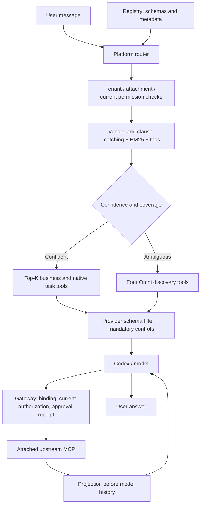

# Adaptive MCP Gateway V2

V2 is an opt-in implementation in **new files only**, outside the pinned Codex repository. Production still uses its existing path. The live benchmark and all raw requests are in [the comparison report](adaptive-mcp-v2/comparison.md). Inspection findings and the architecture diagram were recorded before implementation in [the design document](ADAPTIVE_MCP_GATEWAY_V2_DESIGN.md).

## Final live result

Same model and three sequential messages in each fresh conversation:

| Mode                          | Provider calls | Input tokens | Output tokens | Total tokens |
| ----------------------------- | -------------: | -----------: | ------------: | -----------: |
| Direct                        |              4 |       48,490 |           783 |       49,273 |
| Omni, optional projection     |              7 |       71,757 |           724 |       72,481 |
| Omni, required projection     |              7 |       68,408 |           521 |       68,929 |
| Adaptive, platform projection |              4 |   **18,210** |       **668** |   **18,878** |

Adaptive saved **62.4% of input tokens** and **61.7% of total tokens** against Direct, with the same number of provider calls. Its model-visible schema counts were **2, 3, 3, 2** across those four calls. The Qlik result shrank from **20,097 to 6,358 bytes (68.4%)**, preserving all 50 returned rows and pagination. This is one controlled conversation per primary mode, not a production-wide statistical estimate.

These are **provider-reported** usage totals. The custom provider reports zero output tokens for tool-only calls despite emitting tool arguments. Actual billable tool-call output cannot be independently verified; zero in those counters must not be interpreted as free tool generation. Exact input attribution and currency billing are also unavailable from these responses.

## Execution flow



On the Qlik fast path, the model calls `get_apps` through the runtime's MCP namespace. It makes no `discover_server`, `discover_tools` or `get_tool_schema` calls. Catalog hydration, schema lookup, ranking and permissions happen locally before the provider call.

### The pinned-runtime boundary

Codex registers MCP schemas when a thread starts. Its pinned start/resume/turn API cannot replace a thread's dynamic tool catalog every turn. V2 therefore keeps a stable dispatch catalog inside Codex and filters **the actual Responses request before model-gateway translates it for the provider**. This distinction is visible in separate captures:

- Codex JSON-RPC: configuration, thread and turn messages.
- Original Codex Responses request: the registered runtime catalog.
- Actual filtered Responses request: the schemas offered to the model.
- Translated provider request: complete system instructions, history and provider tool schemas.

The gateway checks the selected bindings again before execution. The response adapter checks function-call names before Codex receives them. An unexposed native task tool cannot execute through a hallucinated provider action. Schema filtering is an optimization, not permission enforcement.

## New files and responsibilities

| File                                            | Responsibility                                                                                                                                                          |
| ----------------------------------------------- | ----------------------------------------------------------------------------------------------------------------------------------------------------------------------- |
| `agent-core/src/tool-router-v2.ts`              | Normalized tenant/global registry, lexical descriptor index, retrieval abstraction, BM25/vendor/clause ranking, permissions, Top-K, coverage, fallback and calibration. |
| `agent-core/src/mcp-transport-v2.ts`            | Copy of V1's private HTTP transport, exported for V2; initialization, sessions, JSON/SSE, paginated catalogs, timeouts, limits and invalidation. No action retries.     |
| `agent-core/src/adaptive-mcp-gateway-v2.ts`     | Authenticated loopback MCP gateway, bindings, full registry hydration, authorization, approval receipts, rate limits, errors, audit and projection.                     |
| `agent-core/src/adaptive-model-boundary-v2.ts`  | Per-request namespace/schema filtering, native task selection, mandatory controls, current registry schemas and output-call guard.                                      |
| `agent-core/src/adaptive-session-v2.ts`         | External conversation integration: current policy callbacks, router/gateway lifecycle, compact context, invalidation and model-request hooks.                           |
| `agent-core/src/mcp-routing-v2.ts`              | Operator mode factory: Direct unchanged, existing Omni V1 or Adaptive V2. Defaults to Direct.                                                                           |
| `agent-core/src/adaptive-observability-v2.ts`   | Usage and projection aggregation; unavailable provider usage remains unknown.                                                                                           |
| `agent-core/test/*v2.test.ts`                   | Routing, gateway, boundary, session, modes and observability verification.                                                                                              |
| `platform/scripts/benchmark-adaptive-mcp-v2.ts` | Four-mode live sequential-thread benchmark, exact payload capture, provider usage and timings.                                                                          |
| `platform/scripts/adaptive-mcp-v2-fixtures.ts`  | Reproducible local multi-server, ambiguity, follow-up and irrelevant-question traces.                                                                                   |

All existing Direct/Omni files remain byte-for-byte unchanged during V2 work. V1's exported projector is reused rather than rewritten. The private transport was copied because importing it would have required changing the existing module.

## Registry

`RegisteredTool` contains `id`, `serverId`, `serverName`, `toolName`, `description`, `inputSchema`, optional `outputSchema`, `sourceType`, tenant/global scope, enabled/availability, tags/aliases, read-only/destructive/approval metadata and a dispatch binding name. Registration clones and whitelists metadata; connection URLs, credentials and cached authorization decisions are not registry entries.

MCP schemas always belong to an explicit tenant. Only explicitly global native schemas can cross tenant scope. Agent attachments further restrict the MCP catalog. Disabled/unavailable tools are excluded. Unknown safety annotations remain conservative; a read-looking name cannot authorize a write.

The registry binding helper preserves unique legal names and namespaces collisions. The gateway uses stable server-qualified names such as `qlik__get_apps`, adding identity hashes for sanitized/length collisions. This keeps dispatch names stable through catalog enable/disable changes in the pinned runtime. Calls still invoke business tools directly rather than `invoke_tool`; descriptions identify their system. This is a deliberate naming tradeoff, not evidence that shorter names were benchmarked.

## Routing and confidence

1. Scope the registry to the tenant, attachments, enabled tools and availability.
2. Evaluate current authorization with the host's policy callback. Exceptions deny access.
3. Retrieve using exact vendor/server matches, tool names, aliases, tags, descriptions and BM25.
4. Split explicit multi-system requests into clauses so a strong match on one system cannot hide another requested system.
5. Rank authorized candidates, select Top-K and verify requested-system coverage.
6. Use direct tools above the configured confidence threshold; fall back when confidence, ambiguity or coverage is insufficient.

The default threshold is **0.85**, with cross-server ambiguity margin **0.025**. These were selected by a reproducible grid search against **20 labeled local fixtures**, which matched all 20. They are heuristic scores, not probabilities, and this is in-sample evidence. Configure `highConfidenceThreshold`, `ambiguityMargin` and `topK` through `AdaptiveSessionOptionsV2.routing`; defaults are not a production accuracy guarantee.

Native optimization keeps `update_plan` and `request_user_input` mandatory. Document, visualization, workspace, helper, goal and MCP-resource capabilities are exposed only for matching intent. Unknown runtime controls remain visible for compatibility. Native schemas also have normalized registry metadata, and native permissions are checked at the provider boundary. Native family selection is deterministic and intentionally conservative; it is not a universal semantic classifier.

Compact conversation state stores recent successful server/tool identities. Follow-ups such as “Which ones were modified recently?” retain Qlik context; a subsequent India question selects no enterprise tools. Routing does not call an extra LLM or send a complete registry to the model.

## Projection policy

Projection happens before the MCP result reaches Codex/history. Known ordinary app-list requests use platform-selected name, GUID, stream and pagination fields. Name-only requests use names and pagination; requested dates, descriptions, GUIDs, streams or reload timestamps extend the deterministic selection. Missing paths never create values.

For a known projection, its selector is removed from the provider-visible schema. A model-generated `fields: ["*"]` cannot override a platform-owned simple-list projection. Explicit requests for raw/full output or all metadata retain the full-result escape hatch. Unfamiliar metadata requests and discovery fallback retain model-selected projection; if required fields are not selected, the gateway fails explicitly rather than silently dropping them.

The gateway preserves pagination and known cursor/count/page metadata at supported container paths. `fields: ["*"]` returns an intentionally complete authorized result. Non-projectable or absent-field responses fail explicitly after execution and warn against repeating the action. The gateway never retries an action to recover a projection error.

## Authorization and approvals

Routing, authorization and approval remain separate. `AdaptiveSessionV2` requires an authenticated tenant/user scope and current host authorization callback. Attached connector configuration must come from the existing authorized `PlatformService.configuration` path. Credentials remain in the gateway and are redacted from metadata, results and captures.

Every execution checks current policy again. Gateway endpoints use independent loopback bearer credentials. Cross-tenant tokens, foreign routing metadata, unselected tools, disabled/unavailable tools and revoked permissions are rejected. Schema validation applies before upstream calls.

Codex continues to use on-request MCP approval. Write/destructive/unknown-safety tools require an exact, expiring, single-use invocation receipt inside V2 as an additional check. The host issues that receipt only after its existing approval UI confirms the exact arguments. A remembered chat grant is insufficient for a generic fallback invocation. Receipts are revoked on route changes, turn completion or invalidation.

The live benchmark approves only the user-authorized Qlik `get_apps` read operation. It does not approve arbitrary writes or another connector action.

## Caches and failures

The transport caches server initialization, complete paginated tool metadata and schemas. The router has a bounded 512-entry descriptor-token index; BM25 document frequencies are rebuilt over the currently authorized corpus. Metadata/configuration revisions invalidate the index. Authorization results are never cached.

Reconnect, schema, configuration, permission or enable changes invalidate gateway metadata, schema validators, route state and receipts. In-flight routing fails closed if registry metadata changes. Individual unavailable MCPs are removed while healthy servers remain usable. An upstream transport failure marks that server unavailable without retrying the action.

Because Codex's dispatch catalog is thread-static, adding/removing tools requires a host/runtime catalog reconnect while retaining the conversation. V2 reports this requirement; it does not edit Codex or silently expose a newly registered tool that the runtime cannot dispatch. Existing bindings use current registry schemas at the provider boundary.

## External integration

The new factory reads `MCP_ROUTING_MODE=direct|omni|adaptive`; Direct is its default. This factory and the new benchmark are opt-in entry points. Existing production launchers were deliberately not rewired. Avoid double wrapping: use `TRUEX_MCP_GATEWAY_MODE=direct` when the V2 factory owns routing.

Illustrative host integration:

```ts
const prepared = await prepareMcpRoutingV2(attachedMcpConfigs, {
  scope: authenticatedTenantAndUser,
  authorize: existingAgentCorePolicy,
});
// Attach prepared.mcpServers through the existing business-runtime config,
// and append prepared.instructions to the existing agent instructions.

if (prepared.session) {
  await prepared.session.beforeTurn(userMessage);
  // In the external Responses relay, before forwarding to model-gateway:
  const filtered =
    await prepared.session.filterModelRequest(codexResponsesBody);
  const response = await forwardToModelGateway(filtered.body);
  const guarded = prepared.session.guardModelResponse(
    response,
    filtered.allowedNames,
  );
  // Stream guarded to Codex. After an exact approval UI confirmation:
  // prepared.session.approveInvocation(bindingName, exactArguments);
  // When the turn settles:
  // prepared.session.finishTurn();
}
// On conversation shutdown: prepared.close().
```

The benchmark demonstrates the complete external pipeline with the existing runtime and manager. Wiring the new entry point into a production launcher is a separate deployment step; no production environment file or database record was changed.

## Reproduction and evidence

Run from the project root:

```sh
PROJECT_ROOT="$PWD" platform/node_modules/.bin/tsx platform/scripts/benchmark-adaptive-mcp-v2.ts --mode direct
PROJECT_ROOT="$PWD" platform/node_modules/.bin/tsx platform/scripts/benchmark-adaptive-mcp-v2.ts --mode omni --projection optional
PROJECT_ROOT="$PWD" platform/node_modules/.bin/tsx platform/scripts/benchmark-adaptive-mcp-v2.ts --mode omni --projection required
PROJECT_ROOT="$PWD" platform/node_modules/.bin/tsx platform/scripts/benchmark-adaptive-mcp-v2.ts --mode adaptive
platform/node_modules/.bin/tsx platform/scripts/adaptive-mcp-v2-fixtures.ts
```

The live harness reads model/MCP documents, uses an isolated temporary runtime and in-memory agent configuration, executes the three messages sequentially, and captures actual provider usage. It performs no database writes. Four modes use the same provider/model, messages and timeout configuration.

Local [fixture traces](adaptive-mcp-v2/fixture-traces.json) cover:

| Request                                     | Routing      | Selected business tools                                            | Total model schemas including controls |
| ------------------------------------------- | ------------ | ------------------------------------------------------------------ | -------------------------------------: |
| List Qlik apps                              | Direct tools | `qlik/get_apps`                                                    |                                      3 |
| Capital of India                            | Direct tools | None                                                               |                                      2 |
| Compare SAP/Snowflake/Qlik                  | Direct tools | `sap/get_sales_orders`, `snowflake/sales_analysis`, `qlik/get_kpi` |                                      5 |
| European margin/opportunities investigation | Discovery    | Four Omni tools                                                    |                                      6 |
| Modified-recently follow-up                 | Direct tools | `qlik/get_apps`                                                    |                                      3 |

SAP/Snowflake/Salesforce examples are deterministic local fixtures, not live integrations. Exact semantic accuracy, held-out calibration, live multi-system orchestration and production-scale concurrency remain unverified. The live app answers may abbreviate the returned page; preserving 50 source rows does not prove the assistant listed every row. Answer presentation is assessed separately in the benchmark report.

The experiment measures complete input/output usage, raw call counts, schema sizes, result bytes, timings and fidelity. It does not derive exact schema/system/history token splits from bytes. Provider cache/reasoning counters or failed-call usage that are absent remain unknown. Currency cost requires a verified price for the custom provider.

See [validation evidence](adaptive-mcp-v2/validation.json), [the comparison](adaptive-mcp-v2/comparison.md), [the complete payload/token ledger](adaptive-mcp-v2/PAYLOAD_TOKEN_LEDGER.md) and the linked raw payloads for final results. The two earlier adaptive trials are preserved: one used default projection; another exposed the full-result escape and the model selected it. That regression prompted the deterministic projection policy rather than being hidden from the comparison.
