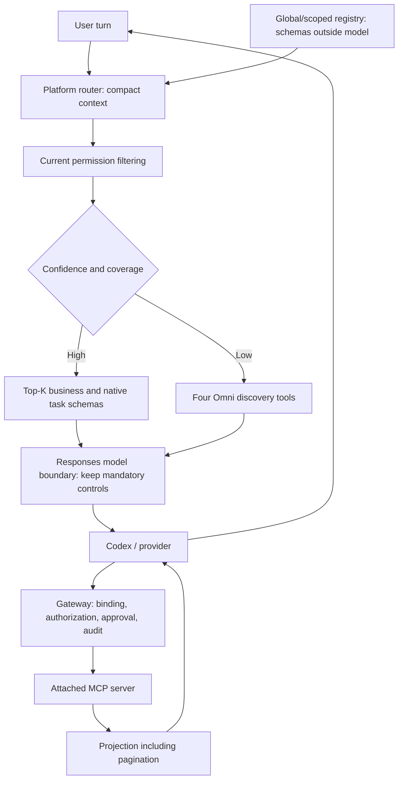

# Adaptive MCP Gateway V2: implementation boundary

This experiment adds new files only. Existing Direct and Omni V1, production environment files, database records and the pinned Codex repository remain unchanged. Direct remains the production default. `MCP_ROUTING_MODE=adaptive` is opt-in through the new V2 entry points.

## Inspection findings

| Boundary                                | Existing implementation                                                                                                        | V2 minimal extension                                                                                                                                                                      |
| --------------------------------------- | ------------------------------------------------------------------------------------------------------------------------------ | ----------------------------------------------------------------------------------------------------------------------------------------------------------------------------------------- |
| MCP HTTP transport/catalog/schema cache | `agent-core/src/omni-mcp-gateway.ts`, private `NativeConnector`                                                                | Copy the private transport into a new V2 module; retain protocol, pagination, limits, no action retries.                                                                                  |
| Projection                              | V1 exported `projectFields` and gateway result handling                                                                        | Reuse the projector; choose fields on the platform; preserve pagination before history insertion.                                                                                         |
| Agent configuration/security            | `BusinessRuntime.configuration` enforces HTTP connectors, read-only workspace and on-request approvals                         | Keep the runtime unchanged; attach an authenticated, agent-scoped V2 gateway through its existing MCP configuration.                                                                      |
| Application-native tools                | `BusinessRuntime.dynamicTools`: four document/visualization tools and eight workspace tools (optional scripts disabled)        | Rank/select native task schemas at the model boundary; retain runtime registration for dispatch.                                                                                          |
| Other native schemas                    | Config enables five helper, three goal, two plan/question and three MCP resource tools                                         | Keep plan/question control tools mandatory; select helper/goal/resource capabilities only when relevant. Unknown runtime controls remain visible rather than guessing they are removable. |
| MCP schema construction                 | Pinned runtime catalogs MCP at thread start; `ThreadResumeParams` and `TurnStartParams` have no dynamic-tool replacement field | Keep dispatch registration stable; filter the outgoing Responses tool array immediately before model-gateway translation. This is the exact provider-visible exposure boundary.           |
| Tool output/history                     | MCP gateway returns tool result to Codex, which appends it to subsequent model requests                                        | Project inside V2 before returning MCP `tools/call`.                                                                                                                                      |
| Approval                                | Codex on-request MCP controls plus AgentCore manager approval UI                                                               | Preserve prompt configuration; gateway independently authorizes every call and fails closed on unapproved writes. Exact invocation receipts cannot authorize another action.              |
| Observability/benchmark                 | Existing four/seven-call harness captures JSON-RPC, Responses and translated Anthropic requests                                | New harness captures pre-filter runtime requests, post-filter model requests, routing decisions, result sizes and authoritative provider usage.                                           |

## Architecture

The provider receives only the selected schemas. The runtime keeps the full session dispatch catalog; that catalog is not sent to the provider. Provider output is checked against the exposed names, and the gateway checks the current route and current authorization again before upstream execution. Filtering alone is never an authorization boundary.

## Ownership and validation

New V2 registry/router, transport/gateway, model-boundary adapter and benchmark modules have separate ownership. Each has unit/integration tests. Local multi-system fixtures exercise SAP/Snowflake/Qlik selection and genuine ambiguity; they must not be described as live integrations. The live three-message conversation compares Direct, Omni optional, Omni required and Adaptive with identical model, timeout and environment settings. Token usage comes from provider usage, not string-size estimates; unavailable cache/reasoning/failed-call usage stays unknown. Schema bytes are attribution measurements, not exact component token counts.

Thresholds are configurable and validated against labeled routing examples; lexical confidence is a heuristic score, not a calibrated probability. Production remains Direct until live usage, correctness and policy checks support promotion. V2 cache invalidation must purge metadata/index/schema state, while authorization is evaluated afresh on exposure and execution.
