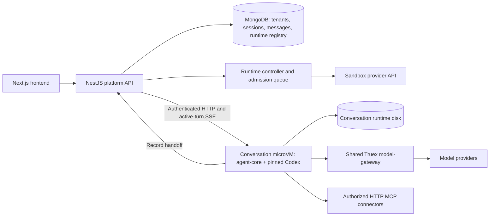

**Truex: per-conversation microVM deployment and scaling plan**

Research date: 3 October 2026. This is a deployment proposal grounded in the current source and providers' public documentation. Prices are USD list prices; calculations exclude credits and negotiated discounts. No infrastructure was provisioned and no provider has been benchmarked with Truex.

State and resume follow-up: [THREAD_STATE_DEPLOYMENT_PLAN.md](THREAD_STATE_DEPLOYMENT_PLAN.md) specifies durable ownership, command journaling, checkpoint publication, wake/restore, and legacy migration. Its retained-volume recommendation is now superseded by [EPHEMERAL_THREAD_RUNTIME_PLAN.md](EPHEMERAL_THREAD_RUNTIME_PLAN.md): keep provider disks only while conversations are active, publish portable checkpoints externally, and destroy inactive VMs. Use that latest plan for the current state lifecycle, provider pilot and revised costs; retained-resource estimates in earlier plans are comparison baselines.

**Decision**

Evaluate Northflank and Daytona Linux VM sandboxes with the same Truex workload first. Choose Northflank if completed-turn recovery from disk meets the product's latency and continuity requirements: it has the lowest published allocated-compute rate among the providers shortlisted here. Choose Daytona's Linux VM class if memory-preserving suspension is required. Blaxel is a strong third candidate when automatic standby and very fast wake-up are priorities, subject to region, retention quota, and image integration checks.

This is an architectural fit assessment, not a claim that any service is already a drop-in replacement. All three need a Truex runtime controller. A sandbox service supplies the isolated computer; Truex continues to own conversation semantics, permissions, model routing, persistence, and scheduling.

Here, “agent-core” means this repository's TypeScript adapter, not Amazon Bedrock AgentCore. “One thread per VM” means one user-visible root conversation per VM. Codex helper threads currently execute inside their parent's engine; separate microVMs for every helper require an additional collaboration redesign.

**What the current code actually does**

| Current implementation | Deployment implication |
| --- | --- |
| `agent-core/src/index.ts:37` constructs one `BusinessRuntime`, then one `ThreadManager` with a default capacity of 20. `client.ts` launches pinned Codex over stdio. | Today, one adapter and Codex process serve multiple root conversations. A StatefulSet replica is not a VM per conversation. |
| `platform/src/service.ts:278` reads a static `AGENT_CORE_URLS` list; `call()` rejects addresses outside it. `create()` round-robins these hosts and stores `agentCoreHost`. | Dynamic sandbox IDs and endpoint resolution must replace static owner selection for new sessions. Retain legacy routing during migration. |
| `business-runtime.ts:359` creates tenant workspaces and thread markers under the runtime home. The Dockerfile uses `/data/codex`, with the adapter appending `business-v1`. | Preserve the entire runtime home: Codex state, markers, workspace files, and adapter record spool. Mongo chat messages alone cannot restore the full engine. |
| `platform/src/service.ts:1590` polls every non-dead current-policy session every two seconds. | Polling all historical conversations is incompatible with cheap automatic standby and grows with saved sessions. |
| `manager.ts:1163` sends an SSE heartbeat every 15 seconds. | A permanent platform-to-runtime stream can keep an otherwise idle VM active. |
| `platform/src/service.ts:1771` creates a fork on the parent's host and copies its session routing. | A fork must get a separate VM and routing record to satisfy root-conversation isolation. |
| `agent-core/src/script-runner.ts` implements Docker execution with no network, a restricted user, resource limits, and a workspace-only mount. | A hosted VM does not automatically reproduce that inner security boundary. The current agent-core image also has no Docker CLI/daemon. |
| `platform/src/auth.ts`, `access.ts`, `tenant.ts`, and `index.ts` implement sign-in, ownership, and tenant database context. | The README's “no authentication or multi-tenancy” statement is stale. Deployment should configure the implemented production auth mode and validate it. |

The code already provides useful foundations: a pinned release build in `agent-core/Dockerfile`, per-thread configuration, serialized mutations inside an adapter, durable record acknowledgement, generation-aware SSE recovery, and same-owner resume. Preserve these rather than replacing Codex with a vendor agent framework.

**Provider comparison**

The compute comparison uses 2 vCPU and 4 GB/GiB RAM where selectable. Blaxel's row is a 4 GB sandbox: CPU is automatically assigned, so it is not a guarantee of equivalent CPU capacity. Providers use their own GB/GiB billing conventions.

| Provider | Published active compute | Suspension behavior | Assessment for Truex |
| --- | --- | --- | --- |
| Northflank | $0.01667/vCPU-hour + $0.00833/GB-hour = **$0.06666/hour** | Ends processes; attached volumes survive; ephemeral files are lost. | Best active compute economics; requires boot and Codex resume after stopping. |
| Daytona Linux VM | $0.0504/vCPU-hour + $0.0162/GiB-hour = **$0.1656/hour** | VM pause preserves RAM and disk; compute stops after pause completes. | Good balance of explicit lifecycle control and continuity. Select `linux-vm`. |
| Blaxel Sandboxes | $0.0000115/allocated-GB-second = **$0.1656/hour at 4 GB** | Automatic standby preserves memory and filesystem; snapshot storage remains billable. | Strong automatic standby option; integrate its sandbox API into our image. |
| E2B | Same CPU/RAM unit rates as Daytona = **$0.1656/hour**, plus **$150/month** on Pro | Memory/disk pause; paused retention is indefinite. | Strong fallback; account plan and concurrency add-ons affect cost. |
| Runloop | $0.108/CPU-hour + $0.0252/GB-hour = **$0.3168/hour**, plus **$250/month** for Pro | Suspend preserves disk, **not RAM**; restart daemons on resume. | Useful coding-agent infrastructure, but less compelling for this cost-focused deployment. |

Compute sources: [Northflank pricing](https://northflank.com/pricing), [Daytona pricing](https://www.daytona.io/pricing), [Blaxel pricing](https://blaxel.ai/pricing), [E2B pricing](https://e2b.dev/pricing), and [Runloop pricing](https://runloop.ai/pricing). Lifecycle sources: [Northflank management](https://northflank.com/docs/v1/application/sandboxes/configure-and-manage-sandboxes), [Daytona lifecycle](https://www.daytona.io/docs/en/sandboxes/#pause--resume-sandboxes), [Blaxel lifecycle](https://docs.blaxel.ai/Sandboxes/Overview), [E2B persistence](https://docs.e2b.dev/sandbox/persistence), and [Runloop lifecycle](https://docs.runloop.ai/docs/devboxes/lifecycle).

Northflank's managed CPU sandboxes use microVM isolation; its managed GPU sandboxes use gVisor. Use the CPU sandbox product/API for this deployment. Its services accept custom container images, making the existing image a relatively direct starting point. [Managed sandbox documentation](https://northflank.com/docs/v1/application/sandboxes/sandboxes-on-northflank-cloud), [quickstart](https://northflank.com/docs/v1/application/sandboxes/quickstart).

Daytona supports multiple sandbox classes. A container sandbox does not support memory pause, so the default class is not sufficient for this continuity requirement. Build a Linux VM snapshot from our image and create conversations from it. VM snapshots can include memory; they are also useful for evaluating conversation forks. [Sandbox classes and snapshots](https://www.daytona.io/docs/en/sandboxes/), [snapshot documentation](https://www.daytona.io/docs/snapshots/).

Blaxel requires its sandbox API binary in custom images. Preserve Truex's pinned Codex binary instead of using a vendor Codex image with a different revision. Its separate “Agent Runtime” product is marked coming soon; this proposal uses the available Sandboxes product. Blaxel joined Baseten in September 2026 and continues operating, so it is no longer an independent startup. [Image requirements](https://docs.blaxel.ai/Sandboxes/Templates), [company announcement](https://blaxel.ai/blog/blaxel-is-joining-baseten-to-build-the-future-of-agentic-infrastructure).

E2B documents approximately four seconds of pause time per GiB of RAM and approximately one second to resume. Its billing documentation states billing stops while paused. Check storage/volume charges for the exact selected products before signing; do not assume that statement covers every optional storage feature. [Persistence](https://docs.e2b.dev/sandbox/persistence), [billing](https://docs.e2b.dev/billing).

Also screened: Fly.io Sprites and Hopx. Sprites persist disk but lose RAM on sleep, so they belong to the same disk-recovery category as Northflank. Hopx publishes CPU/RAM rates matching Daytona/E2B, with no subscription, but the reviewed sources did not establish memory-preserving suspend semantics sufficiently to rank it above the shortlist. [Sprites lifecycle](https://docs.sprites.dev/working-with-sprites/), [Hopx rates](https://www.hopx.ai/pricing/). These are managed services from smaller vendors; the plan does not require Truex to operate a hyperscaler account.

**Target deployment**

Keep the frontend, platform, model-gateway, database, and controller shared. Only agent-core plus Codex belong in each conversation VM. Keep the gateway's existing Responses translation and prompt-cache behavior; do not replace it just because a provider offers another model gateway.

For Northflank, shared application services and conversation VMs can be colocated on the same managed platform. For Daytona/Blaxel, the shared application tier can remain on an application host such as Northflank. Cross-provider gateway access then needs authenticated TLS or vendor-supported private connectivity; the existing Compose-only internal hostname will not work. Choose a common region for the API, gateway, MongoDB, and runtime wherever possible.

Use an immutable image digest, built once in CI from `codex.lock.json`, the verified source checkout, and locked Node/Rust dependencies. Do not compile Rust or install application dependencies for each new conversation. Start with the current Node 24/Debian image and run Node directly so shutdown signals reach the process.

Set `MAX_THREADS=1` for root admission and add a binding between a VM and its authorized root conversation. A numeric capacity is not an authorization control. Bind private runtime requests to tenant, session, and root thread. Helper threads remain in that VM for the first release; account for their concurrency when sizing it.

**Required implementation work**

1. Add a provider interface for create, inspect, resolve endpoint, wake, sleep, destroy, and attach/export durable state. Advertise capabilities such as memory-preserving suspension and filesystem snapshots; do not pretend all providers' “pause” calls are equivalent.
2. Add a runtime registry keyed by tenant and session, with provider, sandbox ID, image digest, Codex revision, storage reference, lifecycle state, last active time, and lease generation. Resolve endpoints server-side from that registry. Validate provider-owned destinations and authenticate runtime calls; never accept an arbitrary owner URL from a browser.
3. Reserve a session ID before provisioning. Use it as the provider label/idempotency key where supported. Persist provisioning progress, reconcile uncertain create outcomes, and clean up abandoned resources. Two simultaneous requests must not create two engines for one conversation.
4. Introduce durable per-session command/admission records and distributed leases. The existing in-process `serial()` locks do not coordinate multiple platform/controller replicas. Fence old owners and ensure the engine sees only one mutating request stream. Queue capacity admissions, but reconcile ambiguous accepted turns and connector mutations before retrying them.
5. Change record ingestion to target active or explicitly dirty sessions. Persist completed records and acknowledge them before sleeping. Use lifecycle webhooks for provider state when available. A low-frequency reconciliation job should inspect provider metadata without waking every runtime's application endpoint.
6. Separate browser SSE from idle runtime SSE. The platform can keep browser heartbeats alive using saved state; detach the runtime connection when safe to sleep. Reconnect with cursor/snapshot recovery after wake. Do not globally health-poll sleeping application endpoints.
7. Add lifecycle eligibility checks covering running turns, helpers, goals that are continuing, tools, pending approvals/questions, unacknowledged records, and concurrent writes. Never suspend a model call because it has produced no tokens recently.
8. Make `/fork` provision a distinct VM and restore the selected fork's engine state and workspace metadata. The current implementation retains the parent host. First prove a filesystem-based transfer at a quiescent point; provider VM cloning is optional and must not accidentally start two copies of a running turn or retain usable parent credentials.
9. Keep uploaded/generated artifacts durably available through platform-authorized access when the runtime sleeps. Live Codex databases and rollouts need a tested filesystem/volume; object storage is appropriate for exports and backup bundles, not an untested replacement for a live SQLite filesystem.

A minimal first release can keep polling and runtime SSE only while a VM is actively leased, and keep pending requests awake. A later release can suspend during long waits after deadline, credential refresh, network reconnection, and timer behavior are explicitly handled.

**Lifecycle and recovery policy**

Proposed initial policy: create on the first message, retain a VM association for the conversation, and sleep 30–60 seconds after a completed, quiescent turn. Show provisioning/waking status in the UI. Idle browser viewing should normally use persisted messages and artifacts.

On Northflank, sleep is allowed only after graceful drain and a durable checkpoint. Wake starts a fresh adapter/Codex process on the same private volume, then runs existing `thread/resume` and transcript reconciliation. Pending approvals and live helper work must remain awake because stopping destroys their process state.

On Daytona/E2B, use memory-preserving pause only at a safe boundary initially. Even when RAM survives, external TCP connections, model streams, and MCP connections cannot be assumed to survive. Request deadlines must not become accidentally extended or expire unexpectedly after wake.

On Blaxel, keep a runtime connection or explicit task-scoped keep-alive during background work. Do not start the permanent agent-core daemon with an indefinite keep-alive, because that defeats standby. A `keepAlive` process without an explicit timeout has a documented ten-minute auto-kill default; configure task lifetime deliberately. Remove active connections after record acknowledgement so standby can occur. [Process execution and keep-alive](https://docs.blaxel.ai/Sandboxes/Processes).

Keep recently used runtime state for a proposed seven days, then export a quiescent recovery bundle and retain artifacts under the product's retention policy before removing billable runtime resources. This requires a verified restore path; do not delete the runtime merely because Mongo contains chat text. A user archive operation is not, by itself, authorization to delete the conversation's durable state.

After a node crash, process memory may be lost even on a memory-suspending provider. Restore from durable state, mark uncertain in-flight work explicitly, and do not automatically repeat a business write. Maintain tested backups for MongoDB and runtime files separately.

For upgrades, send new conversations to a new image and keep existing conversations on their pinned image until quiescent migration. Back up before changing runtime storage schemas. Rollback uses the previous image and a compatible state snapshot.

**Security boundaries needed by this architecture**

Configure the implemented `AUTH_MODE=google` production path and validate tenant/user isolation. Keep runtime administration credentials in the controller, database credentials in the shared services, and provider keys in the gateway where supported. The current direct Responses route passes the provider key to the runtime; forcing suitable profiles through Truex's gateway can avoid that exposure.

Add revocable tenant/session/profile scope to runtime model tokens. Current gateway tokens are profile-scoped and non-expiring; implement and test refresh/resume before imposing an expiry that could break long-lived threads. Runtime API authentication and MCP authorization must match the registered conversation, not merely possession of a guessed URL.

Start the pilot with `run_script` disabled, matching its current default. If enabled, retain a separate restricted execution boundary: either prove a daemon confined to the conversation VM works, or implement a remote `ScriptRunner` that transfers only permitted workspace files into a separate execution sandbox and imports bounded results. Do not mount a host Docker socket, or replace `DockerScriptRunner` with unrestricted local `spawn`. A conversation VM protects other conversations but does not protect the controller or credentials inside that same VM from a script.

**Compute budget**

The following are our calculations from the published rates. One workload unit means ten total minutes of active runtime across its turns, not ten minutes per user or per message.

| Monthly workload units | Active VM hours | Northflank | Daytona | Blaxel, 4 GB | E2B Pro | Runloop Pro |
| --- | ---: | ---: | ---: | ---: | ---: | ---: |
| 1,000 | 166.67 | $11.11 | $27.60 | $27.60 | $177.60 | $302.80 |
| 10,000 | 1,666.67 | $111.10 | $276.00 | $276.00 | $426.00 | $778.00 |
| 100,000 | 16,666.67 | $1,111.00 | $2,760.00 | $2,760.00 | $2,910.00 | $5,530.00 |

E2B and Runloop figures include the listed base plans; higher concurrency tiers or enterprise agreements can add cost. Other rows exclude optional support, networking, or enterprise packages. Northflank is about 60% cheaper for equal allocated active time than the $0.1656/hour rows. Blaxel CPU allocation must be benchmarked before treating those configurations as equivalent performance.

Active time includes model/MCP waiting, drain/wake overhead where billed, and keeping pending requests alive. These services do not make an in-flight Codex model call free merely because CPU utilization is low. If average active time doubles, the variable compute component doubles.

Retained storage is a separate, potentially larger line item:

| Metered retained data/capacity | Monthly cost at the published rate |
| --- | ---: |
| Northflank provisioned disk, 1,000 GB | $150 |
| Daytona billable disk, 1,000 GiB, 730 hours | $78.84 |
| Blaxel standby snapshots, 1,000 GB | $200 |
| Blaxel provisioned volumes, 1,000 GB | $120 |

Storage sources: [Northflank rates](https://northflank.com/pricing), [Daytona rates](https://www.daytona.io/pricing) and [state-dependent billing](https://www.daytona.io/docs/billing), [Blaxel rates](https://blaxel.ai/pricing). Daytona advertises an initial free disk allowance; the table deliberately uses already-billable capacity rather than assuming allowance scope. Snapshot size and provisioned volume size are different meters, and attaching a volume does not imply snapshots become free.

For example, 10,000 Northflank conversations each retaining a provisioned 10 GB volume would cost $15,000/month in disk even with low compute usage. Do not adopt that allocation by default. Measure state size, confirm minimum volume allocations, and export cold conversations. E2B's documented paused billing may be attractive for retention-heavy workloads despite its Pro fee; validate the exact storage products.

For a small pilot, reserve a provisional $100–200/month for shared application/database compute, storage, and ordinary traffic, then add runtime usage, retained state, and model tokens. This is a resource-budget estimate, not a quoted package or a high-availability deployment. Production redundancy, backups, data volumes, support, and region-specific pricing need a separate quote. Model token costs remain independent.

**Scaling and account limits**

Autoscale for active conversations and admission wait time, not the number of saved conversations or CPU utilization alone. A model-bound thread can consume little CPU while still requiring its VM. If arrivals are 60 conversations/minute and mean active duration is two minutes, average active concurrency is approximately 120; a provisional 30% reserve gives 156 slots. Size bursts and p95 duration separately.

| Stage | Proposed operating target | Required evidence |
| --- | --- | --- |
| Pilot | 10–20 active conversations | Image boots, private routing, complete turn, sleep/wake, artifacts, approval wait, and failure reconciliation. |
| Initial production | 100 active conversations | Distributed leases, admission queue, two platform replicas, durable ingestion, quota alarms, and measured unit cost. |
| Growth | 1,000 active conversations | Approved provider capacity and create/wake throughput, streaming/model/MCP limits, retention exports, and restore drills. |
| Larger fleet | 10,000 active conversations | Capacity agreement, regional isolation, sharded controller work, and recovery/budget evidence at representative load. |

These are Truex planning targets, not guaranteed self-service capacities. E2B lists Pro concurrency of 100, add-ons to 600/1,100, and a five-per-second Pro creation rate. Paused lifetimes are unlimited, while continuous execution has plan limits. [Pricing](https://e2b.dev/pricing), [limits](https://docs.e2b.dev/billing).

Daytona's Tier 2 pool lists 100 vCPU and 200 GiB: at 2 vCPU/4 GiB this caps running compute at 50 VMs before other limits. Tier 3 and Tier 4 increase CPU to 250 and 500. Creation rates are separately tiered. Confirm the Linux VM region/class quota in the account rather than reading the headline as a concurrency guarantee. [Daytona limits](https://www.daytona.io/docs/en/limits/).

Blaxel starter tiers have sandbox-count and TTL limits; standby sandboxes count toward quotas. Credit top-ups unlock tiers and are prepaid usage, not an extra subscription. Verify both total retained sandbox count and active capacity. Its reviewed Mark 3 region table lists Oregon and Frankfurt; do not assume an India/Singapore sandbox region is available. [Quota rules](https://docs.blaxel.ai/Security/Quotas), [region documentation](https://docs.blaxel.ai/Infrastructure/Regions).

Colocate model-gateway and runtime where possible and measure actual round-trip time to customer MCP endpoints. Private SAP/customer networks may need a tunnel or private connectivity; public sandbox previews do not solve that requirement. Treat this as a selection criterion before a provider commitment.

**Execution sequence and acceptance**

1. Build and verify the pinned release image. Run it on Northflank CPU sandboxes and Daytona Linux VMs with an isolated test tenant and fixture provider. Measure provision, app readiness, first token, resource usage, shutdown, wake, and complete recovery.
2. Implement the provider adapter, registry, root binding, authenticated routing, command journal, leases, and active-only ingestion. Prove concurrent create/wake requests yield one owner. Add idle eligibility and remove idle runtime SSE connections.
3. Validate a real provider conversation, HTTP MCP, artifacts, steer/stop, pending clarification, helper collaboration, goals, fork into a distinct VM, platform restart, runtime crash, and record acknowledgement interruption. Force ambiguous mutation outcomes and verify business writes are not replayed blindly.
4. Run representative 10/100-conversation loads. Hold a browser tab open after completion and verify the provider's billed runtime stops increasing while it sleeps. Verify state after repeated wake cycles and test checkpoint restore into a new VM with the same pin.
5. Select the provider using measured total cost per completed conversation, p95 wake-to-first-token, durable state cost, customer-network access, and approved quotas. Roll out new conversations by cohort while legacy owners remain reachable.

Planning allowance: roughly 2–3 engineering days for the initial provider/image experiment, 1–2 weeks for the controller and lifecycle changes, and another week for recovery/load verification. These are estimates dependent on provider access, existing test coverage, and fork migration complexity.

Do not declare deployment complete from documentation or fixture tests. Acceptance requires our pinned engine running on the selected service, representative live workflows, observed billing behavior, and a successful durable restore.
