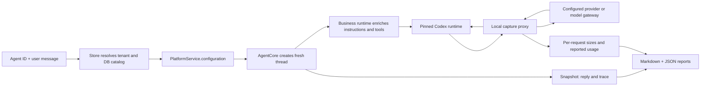

# Agent token profiling

Use this operator script to establish a token baseline for a DB-backed agent before optimizing its prompts, skills, connectors or tool results.

```bash
npm run profile:tokens -- \
  --agent-id YOUR_AGENT_ID \
  --message "Your real test question" \
  --out benchmark-reports/my-agent-baseline.md
```

For multiline input:

```bash
npm run profile:tokens -- \
  --tenant YOUR_TENANT_ID \
  --agent-id YOUR_AGENT_ID \
  --owner-id YOUR_USER_ID \
  --message-file /absolute/path/question.txt \
  --out benchmark-reports/my-agent-baseline.md
```

The Markdown report and a sibling JSON file are written after completion or a handled failure. Exit code is zero for a completed turn, nonzero for failure, approval wait or timeout. A completed run can still have unavailable token usage if the provider omitted it.

## Prerequisites

- Install platform dependencies with `npm --prefix platform ci`.
- Run AgentCore with the project's pinned Codex runtime and normal runtime configuration (`npm run dev`, or your existing deployment).
- Provide Mongo connectivity and catalog settings through environment variables or `platform/.env`.
- Configure model gateway settings and connector encryption keys as you do for the platform when the selected agent needs them.
- The selected agent and its model/skills must exist and be enabled/allowed in the selected tenant.

This CLI is an operator diagnostic with DB credentials. `--owner-id` selects that owner's attached user connectors; it does not authenticate a user. It bypasses the platform HTTP login layer and does not create a platform session/chat. Use only an owner you are authorized to operate as. The model receives the real message and can use the configured connectors under the normal AgentCore approval policy. Pending approval stops this run unless it names an MCP tool explicitly listed with `--allow-tool SERVER:TOOL`; other user input always stops the run.

## Options

| Option           | Purpose                                                            | Default                                                                      |
| ---------------- | ------------------------------------------------------------------ | ---------------------------------------------------------------------------- |
| `--agent-id`     | Agent DB ID; required                                              | None                                                                         |
| `--message`      | User message; mutually exclusive with message file                 | None                                                                         |
| `--message-file` | UTF-8 file containing the user message                             | None                                                                         |
| `--tenant`       | Tenant registry ID; resolves DB and allowed catalogs through Store | `default`                                                                    |
| `--owner-id`     | Include this owner's user connectors                               | Tenant connectors only                                                       |
| `--core-url`     | Running AgentCore endpoint                                         | First `AGENT_CORE_URLS`, then `AGENT_CORE_URL`, then `http://127.0.0.1:4100` |
| `--cwd`          | Agent workspace path, interpreted by AgentCore                     | Platform's configured workspace                                              |
| `--out`          | Markdown report location; JSON uses the same stem                  | Timestamped file in `benchmark-reports/`                                     |
| `--timeout-ms`   | Turn wait and per-provider-request deadline                        | `300000`                                                                     |
| `--proxy-port`   | Fixed local capture listener port                                  | `0` (random free port)                                                       |
| `--proxy-url`    | Capture listener URL reachable by AgentCore                        | Local listener URL                                                           |
| `--help`         | Show CLI usage                                                     | Off                                                                          |

Environment variables take precedence over `platform/.env`. AgentCore must be able to reach the capture listener. The listener binds only to `127.0.0.1`. For a remote AgentCore, use a private tunnel or equivalent port forwarding: set a fixed `--proxy-port` locally and set `--proxy-url` to the tunnel endpoint on the AgentCore host. This tool does not establish that tunnel. A Docker/network namespace's loopback is distinct from the CLI's loopback.

## Request flow



The script imports the existing platform builder; it does not duplicate Mongo lookup, model routing, tenant allowlists, skill loading, MCP selection, key decryption or URL checks. It sends the resulting configuration to `/threads`, the message to `/threads/:id/turns`, and polls snapshots for the terminal trace. AgentCore/Codex supply their normal instruction/tool enrichment. The only provider setting changed is `base_url`, pointing at a private pass-through observer that forwards to the original URL. The fresh diagnostic thread is deleted afterward. Cleanup failure is recorded in the report. No existing chat/thread is deleted, and no agent/model DB document is updated. Store startup creates/ensures its normal indexes.

## Reading the report

| Report section        | What it tells you                                                                       | Precision                                    |
| --------------------- | --------------------------------------------------------------------------------------- | -------------------------------------------- |
| Overall usage         | Input, cached input, uncached input, output, reasoning, other output, total             | Provider-reported at Responses boundary      |
| Calls and retries     | How many HTTP attempts occurred and how context grows                                   | Reported usage where supplied                |
| Ranked input split    | Instruction, context/history, tool-result and per-tool schema sizes across all attempts | Rough `ceil(string length / 4)` estimates    |
| Visible output split  | Message/tool-call item sizes                                                            | Rough estimates; excludes hidden reasoning   |
| AgentCore cross-check | Main/helper trace usage                                                                 | Runtime-reported, separate from proxy totals |
| Platform inventory    | Base prompt/persona/skill bodies before runtime enrichment                              | Rough estimates; not added to model totals   |
| Agent response        | Returned assistant messages, privacy-masked                                             | Response text                                |

Cached input is already included in input. Reasoning is already included in output where the provider reports it. Never add these subsets a second time. Output minus reasoning includes both assistant text and tool-call arguments; it is not necessarily the final answer alone. Missing usage means unavailable. Partial coverage is a lower bound for the full run. Providers that omit cached/reasoning details appear as zero for those fields; that does not prove caching/reasoning was absent.

Section estimates are size indicators, not exact model tokenizer counts. They include visible JSON wrappers, do not reconcile to provider usage and can be inaccurate for code, identifiers, non-English text or multimodal content. Codex environment messages are grouped with user context. Tool results and assistant history are counted again each time sent. Skill bodies in the inventory cost model input only when Codex actually loads them. Remote server history referenced by `previous_response_id` is not visible to the proxy.

For gateway routes, capture occurs before gateway prompt/protocol translation. Gateway-normalized counters may differ from native provider accounting. Gateway-internal retries/calls and helper model overrides using another provider URL are outside capture coverage. The JSON stores actual request/response payloads with known credentials redacted. HTTP headers are never stored. Markdown reply text is privacy-masked; JSON payloads preserve business content for inspection.

## Optimization workflow

1. Run one representative question and save the baseline.
2. Inspect the largest ranked components and the first versus later call sizes. Large first-call schemas/instructions indicate startup overhead; later growth suggests tool results/history.
3. Change one thing: narrow attached connectors, shorten verbose schema descriptions, avoid repeatedly loading large skills, or reduce tool-result payloads.
4. Re-run the same question with a fresh diagnostic thread and compare total input/output, cached input, number of calls, and answer quality.
5. Compare both easy and tool-heavy questions. A smaller prompt is useful only if answers remain correct and tool behavior stays reliable.

Exact per-section billed token attribution requires provider/tokenizer support and is not inferred by distributing total usage across these estimates. No live result is included here because an agent ID and test message were not supplied.

## Validation

```bash
node platform/node_modules/tsx/dist/cli.mjs --test platform/test/token-profiler.test.ts
npm --prefix platform run build
```

The focused tests cover request categorization, missing usage, cached/reasoning subset accounting, fragmented SSE forwarding, duplicate terminal usage, JSON responses and a Mongo-backed CLI flow using fixture AgentCore/provider endpoints. Fixture validation does not establish live provider availability or actual token consumption for your agent.

## Supply documents directly (no Mongo)

```bash
npm run profile:tokens -- \
  --agent-file /absolute/path/agent.json \
  --model-file /absolute/path/model.json \
  --mcp-file /absolute/path/mcps.json \
  --message "Your question" \
  --core-url http://127.0.0.1:4100 \
  --out benchmark-reports/document-baseline.md
```

The agent and model files each contain one document. MCP and optional `--skills-file` inputs accept one document or an array. Standard JSON and Mongo shell object exports are accepted, including unquoted property names, single-quoted strings, trailing commas, and `ObjectId`, `NumberInt`, `NumberLong`, `ISODate` or `Date` constructors with one literal argument. These exports are parsed as data; JavaScript expressions, functions and executable statements are rejected. Mongo Extended JSON IDs such as `{"$oid":"..."}` are supported. Agent `modelProfileId` must match the model `_id`; any supplied `--agent-id` must match the agent `_id`. If the agent has `skillIds`, supply the matching skill documents too.

Example `agent.json`:

```json
{
  "_id": "my-agent",
  "name": "Token profiling agent",
  "modelProfileId": "my-model",
  "systemPrompt": "You are a helpful assistant.",
  "skillIds": []
}
```

Example `model.json` (replace with your actual stored profile):

```json
{
  "_id": "my-model",
  "provider": "Anthropic",
  "modelName": "YOUR_MODEL_NAME",
  "baseUrl": "https://api.anthropic.com/v1",
  "wireApi": "anthropic",
  "apiKey": "YOUR_PROVIDER_KEY"
}
```

Example `mcps.json`:

```json
[
  {
    "_id": "sap-connector",
    "name": "sap",
    "transport": "http",
    "url": "https://YOUR_MCP_HOST/mcp",
    "auth": { "kind": "bearer" },
    "apiKey": "YOUR_CONNECTOR_KEY"
  }
]
```

Omit `--mcp-file` or use `[]` for no connectors. Supplied MCPs without `scope` default to tenant scope; absent `agentIds` means attach to the supplied agent. Explicit attachment lists, disabled flags and user ownership are respected. A user connector still needs `--owner-id` matching its `ownerId`. MCP keys may be plain legacy `apiKey`/`apikey` or encrypted `apiKeyEnc` with the normal encryption environment. URL checks and HTTP connector policy are the same as the platform.

Document mode reads no Mongo data and writes no DB indexes. It supplies documents through a read-only Store adapter to `PlatformService.configuration`. For gateway routes it starts a private, temporary instance of the existing gateway with the supplied model as its profile source. Install gateway dependencies (`npm --prefix model-gateway ci`) for this mode. No separately running gateway, gateway catalog record or configured gateway secret is needed. AgentCore and Codex must still be running; document inputs cannot replace the runtime. The document mode tenant is only a runtime namespace label; it does not verify a tenant registry or its catalog allowlists. Keep credential-bearing JSON files outside version control.

## Diagnose a failed run

A report with a populated model/inventory but `calls: []` and no `threadId` means configuration finished, but no provider request was captured and thread creation never returned successfully. It does not establish the exact cause. The earlier version hid the underlying error; re-run with the updated script for evidence.

New reports contain `stage` and a sanitized `failure` object with message, available error code, HTTP status and immediate cause. The console prints the stage and error code too:

| Stage              | What to inspect                                                              |
| ------------------ | ---------------------------------------------------------------------------- |
| `connect`          | Mongo connection and tenant lookup (DB mode)                                 |
| `document-gateway` | Gateway dependency installation and startup                                  |
| `configuration`    | Model fields/routing, attached MCPs, encryption, skills                      |
| `capture-listener` | Local listener port availability                                             |
| `thread-create`    | AgentCore reachability, pinned Codex startup, workspace path, runtime config |
| `turn-start`       | AgentCore turn acceptance                                                    |
| `turn-wait`        | Model errors, approval wait, terminal trace or timeout                       |

Known credentials and URLs are redacted from error details. A remote AgentCore still needs a route to the local capture listener even in document mode. Argument/file validation errors print a sanitized message and may occur before report creation.

## Inspect actual data in the JSON report

| JSON path                      | Actual data available                                                                                      |
| ------------------------------ | ---------------------------------------------------------------------------------------------------------- |
| `userMessage`                  | Original user message                                                                                      |
| `sourceDocuments`              | Supplied agent/model/MCP/skill documents in document mode, with credentials redacted                       |
| `platformConfiguration`        | Configuration produced by the platform builder before capture routing                                      |
| `agentCoreRequest`             | Configuration submitted to AgentCore, including capture routing                                            |
| `agentCoreResponse`            | Thread creation result                                                                                     |
| `turnRequest`, `turnResponse`  | Submitted turn and acceptance result                                                                       |
| `inventory[].data`             | Base instructions, persona, skill bodies, and connector names behind each inventory estimate               |
| `calls[n].request`             | Complete captured Codex Responses request, including instructions, input history, tools and model settings |
| `calls[n].parts[k].data`       | Actual string or structured item behind that input section's size estimate                                 |
| `calls[n].responseEvents`      | Parsed streamed JSON events, including text deltas and completion/errors                                   |
| `calls[n].responseBody`        | Most recent response object from the stream, or the non-streaming JSON response                            |
| `calls[n].outputParts[k].data` | Completed visible output items behind each output estimate                                                 |
| `runtimeSnapshot`              | Latest AgentCore snapshot, including messages, trace, timings and runtime state                            |

Section characters/token estimates are calculated before redaction. Captured payloads may have different sizes after known credentials are replaced with `[REDACTED]`. No synthetic data is backfilled into earlier summary-only reports; rerun to capture actual payloads. Hidden provider reasoning and gateway-internal translated payloads remain outside this capture. Streaming events can repeat text also present in completed output items; they are alternative views of the same data and must not be summed as additional token usage.

## Sequential messages in one thread

Repeat `--message` or supply `--messages-file` containing a JSON array of strings:

```bash
npm run profile:tokens -- \
  --agent-file agent.json \
  --model-file model.json \
  --mcp-file mcps.json \
  --message "Hi bro ?" \
  --message "Can you list down the apps in the qlik ?" \
  --message "What is the capital of india ?" \
  --out benchmark-reports/token-conversation.md
```

Equivalent file-based command:

```bash
npm run profile:tokens -- \
  --agent-file agent.json --model-file model.json --mcp-file mcps.json \
  --messages-file benchmark-reports/qlik-conversation-messages.json \
  --allow-tool qlik:get_apps \
  --out benchmark-reports/token-conversation.md
```

Only one thread is created. Each message starts a separate turn after the preceding turn's matching terminal trace reports `completed`. Conversation history is retained by Codex. A failed/interrupted turn, timeout or approval wait stops the sequence; subsequent questions are not sent. `--timeout-ms` applies separately to each turn. Single-message commands remain supported. Repeated `--message`, `--message-file`, and `--messages-file` are mutually exclusive input modes.

The Markdown includes a per-turn usage table and the complete question/response transcript, alongside overall usage and input/output breakdowns. JSON `turns[]` records each question, acceptance, reply, status, timing, trace, provider usage and associated `callIndexes`. Each `calls[]` entry includes `turnIndex` and `turnId`, and top-level `providerUsage` sums measured provider calls across the conversation. Top-level `runtimeUsage`/`helperUsage` sum trace counters across turns; top-level `turnRequest`, `turnResponse`, `turnId`, `response`, and `runtimeSnapshot` describe the latest attempted turn for backward compatibility.

An additional `token-conversation.payloads.json` contains the untruncated payload bodies:

| Field                                    | Boundary                                                                  |
| ---------------------------------------- | ------------------------------------------------------------------------- |
| `threadCreate`                           | Actual platform configuration body submitted to AgentCore                 |
| `turns[].request`                        | Each actual user turn body submitted to AgentCore                         |
| `codexProviderRequests[].body`           | Complete Responses body Codex emitted to the model provider/capture proxy |
| `codexProviderRequests[].rawRequestJson` | Compact JSON serialization of that complete captured body                 |

The payload file explicitly identifies these boundaries. Internal AgentCore → Codex app-server JSON-RPC calls are not intercepted. The model-facing payload already reflects Codex/runtime enrichment, including instructions, tools and retained history. It is captured before gateway translation when a gateway is used. Known credentials are redacted; `rawRequestJson` means complete redacted JSON, not original byte-for-byte transport. Hidden server-side history or hidden reasoning is not reconstructed. A tool-heavy turn can have multiple complete provider payloads; every captured call is included, not just the final call.

For the Qlik sequence, `--allow-tool qlik:get_apps` authorizes only that exact MCP tool for this run. It responds with `Allow` to matching runtime MCP approval questions and records each answer under `turns[].toolApprovals`. Repeat the option to authorize additional known tools explicitly. Unmatched approvals, secret inputs and ordinary clarification questions stop the sequence. This option is not a blanket connector or session grant.
