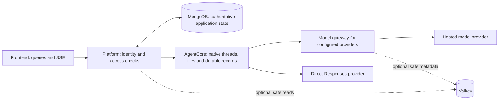

# Application caching: POC to production AWS

**Status:** application implementation complete for the first safe rollout; optional caches default off. Local verification is recorded in [the implementation report](../verification-reports/2026-10-06-application-cache.md). Production AWS deployment and live-provider experiments remain release gates.
**Date:** 2026-10-06. **Inspected baseline:** `application-caching`, `e44b79e`.
**SOP:** [AGENTS.md](../AGENTS.md). **Deployment preference:** low-cost POC first, then production AWS.

This plan supersedes the historical [2026-10-01 draft](CACHING_PLAN.md). It complements, and does not replace, the proposed [AgentCore durability specification](../development-spec.md). Sections 2–10 preserve the inspected baseline and proposal; section 11 records the implemented scope. Three GPT-6.1-Sol agents researched and implemented the platform/frontend, model, and runtime layers, followed by independent cross-reviews. See [operations and rollback](APPLICATION_CACHE_OPERATIONS.md) for actual controls.

## 1. Decision and scope

Start with measurement, removal of repeated work, bounded process-local caches, and provider prompt caching. Add **Valkey** as an optional shared read cache when cross-process reuse justifies it. For production AWS, prefer **Amazon ElastiCache for Valkey**, choosing Serverless or a node-based deployment from measured traffic, regional cost, and operational requirements. This recommendation follows the repository's AWS topology; it is not a claim that one engine is fastest for every workload.

Cover every layer by defining its cache policy. Do not cache every operation. MongoDB, native Codex state, and the authoritative file store retain their existing responsibilities. Cache loss must not lose conversations, undo revocation, approve a tool call, spend a budget twice, or change command delivery semantics.

Initial scope excludes semantic answer caching, live agent-turn response caching, SAP mutation/result replay, cache-based writer ownership, auth-session caching, and changes to durable event-write ordering. S3 checkpoints remain a separate durability project. There are no vendor/Codex modifications in the initial caching work.

## 2. Inspected flow and constraints



The gateway is a shared service; it is not part of the AgentCore runtime image. Direct Responses profiles bypass the gateway. AgentCore does not need direct cache connectivity in the first release. Each native runtime keeps its own bounded local caches.

| Observed behavior                                                                                                  | Evidence                                                                                                           | Planning consequence                                                             |
| ------------------------------------------------------------------------------------------------------------------ | ------------------------------------------------------------------------------------------------------------------ | -------------------------------------------------------------------------------- |
| Google cookie authentication exists alongside dev and shared-identity POC modes                                    | `platform/src/index.ts:176`, `platform/src/auth.ts:323`                                                            | Design for current user/role boundaries even when POC testers share one identity |
| Sessions/projects depend on ownership and chat visibility; MCPs can be tenant or user scoped                       | `platform/src/access.ts:84`, `platform/src/service.ts:878`, `:935`                                                 | Tenant + URL alone is an unsafe response cache key                               |
| Models/skills share a catalog but are filtered by tenant allow-lists                                               | `platform/src/store.ts:325`, `:333`                                                                                | A global catalog projection cannot replace current tenant eligibility checks     |
| Configuration resolves the chat owner's MCPs, decrypts keys, and rechecks connector DNS safety                     | `platform/src/service.ts:381`, `:427`, `:456`, `:465`                                                              | Do not cache assembled runtime configuration or skip security checks             |
| Conversation open gets a snapshot, ingests/reconciles records, then loads messages; timing/trace reads also ingest | `platform/src/service.ts:1574`, `platform/src/index.ts:580`, `:610`                                                | Coalesce repeated recovery/ingestion before adding broad history caching         |
| Each replica runs its own 2s poll loop                                                                             | `platform/src/service.ts:1647`, `:1659`                                                                            | Duplicate processing must remain safe independently of caching                   |
| Gateway already caches profiles and secrets; profiles can be served stale for up to an hour                        | `model-gateway/src/profiles.ts:47`                                                                                 | Address revocation/freshness before extending these caches                       |
| Runtime repeatedly reads marker JSON; document lists read metadata files                                           | `agent-core/src/business-runtime.ts:118`, `agent-core/src/file-tools.ts:202`                                       | Small bounded L1 caches can remove disk work                                     |
| Durable events are written before subscriber delivery; failure stops admission                                     | `agent-core/src/manager.ts:1283`, `:1330`                                                                          | Preserve this ordering while reusing serialized event frames                     |
| Frontend API helper has no application query cache; documents/visualizations refetch across views                  | `frontend/lib/api.ts:98`, `frontend/components/assistant-tools.tsx:44`, `frontend/components/visualization.tsx:36` | Reuse reads in memory without persisting private content in browser storage      |

The old draft contains unverified performance observations and outdated line references. This audit did not reproduce its token counts, zero prompt-cache hits, claimed replica counts, or proxy diagnosis. Those are hypotheses for Phase 0, not established root causes. Several prior suggestions are already partly implemented: owner-based list indexes, deterministic command IDs, and loaded-thread resume handling. Verify before changing them.

## 3. Tool selection

| Tool                                | Fit for Truex                                                                                                                             | Decision                                                                                                                                                                                                                                                                                                                            |
| ----------------------------------- | ----------------------------------------------------------------------------------------------------------------------------------------- | ----------------------------------------------------------------------------------------------------------------------------------------------------------------------------------------------------------------------------------------------------------------------------------------------------------------------------------- |
| Bounded process-local LRU/TTL cache | Removes repeated parsing/reads without network cost; one copy per process                                                                 | First POC step; enforce byte, entry and lifetime limits                                                                                                                                                                                                                                                                             |
| Valkey, self-hosted                 | Shared Redis-protocol cache with BSD licensing; requires patching, monitoring and recovery ownership                                      | Optional low-cost POC container if cross-process reuse is demonstrated; [official project](https://valkey.io/)                                                                                                                                                                                                                      |
| ElastiCache for Valkey              | Aligns with AWS-hosted platform/gateway; managed operations and HA options                                                                | Preferred production service; [deployment options](https://docs.aws.amazon.com/AmazonElastiCache/latest/dg/WhatIs.deployment.html)                                                                                                                                                                                                  |
| Redis / Redis Cloud                 | Mature ecosystem and managed offering; licensing depends on release/product                                                               | Good alternative where existing operations/contracts favor it; no required Redis-specific feature identified; [licensing](https://redis.io/legal/licenses/)                                                                                                                                                                         |
| Dragonfly                           | Redis-compatible engine worth testing for multicore throughput/memory pressure; compatibility and deployment operations need verification | Benchmark candidate after a demonstrated bottleneck; vendor claims are not Truex measurements. Its [BSL 1.1 license](https://github.com/dragonflydb/dragonfly/blob/main/LICENSE.md) has production-use conditions; check the pinned release; [compatibility](https://www.dragonflydb.io/docs/command-reference/compatibility)       |
| Memcached                           | Simple ephemeral object caching, but a smaller primitive set for this proposed invalidation design                                        | Viable for simple disposable object caching; supports CAS/counters as well as GET/SET; not the default here; [official overview](https://docs.memcached.org/)                                                                                                                                                                       |
| Upstash Redis                       | Managed HTTP-accessible caching can suit edge/serverless clients                                                                          | Conditional if topology changes; account for [eventual consistency](https://upstash.com/docs/redis/features/consistency) and Pro-only [private connectivity](https://upstash.com/docs/redis/features/security). Current long-lived AWS services favor colocated access; [REST API](https://upstash.com/docs/redis/features/restapi) |

Prefer one engine and one small application adapter. Do not introduce Redis, Dragonfly, a vector cache, and a queue together. Defer vLLM/SGLang/LMCache: the application currently calls hosted providers, so it does not own their GPU KV caches.

**Node client:** evaluate a pinned `redis`/node-redis client first, behind a narrow adapter. The upstream [ioredis README](https://github.com/redis/ioredis) now recommends node-redis for new projects and describes ioredis maintenance as best effort. Valkey GLIDE is an alternative after checking Node 24, ARM64/container packaging, shutdown, TLS, and cluster behavior. The old draft's ioredis choice is not a requirement.

**Production deployment choice:** start the cost comparison with Valkey Serverless for uncertain/bursty usage; choose node-based primary + replica across AZs when steady traffic or configuration control justifies fixed capacity. Serverless requires a cluster-capable TLS client. Its eviction policy is fixed `volatile-lru`, it has no keyspace notifications, and port 6380 provides eventually consistent reads. Use the primary endpoint initially and put TTLs on every disposable entry. Node-based parameter groups can support a chosen eviction policy. [AWS configuration](https://docs.aws.amazon.com/AmazonElastiCache/latest/dg/RedisConfiguration.html).

Explicitly configure/test standalone client mode for the POC and cluster mode for Serverless. Future multi-key transactions/scripts must obey same-slot requirements; do not put every tenant key in one slot just for convenience. The first adapter uses single-key operations and does not need cross-key transactions.

Use private networking for production, encryption in transit/at rest, scoped service credentials/ACLs, and same-region placement near platform/gateway. Provision actual subnet/security-group connectivity; a URL alone does not establish reachability. Do not add a public cache endpoint for this plan. Production sizing must include replica memory, connection counts and failover headroom.

**Cost decision:** no monthly quote is credible until region, working-set bytes, requests/second, average value size, and duty cycle are known. Serverless charges stored GB-hours and ECPUs; Valkey has a 100 MB minimum metered storage size. Node-based pricing includes primary and replica node hours; do not apply that replica multiplier to Serverless metering. Compare cache + HA + traffic + operational costs against saved Mongo/runtime work. Large document values can erase the benefit of caching tiny metadata. Use the [current AWS pricing page](https://aws.amazon.com/elasticache/pricing/) and target-region calculator during Phase 0.

## 4. Cache policy by layer

The values below are **initial experimental ceilings**, not verified latency or freshness guarantees. Tune them against measured workloads and an explicit product freshness contract. Security checks have no stale fallback.

| Layer / resource                    | Proposed mechanism and scope                                                       | Initial bound / invalidation                                                               | Exclusions                                                                                                                                                                     |
| ----------------------------------- | ---------------------------------------------------------------------------------- | ------------------------------------------------------------------------------------------ | ------------------------------------------------------------------------------------------------------------------------------------------------------------------------------ |
| Browser static assets               | Existing content-hashed Next assets; CDN later                                     | Asset deployment hash                                                                      | No shared CDN caching of authenticated APIs or SSE                                                                                                                             |
| Frontend server queries             | Memory-only query reuse, in-flight dedupe, mutation/SSE invalidation               | Catalog 30–60s; mutable lists 5–15s; byte/count caps for inactive queries                  | No persistent chats, documents, prompts or credentials                                                                                                                         |
| Platform catalog display            | Safe public model/skill/agent projections in L1; optional L2                       | 30–60s + source revision/invalidation                                                      | Enabling/disabling, permissions, allow-list enforcement remain authoritative                                                                                                   |
| Platform personalized metadata      | Separate scoped MCP/list projections after access checks                           | 5–15s initially; owner/role/filter-aware keys                                              | No decrypted connectors or assembled thread config                                                                                                                             |
| Runtime markers                     | One parsed marker per runtime/thread in bounded L1                                 | Invalidate successful marker writes, restore, fork, cleanup and process generation changes | Preserve fail-closed capabilities and existing errors; valid legacy markers retain default-tenant compatibility; never synthesize cached ownership for missing/corrupt records |
| Runtime file metadata               | Per-workspace document list cache                                                  | Invalidate save/upload/copy/cleanup; short safety TTL where mutations bypass wrapper       | No authoritative file deletion/retention decisions                                                                                                                             |
| Runtime extracted document text     | Derived PDF/Office text in byte-bounded L1, if profiling confirms repeated parsing | Tenant/thread/file/content hash/parser version; invalidate on cleanup/restore              | No global file ID cache; no plaintext text in shared L2 initially                                                                                                              |
| Streaming                           | Serialize a public event once for its subscribers; retain bounded replay           | Runtime generation + sequence                                                              | Do not cache active snapshots/approvals as static truth; preserve durable ordering                                                                                             |
| Gateway                             | Bounded metadata reuse; credentials process-local only                             | Fresh security state, credential version, explicit expiry                                  | No secrets/prompts in L2; no stale enabled-state fallback; defer SDK client pooling                                                                                            |
| Provider prompt cache               | Provider-side reuse of a stable exact prefix                                       | Model/provider capability and approved retention                                           | Not response replay; does not replace approvals, runtime state or authorization                                                                                                |
| Completed traces/helper transcripts | Later: immutable public payloads only, after lifecycle verification                | Tenant/principal/resource/content or finalization revision                                 | No running transcripts, masked live context or mutable summary/list pretending to be immutable                                                                                 |
| Documents/downloads/visualizations  | First cache lists/derived work on server; keep current HTTP `no-store`             | Consider private revalidation later under retention/revocation contract                    | No year-long browser persistence for sensitive bytes                                                                                                                           |
| MongoDB                             | Index/projection/batching/pagination improvements on misses                        | Validate actual query plans                                                                | Database buffers are not a substitute for application cache policy                                                                                                             |

Document save currently uses `list()` inside its per-thread queue to enforce 50-file/25 MB limits (`agent-core/src/file-tools.ts:275`). A cached display list must never become stale quota authority. Keep quota reads authoritative, or maintain writer-owned metadata under that existing queue and update it only after the successful metadata rename. Invalidate on copy/restore/cleanup and test concurrent uploads, failed saves and both count/byte limits.

### Frontend choice

Prefer incremental **TanStack Query v5** adoption for read-only catalogs/MCP lists first, if introducing one dependency is acceptable at implementation review. It supplies query lifecycle/invalidation facilities; it is not a byte-bounded LRU by default. Configure query freshness, garbage collection, inactive entry limits, and explicit size/admission limits for retained conversations. Do not rewrite the streaming chat state in the same PR. A small existing-style single-flight/LRU helper is sufficient for the first narrow POC slice if library adoption would expand that change.

Override automatic retry behavior: no retries for auth/permission failures, and no wrapping create/send/approve/upload mutations in a generic retrying cache helper. Check Next 16's installed documentation per [frontend/AGENTS.md](../frontend/AGENTS.md) before implementation. [TanStack defaults](https://tanstack.com/query/latest/docs/framework/react/guides/important-defaults), [query invalidation](https://tanstack.com/query/latest/docs/framework/react/guides/query-invalidation).

Establish an authenticated identity scope before loading personalized queries. Clear/cancel all relevant queries and reject late results on logout, tenant/user switch, role change, and auth failure. Include the API origin/environment in the scope. Bind SSE cursors and visualization widget state to the same scope; current browser storage uses session/file IDs alone. Synchronize clearing across tabs. POC shared identity is deliberate behavior, not evidence of multi-user isolation.

## 5. Cache contract and consistency

### Small shared primitives

Proposed new modules: `shared/cache.ts` for typed cache-aside/single-flight/bounds and `shared/cache-redis.ts` for the optional transport. These files do not exist yet. Keep caller-owned resource policies; do not build a generic cache service or expose it to the browser. Each consuming service owns its connections and shutdown behavior.

Implement only bounded `getOrLoad`, set-with-expiry, targeted invalidation and health/metrics initially. Add Pub/Sub invalidation only with L2. Do not add a generic distributed lease to the first abstraction. Reuse existing logging/error patterns. Pin dependencies in each consuming service's lockfile and verify compiled shared-module imports.

Proposed envelope: schema version, source revision when implemented, fetched time, absolute freshness expiry and validated value. On an L2 hit, L1 retains only the **remaining** allowed freshness, never a fresh full TTL. Admission checks enforce maximum serialized size, supported types and allowed fields. Return copies or immutable values to prevent callers mutating a shared cached object. Bound pending loads, subscribers and negative-cache cardinality as well as stored values.

### Identity and key design

Conceptual personalized key:

```text
truex:<environment>:<schema>:<tenant>:<principalScope>:<policyRevision>:<resource>:<resourceRevision>:<queryHash>
```

Canonicalize filters, pagination, locale and every representation-affecting setting. Encode or hash components safely; do not embed tokens, secret values, raw prompts or private file names. Tenant-wide underlying object caches may omit principal only when current authorization and public projection are performed separately. MCP configuration/discovery additionally binds to the **stored chat owner**, connector/credential revision, agent attachments, toolset fingerprint and runtime policy. An admin viewing a chat must not substitute their own connectors for the owner's.

Revisions/policy epochs in this design are **proposed source-owned metadata**, not existing fields. Do not invent them in callers before defining schema, mutation owners, migration and tests. TTL-only caching can be used for display data with explicit bounded staleness; it is not sufficient for permission/configuration enforcement.

The initial TTL-only L1 still needs a per-key invalidation generation: capture it when a load starts and populate the cache only if unchanged. Mutation/cleanup/invalidation must advance it even when no value exists. Identity switches use a separate frontend epoch. Cross-replica TTL-only display caching deliberately allows the configured stale window; Pub/Sub alone cannot prevent all late fills. Source revisions are required before claiming stronger cross-replica consistency. Never reset a TTL based on late load completion when doing so would extend the defined source-freshness window.

### Writes, stale fills and missed invalidation

1. Validate and authorize the mutation using current source state.
2. Commit the data and its revision atomically at the appropriate source boundary. Use entity-level atomic revision updates; an aggregate revision spanning multiple documents requires verified transaction support or a separately designed reliable change path.
3. Evict local old entries and send an invalidation hint after commit. If cache publication fails, the source mutation remains successful and the failure is observable.
4. A reader fills an immutable revision-qualified key. An old in-flight fill cannot replace the current revision. The loader must prove its payload matches that revision, including multi-document consistency where applicable.
5. For any cached data influencing dispatch/permissions, validate current authoritative revision/eligibility before use. Phase 1 keeps those data uncached. This may retain a cheap Mongo read while removing repeated heavy reads; correctness is the priority.

Pub/Sub and TTL accelerate freshness; they do not guarantee durable delivery. Flush affected L1 entries on subscriber reconnect and keep a bounded safety expiry. Pub/Sub-only invalidation must never be described as immediate revocation. If later workloads require dependable revision propagation, consider Mongo change streams/outbox only after verifying topology/support and measuring the need.

Inventory every writer: user and tenant MCP create/update/delete/attach, agent writes, model/skill catalog scripts, admin membership/role changes, tenant status/visibility/allow-lists, uploads/generated files, fork/restore/cleanup. Administrative direct Mongo writes bypass application invalidation. Migrate them to reviewed writer paths or use strict source validation; do not assume a cache knows about them.

### Failure behavior

Cache down/slow/corrupt/evicted → treat as a miss, report bounded diagnostics, and call the existing authority. Start with a 20–50ms cache-command deadline only as a local/same-region hypothesis, then tune from p99 measurements. Disable offline command queues/unbounded retries and bound reconnect backoff. A timeout must not leave growing pending work or late writes after invalidation. Circuit-break open during failures; recover with limited probes.

Fallback must be capacity-safe: local single-flight, bounded origin concurrency, and existing admission/backpressure. A cold cache should not create an uncontrolled Mongo/runtime stampede. Only explicitly classified display data may use bounded stale values on error. If Mongo/auth/security authority fails, preserve its error instead of accepting an old authorization/profile decision.

Do not put correctness-critical leases, budgets, command delivery, acknowledged event cursors, checkpoints, or cache-version authority into the evictable read cache. Existing deterministic Mongo message IDs remain the duplicate guarantee. A later poll-coordination project must preserve persist-before-ack, order/generation awareness and durable idempotency even with two pollers. A separate non-evicting coordination deployment alone does not solve failover/split-owner races.

### HTTP validators

For the first cache slice, preserve existing `no-store` on sensitive downloads/live context. Establish a proposed default `no-store` policy for auth, identity (`/api/me`), admin and other sensitive responses; blanket coverage is not currently implemented. Allow-list approved safe reads before adding `private, no-cache` and ETags, after current access checks. Initially hash the actual authorized representation; do not derive list validators only from newest timestamp or file count. Changes to an older item, role, visibility, deletion or pagination must affect the representation/validator. Include relevant `Vary` headers, but do not treat `Vary` as authorization. A valid conditional request must be authorized before 304 is returned. Preserve SSE `no-cache, no-transform` and disable proxy buffering. [HTTP caching standard](https://www.rfc-editor.org/rfc/rfc9111.html).

## 6. Model-layer plan

Provider prompt caching reuses computation over prompt prefixes; Redis/Valkey does not implement it. Optimize the actual post-adapter payload, since direct Responses, Anthropic, Gemini and Chat Completions serialize different requests.

1. **Expose evidence first.** Record uncached input, cache-read input, cache-write input, output, provider/model/profile revision, first-token latency and final status. Anthropic already reads cache writes but merges them into input; gateway logs and downstream shared/trace types omit parts of the breakdown. Extend `model-gateway/src/{adapter,responses,logging}.ts`, provider adapters, `shared/contracts.ts`, and `agent-core/src/{trace,manager}.ts` after checking the pinned parser. Preserve total-token accounting and test that budgets do not change through double counting.
2. **Stable-prefix contract.** Deterministically order compatible tools, schemas and skills; isolate volatile turn data from genuinely stable instructions where semantics permit. Never move or weaken guardrails/approval instructions merely to achieve a hit. Hash segments for diagnostics without logging prompt bodies. Test identical effective requests and changed instructions, model, tools, owner and connector credentials.
3. **Anthropic.** Existing adapter sends ephemeral cache control. Verify configured model thresholds and breakpoint behavior, then run controlled direct-versus-configured-endpoint repeated-request probes. A missing hit could be request instability, minimum size, metrics translation, expiry or proxy behavior; do not blame a proxy without evidence. Select TTL from usage intervals and write/read economics. [Official prompt caching](https://platform.claude.com/docs/en/build-with-claude/prompt-caching).
4. **OpenAI/direct Responses/compatible chat.** Check the configured model's current caching contract and the pinned client's emitted fields. Current official docs include both automatic caching and model-dependent explicit controls. The pinned Codex request emits `prompt_cache_key` but has no `prompt_cache_options` or `prompt_cache_retention` fields (`vendor/codex/codex-rs/codex-api/src/common.rs:252`). Start with its supported automatic caching. The chat adapter currently drops prompt-cache controls; forward only verified fields to capable endpoints, with unsupported-provider tests. Direct routes need separate tests because gateway changes cannot affect them. The gateway currently supports chat/Anthropic/Gemini adapters, not a Responses passthrough: forcing a direct profile through it is not a solution. New explicit controls need a supported transport extension or a separately reviewed runtime upgrade, outside the first release. A prompt cache key is a routing hint, not an access-control boundary. [Official prompt caching](https://developers.openai.com/api/docs/guides/prompt-caching/).
5. **Gemini.** Preserve implicit cache usage metrics first. Consider explicit cached-content resources only when stable-prefix size/reuse offsets storage cost; scope by provider account/credential, tenant, owner, model and content hash. Add expiry/error recovery and cleanup before rollout. Do not generalize retirement dates across Gemini models. [Caching guide](https://ai.google.dev/gemini-api/docs/caching), [model deprecations](https://ai.google.dev/gemini-api/docs/deprecations).
6. **Gateway profile freshness.** Separate safe display/config metadata from enabled-state and credential validity. Keep secrets in a bounded process-local cache with a defined rotation contract. On expiry, require refresh for security-relevant state; do not keep a one-hour stale fallback after a lookup failure. Test revocation/rotation across replicas and direct credential paths, including `clear()` while a secret lookup is pending: the existing secret-fill path has no equivalent generation guard. Exact revocation timing requires an explicit live-request contract; requests already dispatched cannot be retroactively cancelled by cache invalidation. Resolve the existing stale-policy risk before expanding caching of dispatch-related metadata.

Do not naively pool Anthropic SDK clients by profile. Their current fetch hook captures request-specific response/rate-limit handling (`model-gateway/src/server.ts:178`, `adapters/anthropic.ts:544`); reuse could mix request state. Any client-pooling optimization requires separating that state and measured benefit in a later change.

Application-side live masked turn context/prompt bodies remain uncached. Provider-side prompt retention is a separate approved data-handling choice. Do not log prompt hashes as an uncontrolled cross-tenant correlation mechanism; scope diagnostic hashes and restrict logs.

Exact output caching is a later opt-in for isolated, side-effect-free, reproducible tasks over immutable inputs. Key every effective input: tenant/principal, provider/model/version, prompt/instruction/schema version, generation parameters, file/content hash and policy revision. No tool calls or live SAP state. Even temperature zero does not establish reproducibility. Inventory an actual task and prove suitability before creating a generic answer cache.

MCP `tools/list` caching is later work: first locate discovery inside the pinned runtime and verify a supported invalidation integration. Cache definitions, not executions, under owner/credential/server/toolset revisions. Honor server tool-list changes and permission revocation. Do not add a second independent discovery stack outside Codex just to introduce this cache.

## 7. Implementation sequence and reviewable PRs

Each row is a phase, split into focused PRs with separate flags/checks. Effort estimates and dates require Phase 0 evidence and team capacity; the sequence is a dependency plan, not a delivery promise. Within Phase 1, separate platform work coalescing, safe catalog L1, and runtime marker/file-list caches. Within Phase 2, separate provider metrics/controls from frontend query adoption. Add the sensitive-response HTTP policy before opting safe routes into caching.

| Phase                         | Smallest proposed change / files                                                                                                                                   | Exit evidence                                                                                                                                 |
| ----------------------------- | ------------------------------------------------------------------------------------------------------------------------------------------------------------------ | --------------------------------------------------------------------------------------------------------------------------------------------- |
| 0 — baseline                  | Route/runtime timing in `platform/src/{index,service}.ts`, shared logging; provider cache counters in gateway/shared/trace; a reproducible non-production workload | Cold/warm open, startup, send preparation and TTFT p50/p95/p99; query/RPC counts; provider counter integrity; regional cost inputs            |
| 1 — low-cost POC              | Coalesce same-process ingestion/recovery per tenant/session, with authority outside the shared work; bounded safe catalog/marker/file-list L1; relevant tests      | Cache-off parity, no ack-before-persist, bounded memory, fewer measured source operations; no Redis deployment required                       |
| 2 — model and frontend        | Stable provider prefix tests/verified controls; incremental scoped query reuse in `frontend/lib/api.ts` and relevant consumers                                     | Repeated identical live-provider probe reports valid counters where supported; shared frontend reads dedupe; isolation and auth clearing pass |
| 3 — optional POC shared cache | `shared/cache-redis.ts`, platform/gateway env and lifecycle wiring, optional private Valkey local/development service instructions                                 | Two replicas, missed invalidation and cache-kill tests; measured L2 reuse worth its latency/cost; all L2 payloads secret-free                 |
| 4 — production AWS            | Reviewed cache infrastructure, TLS/ACLs/networking, alerts, load test and capacity/fallback sizing                                                                 | Target region/account support verified; Serverless vs nodes cost comparison; failover/cold-cache tests; canary and rollback rehearsal         |
| 5 — selective expansion       | Completed immutable traces/transcripts, document parsing cache, safe ETags; large-file delivery considered separately                                              | Actual immutability and retention boundaries tested; each added cache class improves measured user latency/load                               |

Phase 2 provider and frontend work may proceed independently after Phase 0; shared caches are not prerequisites for prompt caching. Tune Mongo misses alongside the relevant phase: batch reconciliation, project fields, paginate message history with a compatible UI contract, persist/backfill titles, and use `explain` for real list/poller filters. Do not add redundant indexes or combine all these changes into one cache PR.

Provider experiments must classify eligible and below-threshold requests by the configured model, use unchanged prefixes within retention, allow hits already present on the first measured request, and verify metrics rather than mandate that only the second request hits. Unsupported endpoints retain baseline behavior. A zero read count alone is not evidence of a cache bug.

If engine selection needs an experiment, compare Valkey and Dragonfly with the same CPU/RAM budget, clients, TLS/network path, actual value sizes, TTL churn and concurrency. Include eviction, cold-cache and failure runs; raw engine QPS or vendor multipliers cannot establish end-to-end application gains. Reconsider Dragonfly only if it measurably improves the constrained workload enough to justify its compatibility and operating costs.

Proposed backend flags, following existing feature conventions: `CACHE_L1`, `CACHE_L2`, `CACHE_RUNTIME_METADATA`, `CACHE_PROVIDER_CONTROLS`; proposed frontend flag: `NEXT_PUBLIC_CLIENT_CACHE`. Define exact parsing/defaults in implementation; all default off initially. A validated `CACHE_URL` only supplies connectivity, not automatic enablement. Disable cache reads and writes together during rollback. Keep public feature responses about product capability, not internal hostnames or credentials.

## 8. Acceptance criteria, Break Mode and measurements

| Risk / test                                                                                      | Required result                                                                                                                                                |
| ------------------------------------------------------------------------------------------------ | -------------------------------------------------------------------------------------------------------------------------------------------------------------- |
| **Critical:** two users in one tenant; two tenants with colliding resource IDs; admin demotion   | Warm L1/L2 and browser caches cannot cross identity boundaries; currently unauthorized reads/304s and writes stay denied                                       |
| **Critical:** membership removal, disabled tenant/model, deleted/revoked MCP while cache is warm | Cache never grants access or dispatches a newly denied action; defined authority/revocation contract holds with lost Pub/Sub and cache outage                  |
| **Critical:** slow/duplicate ingestion, process death between Mongo persist and records ack      | No loss/early ack; durable retries remain correct; cached cursor/lease never substitutes for persisted state                                                   |
| **High:** old loader completes after mutation/invalidation/logout/restore                        | Locally invalidated or source-verified old generation/identity cannot become current; TTL-only cross-replica display staleness stays within its explicit bound |
| **High:** stopped/replaced AgentCore, corrupt/missing marker, restored family                    | Clear derived caches; restore authority before reuse; no synthetic thread and no bypass of durability spec                                                     |
| **High:** cache unavailable/slow, network partition, failover, malformed JSON, oversized entries | Existing source behavior preserved; bounded deadlines/pending work/retries; errors measured; secrets never logged                                              |
| **High:** all entries expire together; hot key; 10x measured peak; cold cache                    | Bounded source concurrency and memory; acceptable fallback latency/error rate and overload behavior                                                            |
| **High:** connector DNS changes with metadata cached                                             | Existing SSRF/DNS validation still runs at the use boundary                                                                                                    |
| **High:** concurrent uploads at file-count/byte quota, save failure and cached lists             | Existing limits remain enforced; no stale quota approval; unsuccessful save does not populate metadata caches                                                  |
| **High:** secret rotation/clear during a pending lookup                                          | Generation guards cover both profile and secret fills; old credentials cannot refill the current cache                                                         |
| **Medium:** ETag for older item update/delete, role/visibility/filter/pagination change          | Validator reflects actual authorized output; 304 cannot revive inaccessible data                                                                               |
| **Medium:** many documents, huge histories, randomized IDs and negative misses                   | Entry/byte/in-flight/cardinality limits hold; no unbounded L1 or uncapped retained UI payloads                                                                 |
| **Medium:** prefix changed, streaming interrupted, tool-call IDs/schema changed                  | Correct provider request/usage semantics; no cached answer or tool execution replay                                                                            |

Benchmark cache-disabled, cold, warm and outage modes with identical datasets and concurrency. Separately measure frontend render/open time, API p95/p99, Mongo reads/query plans, AgentCore invocation/recovery count, event-loop lag, memory/RSS, cache round-trip/serialization latency, and model TTFT/cached token usage. Warm metadata wins do not prove first-token improvements when cold starts or model inference dominate.

Initial go/no-go hypothesis: the targeted repeated-read workload should reduce origin reads by at least 50% and improve its p95 by at least 20%; unaffected routes should show no material regression. These are proposed experimental targets, not measured gains. Fail the experiment if source savings do not justify cache latency, cost or stale-data complexity. Determine numerical outage latency/capacity limits from the baseline before release. Security, correctness and bounded resource tests are unconditional gates.

Extend existing ownership/auth/tenant/MCP-scope, persistence/commands/goal-replay, profiles/adapter/observability, runtime/file-tool and frontend test suites. Add cache-specific unit tests for TTL including remaining L2 freshness, race invalidation, mutation safety, negative-cache bounds, timeout recovery and schema rejection. Integration tests must exercise the real selected cache/client, plus multi-replica HTTP and failure behavior; mocks do not validate failover or command compatibility.

At implementation completion run root `npm run format:check`, `npm run build`, `npm test`, and separately `npm --prefix frontend test` and `npm --prefix frontend run typecheck` (root tests omit frontend). Run `npm run codex:verify`/protocol checks where affected by the change; avoid needless protocol regeneration in documentation-only work. Apply repository-required checks and the pre-push SOP when preparing code for GitHub. Provider-live checks require the approved non-production credentials/environment and explicit test-cost accounting; never embed credentials in fixtures.

## 9. Rollout, rollback and observation

Roll out one resource class at a time: off → non-production → small canary → broader rollout. Test cache-disabled rollback before production. A unique schema/environment namespace prevents old deployments reading incompatible payloads; mixed versions continue to use Mongo/native state. Proposed revisions require an expand/backfill/verify rollout before relying on them. No destructive migration is needed for the initial safe read caches.

Dashboard bounded labels by service/resource/outcome, with hit/miss/bypass/error, entry bytes/count, stale age, load/serialization time, eviction, origin fallback/concurrency, invalidation failures, reconnect state and provider read/write token counts. Use scoped logs/traces for tenant/request diagnosis rather than user/key IDs as high-cardinality metric labels. Alert on origin overload, cache p99/errors, memory/connection pressure, revocation-test failure, unexpected 304s, ingestion failures and latency regressions.

Rollback disables the affected cache reads/writes, flushes its namespace/L1/browser memory, and returns to authoritative behavior. Cache recovery does not require restoring cached data. Observe real error rates, latency, Mongo/runtime load, provider spend and stale-data reports after each rollout. Do not claim production readiness from unit tests or a successful cache deployment alone.

## 10. Outstanding evidence and decisions

- Actual AWS region, replica counts, cache networking, target peak concurrency and budget were not read from a deployed environment. The repository describes topology, not proof of its live configuration.
- The research task did not run benchmarks or integrations. The subsequent implementation now includes measured local Mongo/Valkey and filesystem benchmarks, synthetic gateway/frontend fixtures, and real standalone/cluster cache tests; see section 11. Deployed latency, provider hit rates and AWS costs remain unknown.
- Confirm product display-freshness, document-retention and revocation timing requirements before enabling broader content/config caching. Existing 5s tenant cache and gateway stale profile policy deserve explicit review.
- Verify Mongo deployment transaction/change-stream support before introducing any aggregate revision/outbox mechanism. Initial display TTL caching avoids that dependency.
- Confirm finalization semantics before treating traces/transcripts as immutable. A completed turn does not make its session, totals or helper list immutable.
- Validate Node/client/cache command compatibility, regional managed-service availability, release-specific licensing and target-region cost during implementation. Engine choice can be revisited without changing resource policies.

The first implementation milestone is a measured POC with safe metadata reuse and provider-cache visibility. A managed distributed cache follows when measured reuse and production operations justify it.

## 11. Implemented scope and remaining gates

| Layer | Implemented | Deliberately retained boundary |
| --- | --- | --- |
| Platform | Safe agent/model L1, model-picker Valkey L2, scoped keys, same-session ingestion singleflight, private validators, timing and bounded numeric cache logs | Current access/configuration and Mongo persistence remain authoritative; no history or connector/configuration cache |
| Frontend | Bounded metadata query reuse, active-only identity verification, identity/focus/BFCache/mutation fencing, scoped stream cursors, memory-only widget state | Private session/document/visualization GETs remain uncached and reject stale identity generations |
| Gateway | Bounded fresh profile/secret caches, lookup deadlines, explicit retryable failures, read/write token accounting and capability-gated provider controls | No expired dispatch fallback, shared credentials, answer cache, new Responses transport or Gemini explicit-cache lifecycle |
| AgentCore | Source-verified marker/list/text caches and event serialization reuse | File quota admission, native ownership/state, durable writes and approvals retain authoritative behavior |
| Operations | Local Valkey helper, real standalone/cluster/failure/recovery tests, layer benchmarks, rollback instructions | No deployed infrastructure, actual AWS failover or live provider calls performed |

The optional transport lives in `platform/src/cache.ts`, while the dependency-free local helper is `shared/cache.ts`; AgentCore does not import a Redis client. New optional flags remain off. Existing gateway caches keep bounded retention with stricter expiry handling.

The implementation adds regressions for stale fills, hot-key waiter overload, credential expiry/rotation, identity bootstrap/account cycles, file corruption/removal/quota races, persistent-before-ack ingestion, written cache commands whose replies never arrive, and repeated Pub/Sub lifecycle safety. A second review found and corrected failures before declaring the local implementation finished.

The local performance hypothesis is met for the measured catalog workload. This does not establish AWS sizing, first-token gains, live-provider economics, or peak fallback capacity. Phase 4 requires region/account/network/ACL/TLS/HA validation and deployed measurements. Phase 5 expansion (immutable traces/transcripts, MCP discovery, output caching) remains conditional future work; source-verified document parsing and safe catalog ETags are included now. No destructive migration is required.
