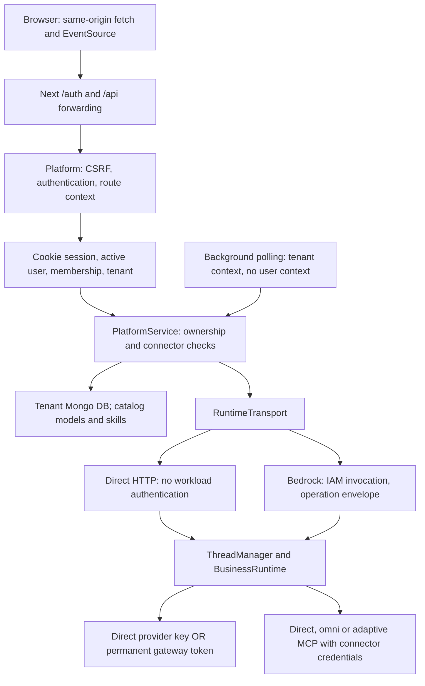
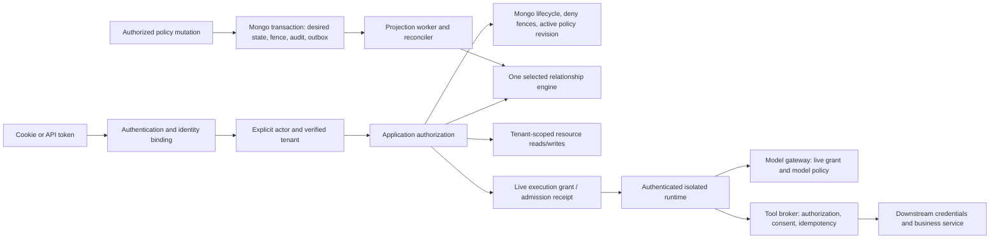

# Enterprise authorization implementation plan

Status: proposed implementation sequence, 2026-10-12. Repository inspected at `8501163c7f3fd53a7406b2f0f560ea8130f5663f` on Node `v24.11.0`. This document translates the supplied 2026-10-08 authorization proposal into repository-specific changes. Implementation is active in this branch: foundations, additive identity records and synthetic-tested API verification exist. This document describes the full target; the [build plan](ENTERPRISE_AUTHORIZATION_BUILD_PLAN.md) and [baseline](authorization/BASELINE.md) track implemented versus outstanding work. Enterprise enforcement and rollout remain incomplete.

The outcome is shared SaaS with strict tenant isolation, private content, enterprise identity, bounded delegated execution and auditable revocation. Installing a JWT library or adding role checks cannot deliver that outcome: the current platform, background workers, runtime, model routes and connector transports all participate in authority.

## 1. What the code actually does

### Current request and execution flow



In Google mode, `authMiddleware` populates response locals; `route()` installs user/tenant/request AsyncLocalStorage contexts. The HTTP route wrapper already rejects ordinary `/api` calls with missing user/tenant context. Service methods generally use `sessionFor` and ownership filters, but internal methods can run without an actor. `poll()` loops tenant databases and acknowledges runtime records independently of browser subscribers.

`configuration()` selects the conversation owner's personal connectors plus attached tenant connectors. `create()` writes the owner once; resume uses the saved owner. `owned()` routes commands to the saved runtime host/session; it is not itself a complete authorization guard. These patterns explain why initially shared conversations must be read-only: a second actor must not inherit the owner's execution credentials.

### Corrections to the supplied proposal

| Proposal assumption                      | Current evidence                                                                                                           | Implementation consequence                                                                                                                                                              |
| ---------------------------------------- | -------------------------------------------------------------------------------------------------------------------------- | --------------------------------------------------------------------------------------------------------------------------------------------------------------------------------------- |
| `/api` browser forwarding is missing     | `frontend/app/api/[...path]/route.ts`, `frontend/lib/forward.ts`; `api.ts` uses `base = ""`                                | Keep the BFF; extend and test it rather than rebuilding it. Forwarder currently omits `Authorization`; decide explicitly whether bearer clients use the public platform API or the BFF. |
| Google sign-in/invites accept Gmail only | `google.ts:identityFrom`, `invites.ts:issueInvite`; Google tests accept Workspace accounts                                 | Enterprise broker federation is still required, but removing a Gmail-only restriction is no longer work.                                                                                |
| Corporate dots and tags are removed      | `auth.ts:emailKey` canonicalizes Gmail domains only; corporate-address regression vectors exist                            | Preserve this behavior. External identity binding must still use issuer/subject, never email-only linking.                                                                              |
| SSE authorizes only at open              | `index.ts` uses `watchAccess`; `streams.ts` defaults to 10 seconds, caps at 25 seconds                                     | Reuse the guard, add policy/execution lifecycle and bounded checks. Current timing does not satisfy the proposed 5-second bound.                                                        |
| Mongo transaction support is wholly new  | `Store.withCatalogTransaction` uses snapshot reads and majority writes; Google onboarding/invites already use transactions | Extend the existing helper for authoritative policy/audit/outbox writes. Several current tests use standalone Mongo, so they cannot prove the new concurrency contract.                 |

The pasted plan's line numbers are stale; use the symbols linked in this document when implementing. Root README also still says authentication/multi-tenancy are absent, which conflicts with the code; correct that documentation in the implementation rollout.

### Remaining risks, prioritized

| Priority                         | Code evidence                                                                                                   | Failure to prevent                                                                                                                                                                                          |
| -------------------------------- | --------------------------------------------------------------------------------------------------------------- | ----------------------------------------------------------------------------------------------------------------------------------------------------------------------------------------------------------- |
| Critical for enterprise launch   | `access.ts:decide/decideAgent/ownerFilter`; `tenant.ts:currentTenantId`; `store.ts:db`                          | Missing actor becomes privileged internal access; missing tenant selects default data. HTTP has protection, but internal/service paths retain this behavior.                                                |
| Critical for enterprise launch   | `agent-core/src/index.ts` document/event/thread endpoints; `manager.ts:ownedBy`; `agentcore.ts:parseInvocation` | Direct runtime calls are unauthenticated; tenant matching is optional and not enforced on every operation. File routes call file tools directly.                                                            |
| Critical for protected execution | `service.ts:configuration/gatewayConfig`, `mcp.ts:mcpConfig`, `model-route.ts:resolveRoute`                     | Loaded runtime credentials remain usable after access changes; direct Responses model routes carry the actual provider key. Gateway-only fixes leave that route open.                                       |
| High                             | `access.ts`, `service.ts:isPassiveView`                                                                         | Admins read private content without an explicit share/emergency grant; absent visibility preserves shared reads.                                                                                            |
| High                             | `business-runtime.ts:prepareMcp`, `adaptive-session-v2.ts`                                                      | Adaptive hooks exist, but use a synthetic gateway UUID and loaded connector configuration, not current human/service membership, grants or business authorization. Omni/direct paths also need enforcement. |
| High                             | `admin.ts:adminAuthRoutes`, member DELETE route; `audit.ts:auditAfter`                                          | Shared admin sessions have `userId: null`; removal can commit and then fail cleanup, while retry returns 404. Mutation audit is best effort after state changes.                                            |
| High                             | `streams.ts:watchAccess`, `service.ts:history`                                                                  | Slow guard promises have no independent expiry; recovery keys lack authorization generations/revisions. Revocation can be missed or delayed.                                                                |
| High                             | `platform/Dockerfile`, `user.ts:authMode/pocUserResolver`                                                       | Production image defaults to shared POC identity. Enterprise startup must reject insecure modes and overrides.                                                                                              |

These are repository findings and launch blockers, not evidence about network exposure or a live deployment.

## 2. Observable behavior and scope

The first enterprise release must satisfy all of the following:

1. Every protected operation has an explicit verified human, service or workload actor and an explicit server-resolved tenant. No absence-based privilege or default-tenant fallback.
2. Cookie and bearer callers reach the same service authorization path. Invalid bearer authentication cannot fall back to cookies; conflicting/ambiguous credentials deny. Scopes restrict, never expand, live permissions.
3. Organization administration does not grant private transcripts, documents, titles, traces, counts or another person's connector material. A role capability and a content relationship are separate required gates.
4. A conversation is private by default. Initial shares grant reading only to current same-tenant users/groups; send, upload, approvals, fork, resume and execution remain owner-authorized. Personal folders remain personal.
5. A successful revoke commits authoritative denial before cleanup. Old tokens, sessions, projected tuples, caches, approvals and child grants cannot restore a removed generation. Removing one membership preserves unrelated tenant access.
6. Read/SSE delivery stops within the proposed 5-second target after revocation commit, including dropped invalidation and slow dependencies. Sensitive admissions are atomically ordered against revocation; prior remote-accepted work is reconciled rather than claimed to be undone.
7. Every runtime/artifact/helper operation verifies workload identity, tenant, conversation/thread, operation and generation. Runtime filesystem/network isolation must survive a malicious tenant, not just accidental folder confusion.
8. Protected model/tool requests use revocable execution authority, broker-held downstream credentials and restricted egress. Denied work causes zero new downstream dispatches.
9. Policy mutations, emergency disclosures and sensitive admissions have durable audit. Policy/identity/storage/audit outages fail closed with actionable errors.
10. Lists, detail, search, download, visualization, export, events, snapshots and recovery agree on access without unchecked metadata or unbounded scans.

Preserve existing chat/steer/interrupt, document viewing, personal project organization, tenant model/skill restrictions and disconnected-client ingestion when the current actor has permission. Initial non-owner reading should use persisted content; do not wake the owner's runtime. Live shared viewing requires a separately authorized read envelope and isolation proof.

Explicitly defer collaborative execution using another person's credentials, cross-tenant sharing, arbitrary policy scripts, automatically granted directory owner roles, a custom OAuth server, a second general-purpose policy engine and automatic region failover. Search/RAG permission enforcement is required when those surfaces exist; it is not a reason to add a search product now.

## 3. Target boundary and code ownership



Keep one policy interface in the platform application layer, with a thin selected-engine adapter. Extend `access.ts` into asynchronous guards rather than spreading SDK calls or role-name comparisons across routes. AsyncLocalStorage may carry the context, but public service methods must require it; worker entry points install explicitly scoped workload contexts. A caller cannot manufacture an internal context from request fields.

A06 now propagates immutable verified HTTP contexts and enforces the structural tenant-storage boundary in OIDC mode: no implicit resource database, no caller-created routing reference, and no cached active registry resolution. The [storage contract](authorization/STORAGE_CONTEXT_CONTRACT.md) specifies the remaining live policy, worker, service and named-administration requirements. Enterprise resource/execution routes remain gated.

Runtime, gateway and broker services use an authenticated internal decision/admission protocol backed by that same authority. Token verification at each service is necessary but insufficient: live grant/lifecycle checks and dispatch receipts remain required. Define timeout, caller audience, operation binding and denial behavior for this protocol in A01–A03; do not implement separate role logic in each service.

Suggested new files, subject to Phase 0 review:

| Area                       | Existing integration points                                                                          | Proposed additions                                                                                                                         |
| -------------------------- | ---------------------------------------------------------------------------------------------------- | ------------------------------------------------------------------------------------------------------------------------------------------ |
| Typed contracts            | `shared/contracts.ts`, `platform/src/user.ts`, `http.ts`                                             | `shared/authorization.ts`: fixed actions, principal/context, resource reference, decision and invocation contracts                         |
| Authentication             | `auth.ts`, `google.ts`, `invites.ts`, `index.ts`                                                     | `identity.ts`, `api-auth.ts`, `oidc.ts`: trusted bindings, JWT verifier, broker login                                                      |
| Policy and state           | `access.ts`, `store.ts`, `tenant.ts`, `service.ts`                                                   | `authorization.ts`, `policy-engine.ts`, `policy-state.ts`, `policy-worker.ts`; engine model and fixture directory under `platform/policy/` |
| Administration             | `admin.ts`, `workspaces.ts`, `audit.ts`                                                              | Access-management service/routes, provisioning inbox, emergency grants; separate named platform administration                             |
| Execution                  | `runtime-transport.ts`, agent-core `index.ts/agentcore.ts/manager.ts/business-runtime.ts/tenancy.ts` | Invocation verification and execution-grant client; guard file tools and child-agent admission                                             |
| Model and tool enforcement | `model-route.ts`, gateway `server.ts`, MCP modules                                                   | Grant verification at model gateway; a separate protected tool-broker service with credential custody                                      |
| UI                         | Existing Next API/auth forwarders, `api.ts`, `transport.ts`, tenant selection                        | Capabilities, organization access settings, scoped sharing UI, denied/pending/revoked states                                               |

Do not move the whole `PlatformService` or change framework/dependency architecture as part of authorization. Reuse error codes, request IDs, safe response projections, MCP validation and transport logic. Reuse adaptive/omni discovery, argument validation and projection; they remain clients of the broker, not secret custodians.

### Proposed decision contract

`requirePermission(context, action, resource)` and bounded `checkMany` must combine live actor/membership/service status, scope ceilings, tenant containment, resource/grant generation, active policy model/revision, engine relationship, model/tool policy and required consent. Return a typed decision with request/decision ID and revisions; unavailable is distinct from a permission denial.

Resource references include server-loaded tenant, type, ID and immutable generation. Engine store/model/revision routing comes from the tenant registry; never accept those values from the client. Helpers that accept an already-loaded `Session`, such as `capability(..., loaded)`, must not become a path around verification.

Use 401 for failed authentication, 404 for inaccessible resource existence, 403 for a known-resource disallowed action, 409 for an actionable lifecycle conflict, and 503 for unavailable authorization dependencies. Avoid exposing hidden-resource details in errors, timing diagnostics or the UI. Backend decisions remain authoritative; `/api/me` capabilities only guide presentation.

## 4. Endpoint and action inventory

Create a typed route/operation inventory first. The following is the initial mapping; action names are proposed. Each row needs positive, negative, tenant-crossing and no-dispatch tests. All conversation subresources inherit the conversation content gate.

| Existing surface                                                        | Required actions / additional rule                                                                                                                                                       |
| ----------------------------------------------------------------------- | ---------------------------------------------------------------------------------------------------------------------------------------------------------------------------------------- |
| `/api/me`, tenant selection, `/auth/tenants`                            | Verified account for selection; active membership for chosen tenant. Pre-tenant onboarding may query only catalog identity/memberships, not protected tenant resources.                  |
| GET `/api/agents`, `/api/models`                                        | `agent.read`, `model.use` visibility; tenant catalog restrictions and bounded authorized listing                                                                                         |
| POST `/api/agents`                                                      | `agent.create` in approved scope, model/skill/connector eligibility; client cannot choose creator                                                                                        |
| POST `/api/sessions`                                                    | `conversation.create` + `agent.use` + `model.use` + attached `connector.use`; issue execution grant only after all checks                                                                |
| GET session/list/history/goal history/timings                           | `conversation.read`; redact private metadata; persisted shared views do not resume/ingest                                                                                                |
| GET traces/turn context/helper transcripts                              | `conversation.trace.read` or `conversation.read` as catalog review decides; no unchecked tool arguments or context                                                                       |
| GET events/snapshot/recovery                                            | `conversation.read`; expiring read lease, fresh fence and runtime read envelope; no cursor authority                                                                                     |
| POST messages/steer/interrupt                                           | `conversation.send` / `conversation.interrupt`; current owner and execution grant, including after waiting for resume                                                                    |
| POST approval response/approval mode                                    | `conversation.approve` / `conversation.approval_mode.manage`; typed request/action/argument binding and current execution scope                                                          |
| `/api/sessions/:id/capabilities`, commands, goal review                 | Map each allowed method to a fixed action: goal read/set/review, archive/unarchive, fork, resume, settings, etc. Unknown method denies. Starting/resuming a goal is execution admission. |
| GET documents/download/visualizations; POST documents                   | `document.read`, `document.download`, `document.upload`; same content gate, generation and runtime/file ownership binding                                                                |
| Personal project list/create/rename/delete/assignment                   | `project.read/create/update/delete`; folder remains private. Assignment also checks conversation management and folder ownership; no inherited sharing.                                  |
| `/api/mcp`, `/api/agents/:id/mcp`                                       | Own credential-profile management + `connector.attach/use`; profile ownership and agent management are distinct checks                                                                   |
| `/api/tenant/mcp`, agent tenant attachments                             | Scoped `connector.manage/attach`; no generic `role === admin` shortcut; never reveal secret values                                                                                       |
| `/api/admin/*`, `/auth/admin/*`                                         | Named platform control-plane permissions; separate app/audience/session, MFA. No automatic customer-content permission.                                                                  |
| Runtime threads/events/records/ack/items/files/approvals/helpers/delete | Workload operation envelope + resource/execution/read grant. `records/ack` is privileged worker bookkeeping, not end-user execution authority.                                           |
| Model provider dispatch; MCP discovery/resources/templates/tools        | Grant-bound `model.use`, `connector.use`, `tool.invoke` with read/write business actions; authorize metadata exposure and resource reads as well as tool execution                       |

Existing agent publish/update, sharing, export, SCIM, groups/custom-role and emergency routes do not yet constitute a complete enterprise API. Add them only with their service guards and contracts. Do not expose raw engine tuple writes as an administration API.

## 5. Records, indexes and lifecycle

Keep tenant application data in its current Mongo database and shared catalogs/control-plane metadata in the catalog initially. All scoped control-plane records contain `tenantId`. The existing tenant is the organization boundary. The product currently calls tenants “workspaces”; a new shared resource workspace must have a distinct model and UI wording. `Project` remains a personal folder.

| Record / location                                   | Required state                                                                                                                            | Required uniqueness or query indexes                                                                                                                      |
| --------------------------------------------------- | ----------------------------------------------------------------------------------------------------------------------------------------- | --------------------------------------------------------------------------------------------------------------------------------------------------------- |
| Principal and external identity / catalog           | Preserve human `users._id`; add human/service kind, status, generation; binding to trusted connection/issuer/subject or registered client | Scoped trusted connection + issuer + subject; registered client binding; principal status. Existing unique email/google indexes require staged migration. |
| Membership / catalog                                | Existing user/tenant membership plus generation, status, revocation watermark and approved role bindings                                  | Existing `(userId, tenantId)` unique index; `(tenantId, status)`; preserve tombstone on rehire                                                            |
| Browser/API session or credential binding / catalog | Principal/membership generation, app/audience, issuer/client, expiry/revocation cohort                                                    | Hashed session/credential ID; tenant/principal/generation; expiry indexes are cleanup only                                                                |
| Group and edges / catalog                           | Tenant-bound immutable directory IDs, generation, approved mappings, bounded depth/fan-out                                                | `(tenantId, directoryConnectionId, externalId)`; group/member-generation edge; reject cycles transactionally                                              |
| Resource workspace / tenant DB                      | Workspace owner/manager relationships and resource placement; no automatic transcript readership                                          | Workspace ID/generation and membership lookups                                                                                                            |
| Role definition/binding / catalog                   | Fixed action bundle, immutable version; scoped binding and grantable ceiling                                                              | `(tenantId, roleId, version)`; unique binding for subject generation/scope/role version                                                                   |
| Resource/grant / tenant DB + policy metadata        | Server-owned tenant/owner, immutable generation, desired/published revision, pending/active/deleted state                                 | Resource type/ID/generation; unique grant target/subject generation/relation; owner and list indexes                                                      |
| Tenant policy state / catalog                       | Deny fence, desired/active revision and model, projection namespace, admission epoch                                                      | One authoritative state document per tenant initially; exact-revision compare-and-set                                                                     |
| Audit/outbox/cleanup/inbox / catalog                | Stable operation/event IDs, desired revision, attempts/lease, outcome and reconciliation state                                            | Unique event/operation ID; `(state, nextAttemptAt)`; tenant/revision; audit tenant/time                                                                   |
| Execution grant, admission, approval / catalog      | Initiator/effective actor/workload, tenant/resource generation, parent, scope, lifecycle, expiry, exact approval digest                   | Unique tenant/client/idempotency key; grant status/parent/generation; expiry; duplicate requests with changed payload conflict                            |
| Emergency grant / catalog                           | Named requester and independent approver, reason, step-up evidence, content scope, ≤15-minute expiry/cancellation                         | Grant ID; tenant/resource/generation; approval operation; live expiry/revocation checks                                                                   |

`googleSub` is currently mandatory and globally unique in the user contract; don't create service or non-Google principals with fake Google subjects. Expand identity bindings, backfill stable IDs, then replace those assumptions. Corporate email uniqueness cannot safely serve as global federated identity uniqueness. Email conflicts require explicit linking/migration policy; no auto-link by matching an address.

New membership generation alone is insufficient if an old JWT is silently mapped to the new active generation. Stamp browser/execution/service credentials with generations, and require broker token issuance/revocation-cohort evidence compatible with rehire. Define verified `iat`/session/client contracts and membership `validAfter` where supported; if old and new credentials cannot be distinguished, deny that token path until an approved fresh exchange exists. Global principal suspension and one-tenant removal have different fences.

## 6. Two proofs required before committing to the engine

### Monotonic policy projection

Mongo and the policy service are not one transaction. Extend `withCatalogTransaction` to atomically persist desired state, lifecycle/fence revision, mandatory audit and outbox. Pass the same Mongo `ClientSession` to every write; external effects occur after commit and outside retryable transaction callbacks.

Grant/create stays pending until projection and a consistency check acknowledge exactly the current revision/model. Revoke/delete commits denial and invalidates execution admission first. Group/custom-role mutations initially fence the tenant while projection catches up. Pending records must not appear as granted resources in ordinary lists.

Workers use durable leases, stable event IDs, retries with backoff/jitter and exact-revision activation. But a lease or stale-ack rejection does not stop an already-submitted engine write. The POC must resolve `grant N → revoke N+1 → late write/ack N` before rollout. Candidate: an immutable, revision-isolated graph snapshot with an atomic active-namespace pointer; every traversable principal/group/role/resource edge must stay in that namespace. The local full-scale experiment measured 90–108 second full copies on SpiceDB, so this candidate is rejected for ordinary publication. The next experiment versions only changed immutable group/role/scope/content components, using a fixed native engine condition and server-owned published references. That design still requires Mongo root/admission integration, bounded complete list semantics, recovery and retention proofs. Alternatives need equally concrete late-write proof. Never mutate an active snapshot through a stale worker.

The measured comparison selects SpiceDB v1.56.2 on PostgreSQL for implementation. Use a server-controlled cell/tenant registry, versioned schema types and immutable components; active references and post-write ZedTokens come from the published Mongo root. Revision tokens alone do not solve application writer ordering. OpenFGA remains comparison evidence only. The [decision record](authorization/ENGINE_DECISION.md) documents unmet latency and outstanding rollout gates; do not deploy two production engines.

OpenFGA `HIGHER_CONSISTENCY` bypasses caches; that is not a cross-database commit. SpiceDB supports revision-based freshness. Initial protected checks use authoritative fences and the selected consistency mode; no stale-positive fallback. See [OpenFGA consistency](https://openfga.dev/docs/interacting/consistency) and [SpiceDB consistency](https://authzed.com/docs/spicedb/concepts/consistency).

### Sensitive admission ordering

An authorization check followed by a remote dispatch has a race. Prototype admission and revocation that conditionally write the same authoritative epoch/fence document. Persist the one-use receipt, request digest and mandatory audit in that transaction. Snapshot reads plus an unrelated receipt insert are insufficient. Reuse majority write concern and test concurrent commits, driver retries, failover and ambiguous commits on a real replica set. Mongo standalone cannot validate this design; see [Mongo transaction production considerations](https://www.mongodb.com/docs/manual/core/transactions-production-consideration/).

Receipt states distinguish reserved/admitted, dispatching, remote accepted, succeeded, rejected, unknown and reconciled. Give receipts a short dispatch deadline; recheck expiry and current state at the broker. Business idempotency keys are tenant/client/action/target scoped. A remote timeout becomes unknown until queried/reconciled or safely retried using downstream-supported idempotency. No blind replay of financial mutations; no claim that revocation reverses already accepted SAP work.

## 7. Dependency-ordered implementation PRs

Each PR includes focused tests, migration/rollback notes and final-diff review. PR numbers identify reviewable outcomes; split a row further if necessary. Contract prototypes may run only against isolated synthetic data before the launch gates.

| PR                                               | Depends on         | Concrete changes                                                                                                                                                                                                                                         | Exit evidence                                                                                                                                                                                |
| ------------------------------------------------ | ------------------ | -------------------------------------------------------------------------------------------------------------------------------------------------------------------------------------------------------------------------------------------------------- | -------------------------------------------------------------------------------------------------------------------------------------------------------------------------------------------- |
| A00: inventory and reliable baseline             | —                  | Extract typed route/runtime method coverage from `index.ts`, admin/workspace routes and capability allowlists. Make test subprocess environments hermetic; record baseline failures before behavior changes.                                             | All existing surfaces accounted for; fixtures cannot pick a configured Bedrock runtime from `.env`; documented baseline.                                                                     |
| A01: action/principal contract                   | A00                | Add `shared/authorization.ts`, privacy/action fixtures, typed contexts and deny reasons. Define workload privileges for ingestion/reconciliation/cleanup. No production allow path yet.                                                                  | Missing context, cross-tenant actor/resource, admin-without-share and role-capability-without-content-relation deny in fixtures.                                                             |
| A02: authoritative state and concurrency POC     | A01                | Prototype generations, fences, pending grants, transactional audit/outbox and admissions using `Store.withCatalogTransaction`; local replica-set fault harness.                                                                                          | Crash at every commit/write boundary; admission-versus-revoke races; duplicate events and changed idempotency payloads; standalone fails closed.                                             |
| A03: real engine POC and selection               | A01, A02           | Add isolated OpenFGA/Postgres and alternative experiment configuration; actual models for fixed/custom capabilities AND content relationships; benchmark list/revoke/late-write isolation.                                                               | Chosen engine, topology, consistency/publication ADR; engine-parsed model/real queries, migration and delayed-write traces; no unresolved stale-allow path.                                  |
| A04: additive identity data migration            | A01                | Add trusted connection/bindings and service principal/client records to `auth.ts`/`store.ts`; Google backfill preserving IDs; generation-aware sessions/memberships.                                                                                     | Dry-run collision report; mixed old/new schema tests; verified issuer/subject binding; old credentials cannot gain a rehire generation.                                                      |
| A05: broker OIDC and API authentication          | A04                | Reuse `openid-client` for broker PKCE/state/nonce; add strict `jose` verifier in `api-auth.ts`; normalize cookie/bearer contexts before resource reads. Reorder CSRF deliberately.                                                                       | Production CommonJS compiled loading tested on Node 24; forged/ID/wrong-audience tokens deny; rotation/JWKS outage and invalid-bearer-cookie fallback tests.                                 |
| A06: explicit contexts and secure startup        | A01, A04, A05      | Migrate `poll`, ingest, cleanup, admin and scripts to bounded workload contexts. Replace absent-user/default-tenant allowances in `access.ts/tenant.ts/store.ts`; named admin MFA/session gates; enterprise startup rejects POC/dev modes and overrides. | HTTP and direct service missing-context tests; worker cannot perform human actions; admin actor attributable; old image cannot join enforced enterprise tenant.                              |
| A07: policy adapter and publication              | A02, A03, A06      | Implement single adapter/async guards, pinned tenant-store/model routing, outbox worker/reconciler, generations/ownership and conservative fences.                                                                                                       | Real engine and replica-set integration: pending never grants, old ack cannot clear newer fence, restore remains denied until reconciled; audit failure rolls back mutation.                 |
| A08: resource guards and bounded listings        | A07                | Replace owner/admin checks in `service.ts` and direct DB route reads with actions; candidate-page/bulk-check list planner; catalog filters and history-key updates; method-to-action mapping.                                                            | Per-route fixture matrix; no title/count/helper/trace/artifact leaks; zero denied upstream calls; pagination remains correct across sparse grants/revocation.                                |
| A09: read delivery and stream revocation         | A05, A07, A08      | Extend `watchAccess` with deadlines and expiring decision leases; stop emission when lease expires; lifecycle-aware recovery and frontend identity/cache reset. Preserve BFF SSE/cookie/abort handling.                                                  | Measured ≤5 seconds from authoritative revoke to last newly emitted protected content with lost invalidation/slow DB; reconnect cursor and queued buffers do not restore access.             |
| A10: runtime authentication and isolation        | A01, A05, A06, A07 | Extend `RuntimeRequest`, Bedrock envelopes and direct transport with verified operation grants/workload auth. Guard all core/file/helper methods; require tenant/resource generation; prove session/process/filesystem/network isolation.                | Forged envelopes, arbitrary thread IDs, file routes and missing tenant deny; two hostile tenants cannot cross runtime/history/storage boundaries; legacy markers require explicit migration. |
| A11: workspaces, built-in roles and read sharing | A07, A08           | Add resource-workspace records; scoped built-in roles; explicit share lifecycle; retain personal Project semantics; private default, no blanket admin read.                                                                                              | Owner/member/admin/share matrix on real engine; shared reader cannot send/upload/approve/resume/fork or load owner's connectors.                                                             |
| A12: custom roles and emergency access           | A11, A06           | Versioned role bundles, scoped bindings and grantable ceilings; atomic last-owner protection; independent emergency approval, step-up, ≤15-minute grants and durable audit.                                                                              | Self-escalation, role-edit widening, owner races, self-approval, expiry/cancellation and audit outage deny.                                                                                  |
| A13: SCIM/groups and durable removal             | A04, A07, A11      | Tenant-bound provisioning inbox/connection auth, immutable external IDs, bounded groups, lifecycle tombstones and reconciliation. Replace member-removal endpoint with atomic deny + retryable cleanup job.                                              | Duplicate/reordered events, cycles, rehire, failed cleanup/retry and same group names across tenants; one removal leaves other tenant active.                                                |
| A14: live delegation and grant lifecycle         | A07, A10, A11      | Issue human/service execution grants; intersection with parent, model/connector/resource scope, expiry/depth/child quotas. Persist runtime-to-grant binding; renew/resume/fork safely.                                                                   | Tenant swap, scope widening, parent revoke/expiry, orphaned child and restart/replay tests; scheduled goals cannot continue as unscoped workers.                                             |
| A15: protected tool broker and approvals         | A02, A12, A14      | Broker owns secrets and downstream dispatch. Adapt direct/omni/adaptive MCP to broker-only credentials; dynamic authorization at exposure and execution; bind approval to normalized business arguments and action/target.                               | Raw secret absent from runtime/config/markers; egress bypass denied; SAP scope and changed-argument approval tests; zero dispatch after denial; remote-success/timeouts reconciled once.     |
| A16: model gateway enforcement                   | A14                | Replace permanent HMAC gateway contract with separate short-lived audience/workload grant path and live checks; force enterprise direct Responses providers through enforced mediation; renew loaded config safely.                                      | Revoked/expired/wrong-tenant/wrong-model grant denies all provider routes; long/cold-resumed threads work through controlled renewal; legacy token rejected.                                 |
| A17: access-management experience                | A05, A08–A13       | `/api/me` capabilities; organization settings for members/groups/roles/service clients; share/revoke dialog, scoped agents/connectors; pending/revoked/outage states and audit views.                                                                    | UI mirrors backend; direct API still denies hidden controls; tenant switch clears caches/streams; no engine IDs or implementation choices in ordinary flows.                                 |
| A18: migration, canary and launch                | A09–A17            | Idempotent dry-run/backfill/reconciliation tooling; model-version rollout; tenant enforced canary; runtime credential restart/migration; load/outage/restore/security verification and runbooks.                                                         | Section 10 gates passed with evidence; safe rollback rehearsed; no old deployment can reopen POC/admin/private-content bypasses.                                                             |

### Authentication specifics for A05

Bound credential/header sizes; accept only configured mechanisms and HTTPS issuer/JWKS endpoints. Verify algorithm, signature, issuer, API audience, access-token purpose, required expiry, not-before and bounded clock tolerance; never fetch token-supplied `jku`, `x5u` or arbitrary issuer URLs. Keep API, browser ID, runtime, model and broker audiences distinct. Live principal/service binding and tenant membership are mandatory after cryptographic verification.

API bearer selection/verification now runs before CSRF in `index.ts`; only fully verified bearer requests receive the exemption. Cookie mutations retain Origin/JSON requirements. Generic browser OIDC and canonical opaque cohorts are implemented; see [browser contract](authorization/BROWSER_AUTH_CONTRACT.md). Live vendor federation/generation hooks remain unverified. Authentication routes retain their appropriate CSRF/state/nonce rules. For mixed credentials, the initial policy should reject ambiguity; don't choose a credential opportunistically. The existing browser BFF remains cookie-focused, with machine clients on a documented public API origin. A cookie-only BFF must reject incoming Authorization credentials rather than silently strip them and authenticate a cookie. If bearer BFF support is added, forward Authorization only deliberately and add conflicting-credential tests. Keep no-store responses and extend relevant Vary handling to the selected authentication mechanism.

Broker contract must cover API token issuance/client credentials, SSO, approved MFA evidence, tenant connections, SCIM/event guarantees, regions and revocation cohorts. Auth0/WorkOS remain candidates; no vendor has been selected. Target human/API token lifetime is five minutes subject to provider testing. Cache trusted JWKS with coalescing, refresh limits and bounded freshness; unknown key or expired freshness during outage denies. Emergency issuer/key disabling is a live fence, not a cached crypto result.

For A12–A13, distinguish preventing a voluntary last-owner role removal from processing an authoritative directory deprovision. Do not keep a terminated principal active to satisfy the owner invariant. If deprovision leaves no eligible owner, revoke that membership, fence affected administration and enter a governed recovery workflow; never nominate a replacement from SCIM automatically. Finalize the recovery approver/ownership-transfer contract before enabling directory lifecycle for owner accounts.

### List and read implementation specifics for A08–A09

Start with indexed tenant/owner candidate filters and bounded bulk checks. For shared resources, use a bounded cursor through Mongo candidates or a proven engine ID plan, never an unbounded accessible-ID array. Cursors include query/principal/tenant generation and policy context; recheck before delivery and define restart behavior when policy changes. Return authorized results only; no raw total counts. If exact authorized counts are too expensive, omit them until a measured implementation exists. Empty pages with a continuation can be valid under bounded scanning; the UI must handle this. See [permission-aware search strategies](https://openfga.dev/docs/interacting/search-with-permissions).

Extend the existing recovery promise key with membership/principal/resource generations and policy model/revision. Recheck before returning a completed recovery; do not reuse a previous decision as a durable allow. Client identity generation and session caches must clear on revocation/tenant switch. No cache invalidation event is sufficient by itself.

For streams, a timer alone is not a revocation bound: a pending Mongo/engine call can hang while events continue. Choose and measure lease/check deadlines so interval + check time + scheduling/output margin fits inside five seconds. Apply an emission gate, bound buffered output and terminate/abort on expiry or unavailable authority. Already transmitted bytes cannot be recalled; evidence measures the final server/proxy protected emission after commit. Bearer SSE uses an authenticated supported client or cookie BFF session; native EventSource cannot set an Authorization header.

## 8. Migration and release boundaries

Use expand → backfill → reconcile → shadow → enforce per tenant → retire legacy state. Introduce new fields/indexes and write both necessary forms before retiring the old user/role assumptions. Pin policy models and test mixed application versions. The existing `runtimePolicyVersion` controls runtime compatibility; it is not a substitute for policy revision or membership/resource generations.

Backfill reports include ownerless conversations/projects/agents, identity/email conflicts, legacy visibility, unscoped connectors, direct provider routes, loaded permanent gateway credentials and runtime markers without tenant/grant binding. Assign reviewed ownership or quarantine/archive records; never assign shared POC content to the first enterprise login. Legacy shared visibility is not consent for permanent resource grants.

| Milestone                                 | What may be exercised                                                                       | Must remain blocked                                                                                      |
| ----------------------------------------- | ------------------------------------------------------------------------------------------- | -------------------------------------------------------------------------------------------------------- |
| Contracts/POCs: A00–A03                   | Isolated synthetic identities, data, real engine/replica-set experiments                    | Customer multi-tenant runtime/execution and production policy mutation                                   |
| Identity/persisted authorization: A04–A09 | Single isolated tenant or isolated synthetic data; persisted reads and access policy        | Runtime-facing detail recovery, SSE, artifact fetching and execution until A10 isolation passes          |
| Multi-tenant resource pilot               | A07–A13 enforced, A10 proven; persisted resources and supported authenticated runtime reads | Legacy runtime/model/connector credentials; unbrokered protected execution                               |
| Contained execution pilot                 | A09/A10/A14–A16 proven; current bounded grants, broker and enforced egress                  | Unmediated SAP/MCP/provider access and unrestricted child/background execution                           |
| Enterprise launch                         | A18 plus all cross-boundary gates                                                           | Any accepted workaround that restores implicit identity, tenant fallback or private-content admin bypass |

Close unsupported streams and restart/reconfigure loaded runtimes with an actionable user message during credential migration. Reconcile in-flight remote operations before retries. Server-side tenant enforcement state must prevent old application versions from serving enforced tenants; do not rely only on a new image's local flag.

Rollback may disable protected execution or fence a tenant. It must preserve private-content rules, actor/tenant binding, generations, revocations and mandatory audit. A rollback to POC identity, read-all administrators, missing-context privilege or permanent unscoped execution is prohibited. Restore begins fenced until authoritative revocation history and desired policy are reconciled. If the latest revocation state cannot be recovered, keep the tenant blocked; customer RPO/RTO and retention commitments need an explicit recovery design.

## 9. Validation commands and current evidence

This planning task changes documentation only. Focused existing tests were run to check the behaviors used in this plan, not to certify the proposed system. Existing suites explicitly assert admin/private reads and permanent gateway compatibility; passing them demonstrates the legacy baseline. Change those expectations deliberately in enterprise tests and retain only approved development compatibility.

```bash
# Platform: run from platform/; clear configured runtime routing for fixtures.
AGENTCORE_RUNTIME_ARN= ./node_modules/.bin/tsx --test \
  test/auth.test.ts test/ownership.test.ts test/tenancy.test.ts \
  test/user.test.ts test/tenant.test.ts test/google.test.ts \
  test/private-access.test.ts

# Browser forwarder: run from frontend/.
node --experimental-strip-types --test test/forward.test.ts

# Existing gateway: run from model-gateway/.
./node_modules/.bin/tsx --test test/server.test.ts
```

Initial platform run without an explicit empty runtime ARN: 58/59 passed. The ownership HTTP test failed because turn context returned `404 CONTEXT_NOT_FOUND` instead of fixture-expected 200; the same failure reproduced in isolation. The shell had no runtime ARN, but local `platform/.env` contained one and `dotenv/config` loaded it into the subprocess. `runtimeHosts()` prioritizes it over the fixture `AGENT_CORE_URLS`. An isolated rerun with `AGENTCORE_RUNTIME_ARN=` passed 1/1; the full focused platform rerun with that setting passed 59/59. This is a test-isolation defect: fixture routing must explicitly clear unrelated deployment settings and prevent `.env` from redirecting tests. No configuration values or secrets are reproduced here.

Frontend forwarder: 8/8 passed, including cookie separation, blocked admin paths, oversized bodies, no-store, SSE streaming and abort cleanup. Node emitted its existing module-type warning. Model gateway: 5/5 passed, including profile binding and legacy-token compatibility. No new JWT, policy engine, broker, real runtime isolation, load or disaster-recovery implementation has been tested.

The existing private-access test measured stream closure 213 ms after membership removal with its 300 ms fixture interval. That validates the existing guard in this fixture, not the default production timing or the proposed five-second policy/lifecycle guarantee. The new document also passes Prettier formatting checks; final review confirms it is the only repository change in this task.

For implementation, repository quality commands are `npm run format:check`, root `npm test`, `npm --prefix frontend test`, `npm --prefix frontend run typecheck` and root `npm run build`. Root `test` omits frontend tests. There is no package lint script to invent. Add meaningful engine/replica-set/broker integration and fault-test commands in A00–A03; verify compiled production loading, not just `tsx` imports. Before frontend code changes, follow `frontend/AGENTS.md` and read the installed Next.js documentation for the touched APIs.

### Required adversarial test matrix

| Dimension            | Release-blocking evidence                                                                                                                                                                             |
| -------------------- | ----------------------------------------------------------------------------------------------------------------------------------------------------------------------------------------------------- |
| Identity             | Invalid bearer never falls back; issuer/kid collisions, ID tokens, wrong audience, key rotation/outage/floods; same email is not implicit linking; removed generation cannot return through old JWT   |
| Tenancy/privacy      | Concurrent tenants with equal names/guessed IDs; missing context; caller-chosen store/model; custom read-capability without content relationship; admin metadata/artifact/cache denial                |
| Publication/recovery | Crash after every Mongo/outbox/engine boundary; delayed old writes/acks; duplicate/reordered events; old model overlap; restore from stale allow graph                                                |
| Mutation/concurrency | Simultaneous last-owner removals, role widening and admission/revoke transactions; meaningful write-conflict/failover traces; replay with changed body denies                                         |
| Lifecycle            | Removal with failed credential/session cleanup; repeated DELETE converges; directory add after removal cannot revive; rehire creates fresh binding; unrelated tenant remains active                   |
| Runtime/delegation   | Unauthenticated direct core access including files; forged Bedrock application envelope; child scope widening, cross-tenant fork/resume and expired parent; malicious filesystem/network attempts     |
| Delivery             | Revoke during list/check/recovery/stream; lost invalidation, hung dependencies, restart and reconnect; authorized sparse pagination; no titles/counts before check                                    |
| Tool/model           | Revoked loaded MCP/model config; direct/omni/adaptive bypass; broker credentials absent from runtime; forbidden business scope; altered approval digest; remote timeout after success dispatches once |
| Operations/scale     | Policy/DB/audit/broker failures; noisy neighbor, hot epoch document, worker backlog; recovery cannot remove newer fences; bounded shutdown/cleanup                                                    |

## 10. Launch gates, operations and decisions

The proposal's latency/availability figures are experiments, not contractual guarantees. Record hardware, versions, topology, data distributions, model revision, consistency modes, p50/p95/p99, error/deny rates and operating cost.

| Gate                  | Initial target / evidence                                                                                                                                                   |
| --------------------- | --------------------------------------------------------------------------------------------------------------------------------------------------------------------------- |
| Isolation             | Zero cross-tenant allows or unauthorized private metadata in adversarial tests; actual runtime/storage/egress proof                                                         |
| JWT                   | Cached-key verification p99 ≤20 ms; all negative identity/provider cases deny                                                                                               |
| Policy/list           | Policy p99 ≤25 ms; authorized-page overhead p99 ≤100 ms; include authoritative fence and end-to-end costs separately                                                        |
| Revocation            | Protected reads/SSE stop within 5 seconds; no new sensitive admission ordered after committed revoke; earlier work traceable                                                |
| Cleanup               | ≤60 seconds with healthy dependencies; alert beyond 5 minutes; already-removed retries converge                                                                             |
| Audit/emergency       | Mandatory durable audit survives process death; independent approval; ≤15-minute grant and early cancellation bound                                                         |
| Workload              | Pilot: large tenant with 10k principals/100k resources/1m relationships; regional mix 1k checks/s + 50 lists/s; skewed tenants/mutations and 10× stress to find first limit |
| Availability/recovery | Measure complete protected path before offering the proposed 99.99% SLA; fail-closed outage and restore rehearsals; preserve deny state                                     |

Assign accountable engineering owners before implementation: identity/provisioning, application/policy, runtime/broker, frontend experience and security/operations. Work may overlap only once contracts and prerequisites are stable; the plan does not assume a calendar estimate or staffing level.

Track decision outcome/latency/unavailability, active model/revision, projection lag, fenced tenants, stream last-emission latency, cleanup age, JWKS freshness/key changes, grant admissions/rejections, broker unknown outcomes, audit export lag and per-tenant quota pressure. Use low-cardinality metric labels; put principal/resource/request IDs in restricted structured audit/traces. Routine logs must exclude JWTs, credentials, document bodies and confidential tool arguments. Existing aggregated audit rows are not sufficient for individual mutation/admission receipts; preserve an append-only operation record and governed tamper-resistant export.

Apply tenant/client fair admission limits to API, streams, policy queries, model use, tool dispatch and child agents. Current stream limits are per process; demo quotas are not enterprise cross-instance quotas. Initially fence at tenant scope for correctness, then narrow only with evidence that ordering and revocation remain intact.

Before production selection, resolve broker issuer/client/MFA/rehire contracts and regions; engine publication isolation/cardinality/list cost; nested-group bounds; actual tenant volumes; runtime sandbox/storage/egress guarantees; secrets custody; Mongo topology; audit retention/export and customer residency/RPO/RTO. These block enterprise promises, not isolated prototypes.

The first concrete delivery is A00–A03: reproducible route coverage, explicit contracts, real transaction/concurrency proof and an engine decision backed by adversarial traces. Authentication integration follows those contracts. Runtime isolation and broker/gateway enforcement remain launch dependencies even if login and access-management UI are finished.

## 11. Repository reading map

Use these existing entry points to start each implementation slice:

- Identity and context: [auth.ts](../platform/src/auth.ts), [user.ts](../platform/src/user.ts), [tenant.ts](../platform/src/tenant.ts), [http.ts](../platform/src/http.ts), [Google login](../platform/src/google.ts), [invitations](../platform/src/invites.ts).
- Resource behavior: [platform routes](../platform/src/index.ts), [access decisions](../platform/src/access.ts), [service orchestration](../platform/src/service.ts), [storage/indexes/transactions](../platform/src/store.ts), [shared contracts](../shared/contracts.ts), [database contracts](../platform/src/documents.ts).
- Administration/lifecycle: [admin.ts](../platform/src/admin.ts), [workspace onboarding](../platform/src/workspaces.ts), [audit.ts](../platform/src/audit.ts), [stream guard](../platform/src/streams.ts).
- Browser integration: [API route](../frontend/app/api/[...path]/route.ts), [auth route](../frontend/app/auth/[...path]/route.ts), [forwarder](../frontend/lib/forward.ts), [API client](../frontend/lib/api.ts), [stream transport](../frontend/lib/transport.ts), [frontend instructions](../frontend/AGENTS.md).
- Execution and files: [runtime transport](../platform/src/runtime-transport.ts), [core HTTP endpoints](../agent-core/src/index.ts), [Bedrock adapter](../agent-core/src/agentcore.ts), [thread manager](../agent-core/src/manager.ts), [business runtime](../agent-core/src/business-runtime.ts), [file tools](../agent-core/src/file-tools.ts), [runtime tenancy](../agent-core/src/tenancy.ts).
- Tool/model authority: [MCP configuration](../platform/src/mcp.ts), [model route selection](../platform/src/model-route.ts), [gateway tokens](../shared/gateway-token.ts), [gateway server](../model-gateway/src/server.ts), [adaptive integration](../agent-core/src/adaptive-session-v2.ts), [adaptive gateway](../agent-core/src/adaptive-mcp-gateway-v2.ts), [omni gateway](../agent-core/src/omni-mcp-gateway.ts), [MCP method selection](../agent-core/src/mcp-method.ts).
- Existing behavior tests: [auth](../platform/test/auth.test.ts), [Google flows](../platform/test/google.test.ts), [ownership coverage](../platform/test/ownership.test.ts), [private access and revocation](../platform/test/private-access.test.ts), [tenancy](../platform/test/tenancy.test.ts), [BFF forwarding](../frontend/test/forward.test.ts), [gateway](../model-gateway/test/server.test.ts).
