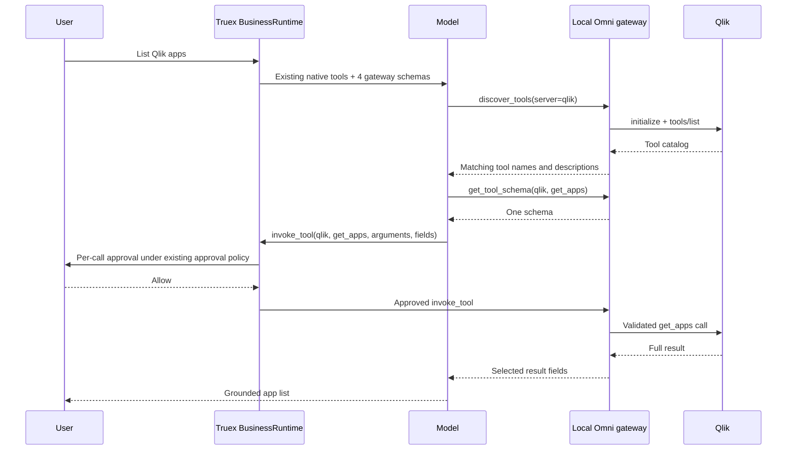

# Truex Omni MCP gateway

Truex can expose four gateway tools in place of each attached connector's complete tool catalog. The platform selects this mode; users do not provide `enabled_tools` lists. The implementation lives entirely outside `vendor/codex` and uses the existing pinned Codex HTTP MCP interface.

The design applies incremental discovery and response projection from [Uber's MCP gateway engineering article](https://www.uber.com/in/en/blog/designing-mcp-gateway/). It does not reproduce Uber's internal infrastructure, service mesh, organization catalog or CLI Code Mode. BusinessRuntime keeps host shell execution disabled.

## Operator switch

Set `TRUEX_MCP_GATEWAY_MODE=omni` on **agent-core**, then restart the service and create a fresh conversation or reload an idle conversation. The default is direct MCP attachment. Setting the variable to `direct` or removing it restores direct attachment on subsequent starts/resumes.

The platform continues constructing the same connector configuration from tenant attachments. BusinessRuntime replaces its `mcp_servers.*` entries immediately before `thread/start` or `thread/resume` with one authenticated loopback `mcp_servers.omni` entry. No end-user agent configuration is required.

For the field-selection experiment, set `TRUEX_MCP_GATEWAY_PROJECTION=required` on agent-core. The model must provide `fields` for every invocation, selecting dotted paths or explicitly choosing `["*"]` when the complete result is needed. This is a platform setting, not an end-user tool list. The default `optional` behavior preserves the initial comparison, where the model could omit projection entirely. Required selection guarantees an explicit choice; it does not guarantee that the model chooses the smallest useful response.

## Execution flow



The model may skip `discover_server` when it already knows the attached logical connector name. Discovery tools are automatically approved. `invoke_tool` remains subject to the configured approval mode. A greeting or general knowledge question requires no connector discovery.

| Tool              | Purpose                           | What enters model context                                     |
| ----------------- | --------------------------------- | ------------------------------------------------------------- |
| `discover_server` | Identify attached logical servers | Matching server names                                         |
| `discover_tools`  | Search a server's catalog         | Names and short descriptions; no argument schemas             |
| `get_tool_schema` | Retrieve one enabled tool schema  | That tool's arguments, optional output schema and annotations |
| `invoke_tool`     | Validate and invoke a tool        | Full result or requested field projection                     |

`invoke_tool.fields` selects dotted JSON paths. For example, `apps.name`, `apps.guid` and `pagination` preserve a listing's names, follow-up identifiers and pagination. Arrays are traversed automatically. The projection occurs after execution and does not change downstream query semantics. Omit `fields` to retain the result; unsupported or absent selected fields return an explicit error instead of silently hiding data. Original result metadata that could duplicate full data is excluded from a projected response. Downstream tool failures retain their error indication.

## Authorization and credentials

The gateway only exposes connectors attached to that conversation. Existing connector-level enabled/disabled tool filters are honored when present; the platform does not ask users to configure them for token optimization. Each gateway instance has a random bearer credential and binds only to loopback. Upstream connector authentication stays inside agent-core and is absent from the config sent to Codex.

The generic dispatcher is explicitly annotated `readOnlyHint: false`: it can wrap both reads and writes. Discovery and projection never turn it into a universally read-only tool. Under the `readOnly` approval mode, invoking this dispatcher still requires an explicit approval. The `auto` mode retains its established meaning. Dispatcher questions offer `Allow` and `Cancel` for one invocation; session/chat grants for the wrapper are prohibited because they could otherwise cover unrelated downstream actions. Existing grants for the original `qlik.get_apps` tool do not become grants for `omni.invoke_tool`.

## Lifecycle and observability

Each start/resume creates a gateway for that attached configuration. Forked conversations share the source gateway; unloading/deleting/archiving a conversation releases its reference. The final reference closes the listener. Failed starts close newly allocated listeners; runtime exit and stop close all gateways. Resume after unloading obtains a fresh endpoint and configuration. Credentials are not persisted in conversation markers by the Omni integration.

`runtime.omniGateways` is a read-only map of active thread-to-gateway attachments. The `omniGatewayEvent` event adds a gateway identifier and attached thread identifiers to gateway telemetry. Discovery call events and invocation events provide observability. Invocation events report downstream tool identity, arguments, projection fields, duration, and before/after response bytes. Events redact registered credential values. They can include business results, so store them with the same access controls as conversation traces.

## What this experiment can and cannot establish

Keep all native application, planning, helper-agent, goal and resource helper tools unchanged for a fair comparison. The attached Qlik catalog changes from 14 schemas to 4 generic schemas; the other 25 definitions remain. This experiment does not optimize the fixed system prompt or compact existing conversation history.

Gateway-side catalog/schema caching saves connector requests. A schema returned by `get_tool_schema` still enters conversation history and costs model input on later calls. Incremental discovery can require extra model requests, each resending the remaining instructions, tools and history. Therefore a smaller initial payload does not guarantee fewer total input tokens.

Compare fresh direct and Omni conversations using the same three messages, sequential completion, model profile and connector readiness. Sum upstream-reported tokens across **all** model calls, including discovery and tool retries. Also compare total duration, correct app listing, pagination coverage, projected response bytes and the final India answer. Preserve raw JSON-RPC, Responses and provider payloads with credential values redacted. Treat provider cache/usage omissions as unknown rather than verified zero. A single live run is a measured example, not a reliable estimate for every connector workload.

## Validation

Run from the repository root:

```sh
PROJECT_ROOT="$PWD" npm --prefix agent-core test
npm --prefix agent-core run build
```

Focused gateway tests validate transport, connector boundaries, credentials, schema validation, projection, cancellation and errors. Runtime tests validate default-direct compatibility, config conversion, lifecycle and cleanup. Tests using the pinned Codex binary verify external HTTP MCP discovery, the unchanged native tool surface, and approved/denied dispatcher execution. No Codex source modifications are required.
