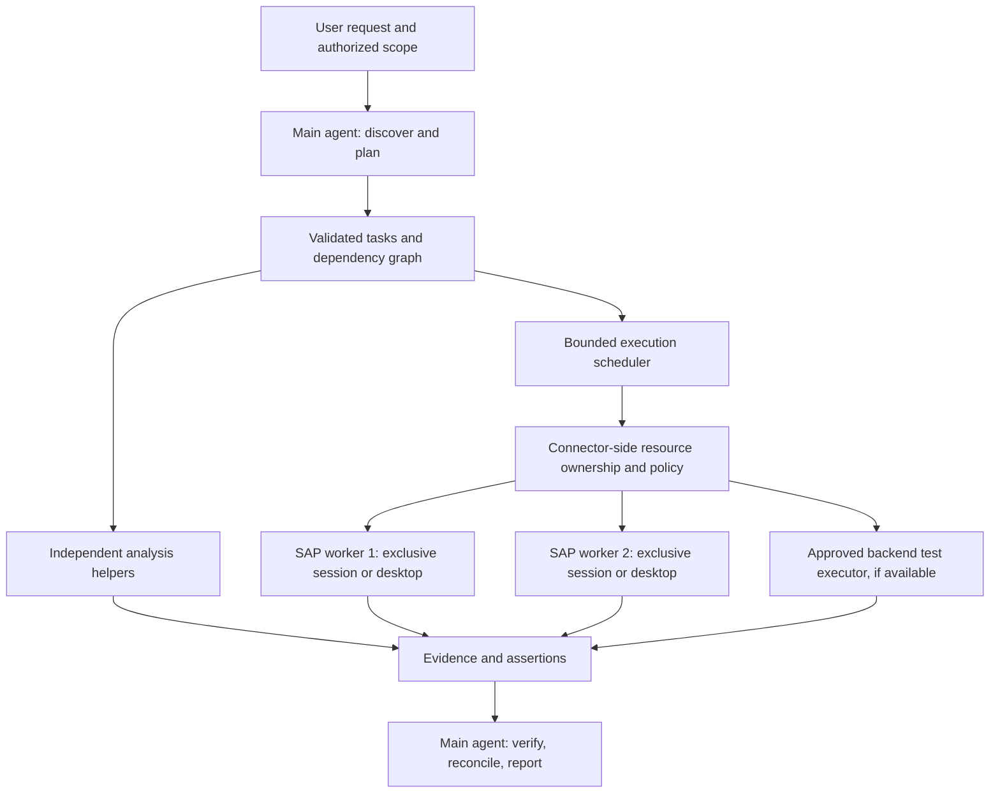

# Parallel task execution and SAP custom-object testing

Status: proposal, 2026-10-07. Documentation only; no runtime change or SAP execution.

## 1. Outcome and ambition

A user asks Truex: “Test the custom object our team developed.” Today the user
may wait roughly 20 minutes while investigation, navigation, test execution,
verification, and reporting happen one after another. That duration is supplied
by the user; its causes have not been measured.

Build toward a system that turns this request into a dependency graph, starts
independent work concurrently, controls scarce SAP resources safely, and returns
evidence as results arrive. The long-term ambition is an SAP testing laboratory:
one request produces a test strategy, execution, adversarial experiments,
minimal reproductions, and an auditable report.

The first release must answer a smaller question: does bounded parallel execution
reduce elapsed time on one real custom object without weakening verification or
creating duplicate business effects?

A faster wrong answer is a failed experiment. More agents are useful only when
they reduce the time to a trustworthy result.

## 2. What exists in this checkout

These findings describe inspected source, including existing uncommitted edits;
they do not establish which version is deployed or prove live SAP capability.

| Existing component                                | Evidence                                                                                                                          | Planning consequence                                                                                                                 |
| ------------------------------------------------- | --------------------------------------------------------------------------------------------------------------------------------- | ------------------------------------------------------------------------------------------------------------------------------------ |
| Helper agents are enabled                         | `agent-core/src/business-runtime.ts` enables V1 multi-agent, disables V2, sets depth 1, and defaults its concurrency setting to 3 | Reuse the engine; first confirm actual simultaneously running helper capacity in the pinned runtime                                  |
| Conversation configuration supports delegation    | `platform/src/service.ts` validates `subAgents.mode` and `maxConcurrent` from 1 to 5                                              | Reuse this configuration; do not silently raise existing limits                                                                      |
| Helpers have lifecycle tracking                   | `agent-core/src/manager.ts` registers children, forwards selected events, rebuilds helper state, and cascades stop                | Extend existing lifecycle behavior rather than building a second agent system                                                        |
| Public helper activity exists                     | `platform/src/public.ts`, `frontend/lib/subagents.ts`, helper components                                                          | Add test progress and resource waits to the established activity view                                                                |
| Timing and token accounting exist                 | `agent-core/src/trace.ts`, `platform/src/traces.ts`                                                                               | Extend traces with dependency and resource-wait information                                                                          |
| Connector access is HTTP based                    | `platform/src/mcp.ts`, `docs/TRUEX_RUNTIME.md`                                                                                    | A Windows SAP GUI executor must live behind an authorized connector; do not add host shell access to the agent                       |
| Helper dynamic tools and questions are restricted | `agent-core/src/manager.ts` declines helper `item/tool/call` and routes questions back to the main agent                          | Main agent owns report publication and clarification; verify native MCP behavior separately before relying on helper connector calls |

`docs/SUBAGENTS_PLAN.md` contains older descriptions of missing helper plumbing.
The current source implements portions of that plan. Treat source and live
experiments as authoritative for this proposal.

Not established: the customer's SAP connector contract, its session selection,
its concurrency support, scripting availability, SAP version, test-system
permissions, credentials, test accounts, and the actual custom object's behavior.
Discovery must resolve these before execution work is designed around them.

## 3. Three different kinds of parallelism

| Layer          | Good candidates                                                                                         | What must stay ordered                                                                      |
| -------------- | ------------------------------------------------------------------------------------------------------- | ------------------------------------------------------------------------------------------- |
| Reasoning      | Read specification, inspect supplied code, derive edge cases, review permissions, design assertions     | Conclusions that depend on facts another task has not produced                              |
| Test execution | Independent cases using isolated fixtures; approved backend checks and GUI checks that do not interfere | Create → read → update → verify for the same business object                                |
| SAP resources  | Independently controlled GUI sessions or desktop workers, with separate data and appropriate identities | Every interaction within one GUI session; every conflicting change to shared business state |

The safe unit of scheduling is a task with declared dependencies and resources,
not an arbitrary tool call. Unknown interference means serialize until measured.

For scripting, SAP documents session-scoped GUI objects and blocking calls while
the server is busy. Independent session contexts make separate-session execution
a candidate, but do not prove the current connector can run concurrently.
[SAP GuiSession documentation](https://help.sap.com/docs/sap_gui_for_windows/b47d018c3b9b45e897faf66a6c0885a8/a4e022f6c155414d9c8ae8eba422cac5.html).

For screenshot/mouse/keyboard automation, treat an entire interactive desktop as
exclusive: two windows on one desktop still share focus and input. Separate SAP
sessions alone do not isolate coordinate-based automation.

## 4. Smallest useful architecture

Start with one main agent, the existing helper cap, and one execution owner.
Analysis helpers return structured findings; they need not control SAP directly.
The execution owner dispatches approved cases through the connector. Add a second
GUI resource only after resource identity and fixture isolation are demonstrated.

Use asynchronous connector jobs when available: submit bounded work, receive a
job identifier, observe progress, and retrieve evidence. If the connector only
offers synchronous steps, discover its limits and measure that path first.
These are proposed behaviors, not claims that such tools currently exist.

Keep the scheduler in the existing backend initially. Reuse MongoDB for durable
task records and atomic claims if suitable. Introduce a separate queue only when
worker lifetime, throughput, or deployment evidence requires it. Never modify
the pinned engine merely to introduce domain-specific scheduling.

## 5. A concrete example

Illustrative object: transaction `Z_ORDER_REVIEW`, a custom order-review screen.
Its assumed specification allows authorized users to filter orders, inspect
details, and save review status. This is a fictional example to replace with the
real transaction, program/class, transport/version, and approved requirements.

### Discover once

1. Identify the object, its dependencies, intended behavior, and version.
2. Confirm the target system/client and allowed read/write scope.
3. Identify callable connector capabilities and automation mode.
4. Capture the starting state and reserve isolated fixtures/accounts.
5. Freeze a reviewed test inventory and expected results before execution.

Writing business data requires explicit authorized scope. This planning request
does not authorize writes, account changes, or SAP execution. A run should capture
scope once and enforce it for every task rather than ask repeatedly per click.

### Work that can overlap

| Workstream      | Examples                                                                              | Execution condition                                                       |
| --------------- | ------------------------------------------------------------------------------------- | ------------------------------------------------------------------------- |
| Analysis        | Check specification/code consistency; propose boundary cases; map authorization rules | Approved supplied material or read-only connector access                  |
| GUI lane A      | Filter valid orders, empty results, display columns, inspect details                  | Exclusive session/desktop; frozen or reserved read fixtures               |
| GUI lane B      | Missing required values, invalid dates, Unicode, oversized values, error recovery     | Independent resource and fixtures; stop if validation unexpectedly writes |
| Backend lane    | Existing ABAP Unit tests; approved API/service assertions; persisted-state checks     | Verified executable interface, compatible release, and no interference    |
| Permission lane | Same scenario under an approved restricted test identity                              | Separate identity/resource; never modify real user roles                  |

Run the save/update scenario only after prerequisites pass. Verify the saved
state through an independently observable business interface, where available.
If another task reads that same object, add a dependency or allocate different
data. Lock-conflict tests intentionally share a resource and run as a controlled
pair after normal cases, never mixed into an unrelated test wave.

ABAP Unit can test business logic below the GUI with isolated dependencies when
the object and SAP release support it. GUI tests remain necessary for navigation,
field wiring, messages, and end-to-end behavior.
[SAP dependency management for ABAP Unit](https://help.sap.com/docs/ABAP_PLATFORM_NEW/ba879a6e2ea04d9bb94c7ccd7cdac446/e18eca61554345429f3a17e30955de8b.html?version=202310.latest).

### One GUI resource is still useful

With only one SAP desktop/session, execute all GUI actions sequentially while
helpers analyze requirements, inspect prior evidence, and prepare the next cases.
Backend work may overlap only when its resource and data access are independent.
Do not advertise parallel GUI execution in this mode.

## 6. Proposed scheduling contract

This is a design vocabulary, not an existing schema or API. Validate connector
capabilities and repository contracts before choosing final field names.

Each task records:

- Tenant, initiating user, run, object version, and authorized environment.
- Goal, expected assertions, dependency IDs, and required capabilities.
- Resource requirements: session, desktop, identity, data keys, and system budget.
- Effect classification: read-only, reversible write, or consequential write.
- Deadline, bounded retry policy, cancellation state, and cost allowance.
- Attempt ID, idempotency key where supported, and evidence references.

Maintain separate execution and business verdicts. Execution states include
pending, ready, running, succeeded, failed, blocked, cancel-requested, cancelled,
and outcome-unknown. Test verdicts include pass, fail, inconclusive, and not-run.
Successful automation does not imply a passed assertion.

Scheduling rules:

1. Validate an acyclic graph and bounded task/input sizes before launch.
2. Start only tasks whose prerequisites succeeded; failed prerequisites block
   dependants without blocking unrelated diagnostic work automatically.
3. Atomically claim all conflicting resources; use canonical ordering or a
   single atomic claim to avoid deadlock and partial resource acquisition.
4. Enforce separate limits for helpers, provider calls, connector jobs, SAP
   systems, GUI sessions/desktops, and tenants. Agent count is not GUI capacity.
5. Use fair scheduling and bounded queues so one large run cannot monopolize SAP.
6. Prefer ready tasks on the measured critical path; batch low-risk observations
   within one case to avoid a model round trip for every deterministic click.
7. Persist intent and task transitions before dispatch. Recover with the original
   attempt identity and reconcile with the executor after uncertain responses.
8. Never retry an uncertain write as a fresh action. Read back by its business
   key or mark outcome-unknown and require reconciliation.
9. Cancel queued work immediately; stop running work at a safe boundary and
   verify quiescence before releasing its resource.

Keep deterministic navigation in a validated executor; use the model to plan,
interpret unexpected state, and diagnose. An unexpected modal or mismatched
screen stops the script rather than triggering speculative clicks.

## 7. Resource ownership: the hard part

A GUI session lease needs a stable connector-issued identity bound to the
system/client/user, executor, and session generation. Do not select “the first
session” or rely on a mutable session index. Verify the binding before dispatch.

Use durable ownership, heartbeats, and fencing tokens at the execution boundary.
Reject commands from stale owners. Token checks cannot undo a command already
executing inside SAP: lease expiry must quarantine the session until the old
executor is stopped and the business outcome is reconciled. Never reassign a
busy desktop just because its heartbeat disappeared.

Test-data ownership is a separate constraint. Give each case reserved business
keys and its own fixture manifest. Separate sessions using the same order,
inventory, configuration, or number range can still interfere. Unknown write
sets require conservative serialization. Separate usernames do not isolate data.

Cleanup uses supported business operations and verified ownership of test data.
Track cleanup independently from the test verdict; do not delete evidence or
declare a clean run while cleanup is pending. A test can commit data despite a
local failure, and transaction rollback is not a universal cleanup strategy.

## 8. The ambitious experiments

These are hypotheses to prototype after the safe execution spine. Each has a
measurable reason to exist and a condition under which it should be abandoned.

| Experiment                     | Unusual idea                                                                                              | Evidence and gate                                                                                                             |
| ------------------------------ | --------------------------------------------------------------------------------------------------------- | ----------------------------------------------------------------------------------------------------------------------------- |
| Uncertainty-first planning     | Ask which next test eliminates the most important unknown, rather than blindly executing a long checklist | Compare confirmed defects and critical coverage per minute against the fixed suite; mandatory cases stay mandatory            |
| Adversarial partners           | One helper proposes how the object should work; another designs the shortest way to falsify that claim    | Keep only additional reproducible failures or valuable coverage; models never vote a result into truth                        |
| Failure shrinking              | After a failure, reduce fields, input rows, and action steps until the smallest reproduction remains      | Replay only isolated safe cases; measure reduction in reproduction steps and debugging time                                   |
| Business invariants            | Check relations such as filter subsets, unchanged totals after sorting, and round-trip persistence        | Derive invariants from approved requirements; discard those invalidated by legitimate business rules                          |
| Two independent observations   | Compare visible GUI results with an authorized backend/business read                                      | Require matching keys, environment, version, and observation time; a mismatch is investigated, not averaged away              |
| Controlled concurrency attacks | Deliberately race two updates or hold a lock to expose duplicate saves and lost updates                   | Dedicated fixtures and bounded load in a test system; require invariant checks before declaring success                       |
| Behavioral maps                | Turn known screens, actions, and assertions into a graph and select unexplored transitions                | Use semantic controls and screen preconditions; replay material is versioned and never treated as blanket write authorization |
| Change-focused testing         | Link transports/object changes to known scenarios and prioritize the affected paths                       | Full-suite comparison must establish miss rates; uncertain impact falls back to broader coverage                              |
| Evidence reuse                 | Reuse safe observations for the same object version, fixture, identity, environment, and freshness window | Invalidate after writes or external changes; never reuse mutable business-state evidence across runs by default               |
| Simulated disturbance          | Inject connector delays, dropped responses, worker restarts, and malformed results                        | Fault injection only in the harness/test environment; live SAP integration is validated separately                            |
| Stop when done                 | End optional exploration when agreed evidence coverage is reached                                         | Required cases cannot be skipped; report optional work as not-run with its reason                                             |
| Adaptive concurrency           | Increase workers only while measured throughput improves and SAP remains healthy                          | Compare concurrency 1/2/3; back off on contention, p95 latency, error rate, or provider throttling                            |

Do not start with twelve specialist agents. Start with a few useful workstreams,
then retain only specializations that beat the baseline on evidence, time, and
cost. Avoid cloning SAP landscapes per case unless existing infrastructure makes
that practical and the isolation benefit justifies provisioning cost.

## 9. Latency: measure the ceiling before promising speed

The elapsed time of a run is its dependency graph's critical path plus queue,
resource, verification, and coordination delays. The sum of overlapping helper
times is not wall-clock duration.

An illustrative 20-minute budget with 4 minutes of unavoidable sequential work
and 16 minutes of evenly divisible independent work would take approximately
`4 + 16/3 = 9.3 minutes` with three execution lanes before overhead. One minute
of extra coordination makes that about 10.3 minutes. These are arithmetic
examples, not a benchmark or a delivery promise.

If 16 of the 20 minutes are a serial GUI sequence, parallelizing the remaining
four minutes yields approximately `16 + 4/3 = 17.3 minutes` before overhead.
That result calls for reducing navigation/model round trips or moving appropriate
checks below the GUI, rather than increasing agent count.

Instrument planning, model time, connector queueing, SAP busy time, GUI actions,
resource/data waits, assertion verification, cleanup, report publication, and
human wait separately. Record run wall time, time to first verified finding,
cost/tokens, evidence completeness, false results, retries, and SAP health.

Use the same case inventory, object version, fixture conditions, and assertion
strength for baseline and candidate. Alternate serial/parallel runs across
representative inputs. Include cold-start costs and failed attempts. Start with
at least ten runs per configuration; expand samples before relying on p95 or
making capacity claims. Report variance and bottlenecks, not just averages.

## 10. Delivery phases and exit criteria

These are dependency milestones, not calendar estimates. Staffing, connector
readiness, and customer SAP access determine the schedule.

| Phase                     | Deliverable                                                                                             | Exit criteria                                                                                                        |
| ------------------------- | ------------------------------------------------------------------------------------------------------- | -------------------------------------------------------------------------------------------------------------------- |
| 0: Trace reality          | Record one representative 20-minute flow; inventory connector/session capabilities and authorized scope | Every substantial wait classified; object/version, test fixtures, and serial baseline captured                       |
| 1: Parallel analysis      | Existing helper engine runs independent analysis; one owner executes GUI cases sequentially             | Live helper/MCP behavior verified; useful findings arrive sooner; no duplicate calls or unauthorized effects         |
| 2: Two isolated GUI lanes | Connector-side ownership, fixture reservations, durable jobs, and two independent resources             | Wrong-session, stale-owner, stop, lost-response, and worker-crash experiments pass; evidence matches serial baseline |
| 3: Hybrid testing         | Run suitable ABAP Unit/backend checks beside GUI cases; structured verdicts and durable evidence        | Release compatibility verified; GUI and persisted-state assertions agree or differences are explicitly diagnosed     |
| 4: Adversarial laboratory | Add failure shrinking, invariants, controlled races, and independent result review                      | Reproducible additional defects or coverage demonstrated without excessive cost/false failures                       |
| 5: Continuous operation   | Change-focused selection, fair multi-run scheduling, capacity controls, resumable runs                  | Miss-rate study, tenant isolation, SAP load limits, retention, and operating recovery drills completed               |

Initial performance target: at least 30% lower median elapsed time for the
representative isolated suite at a concurrency setting of two, with unchanged
required coverage and evidence quality. This is a go/no-go target to test, not
an expected result. If it fails, keep useful analysis overlap and fix the measured
bottleneck before adding workers.

## 11. Repository implementation boundaries

All implementation follows later, through focused changes after Phase 0.

| Area                                                | Reuse / proposed change                                                                                                                          |
| --------------------------------------------------- | ------------------------------------------------------------------------------------------------------------------------------------------------ |
| `agent-core/src/business-runtime.ts`                | Keep helper limits and restricted profile; refine instructions only after proving scheduling behavior                                            |
| `agent-core/src/manager.ts`                         | Reuse helper lifecycle and stop; verify how executor jobs relate to parent cancellation and resume                                               |
| `agent-core/src/trace.ts`, `platform/src/traces.ts` | Add resource/dependency waits and wall-time attribution without double-counting overlaps                                                         |
| `platform/src/service.ts`, `platform/src/store.ts`  | Own validated run requests, durable task state, authorized resource claims, and recovery; extract a focused module only when size warrants it    |
| `platform/src/mcp.ts`                               | Verify connector transport/auth/capability behavior; maintain the current host-access boundary                                                   |
| `shared/contracts.ts`, `platform/src/public.ts`     | Add bounded, redacted test summaries and evidence references; keep old clients working through additive contracts                                |
| Existing helper/activity frontend                   | Show completed cases, active work, waits, verified findings, and stop; details on demand                                                         |
| External SAP connector/executor                     | Enforce actual GUI ownership, identity, cancellation, fencing, job deduplication, and artifact capture; its repository/location is not yet known |

Persisted additions use expand → deploy → verify. Old conversations remain usable;
new run fields are optional for older clients. Rollback disables new scheduling
for new work, drains/quarantines active resources, and retains run/evidence
records. Reverting application code cannot undo a committed SAP write.

## 12. Acceptance and break-mode matrix

| Risk / scenario                             | Required outcome                                                                                                      |
| ------------------------------------------- | --------------------------------------------------------------------------------------------------------------------- |
| Independent analysis tasks                  | Demonstrable temporal overlap and correctly integrated results                                                        |
| Dependent update/read                       | Read cannot start until the relevant state transition is verified                                                     |
| Same GUI session or desktop requested twice | Only one execution owner; the other task waits                                                                        |
| Different sessions, same business key       | Conflicting cases serialize or use distinct fixtures                                                                  |
| User changes active SAP window              | Executor still targets its bound resource or stops safely                                                             |
| Worker heartbeat expires mid-save           | Session quarantined; no reallocation or fresh retry before outcome reconciliation                                     |
| SAP commits, connector response disappears  | Run records outcome-unknown, reconciles by business identity, and avoids duplicate effects                            |
| Stop during long SAP request                | Queued work stops; active work reports cancelling until quiescence is established; resource is not reused early       |
| Connector/provider unavailable              | Bounded timeout; safe retry only; completed evidence retained; affected tasks reported blocked/inconclusive           |
| Backend/GUI observations disagree           | No pass verdict until reconciled; evidence times and keys preserved                                                   |
| Forbidden environment or role               | Enforcement rejects before dispatch, regardless of agent instructions                                                 |
| Tenant/user resource ID forged              | Server and executor reject the ownership mismatch; no evidence leakage                                                |
| Malicious screen text/tool response         | Treated as untrusted data; cannot alter policy, credentials, target, or authorized scope                              |
| Empty/malformed/huge graph                  | Boundary validation rejects invalid dependencies, cycles, unsupported actions, and excessive size                     |
| Huge ALV output or many artifacts           | Bounded extraction and pagination; truncation explicit; incomplete observations cannot satisfy full-result assertions |
| Unicode, locale, date/time boundary         | Assertions use agreed locale/time semantics and retain original inputs                                                |
| 10× concurrent requests                     | Bounded queues, fair scheduling, explicit overload response, and measured SAP resource limits                         |
| Restart/out-of-order events                 | Durable attempts recover once; stale events cannot overwrite newer task state                                         |
| Cleanup failure                             | Cleanup status remains visible; data/resource quarantined when needed; pass does not imply cleanup succeeded          |
| Report storage fails after SAP action       | Business outcome preserved; report publication retried without rerunning the action                                   |

Unit tests cover graph validation, resource conflict classification, transitions,
retry rules, and verdict aggregation. Integration tests cover durable claims,
restart recovery, stale owners, connector contract errors, and cancellation.
Live SAP acceptance covers session identity, actual locks, commit visibility,
permission behavior, busy/modal handling, and cleanup. Mock tests do not establish
live GUI capability, SAP capacity, or production safety.

Run repository-required formatting, type/build checks, and relevant existing
tests for implementation changes. Add regressions that fail before each behavior
fix where practical. Review security, scale, and final diffs before release.

## 13. Security, evidence, and user experience

Enforce environment, transaction/action, identity, data, tenant, and write scope
at the connector boundary. GUI scripting follows the logged-in user's authority;
scripts are not a separate permission sandbox. Verify both client/server
scripting settings and applicable authorizations with the SAP administrators.
[SAP GUI Scripting Security Guide](https://help.sap.com/doc/97d2d0bc2ed248a4a85a0bec608704f8/800.01/en-US/sap_gui_scripting_sec_guide.pdf).

Use dedicated least-privilege test identities, secret storage, authenticated
encrypted connector access, restricted network reachability, audited actions,
and approved test systems. Production writes are out of scope for the first
release. Confirm platform authentication/tenant mode; a shared POC identity is
not an acceptable isolation boundary for multiple customers.

Evidence includes case/attempt, target version, fixture references, assertions,
timestamps, redacted screen observations, connector outcomes, independently
verified business state where available, and artifact integrity metadata. Apply
access checks and retention to raw artifacts as well as their chat summaries.
Credentials and unnecessary customer fields never belong in screenshots/logs.

The user sees one run: “8 of 12 cases verified; 2 running; 2 waiting for a test
session.” Show confirmed findings early, the reason for waits, and separate
functional failures from infrastructure failures. Support one stop action,
resumption of eligible incomplete work, and a final evidence report. Provide an
ETA only after calibration, with uncertainty; avoid exposing scheduler setup to
ordinary users.

## 14. First experiment to commission

Pick one representative object in a test system, ten to twelve meaningful cases,
and two isolated GUI resources if available. Measure serial execution, analysis
overlap with one GUI resource, and isolated execution with two resources.
Keep cases and assertions identical across variants. Inject one dropped response
and one executor interruption in the controlled test harness, then validate the
corresponding recovery behavior against the test system without causing unsafe
effects.

Deliver a before/after timing graph, complete case verdicts, evidence bundles,
cost comparison, SAP resource observations, and explicit blockers. Use that
experiment to choose whether the next investment is more concurrency, fewer
GUI/model round trips, backend testing, or connector reliability.

Outstanding decisions: actual object/specification, deployed platform version,
connector implementation and permissions, available sessions/desktops, fixture
provisioning, write/cleanup scope, SAP load limits, budget, and evidence retention.
These block live execution design details, not preparation of this plan.
