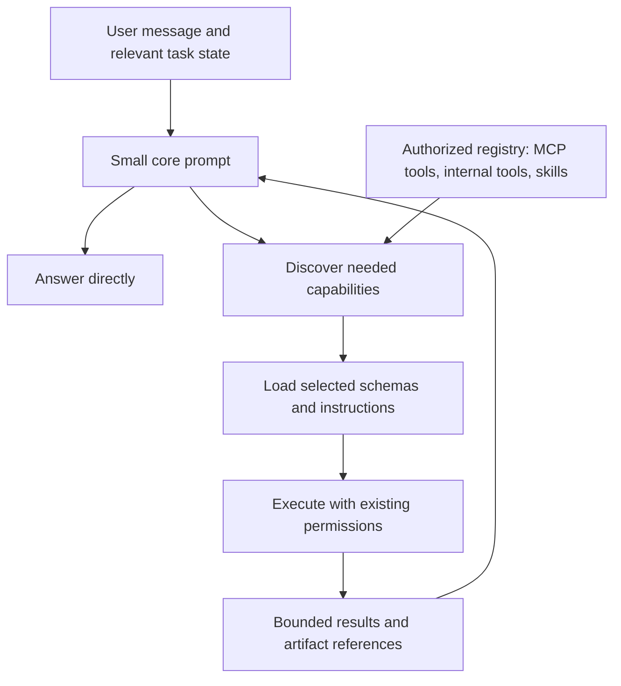

# Progressive context loading for general-purpose agents

Status: proposal for implementation. This document records the architecture discussed on 2026-10-02; it does not claim that the proposed discovery, registry, or lightweight execution lane is implemented.

## Problem and intended behavior

An agent can have access to 20 MCP servers, 100 or more tools, configured skills, a system prompt, an agent description, and internal read, write, blob, and search tools. Eagerly including every schema and procedure makes even a small question expensive.

For a fresh question such as “What is the capital of India?”, the intended behavior is to answer “New Delhi” using a small core prompt, without discovering tools, loading skills, or contacting connectors. Questions requiring current information, private data, documents, or actions should progressively load the necessary capabilities.

Connecting a capability grants access to it. Its complete schema and instructions should enter model context when the task needs them.

Codex remains responsible for its conversation history and compaction. Truex controls the fixed prompt, capability exposure, evidence admitted to the thread, and execution boundaries around that history. Compaction alone cannot eliminate an oversized base prompt that is supplied again on every model request.

## Design principles

- Start with essential instructions and a small discovery surface.
- Treat capability selection as revisable throughout a task.
- Load tool schemas and skill bodies only when needed.
- Preserve relevant task state for implicit follow-ups and continuing work.
- Keep large documents and result sets outside conversation history, with selective retrieval.
- Enforce permissions and action approvals independently of model routing.
- Account for the cost and latency of the complete workflow.
- Preserve provider compatibility and validate capabilities against the pinned runtime.

## Architecture

### 1. Small core prompt

Always retain essential identity and role rules, tenant and owner isolation, authorization requirements, untrusted-data handling, evidence requirements, uncertainty handling, and a brief explanation of capability discovery.

Separate optional procedures explicitly: document generation, visualization instructions, workspace workflows, and skill bodies become capability modules. Agent descriptions should contribute a concise role statement when they affect behavior; display metadata need not be repeated as lengthy model instructions.

System-prompt separation requires explicit authoring or review. Arbitrary paragraphs must not be discarded by a relevance classifier: a paragraph that appears unrelated to a question can contain a mandatory constraint. Some configured agents may legitimately require extensive instructions on every turn.

### 2. Authorized capability registry

Maintain full definitions outside model context for MCP tools, internal tools, and skills. Registry records should include:

- Canonical identifier, short description, category, and search aliases.
- Original parameter schema or skill body, plus a version or digest.
- Server or execution binding and prerequisites.
- Effect classification and applicable approval rules.
- Tenant, owner, agent, and task entitlement boundaries.
- Availability and connector configuration revision.

Credentials stay in existing protected connector/provider configuration. Capability handles must not contain credentials or permit arbitrary destination URLs.

Discovery searches only the caller's authorized inventory. Support exact-name lookup and lexical matching, with semantic matching where it improves recall. Return a bounded set of candidates with canonical identities and enough operational detail to use them correctly.

### 3. Progressive discovery and execution

Use native deferred tool loading when the model, provider, pinned Codex runtime, and adapter support it. Verify this combination rather than assuming a Responses-compatible endpoint implements every Responses feature.

For providers without native discovery support, a stable ordinary-function broker is a proposed fallback:

| Interface                              | Purpose                                                                                   |
| -------------------------------------- | ----------------------------------------------------------------------------------------- |
| `discover_capabilities(query, limit)`  | Find authorized tools or skills and return bounded metadata and selected schemas.         |
| `invoke_capability(handle, arguments)` | Execute a selected capability after checking its original schema and current permissions. |
| `read_skill(handle)`                   | Load the applicable versioned procedure.                                                  |
| `read_artifact(handle, selection)`     | Retrieve specific result content, pages, rows, or passages.                               |

Route the underlying capabilities through this surface so their full schemas are no longer eagerly exposed. Exposing a discovery interface alongside the same eager catalog leaves its original token overhead in place.

Invocation must preserve the underlying server/tool identity, effect classification, approval policy, argument validation, and audit record. Approval must apply to the actual operation, not a generic wrapper name. Recheck entitlements at execution time, including after discovery or an earlier approval.

The broker is a compatibility tradeoff: schemas returned as text do not provide the same model-side constrained argument generation as native typed tools. Validate arguments server-side, return concise correction information, and compare execution correctness against native loading and stable selected tool bundles.

Keep commonly needed capabilities available for an ongoing task. Discover dependencies as they arise. Bound discovery and retry loops; if search misses a capability, broaden the query or request clarification without escaping the authorized inventory.

### 4. Lazy skills and operational instructions

Present a brief overview of available capability families or an explicit discovery instruction. Load the relevant skill body when its procedure is needed, and record its canonical ID, version, and task scope.

Reuse a loaded procedure within the task instead of repeatedly fetching it. Once text enters a Codex thread, it remains in retained history until native compaction changes that history. Lazy loading reduces initial and irrelevant exposure; it does not automatically unload prior skill content.

Required role or authorization rules stay in the core even when their related operational procedure is deferred.

### 5. Bounded evidence and artifact retrieval

Tool results should return relevant fields or excerpts, a result count, provenance, completeness/truncation information, and a stable retrieval handle. Store the complete result outside model history when it is large.

Provide passage search, pagination, field projection, and row selection. Extract immutable uploaded documents once where practical; cache extraction by file identity and extractor version. Report extraction coverage and unsupported content explicitly.

Preserve exact identifiers, amounts, quotations, and other task-critical values. Summary-only results can be insufficient for audits, exhaustive comparisons, or calculations. Such tasks need a path to complete data and deterministic processing without placing every raw record in model context.

Artifact access remains permission-scoped. Define retention and expired-handle behavior, and distinguish missing, inaccessible, stale, and incomplete evidence.

### 6. Durable task state

Persist a small checkpoint containing the objective, relevant entities, constraints, verified decisions, selected capability versions, artifact references, completed actions, pending actions, and unresolved questions.

Record provenance and timestamps or versions for changing external facts. Retrieve only relevant state and refresh mutable data before actions when required. Separate user instructions, verified evidence, and model-generated hypotheses.

A checkpoint supports resume and relevant retrieval; it is not a replacement for the authoritative transcript or Codex's native compaction state.

### 7. Optional lightweight execution lane

A fresh thread with a small core can answer independent questions cheaply. A large existing Codex thread still carries retained messages, tool results, and loaded instructions even after its available tools are reduced.

For an independent question in a large conversation, a genuinely separate bounded execution context is an optional later feature. It must include essential role rules and the conversational state needed for the question. Record its result and source references in the visible conversation and durable task state, and define how the owning Codex workflow receives that result.

Implicit follow-ups such as “What about India?”, “Export it”, or “Do the same for October” should remain with their owning workflow when they depend on prior work. A full-history fork retains the earlier context overhead. Do not silently use a separate lane when essential dependencies are uncertain.

## Expected behavior across use cases

| Situation                              | Expected behavior                                                                                                   |
| -------------------------------------- | ------------------------------------------------------------------------------------------------------------------- |
| Stable factual question                | Answer directly from the small core unless the user requires verification or another source.                        |
| Current information or explicit search | Discover the appropriate research capability and ground the answer in its results.                                  |
| Private connected data                 | Discover an authorized connector; do not substitute public knowledge for the private answer.                        |
| Agent-specific response requirements   | Preserve the relevant role rules, even for a simple question.                                                       |
| Exact tool name                        | Prefer canonical exact lookup and validate availability.                                                            |
| Ambiguous request                      | Broaden discovery or ask a targeted clarification when the choice affects the outcome.                              |
| Mixed-domain request                   | Load the necessary capability families and track dependencies between their outputs.                                |
| Implicit follow-up                     | Resolve prior entities, filters, artifacts, and pending actions before selecting tools.                             |
| Uploaded document                      | Search passages before reading selected content; report extraction limits.                                          |
| Multi-tool workflow                    | Retain needed capabilities and discover additional dependencies as they arise.                                      |
| Large or exhaustive result             | Use external artifacts and selective retrieval; preserve a route to complete processing.                            |
| Missing or failed capability           | Distinguish unauthorized, absent, unavailable, execution failure, and insufficient results.                         |
| Write operation                        | Validate current authorization and approval for the selected operation; prevent unsafe automatic retries.           |
| Steering during active work            | Incorporate the new instruction without losing established evidence or completed action state.                      |
| Subagent work                          | Provide bounded assignments and necessary evidence; return concise findings and references.                         |
| Compaction, restart, or resume         | Restore checkpoints and references, respecting native history and current permissions.                              |
| Connector or skill changes             | Invalidate affected metadata, recheck permissions, and apply instruction changes at a supported lifecycle boundary. |

## Runtime and provider constraints

The current application installs in-house dynamic tools at thread creation and passes user input through the turn-start adapter. Its MCP configuration reload path applies changes at supported lifecycle boundaries. Arbitrary per-turn tool replacement is not an established interface in this design.

Native discovery and broker execution must be separate compatibility paths. Current gateway translation does not establish support for native `tool_search`; ordinary function execution is the candidate fallback. Defer a tool only when a working discovery/execution path exists.

Inventory registration, connector startup, and model-visible schemas are separate costs. Deferring schemas does not prove that 20 MCP servers avoid initialization work. Explore cached versioned metadata and lazy connector initialization separately, with invalidation for configuration, availability, and entitlement changes.

Permissions revoked during a task must take effect at execution time. Instruction and capability version changes also need explicit invalidation: an MCP-only fingerprint cannot reliably identify every skill or prompt change.

## Routing, caching, and cost

Start by letting the primary model choose whether to answer or discover using the small core. A mandatory classifier before every question adds another call, latency, cost, and a possible routing error. Compare rule-assisted routing or a smaller model classifier only after the baseline exposes where they could help.

Keep core instructions and the discovery surface stable. Use deterministic ordering and stable selected bundles where supported. Dynamic tool changes can disturb cached prefixes; native discovery can append definitions later in context on supported paths.

Caching reduces repeated processing and applicable input charges. It does not remove cached content from the logical context window. Disabling tool calls does not itself remove tool schemas from a request. Schema bytes and character counts are diagnostic proxies, not exact provider token counts.

Evaluate complete task cost: routing, discovery, skill loading, model iterations, retries, helpers, compaction, and generation. No percentage savings or latency improvement is established by this proposal.

## Implementation sequence

1. Inventory current prompt components and schema volume. Explicitly split mandatory instructions from optional procedures.
2. Build a versioned authorized registry covering MCP tools, internal tools, and skills.
3. Introduce native progressive loading on verified paths and the stable broker on compatible fallback paths. Preserve existing operation-level controls.
4. Add bounded results, extraction caching, artifact access, and durable task checkpoints.
5. Validate simple questions, continuing workflows, discovery misses, provider differences, and lifecycle recovery.
6. Evaluate the lightweight execution lane and optional routing classifier only when end-to-end measurements justify them.

Initial integration seams include [BusinessRuntime](../agent-core/src/business-runtime.ts), [skill instruction assembly](../agent-core/src/tenancy.ts), [thread lifecycle coordination](../agent-core/src/manager.ts), and [platform configuration](../platform/src/service.ts). Runtime changes need their own implementation review and tests; this documentation branch does not change those components.

## Evaluation and acceptance

Compare the existing eager baseline, progressive loading, and stable small task bundles. Test both cold and warm cache conditions, fresh and large existing threads, direct and gateway providers, and resume before and after compaction.

Measure:

- Instruction, skill, schema, history, and tool-result volume by component.
- Actual provider input/output usage, cache read/write reporting, and reporting coverage.
- Total billed task cost where billing evidence is available.
- First-answer and complete-task latency, including discovery and connector startup.
- Discovery recall, unnecessary discovery, and correct tool selection.
- Answer correctness, tool-chain completion, and implicit follow-up resolution.
- Permission/approval behavior, version invalidation, retries, and recovery failures.
- Main-agent and helper usage separately and in aggregate.

A stable factual question in a fresh lightweight context should complete without capability discovery or skill-body loading. Private-data requests must find and use their authorized sources. Follow-ups and complex tasks must preserve the information and capabilities they need. Discovery failures must have a bounded recovery path. Resume must not duplicate completed external actions.

Accept the design using task correctness and complete cost/latency measurements, with regressions explicitly assessed. Small prompts alone are not sufficient evidence of a better agent.

## References

- [OpenAI tool-search documentation](https://developers.openai.com/api/docs/guides/tools-tool-search): deferred definitions and native discovery behavior.
- [OpenAI prompt-caching documentation](https://developers.openai.com/api/docs/guides/prompt-caching): prefix stability, cache reuse, and model-specific behavior.
- [Codex app-server documentation](https://learn.chatgpt.com/docs/app-server): thread lifecycle, dynamic tools, compaction, and usage events.

Official documentation describes supported product behavior; implementation must also verify the repository's pinned runtime and actual provider adapters.
