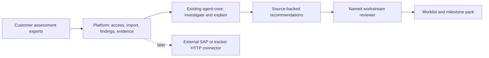

# SAP opportunities for Truex

Research date: 6 October 2026. This is a product discovery recommendation, not a production-readiness audit or a revenue forecast.

## Recommendation

Start with a **migration blocker evidence and reconciliation workbench** for companies planning an ECC-to-S/4HANA migration. The user confirmed that these are the easiest customers to reach for a first paid pilot. That access changes the recommendation: integration incident investigation is attractive for an AMS/support sales channel, but migration evidence reconciliation is the better first product for this channel.

The initial pain statement is:

> We have Readiness Check, ATC, business-partner conversion, interface and testing findings in different reports and spreadsheets. We cannot quickly establish which unresolved issues threaten our next milestone, who owns them, and what evidence proves they are fixed.

Sell a shorter path from a finding to an accountable, verified resolution. Reuse SAP assessments and the customer's issue tracker. A new assessment engine or autonomous migration would expand scope substantially without establishing a paying customer.

The first offer should cover one migration workstream, preferably CVI/business-partner conversion or one custom-code package, exported inputs, a bounded findings backlog, named owners and a weekly evidence pack. Compare two assessment snapshots with remediation tickets and test evidence where available. Live SAP reads can follow once their value and permissions are established.

## What the repository already provides

The inspected working tree has useful infrastructure. Some documentation predates newer source changes, so the README opening is not an accurate inventory by itself.

| Existing capability                                                                     | Repository evidence                                                                          | How to reuse it                                                                                                                                                  |
| --------------------------------------------------------------------------------------- | -------------------------------------------------------------------------------------------- | ---------------------------------------------------------------------------------------------------------------------------------------------------------------- |
| Agent orchestration, persistent conversations, streaming and helper-agent collaboration | `platform/src/service.ts`, `agent-core/src/manager.ts`, `agent-core/src/business-runtime.ts` | Investigate findings and produce explanations using the existing runtime.                                                                                        |
| Document uploads, reading and artifact generation                                       | `agent-core/src/file-tools.ts`, `docs/ASSISTANT_CAPABILITIES.md`                             | Start with exported reports and workbooks; produce remediation and steering-committee packs.                                                                     |
| User/tenant context, tenant membership and database routing                             | `platform/src/auth.ts`, `platform/src/tenant.ts`, `platform/src/store.ts`                    | Reuse tenant ownership rather than creating a separate customer datastore.                                                                                       |
| Personal Gmail authentication and invitations                                           | `platform/src/google.ts`                                                                     | Authentication exists, but the callback explicitly rejects corporate Workspace accounts and hosted-domain claims. Extend the identity path for enterprise users. |
| User/tenant scoped HTTP MCP connector management                                        | `platform/src/mcp.ts`, `platform/src/service.ts`                                             | Attach a customer-approved tracker or SAP connector using the existing boundary.                                                                                 |
| MCP credential encryption                                                               | `platform/src/secrets.ts`, `platform/src/mcp.ts`                                             | Use existing encrypted storage; migrate legacy plaintext profiles where applicable.                                                                              |
| Feature-gated tool approval modes and conversation activity records                     | `platform/src/features.ts`, `agent-core/src/approval-modes.ts`                               | Useful interaction primitives; financial or migration execution still needs operation-specific controls.                                                         |

Important limits: the documented POC uses a shared identity, no implemented SAP domain connector was found in the inspected application source, and chat persistence is not a durable SAP transaction ledger. The running deployment and real SAP connectivity were not inspected. Local filesystem read-only settings do not enforce read-only access to remote SAP systems.

## Market evidence and timing

SAP Business Suite 7 mainstream maintenance ends in December 2027, with optional extended maintenance through 2030. The 2031–2033 private-edition transition option is conditional. These dates create planning pressure; they do not mean ECC stops operating in 2027 or that every customer must finish then. [SAP maintenance strategy](https://support.sap.com/en/release-upgrade-maintenance/maintenance-information/maintenance-strategy/s4hana-business-suite7.html), [transition-option update](https://news.sap.com/2025/08/rise-with-sap-journey-sap-erp-private-edition-transition-option-updates/).

DSAG's February 2026 investment survey reports planned medium/high S/4HANA investment of 42% for on-premises, 22% for private cloud and 6% for public cloud. These measure investment intensity among respondents, not worldwide installation shares. Its emphasis on feasibility, cost-effectiveness and integration supports a practical, measurable migration offer. [DSAG Investment Report 2026](https://impulsant.dsag.de/formate/pressemeldung/dsag-investment-report-2026-companies-are-investing-more-selectively-ai-is-becoming-established-cloud-computing-is-being-put-to-the-test/).

Precisely/ASUG research published in November 2025 for its 2026 report surveyed 173 SAP stakeholders. It reports 59% fully or partially live on S/4HANA, with business-process change and customization among migration hurdles. This is directional evidence from a vendor-sponsored sample, not an estimate of Truex's addressable customers or willingness to pay. [Research summary](https://www.precisely.com/blog/cat-sap-automation/2026-trends-in-sap-automation-modernization-and-btp-adoption/).

Competition must be assessed against current SAP products. Readiness Check already produces migration findings; SAP offers custom-code migration assistance and PI/PO migration tooling. Truex's opportunity is customer-specific remediation coordination and verification across these outputs and the delivery team's systems. [Readiness Check feature overview](https://help.sap.com/doc/bb0e7ba5158c424ab7ce010228bf1de1/latest/en-US/2025-10_Key_Feature_Overview.pdf), [custom-code migration assistant](https://help.sap.com/docs/abap-cloud/abap-development-tools-user-guide/using-custom-code-migration-ai-assistant), [PI/PO migration tooling](https://www.sap.com/products/technology-platform/integration-suite/migration.html).

SAP already provides a Readiness Check Excel extract for Cloud ALM that creates user stories and subtasks. Basic findings-to-tasks conversion is therefore a weak differentiator. The proposed paid value is detecting contradictory or stale evidence across reruns, tickets and validation artifacts, then preparing an accountable milestone decision pack. [SAP-authored Readiness Check upload walkthrough](https://community.sap.com/t5/technology-blog-posts-by-sap/readiness-check-upload-in-sap-cloud-alm/ba-p/13499025).

## Ranked opportunities

Scores are explicit judgments for this repository and the user's migration-customer channel. They are not survey results. Each dimension is 1–5, with 5 best. Higher differentiation means less direct competitive overlap.

Score = 25% urgency + 25% customer economic value + 20% fit/speed to a credible pilot + 15% reachable buyer + 15% differentiation, normalized to 100. Economic value is not vendor revenue. Buyer access and verified customer data should override small score differences.

| Rank | Pain statement and first feature                                                                                                                                                            | Urgency | Value | Fit | Buyer | Differentiation | Score | Revenue mechanism                                                  |
| ---- | ------------------------------------------------------------------------------------------------------------------------------------------------------------------------------------------- | ------: | ----: | --: | ----: | --------------: | ----: | ------------------------------------------------------------------ |
| 1    | **Tickets say migration blockers are fixed, but assessment reruns and tests do not prove it.** Reconcile snapshots, tickets and proof; identify contradictions and produce milestone packs. |       5 |     4 |   5 |     5 |               3 |    89 | Paid diagnostic/pilot, then active-program subscription.           |
| 2    | **Changed interfaces may silently break business processes after migration.** Build representative regression cases, compare outputs and collect owner sign-offs.                           |       5 |     5 |   3 |     4 |               3 |    83 | Paid interface-family pilot, then project/test-cycle subscription. |
| 3    | **Customer/vendor data defects delay business-partner conversion.** Explain exported CVI findings, group defects, assign data owners and track corrected evidence.                          |       5 |     4 |   4 |     4 |               3 |    82 | Paid cleanup workstream, then program subscription.                |
| 4    | **Failed integrations require lengthy investigation to identify the affected business flow and owner.** Produce evidence-backed incident triage and handoff.                                |       5 |     4 |   5 |     2 |               3 |    80 | Recurring landscape/AMS subscription, useful after go-live.        |
| 5    | **Cutover rehearsal steps have unclear dependencies and incomplete proof.** Track rehearsal exceptions and evidence against customer-approved criteria.                                     |       5 |     5 |   2 |     4 |               3 |    79 | Fixed-scope rehearsal package and project subscription.            |
| 6    | **Order blocks delay shipping or invoicing while evidence is scattered.** Investigate one delivery/billing-block category and route it to the owner.                                        |       5 |     5 |   3 |     1 |               3 |    74 | Recurring workflow subscription after migration.                   |
| 7    | **Supplier confirmations hide changes to price, quantity or dates.** Compare a confirmation document with a PO export and flag discrepancies.                                               |       4 |     4 |   5 |     1 |               3 |    72 | Recurring document/workflow subscription.                          |
| 8    | **Blocked invoices require repeated chasing across purchasing and receiving.** Assemble PO/GR/invoice evidence and draft a resolution request.                                              |       4 |     5 |   3 |     1 |               2 |    66 | Recurring exception-volume subscription.                           |

Ranks 1–3 can share a findings/evidence model and grow within the same customer. Rank 4 offers a possible post-migration continuation, but it needs a new operations sponsor and demonstrated operational value. Rank 5 has high consequences and requires experienced migration leadership. Ranks 6–8 have financial value but a weaker immediate sales route given the user's answer.

The problem evidence for interface/CVI migration findings is included in SAP's Readiness Check overview. Verification still requires customer-specific test cases and defect records. [SAP assessment coverage](https://help.sap.com/doc/bb0e7ba5158c424ab7ce010228bf1de1/latest/en-US/2025-10_Key_Feature_Overview.pdf).

For rank 4, SAP Cloud ALM already monitors integration messages and exceptions, while Integration Suite's MCP Gateway became generally available in July 2026. A generic monitoring dashboard or SAP-to-MCP wrapper has substantial native overlap. [Cloud ALM monitoring](https://help.sap.com/docs/cloud-alm/applicationhelp/integration-exception-monitoring), [MCP Gateway release notes](https://help.sap.com/docs/sap-api-management/sap-api-management/what-s-new-for-sap-api-management).

For rank 6, SAP exposes order blocks and incompletion information in its sales-order tooling. The proposed opportunity is investigation across teams and connected systems. [Manage Sales Orders](https://help.sap.com/docs/SAP_S4HANA_CLOUD/a376cd9ea00d476b96f18dea1247e6a5/e7f14402cf5846b4b3d0d677c15414b1.html?locale=en-US).

For rank 7, SAP's June 2026 Lemvigh-Müller case describes an agent workflow handling supplier confirmations and detecting changes. It demonstrates a concrete use case and existing partner competition, rather than an uncontested category. [Customer story](https://news.sap.com/2026/06/lemvigh-muller-ai-agents-order-confirmations/).

For rank 8, SAP documents payment blocks and investigation across purchasing, receiving and suppliers. SAP's AP Assistant already covers several finance exception workflows. Narrow logistics invoice exceptions requiring external evidence are more plausible than a generic finance assistant. [Invoice blocking](https://help.sap.com/docs/SAP_S4HANA_ON-PREMISE/af9ef57f504840d2b81be8667206d485/7870b6531de6b64ce10000000a174cb4.html), [AP Assistant](https://www.sap.com/india/use-cases/joule-assistant/accounts-payable-ai).

## The first sellable product

Buyer: the S/4HANA program director or migration delivery lead. Daily user: a workstream lead or PMO analyst. An implementation partner can provide distribution, but confirm which party owns the budget and customer data.

First customer: an active migration program with a near-term milestone, repeated manual findings consolidation, an accountable sponsor and permission to use its exported reports. A company merely considering migration may lack both urgency and an active backlog.

Offer:

> In four weeks, give one migration workstream a traceable backlog of its assessment findings, accountable owners, missing resolution evidence and a weekly milestone-risk pack. Measure the time saved preparing and verifying it.

Use a customer-approved milestone-risk rubric. Prioritize findings using documented blocker status, affected scope, due date, dependency and missing evidence. Keep source facts separate from suggested severity or remediation. An agent must not invent SAP Notes, compatibility conclusions or readiness certification.

Proposed first-version functions:

1. Import agreed CSV/XLSX exports and relevant PDF/DOCX reports. Preserve source identifiers, locations, upload time and assessment/version context. Confirm actual customer formats before implementing parsers; there is no assumption that SAP has one universal export schema. SAP's Cloud ALM ATC import documentation describes ZIP results in Readiness Check format, so direct ATC ingestion may need an additional bounded parser after sample inspection. [SAP ATC import documentation](https://help.sap.com/docs/cloud-alm/applicationhelp/extensibility?locale=de-DE).
2. Normalize findings into workstream, source ID, description, affected object/process, severity, owner, milestone, due date and status. Explicitly distinguish unknown values from empty or resolved values.
3. Suggest duplicate groups and remediation categories. Require review when records from different systems, clients, runs or severities appear similar.
   Reconcile repeated assessment snapshots with tracker states. Highlight closed tickets whose findings persist and findings that disappear after changes in scope, check variant or exemptions. Neither case alone determines readiness.
4. Show the exact evidence supporting each finding and its proposed next action. Label uncertainty and stale source material.
5. Track `new → triaged → assigned → remediation proposed → awaiting validation → verified closed`. A named authorized reviewer closes a finding against agreed proof. The model does not close one because it generated a plausible fix.
6. Export an owner worklist and weekly evidence pack. Reuse the customer's issue tracker as the system of record where practical. Initial tracker changes can be manual imports/exports; avoid two silently divergent backlogs.

Keep SAP production writes, autonomous ABAP changes, mass data repair and cutover execution out of the first offer. Assessment exports enable early value without those capabilities.

The product must beat a well-run spreadsheet/Jira workflow on evidence retrieval, reconciliation and reporting effort. If customer interviews show that their SI already does this cheaply and accurately, narrow to a specific painful workstream or stop building this wedge.

## What to add to the server

Use the existing boundaries:

Proposed implementation placement, not existing APIs:

| Area                           | Smallest useful addition                                                                                                                                                      |
| ------------------------------ | ----------------------------------------------------------------------------------------------------------------------------------------------------------------------------- |
| `platform/src/`                | Tenant/project-scoped findings and evidence records, import validation, reviewed status transitions and export endpoints. Reuse existing ownership checks and tenant routing. |
| `shared/`                      | Finding/evidence/status contracts with explicit unknown and stale states.                                                                                                     |
| `agent-core/`                  | Reuse document reading and tools; expose bounded operations to retrieve findings/evidence and draft explanations. Keep business state transitions in the platform.            |
| `frontend/`                    | One findings worklist showing source, owner, milestone, next action and missing proof, with an evidence detail view.                                                          |
| Existing agent configuration   | Migration instructions and retrieval sources tied to the customer's approved remediation material.                                                                            |
| External HTTP connector, later | SAP read permissions, OAuth refresh, bounded queries and customer-specific source mappings. Reuse compatible SAP gateway capabilities where available.                        |

A document-only diagnostic can precede this stateful implementation. Use it to verify actual imports, customer demand and reporting value before building all six functions.

Read-only pilot prerequisites: named authorized users, restricted project visibility, customer-approved data processing/model route, encrypted credentials where used, tenant isolation, source retention policy and payload minimization. Extend current personal-Gmail login or use an approved enterprise access boundary. The documented shared-user POC is insufficient for customer accountability.

## Commercial experiments

These are proposed USD price tests, not observed SAP market prices. Adjust for geography, program scale, delivery effort and verified benefit.

| Offer                                 | Price hypothesis        | Included scope                                                                                 |
| ------------------------------------- | ----------------------- | ---------------------------------------------------------------------------------------------- |
| Four-week findings pilot              | $3,000–$7,500 fixed fee | One workstream, agreed exports, named sponsor, baseline and final evidence pack.               |
| Active migration-program subscription | $1,500–$4,000/month     | Defined findings volume, workstreams, refresh cadence, users and support allowance.            |
| Interface regression expansion        | Separate paid scope     | One interface family and agreed cases; price after inspecting test access and delivery effort. |

Separate consulting, data cleanup and custom integration fees from software revenue. Migration programs finish, so renewal cannot be assumed. Operational handoff is a potential expansion, not automatic retention.

Illustrative customer value: six analysts spending eight hours/week on consolidation and evidence checking, with half that work removed, means 24 hours/week saved. At an assumed $100 loaded hourly cost and four weeks/month, that is $9,600/month of capacity value. This is an example to replace with customer measurements; it does not prove headcount savings or that all time is avoidable.

Illustrative vendor revenue: five customers each paying a $5,000 pilot and then $2,000/month for six months would generate $85,000 gross revenue over those engagements. This assumes all five convert and pay. It excludes acquisition, engineering, model/API, onboarding and support costs; it is not profit, a forecast or committed ARR.

Measure contribution per customer: fees minus model/API, hosting and attributable delivery/support costs. High bespoke delivery can turn a nominal SaaS product into an unprofitable services business.

## First 90 days and decision gates

Timing assumes a small capable team and ready customer data. Identity/security work, SAP access and procurement can extend it.

| Period     | Deliverable                                                                                                 | Continue only if                                                                                     |
| ---------- | ----------------------------------------------------------------------------------------------------------- | ---------------------------------------------------------------------------------------------------- |
| Days 1–10  | Interview 8–12 migration sponsors/workstream leads; inspect anonymized exports and the current weekly pack. | At least two sponsors identify recurring expensive work and one accepts a concrete paid pilot scope. |
| Days 11–30 | Assisted document/export pilot and a narrow import/worklist implementation.                                 | Source coverage, ownership and measured reporting savings justify a repeatable workflow.             |
| Days 31–60 | Stable findings/evidence model, refreshed imports, reviewed closure and quality evaluation.                 | One customer renews/expands and a second can onboard without a major custom rewrite.                 |
| Days 61–90 | Expand into either CVI remediation evidence or one interface-regression family.                             | The same buyer funds expansion and delivery costs leave a credible contribution margin.              |

Discovery questions: What failed at the last milestone? Who prepares the weekly pack? How many hours does it take? Which evidence is repeatedly missing? What does Jira/SAP tooling already solve? Who can buy? Which reports may leave the customer environment? What would make the sponsor pay for the pilot this month?

## Acceptance criteria and adversarial review

Agree numerical thresholds with the pilot customer. Suggested starting targets are hypotheses, not measured Truex results:

- Every imported finding retains a traceable source. Missing/unsupported rows produce explicit import errors rather than silent loss.
- Reimporting the same report creates no duplicate findings. A later assessment run preserves history and does not silently reopen or close unrelated records.
- Every recommendation cites retrieved evidence or explicitly states that evidence is insufficient. Severity changes and owner suggestions remain reviewable.
- Finding closure requires a named reviewer and recorded validation evidence. A source row disappearing does not prove remediation.
- Measure baseline versus pilot time for the same reporting tasks; target at least 30% less analyst preparation time without reducing evidence quality.
- Evaluate historical and fresh findings held apart from configuration examples. Measure reviewer acceptance, source accuracy, missed blockers, wrong merges and false closure attempts, rather than fluent responses.
- Other tenants/users cannot read restricted imports or findings. Internal document contents cannot override tool policies.
- Test corrupted workbooks, large inputs, repeated uploads, stale assessment versions, conflicting owner changes, revoked users, model/API failure and interrupted imports. Preserve completed data and mark partial imports clearly.

For future live writes, current chat approvals are insufficient by themselves. Add exact-action authorization, a durable operation receipt, supported idempotency or outcome reconciliation, and explicit verification. SAP's sales-order API can report business errors in a successful HTTP response, so HTTP 2xx alone does not prove the requested state change. [Sales Order API behavior](https://help.sap.com/docs/SAP_S4HANA_CLOUD/03c04db2a7434731b7fe21dca77440da/00d244581efca007e10000000a441470.html).

Remaining uncertainties: actual customer export formats, procurement timing, permissions, model-data processing constraints, existing SI coverage, willingness to pay and repeatability across customer landscapes. This research did not test a customer SAP system or establish production migration correctness. Only this research document was added; existing application changes were not modified.
