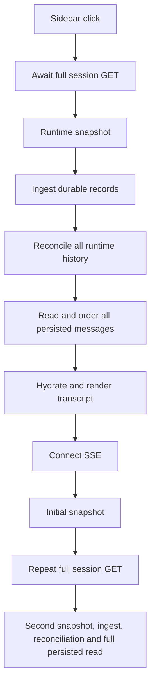

# T3 Code → Truex: chat performance review and implementation plan

Reviewed 2026-10-05 by three parallel agents, with findings checked and synthesized by the primary agent. This pass changes documentation only.

Source revisions:

- T3 Code: `/Users/ashok/t3code`, `cf3e714b0f58e29c8fa8660db50d2187e3263b65`.
- Truex: `/Users/ashok/truex-plan`, `e44b79e9c5eea2b5de000a0cfca6ffff8a5821ec`.

These findings describe the local clones. We did not establish whether the installed T3 application uses exactly this revision, inspect private conversations, or benchmark either application's live UI. Timings below are isolated synthetic measurements, not production latency or a head-to-head comparison.

## Main finding

T3 makes already-viewed conversations immediately available from retained state, loads recent history independently of agent execution, and limits the amount of data and UI work required to show a thread. Truex currently puts runtime recovery and complete transcript reconciliation on the path to displaying saved messages, then commonly repeats that work when SSE connects.

The first improvements should remove this repeated work and make persisted chat readable independently of runtime availability. Our current Next.js, MongoDB, platform service, reducers, and SSE transport can support that design. A framework or transport migration is unnecessary for these first steps.

| Priority | Introduce in Truex                                                     | Expected effect                                                   | Evidence strength                                            |
| -------- | ---------------------------------------------------------------------- | ----------------------------------------------------------------- | ------------------------------------------------------------ |
| P0       | Instrument opening, recovery, requests, bytes, and renders             | Establish before/after evidence and expose the slow phase         | Current source and isolated operation counts                 |
| P1       | Persisted transcript read separate from runtime recovery               | Saved text can appear while the runtime is slow or unavailable    | Verified difference in read paths                            |
| P1       | Coordinate refreshes; remove redundant recovery after initial snapshot | Avoid repeatedly reconciling the same complete thread             | Verified GET → SSE snapshot → second GET flow                |
| P2       | Bounded, scoped in-memory thread cache with explicit sync state        | Fast A → B → A navigation                                         | Verified T3 retained-state mechanism                         |
| P2       | Memoized historical message rows and isolated composer/thread state    | Old Markdown and sidebar rows avoid work on every token/keystroke | Verified rendering structure; browser profiling still needed |
| P3       | Stable history paging, indexed hydration, then timeline virtualization | Long conversations have bounded initial work                      | Verified growth in Truex hydration and history reads         |
| P3       | Compact sidebar projection and scoped list refresh                     | Less list work; a responsive sidebar during thread loading        | Verified list/query/UI structure                             |

## 1. Project structure: what to learn from T3

| Responsibility         | T3                                                  | Truex today                                                               | Adoption decision                                                        |
| ---------------------- | --------------------------------------------------- | ------------------------------------------------------------------------- | ------------------------------------------------------------------------ |
| Wire contracts         | `packages/contracts`                                | `shared/contracts.ts`, events and generated protocol                      | Preserve our shared contract boundary; add explicit read/sync contracts  |
| Shared client state    | `packages/client-runtime`                           | `frontend/lib` reducers plus state and effects in `frontend/app/page.tsx` | Extract thread loading/cache/subscription ownership into focused modules |
| Presentation           | `apps/web`, `apps/mobile`                           | `frontend/components`                                                     | Keep sidebar, composer, and timeline rendering independent               |
| Server/domain          | `apps/server` orchestration and projection services | `platform/src/service.ts`, store and access modules                       | Separate durable reads from runtime operations within existing services  |
| Execution adapter      | Provider adapters                                   | `agent-core` and runtime transport                                        | Keep provider/runtime concerns at the adapter boundary                   |
| Provider model routing | Provider integrations                               | `model-gateway`                                                           | No model-gateway change needed for faster chat reopening                 |
| Desktop host           | `apps/desktop`                                      | Web frontend with remote/local runtime                                    | Desktop packaging is outside this improvement                            |

T3 commits events, read projections, command receipts, and outbox effects in one transaction; side effects run after commit. This gives its projection/sequence protocol a durable foundation. See [architecture](/Users/ashok/t3code/docs/internals/overview.md:53) and [EventSink](/Users/ashok/t3code/apps/server/src/orchestration-v2/EventSink.ts:518).

Borrow the separation of responsibilities. A full event-sourcing/Effect migration would expand this task substantially. T3 itself has large feature components; copying its file sizes or complete component trees would not make our implementation simpler.

## 2. How T3 loads existing chats

### Navigation state is separate from conversation detail

The shell stream carries project/thread metadata. A selected thread has its own detail stream and history loading. Navigation does not require downloading every chat body. The regular shell also excludes the archive dataset. See [ShellStream](/Users/ashok/t3code/apps/server/src/orchestration-v2/ShellStream.ts:15) and [shell updates](/Users/ashok/t3code/apps/server/src/ws.ts:935).

Changed shell aggregates are coalesced in 50 ms windows, up to 512 events, then only affected thread/project metadata is reread. This is metadata batching, not arbitrary dropping of chat events. See [shell batching](/Users/ashok/t3code/apps/server/src/ws.ts:1005).

### Warm navigation renders retained state before opening the live stream

T3 retains a thread snapshot for five minutes after the last consumer leaves, while releasing unused live subscriptions. On return, cached state is emitted before the new live stream. The snapshot includes its applied sequence. See [retention constant](/Users/ashok/t3code/packages/client-runtime/src/state/threadRetention.ts:1) and [retained snapshot emission](/Users/ashok/t3code/packages/client-runtime/src/state/threads.ts:959).

T3 also has IndexedDB shell/thread caches scoped by environment and thread. Cached data is schema decoded, with deletion/error handling. See [storage](/Users/ashok/t3code/apps/web/src/connection/storage.ts:41) and [thread cache](/Users/ashok/t3code/apps/web/src/connection/storage.ts:638).

Its UI/state distinguishes cached, synchronizing, live, empty, and deleted. Cached text does not imply the live connection has completed synchronization. See [thread states](/Users/ashok/t3code/packages/client-runtime/src/state/threadState.ts:6) and [UI sync status](/Users/ashok/t3code/apps/web/src/threadSync.ts:5).

### Cold navigation loads a recent window; old history is progressive

The client loads a bounded recent HTTP snapshot and pages older history independently. See [snapshot loader](/Users/ashok/t3code/packages/client-runtime/src/state/boundedThreadSnapshotHttp.ts:104) and [hydration](/Users/ashok/t3code/packages/client-runtime/src/state/threads.ts:848).

The policy includes ten user turns, 75 items, and a nominal 1 MiB encoded budget. **These are not unconditional hard caps:** normal conversation turns are kept intact, and item/byte budgets apply to histories without turn starts. Oversized turns need explicit handling. See [history policy](/Users/ashok/t3code/apps/server/src/orchestration-v2/threadHistoryPaging.ts:9).

### Cursor replay is tied to matching data, with snapshot fallback

The client seeds `afterSequence` from a cached projection and its sequence, saving only completed data/cursor updates. The server chooses replay or snapshot based on cursor validity and replay budgets: 128 events, 1 MiB encoded replay, and a 1 MiB raw-payload preflight. See [cache/sequence initialization](/Users/ashok/t3code/packages/client-runtime/src/state/threads.ts:189), [subscription](/Users/ashok/t3code/packages/client-runtime/src/state/threads.ts:918), and [replay decision](/Users/ashok/t3code/apps/server/src/orchestration-v2/ThreadStream.ts:9).

### Heavy details stay off the ordinary timeline payload

Wire projections omit or summarize large tool output/diffs; expanded detail is fetched separately. Authoritative stored content remains separate from the presentation projection. See [WireProjection](/Users/ashok/t3code/apps/server/src/orchestration-v2/WireProjection.ts:71).

T3's source includes a deterministic regression fixture with 600 rows and 8 KiB output per row. It records a historical full encoded snapshot of 10,375,121 bytes and asserts a projected bounded snapshot at most 131,072 bytes and at most 2% of that full size. **We read this test; we did not execute it.** It establishes their intended payload regression gate, not their live loading latency. See [transport performance test](/Users/ashok/t3code/apps/server/src/orchestration-v2/ThreadTransportPerformance.test.ts:23).

## 3. Chat and sidebar rendering

| T3 mechanism                                                            | Source                                                                                                                                                                                              | Truex application                                                                                |
| ----------------------------------------------------------------------- | --------------------------------------------------------------------------------------------------------------------------------------------------------------------------------------------------- | ------------------------------------------------------------------------------------------------ |
| Virtualized conversation list using LegendList; older-history anchoring | [MessagesTimeline](/Users/ashok/t3code/apps/web/src/components/chat/MessagesTimeline.tsx:1340)                                                                                                      | Introduce virtualization after paging and stable row identity; preserve scroll and accessibility |
| Memoized timeline and individual rows                                   | [timeline](/Users/ashok/t3code/apps/web/src/components/chat/MessagesTimeline.tsx:504), [row](/Users/ashok/t3code/apps/web/src/components/chat/MessagesTimeline.tsx:1756)                            | Extract historical blocks with stable entries, callbacks, and Markdown plugin references         |
| Row identity reuse                                                      | [row reuse](/Users/ashok/t3code/apps/web/src/components/chat/MessagesTimeline.tsx:4486)                                                                                                             | Unchanged messages must keep stable row references so memoization is effective                   |
| Narrow derived thread subscriptions                                     | [threadDetail](/Users/ashok/t3code/packages/client-runtime/src/state/threadDetail.ts:40)                                                                                                            | Separate transcript, requests, status, activity, and navigation updates                          |
| Virtualized expanded tool activity                                      | [nested list](/Users/ashok/t3code/apps/web/src/components/chat/MessagesTimeline.tsx:3336)                                                                                                           | Expand heavy activity on demand; keep collapsed content cheap                                    |
| Memoized sidebar rows and CSS content visibility                        | [row](/Users/ashok/t3code/apps/web/src/components/Sidebar.tsx:1074), [containment](/Users/ashok/t3code/apps/web/src/components/Sidebar.tsx:1750)                                                    | Keep sidebar updates independent; profile before adding a sidebar virtualizer                    |
| Settled-thread shelf initially shows 10; “show more” adds 25            | [shelf state](/Users/ashok/t3code/apps/web/src/components/Sidebar.tsx:2892)                                                                                                                         | Separate active/recent and older chats; avoid a large initial settled list                       |
| Running tool updates coalesced over 50 ms; terminal events preserved    | [coalescer](/Users/ashok/t3code/apps/server/src/orchestration-v2/ThreadLiveEventCoalescer.ts:18)                                                                                                    | Batch only semantics-safe work; text deltas must concatenate in order                            |
| Cache encoding kept off the active streaming path                       | [settled persistence](/Users/ashok/t3code/packages/client-runtime/src/state/threads.ts:392), [latest-only persistence](/Users/ashok/t3code/packages/client-runtime/src/state/cachePersistence.ts:5) | Start with memory cache; avoid serializing full transcripts on every token                       |

Two details prevent misleading conclusions:

- The default sidebar is not generally a virtualized thread list. It uses bounded settled display, memoized rows, and content visibility. Chat-detail prewarming exists in the **legacy** sidebar; the current sidebar's visibility leases concern PR/VCS data. Do not attribute current chat speed to universal hover-prefetch. See [legacy prewarm](/Users/ashok/t3code/apps/web/src/components/LegacySidebar.tsx:3549).
- T3 can preserve the prior timeline as a paint-only view during a cold switch. Truex should first show the selected thread's own cached content or an honest loading state. Rendering another chat's text requires careful identity and interaction safeguards. See [paint-only switching](/Users/ashok/t3code/apps/web/src/components/ChatView.logic.ts:408).

Truex already has a shared one-second clock that stops when no timer is active. Preserve that useful pattern. See [useClock](/Users/ashok/truex-plan/frontend/components/use-clock.ts:5).

T3 also preserves chat instance identity during draft-to-saved promotion, caches scroll anchors by row ID/offset/follow state (up to 100 threads), and keys composer drafts by thread identity with deferred 300 ms persistence. These improve continuity during navigation; they should inform Truex's scroll/draft behavior without requiring a router migration. See [route identity](/Users/ashok/t3code/apps/web/src/components/ThreadRouteView.tsx:25), [scroll restoration](/Users/ashok/t3code/apps/web/src/components/chat/timelineScrollAnchoring.ts:145), and [composer drafts](/Users/ashok/t3code/apps/web/src/composerDraftStore.ts:97).

## 4. Truex's current read and render bottlenecks



1. **Runtime availability gates saved messages.** `open()` does not install the selected session/transcript until the GET finishes. `history()` awaits snapshot, plan/goal persistence, ingest, and reconciliation before reading saved messages. Recovery errors are caught, but saved text still waits for the failed operation. [Frontend open](/Users/ashok/truex-plan/frontend/app/page.tsx:285), [history](/Users/ashok/truex-plan/platform/src/service.ts:1574).
2. **Initial SSE snapshot triggers another full read/recovery.** The manager sends a snapshot even after successful replay; the frontend snapshot handler unconditionally reloads the transcript using the same expensive GET. [Manager](/Users/ashok/truex-plan/agent-core/src/manager.ts:1147), [snapshot handler](/Users/ashok/truex-plan/frontend/app/page.tsx:473).
3. **Reconciliation is proportional to complete history and writes during reads.** It walks all runtime item pages. User messages each require a lookup plus a write; assistant messages each require a write. These are sequential awaits. [Reconcile](/Users/ashok/truex-plan/platform/src/service.ts:1487).
4. **All persisted messages are returned and hydrated.** `historyEntries()` repeatedly scans/copies a growing array, yielding quadratic worst-case construction for ordinary long histories. [Unpaged read](/Users/ashok/truex-plan/platform/src/service.ts:1606), [hydration](/Users/ashok/truex-plan/frontend/lib/chat.ts:112).
5. **Tokens and composer state share the page render owner.** Each event invokes transcript/helper/observability/plan reducers; changed state rerenders `Home`. `ChatMessages` rebuilds groups and renders historical Markdown without memoized message-row boundaries. React may batch setters within an event, but historical work is still revisited. [Event handling](/Users/ashok/truex-plan/frontend/app/page.tsx:454), [ChatMessages](/Users/ashok/truex-plan/frontend/components/chat-messages.tsx:68).
6. **Traces and timings independently ingest records.** These are already deferred until after initial detail, which is useful; their handlers nevertheless repeat ingestion. [Timings](/Users/ashok/truex-plan/platform/src/index.ts:583), [traces](/Users/ashok/truex-plan/platform/src/index.ts:614).
7. **Sidebar reload is uncached and rows are globally busy during opening.** Opening the sidebar/search triggers a list refresh. The list returns the latest 100 public summaries, but Mongo's exclusion projection still reads internal fields that the public projection discards. [Refresh](/Users/ashok/truex-plan/frontend/app/page.tsx:239), [list](/Users/ashok/truex-plan/platform/src/service.ts:1170), [row busy](/Users/ashok/truex-plan/frontend/components/v2/sidebar.tsx:141).

Existing protections to reuse: generation guards, message/runtime identity aliases, resync signals, owner/visibility checks, background ingestion, and persisted plan fallback. SSE is already capable of live updates and reconnect; transport choice is not the first bottleneck.

## 5. Measurements from this review

### Actual platform methods with isolated collection/runtime stand-ins

The probe called actual `PlatformService.history()` and `reconcile()` using synthetic persisted messages and runtime pages of 100 items, empty durable records, idle snapshot, and unchanged plan. It used no database, network, credentials, or private chats.

| User turns | Runtime calls | Message lookups | Message writes | Messages returned |
| ---------: | ------------: | --------------: | -------------: | ----------------: |
|         10 |             3 |              10 |             20 |                20 |
|        100 |             4 |             100 |            200 |               200 |
|      1,000 |            22 |           1,000 |          2,000 |             2,000 |

Each case also made four session reads, one session write, and one complete message read. Reopening each unchanged fixture repeated the same counts. These are observed method-operation counts; mocked collections cannot establish production database latency. Additional durable records or recovery work can increase the counts.

### Actual frontend hydration helper, CPU only

Node `v24.21.0` on this Mac. Alternating user/assistant messages, unique turn/item identities, 200-character body padding. Median of five hydration samples after a small warm-up:

| Messages | `historyEntries()` median | Synthetic message JSON size |
| -------: | ------------------------: | --------------------------: |
|      100 |                   0.09 ms |                37,896 bytes |
|    1,000 |                   3.54 ms |               383,396 bytes |
|    5,000 |                  46.03 ms |             1,936,396 bytes |
|   10,000 |                 166.78 ms |             3,878,896 bytes |

This excludes React, Markdown parsing, DOM layout, request latency, and database work. The JSON size is for the fixture's messages array, not the complete API response. A second agent's independent three-sample run found about 142 ms at 10,000 messages; microbenchmark timings vary. The actionable evidence is growth in whole-history CPU work, not a claimed browser speedup.

Focused existing tests executed:

```sh
cd /Users/ashok/truex-plan/frontend
node --experimental-strip-types --test test/chat.test.ts test/transport.test.ts
```

Result: **17 passed, zero failed or skipped**. These cover identity/replay/final merging, separate identical messages, reasoning ordering, command results, approvals, malformed events, and stream error behavior. No production benchmark, T3 test suite, build, or full release check was run for this documentation-only pass.

## 6. Implementation sequence and acceptance gates

### Change 1: add opening/recovery instrumentation

Files: `frontend/app/page.tsx`, `frontend/lib/api.ts`, `platform/src/index.ts`, `platform/src/service.ts`; isolated fixtures in existing frontend/platform tests.

Record click-to-selection, click-to-first-transcript-paint, and time-to-live separately. Measure authorization, persisted read, snapshot, ingest, reconcile, response bytes, runtime call counts, Mongo operation counts, long tasks, React commits, and retained cache bytes. Use request IDs and timings without logging transcript contents or credentials.

Acceptance: reproducible 10/100/1,000-turn fixtures, cold and A → B → A runs separately, runtime-unavailable cases, and p50/p95 from repeated equivalent runs. Performance targets are set after this baseline. Avoid making production promises from the Node measurements above.

### Change 2: persisted reading independent of recovery

Files: `platform/src/service.ts`, `platform/src/index.ts`, `frontend/lib/api.ts`, `frontend/app/page.tsx`, shared response contracts and focused tests.

Add an authorized persisted-read path that never invokes runtime snapshot/ingestion/reconciliation. Reuse `sessionFor(id, "read")`, existing public projections, ordering and saved plan/audit data. Preserve the old full-recovery contract during migration. The UI first selects the requested thread and renders persisted content, then synchronizes live state through a coordinated recovery flow.

Initially retain the full durable transcript if needed to keep the first diff small. This first change removes runtime dependency; it does not solve unlimited transcript payloads. Pagination is a separate change with an ordering contract.

Acceptance:

- Persisted read makes zero runtime calls and zero reconciliation writes.
- Saved content displays while the snapshot dependency is deliberately blocked or unavailable.
- Recovery failures leave readable content and an actionable syncing/error status.
- Owner-only writes, tenant isolation, hidden-session 404s, legacy policy checks and public data projection remain intact.
- Stale cached approval/running/permission state never authorizes an action; the server remains authoritative.
- Delayed A/B responses cannot install another thread's state.

### Change 3: coordinate refresh and remove redundant recovery

Files: existing frontend loading/subscription code, a focused thread-loading module, platform refresh/ingestion coordination where needed, transport/replay tests.

Deduplicate in-flight work under a verified authorization scope. Retain snapshots for live state. Replace unconditional snapshot-triggered full recovery with a deliberate merge/refresh decision. A persisted transcript baseline must be linked to an appropriate data revision/cursor or durable catch-up signal before any history refresh is skipped.

**Do not just delete `reloadTranscript()`:** a runtime snapshot may not include older persisted messages, and the saved SSE cursor alone does not prove the browser has the corresponding transcript. Cursor generation, durable persistence progress, replay completion and baseline coverage need explicit handling.

Acceptance: one coordinated initial recovery flight per selected session/scope; no second complete reconciliation for a snapshot that confirms covered state; missing baseline, replay gap, runtime restart, or new durable content triggers refresh; no duplicate/omitted messages; failed persistence never gets acknowledged as successful.

### Change 4: warm thread cache and navigation behavior

Files: a small frontend thread-cache/loading module, `frontend/app/page.tsx`, sidebar callbacks, focused cache/race tests.

Start with memory scoped to the authenticated page. Use entry count, estimated byte budget, and idle TTL; a count alone cannot bound large transcripts. Key by verified identity/tenant/session and authorization epoch. Keep display state distinct from live requests, running state and permission checks. Dispose streams when their consumers leave; retaining cached text need not retain the connection.

Store per-thread draft and scroll state, with clear rules for new drafts, send completion, eviction, and identity switches. Cancel superseded read requests when practical, retain generation guards, and allow selection of another thread while one is loading. Request cancellation must not cancel an agent's running turn.

Acceptance: cached A → B → A paints A before its network response; old thread remains unable to act as the selected thread; cache entry/byte/TTL limits hold; logout, tenant switch, deletion and authorization failure clear relevant state; no stream/subscription leaks; background runs continue and can resynchronize when revisited.

### Change 5: render isolation and indexed hydration

Files: `frontend/components/chat-messages.tsx`, `frontend/components/v2/sidebar.tsx`, composer ownership in `frontend/app/page.tsx`, `frontend/lib/chat.ts`, focused regression tests.

Extract memoized historical message/turn rows. Keep entries and callbacks stable; hoist static Markdown plugin arrays. Move composer updates outside the transcript render owner where practical. Preserve the existing reducer's identity/deduplication behavior while replacing repeated hydration scans with indexed construction if measured long histories justify it.

Batch only text/reasoning deltas with ordering-aware frame processing, if profiling shows a need. Concatenate all text deltas; flush before final/completion/snapshot/error boundaries and handle hidden-tab frame suspension. Advance the committed resume cursor only after corresponding data is applied.

Acceptance: typing and active-turn deltas do not reparse completed Markdown or rerender every sidebar row; distinct identical messages remain distinct; alias/final/replay behavior remains correct; no lost text on stop, unmount, hidden tab, completion or reconnect.

### Change 6: stable history pages and virtualized timeline

Files: shared transcript/read contracts, platform/store history queries/indexes, thread loading/cache modules, chat timeline and integration tests.

Define a stable logical transcript ordering key before paging. Existing runtime `order`, reconstructed timestamps, and command `afterMessageId` anchors make naive `at`-only pagination unsafe. Backfill/order changes need staged compatibility and rollback; keep command anchors and paired turn boundaries consistent. Return a recent window plus an opaque validated cursor; load older pages on demand. Decide explicit oversized-message/turn behavior so nominal count limits do not masquerade as byte limits.

Once paging and row identity are correct, choose a maintained variable-height virtualizer after a dependency/license check. Preserve prepend scroll anchors, expandable content, jump-to-turn behavior, keyboard navigation, copying/search, and screen-reader behavior. Library selection is a future implementation decision, not a requirement to import T3's full UI stack.

Acceptance: opening 1,000 turns downloads and mounts a bounded recent subset; no skips/duplicates with tied timestamps, late ingestion or concurrent deltas; older-page prepend preserves reading position; one huge turn cannot silently exhaust memory; initial payload/row budgets have regression gates.

### Change 7: sidebar and observability refinements

Use an inclusion projection matching `publicSession`, scoped list deduplication, metadata patches after known writes, and independent active/recent/older views. Measure Mongo `explain()` before adding indexes. Trace/timing reads can show persisted data and share a refresh coordinator rather than each ingesting independently.

Acceptance: one token does not refresh the session list; archive/delete/title/project/goal updates stay correct; search can reach older chats; auth/visibility changes invalidate cached metadata; traces remain readable when the runtime is unavailable; refresh failures are observable.

For each implementation slice, run changed-behavior regression tests plus applicable frontend tests/typecheck/build and platform tests/build. Root `npm test` currently excludes frontend tests, so invoke those explicitly. Adapter/stream changes also require relevant agent-core replay, durability, and HTTP integration checks. Finish UI integration with an authorized browser pass against isolated fixtures, measuring actual paint/scroll behavior; helper benchmarks alone cannot validate the user experience.

## 7. Adversarial review and operational safeguards

| Failure to test                                          | Required result                                                      |
| -------------------------------------------------------- | -------------------------------------------------------------------- |
| A → B → A with out-of-order responses                    | Only selected-thread data/status/actions install                     |
| Snapshot arrives while persisted history is loading      | Correct merge; no lost live text or duplicated final                 |
| Stored cursor with no matching browser data              | Snapshot/hydration fallback, not blind replay                        |
| Cursor expired, invalid, or runtime generation changes   | Explicit resync with bounded work                                    |
| Runtime down or cold for a long time                     | Persisted transcript remains promptly readable                       |
| Logout, tenant switch, revoked visibility, deletion      | Cached private content is cleared; server reauthorizes reads/actions |
| Cached approval becomes resolved while hidden            | Stale UI cannot submit it as a current approval                      |
| Same text in separate turns; runtime/durable ID aliases  | Correct separate rows and deduplication                              |
| Ingestion/reconcile fails halfway or two refreshes race  | No premature ack, corrupted order, or duplicate durable effects      |
| Paging with late messages/command anchors                | Stable boundaries and recoverable gaps                               |
| Very large turn/tool output; many warm threads           | Explicit byte budgets, eviction and on-demand detail                 |
| Hidden tab, unmount, stop, completion during delta batch | Ordered flush or safe discard for disposed state; resumable cursor   |
| Browser cache unavailable/corrupt                        | Read-through loading works; cache failure does not block chat        |

Keep current durable record write-before-broadcast and fail-stop behavior. Replacing synchronous spool writes with asynchronous writes is a separate reliability change requiring a bounded queue, completion barriers and crash recovery. See [durable record handling](/Users/ashok/truex-plan/agent-core/src/manager.ts:1322).

Roll out new read/sync behavior behind a reversible flag, keep the legacy full-history path during compatibility testing, and compare timing/error/duplicate metrics before expanding. Avoid destructive storage changes in early phases. Observe persisted-read latency, recovery failure rate, replay gaps, duplicate final suppression, cache memory, and runtime/Mongo work per open after rollout.

## 8. Reconcile with the existing caching plan

`docs/CACHING_PLAN.md` is explicitly a draft and several statements have drifted:

- Authentication and owner/visibility checks now exist. Tenant + URL cache keys are insufficient for user-dependent results; add principal and authorization context.
- Titles are already saved on first message and goal creation. The remaining untitled aggregate serves legacy/untitled entries. See [message title](/Users/ashok/truex-plan/platform/src/service.ts:1459), [title helper](/Users/ashok/truex-plan/platform/src/service.ts:1883).
- A user/date sessions index already exists. Additional policy/date indexes need measured query-plan evidence. See [indexes](/Users/ashok/truex-plan/platform/src/store.ts:177).
- A newest-timestamp ETag cannot safely represent collection deletion/archive/visibility changes without a revision contract.
- Start with bounded memory. Persistent browser transcripts need a retention/privacy decision and revocation rules before copying T3's IndexedDB approach.
- Redis can later help cross-replica leases/invalidation, but it is not required for persisted-first display, removing duplicate recovery, or memoized messages.
- Keep durable storage correctness separate from optional display caches and prompt caching. Faster thread navigation does not require implementing eight cache layers together.

## Recommended first implementation slice

**Instrument chat opening, add a persisted transcript read that performs no runtime work, and display it before coordinated live recovery.** Keep the old recovery route compatible and add tests for a blocked runtime, authorization, stale state and rapid thread switching.

Then remove redundant recovery safely, add bounded warm navigation state, and isolate message renders. Follow with stable history paging and virtualization. This sequence directly targets the source-backed causes of slow reopening while keeping changes focused and reversible.
