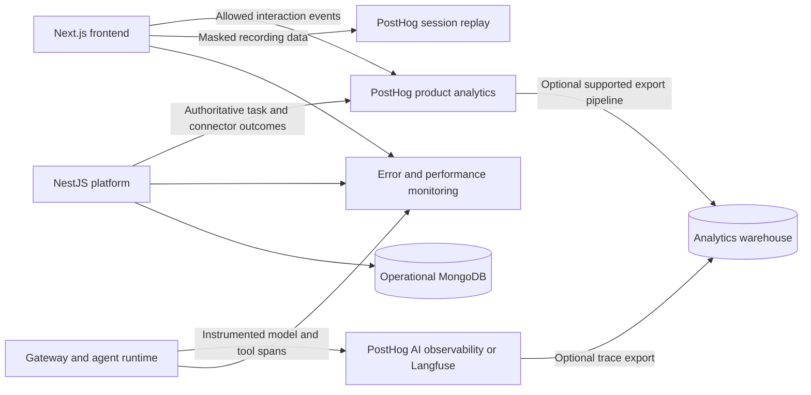

# User behavior analytics: tools, capture plan, and Truex recommendation

Research checked: 2 October 2026. This is a research and proposed instrumentation plan; analytics SDKs have not been installed. Public prices and included features can change. Paid rates, add-ons, retention, region, and enterprise terms need a final check when purchasing.

## Recommendation

For an engineering-led web product such as Truex, evaluate **PostHog Cloud first**. Start with product analytics, explicit business events, masked session replay, and feedback. Trial PostHog's AI observability against a real Truex workflow before deciding whether to add Langfuse. Add Sentry if deeper engineering diagnostics are needed. Use GA4 on the marketing site if campaign attribution is important.

This recommendation is a judgment based on the platform's requirements, not a measured benchmark of the vendors. Mixpanel and Amplitude are strong alternatives. Do not install all three product analytics platforms in production simply to obtain more coverage.

The central principle is: **capture the full journey and its outcomes, with deliberately limited content collection**. A browser click does not prove a backend operation succeeded. A completed AI run does not prove the answer was useful. A replay shows interactions, not the user's thoughts.

## 1. What “understanding user behavior” involves

| Layer | Capture | Questions answered |
|---|---|---|
| Acquisition | Landing page, referrer, UTM campaign, signup source | Where do valuable users come from? |
| Product behavior | Page/screen views, meaningful actions, feature use | What do people use and in what order? |
| Conversion | Onboarding and task milestones | Where do users drop out? |
| Retention | Repeat meaningful use, cohorts, return intervals | Do users return after receiving value? |
| Experience | Masked replays, click/scroll heatmaps, friction signals | Where do users hesitate or struggle? |
| Reliability | Frontend errors, backend failures, latency, traces | Did a technical problem prevent success? |
| AI execution | Model/tool spans, tokens, costs, retries, evaluations | Why did an agent task fail or become expensive? |
| Customer/account context | Stable user ID, organization, role, plan | Which customer groups adopt or abandon features? |
| Feedback | Satisfaction, task-success response, reason codes, interviews | What did users actually want and think? |
| Business outcomes | Subscription/payment state, completed workflows | Does usage lead to measurable value? |

These layers overlap across products, but they require different instrumentation. Session replay, backend events, and AI traces are separate data streams.

## 2. Main tools to evaluate

The “best fit” column is an assessment of fit rather than a claim that competitors lack that capability. SDK support and feature availability should be verified for the chosen platform and plan.

| Tool | Core capabilities | Best fit | Important tradeoff |
|---|---|---|---|
| **PostHog** | Product/web analytics, autocapture, funnels, retention, replay, heatmaps, flags, experiments, surveys, errors, AI observability | Engineering-led SaaS and AI products seeking an integrated stack | Powerful but needs a clear event schema, masking, and usage limits; self-hosting is officially unsupported |
| **Mixpanel** | Event analysis, funnels, retention, flows, cohorts; replay, experiments and feature flags | Product teams doing frequent behavioral analysis | Explicit outcome events still matter; governance, group analysis and advanced functionality vary by plan |
| **Amplitude** | Product analytics, journeys, cohorts, replay, experimentation, activation, guides and surveys | Organizations needing a broad product/growth platform | Advanced capabilities, replay allowances and retention vary by plan |
| **Heap** | Autocaptured interactions, retrospective event definitions, product analytics, replay, heatmaps | Teams that want to discover interactions they did not initially tag | Browser autocapture cannot infer backend success; evaluate pricing and governance against real volume |
| **Fullstory** | Session replay, behavioral capture, product/experience analytics and debugging | Investigating complex UX friction and support cases | Free and paid tiers differ substantially; check replay retention separately from analytics retention |
| **Contentsquare / Hotjar** | Replays, heatmaps, journeys, experience analysis and feedback | UX research, conversion improvement and larger digital experience programs | Hotjar is now part of Contentsquare; compare the current offering rather than old Hotjar plan lists |
| **Microsoft Clarity** | Session recordings, heatmaps and frustration signals | A low-cost way to inspect web UX | Free, but not a substitute for a deliberate business-event model or AI tracing; review data handling before deploying |
| **Pendo** | Product analytics, in-app guides, feedback and replay depending on plan | B2B onboarding, adoption, and customer success | MAU and feature-based commercial terms; replay is not included in every tier |
| **UXCam** | Product/experience analytics, replay, heatmaps and journey investigation | Especially useful to evaluate for native mobile experiences; also offers web analytics | Validate the specific web/mobile SDK, privacy behavior and session allowance |
| **Google Analytics 4** | Acquisition, campaigns, attribution, event/conversion analysis and BigQuery export | Marketing website and acquisition measurement | Pair with a replay/product tool when deep in-product investigation is required |
| **Matomo** | Web analytics with cloud and self-hosted options; replay/heatmaps via paid offerings | Data control and self-hosted web analytics requirements | Operating self-hosted software adds work; replay/heatmaps are not simply included in the free core |
| **Plausible** | Aggregate traffic, referrers, goals and custom events with minimal personal data | Simple website reporting with limited tracking | Its aggregate model does not provide persistent individual user histories or session replay |

Primary sources: [PostHog products](https://posthog.com/products), [Mixpanel plans](https://mixpanel.com/pricing/), [official Mixpanel SDK/autocapture](https://github.com/mixpanel/mixpanel-js), [Amplitude plans](https://amplitude.com/pricing), [Heap pricing](https://www.heap.io/pricing), [Heap autocapture](https://www.heap.io/platform/autocapture), [Fullstory plans](https://www.fullstory.com/plans/), [Contentsquare and Hotjar](https://contentsquare.com/blog/contentsquare-vs-hotjar/), [Clarity pricing](https://clarity.microsoft.com/pricing), [Pendo plans](https://www.pendo.io/pricing/), [UXCam experience analytics](https://uxcam.com/experience-analytics/), [GA4 acquisition](https://support.google.com/analytics/answer/14731736), [Matomo replay plugin](https://matomo.org/faq/heatmap-session-recording/faq_24205/), and [Plausible's tracking model](https://plausible.io/privacy-focused-web-analytics).

### Complementary tools

**Sentry** helps connect errors and performance issues to user experience. Its replay can show browser state, interactions, network requests and console entries alongside tracing. It complements product analytics when the key question is why a feature failed technically. [Sentry replay documentation](https://docs.sentry.io/platforms/javascript/session-replay/).

**Langfuse** provides LLM/agent tracing, cost and latency analysis, evaluations, datasets and prompt-related workflows, with cloud and self-hosted options. It complements product analytics when quality and execution details require dedicated tooling. PostHog also offers AI observability; trial that first if minimizing tools is a priority. [Langfuse observability](https://langfuse.com/docs/observability/overview), [Langfuse documentation](https://langfuse.com/docs), [PostHog AI observability](https://posthog.com/docs/ai-observability).

**Segment and RudderStack** collect, govern and route event data to downstream destinations such as analytics tools and warehouses. They are data infrastructure, rather than replacements for the product-analysis and replay interfaces discussed above. Use one when multiple destinations, identity management or data governance justify another component. Browser replay usually still needs the vendor's recording SDK. [Segment Connections](https://segment.com/product/connections-v3/), [RudderStack documentation](https://www.rudderstack.com/docs/).

## 3. What PostHog captures, and what still needs engineering

PostHog provides a broad integrated toolkit: usage analysis, session replay, experiments, feedback, errors and AI observability. Its product analytics supports autocapture, and group analytics can analyze organizations as well as people. [Products](https://posthog.com/products), [product analytics](https://posthog.com/product-analytics), [group analytics](https://posthog.com/docs/product-analytics/group-analytics).

Use three types of data:

1. **Automatic interaction data:** useful for exploration and finding unexpected paths. Control the scope and volume.
2. **Explicit business events:** named events such as `connector_connection_succeeded` or `artifact_download_requested`. They explain what an action means.
3. **Server-side outcomes and AI traces:** trusted records of what completed, failed, cost money, or called an external tool.

For example, an autocaptured click on “Connect SAP” does not indicate that credentials validated or the connection became usable. Record the attempt in the frontend and the result from the backend. Avoid emitting the same authoritative completion event independently from both.

PostHog AI observability requires the application to send appropriate LLM events/traces. Installing its browser SDK does not automatically expose model execution inside a gateway, subprocess, or external agent runtime. [AI observability documentation](https://posthog.com/docs/ai-observability).

For self-hosting, PostHog's current documentation explicitly says deployments are officially unsupported, lack tagged releases, and have no paid support plans or infrastructure guarantees. Treat its hobby deployment as a separate operational decision. Prefer Cloud for this proposed starting stack unless data control requirements rule it out. [Self-hosting documentation](https://posthog.com/docs/self-host).

## 4. Proposed Truex capture plan

The repository uses a Next.js frontend, a NestJS platform, an agent adapter, a model gateway and MongoDB. A subsequent source review found Google-session authentication, user/tenant contexts and an `/api/me` identity endpoint, despite the README's older statement that authentication and multi-tenancy are absent. Use server-established identities in the authenticated deployment; exclude shared development identities from real-user metrics. See the [PostHog implementation plan](POSTHOG_IMPLEMENTATION_PLAN.md) for the current integration points. Deployment readiness is a separate verification.

The following events are a proposal. Account and billing events apply when those capabilities exist.

| Journey | Proposed events | Main properties |
|---|---|---|
| Access and onboarding | `signup_completed`, `onboarding_started`, `onboarding_completed` | Source, role, onboarding step |
| Conversation | `conversation_created`, `message_submitted`, `conversation_reopened` | Conversation ID, agent ID, message length bucket |
| Agent execution | `run_started`, `run_completed`, `run_failed`, `run_cancelled` | Run ID, status, duration, failure code |
| User intervention | `run_stop_requested`, `run_steer_requested`, `clarification_answered` | Run ID, stage, reason category |
| Connectors | `connector_connection_attempted`, `connector_connection_succeeded`, `connector_connection_failed`, `tool_call_completed` | Connector type, safe tool name, latency, status |
| Files and artifacts | `file_upload_completed`, `artifact_created`, `artifact_download_requested` | File type, size bucket, artifact type |
| Product features | `agent_changed`, `model_changed`, `conversation_forked`, `goal_created`, `visualization_opened` | Previous/new selection categories, feature name |
| Feedback | `response_feedback_submitted`, `task_success_reported` | Rating, reason code, run ID |
| Business lifecycle | `trial_started`, `subscription_activated`, `subscription_cancelled` | Plan, account ID, server-confirmed state |

An observed download request does not prove that a file reached the user's device. Name the event according to what is actually observable. Likewise, a user clicking “Stop” and a run reaching a cancelled state are separate events.

Standard event properties should include:

- `event_id`, `schema_version`, `occurred_at`, and environment/application version.
- Anonymous ID or stable pseudonymous user ID; organization ID when supported.
- Browser session ID, conversation ID, run ID and trace ID where relevant.
- Feature, safe connector/model category, status and bounded error code.
- Duration, time to first visible response, token usage and cost where measurable.
- Experiment assignment/exposure when appropriate.

Distinguish the **browser session**, **conversation**, **agent run**, and **trace**. A conversation may span multiple browser sessions, and a run may continue after the browser closes.

Never trust a client-supplied organization ID as an access-control decision. Product analytics is not the authoritative billing ledger, security audit trail or operational log archive.

## 5. Proposed architecture



Use shared correlation IDs to connect the data. Check supported export methods, plans and retention before treating a vendor as the long-term archive. Identity and schema consistency matter more than having every stream in one vendor.

At the frontend, track navigation and meaningful interactions, and selectively enable replay. At the platform, record committed outcomes and terminal run states. At the gateway/runtime, instrument model and tool execution at the points where that execution is actually observable.

Truex uses SSE and retained conversation history. A recording can include restored messages from earlier sessions as well as newly streamed text. Mask the entire transcript, composer, reasoning display, tool-result panels, connector settings and artifact previews. Do not send every token or SSE chunk as a product event; aggregate per run and capture milestones.

For reliable backend capture, use a durable handoff or outbox appropriate to the platform, retry delivery, and deduplicate using stable IDs. Keep analytics failures outside the critical response path. Validate delivery under disconnect, restart and duplicate-delivery conditions.

## 6. Dashboards that turn data into decisions

| Dashboard | Definition or question |
|---|---|
| Activation | What percentage reach a first meaningful result within a defined period? |
| Onboarding funnel | Access → first conversation → first run → meaningful outcome |
| Task funnel | Submitted → accepted → run started → terminal state → feedback/outcome |
| Retention | Do activated users repeat meaningful usage after 7/30 days or in weekly cohorts? |
| Adoption | What share of eligible active users use each agent, connector and feature? |
| Account adoption | How many active seats and successful workflows exist per organization? |
| Reliability | Failure/cancellation rate, error categories, p50/p95 response times |
| AI efficiency | Tokens and cost per run, retries, tool failures, cost per validated outcome |
| Experience | Which funnel exits coincide with friction or errors in sampled replay? |
| Satisfaction | Task-success responses, feedback reason codes, interview findings |
| Revenue | Which adoption/activation patterns associate with paid conversion and renewal? |

Define an “active user” as someone performing a meaningful action, not just opening a page. Define retention against that same meaningful action, state the cohort denominator and time window, and exclude internal/test traffic.

For an AI product, `run_completed` is a technical result. It should be reported separately from business success, user satisfaction, artifact usefulness, or external system change. Users who provide feedback are a selected subset; report feedback response rates alongside scores.

An example initial value metric is **weekly users with at least one confirmed useful outcome**. If confirmation coverage is low, report successful runs as a proxy and label it clearly. Do not imply that completion proves value.

Funnels and replays suggest hypotheses. Surveys and interviews help explain motivation. Randomized experiments, when correctly designed, can test causal effects; a correlation between feature use and retention does not establish that the feature caused retention.

## 7. Coverage, privacy and data quality

No SDK can truthfully guarantee complete capture. Ad blockers, declined tracking, offline devices, JavaScript failures, unsupported views, cross-device identity gaps, sampling, retention expiry and vendor limits create gaps. Backend capture improves outcome coverage but must follow the applicable collection policy; it should not silently circumvent a user's tracking choice.

For web replay, the recording is commonly a reconstruction of browser state and interactions rather than a literal desktop video. Coverage can differ for canvas, embedded frames and native screens. Validate the actual Truex UI and SDK combination.

PostHog masks input fields by default, but its web documentation says general page text is not masked by default. Therefore, input masking alone does not protect chat messages or tool results. Network headers and bodies are another independent capture surface. [PostHog replay privacy](https://posthog.com/docs/session-replay/privacy). Sentry defaults to masking DOM text, images and inputs; its configuration still requires verification. [Sentry replay](https://docs.sentry.io/platforms/javascript/session-replay/).

Proposed starting controls:

- Allowlist event names/properties; never collect passwords, credentials, authorization headers or connector secrets.
- Send safe categories, identifiers and length/size buckets instead of prompt text or customer documents.
- Disable network-body capture and scrub URLs, event properties, logs and console data.
- Keep any authorized AI-content diagnostics in a separately governed store with narrower access and retention.
- Define regional hosting, retention, deletion, export and dashboard access requirements.
- Establish the applicable consent/disclosure approach before activating collection. Vendor security certification alone does not determine whether the deployment is appropriate.
- Start with short replay retention and sampled replay; these are proposed operating choices, not legal requirements.

Verify privacy with synthetic secrets in the composer, transcript, restored history, tool output, filenames, document preview, settings and URLs. Inspect transmitted payloads as well as rendered recordings. Masking replay does not automatically sanitize ordinary event properties or AI traces.

Measure tracking quality too: event completeness, ingestion delay, duplicate rate, identity coverage and schema violations. Reconcile server-confirmed runs against analytics totals within the allowed tracking population.

## 8. Pricing and volume planning

Public free allowances verified during this research:

| Vendor | Starting allowance or pricing model |
|---|---|
| PostHog | Monthly: 1M analytics events, 5K recordings, 1M flag requests, 100K exceptions, 1,500 survey responses and 100K AI observability events; paid usage/product limits are separate |
| Mixpanel | Free: up to 1M events/month and 10K replays/month, with limited experiment/flag allowances; paid tiers and add-ons vary |
| Amplitude | Free: 2M events/month with limited access to replay and other platform capabilities; verify the selected plan's replay allowance |
| Clarity | Free service for heatmaps and recordings |
| Pendo | Free plan supports up to 500 MAU; paid plans depend on MAU and features |
| Matomo | Self-hosted core plus operating costs; paid plugins/cloud plans for additional capabilities |

Sources: [PostHog pricing](https://posthog.com/pricing), [Mixpanel pricing](https://mixpanel.com/pricing/), [Amplitude pricing](https://amplitude.com/pricing), [Clarity pricing](https://clarity.microsoft.com/pricing), [Pendo pricing](https://www.pendo.io/pricing/), [Matomo plans](https://matomo.org/pricing/).

Use these planning formulas:

```text
Monthly browser events ≈ active users × sessions per user × events per session
Monthly recordings ≈ eligible sessions × recording sampling fraction
Total analytics events = browser events + backend events + other billable events
AI volume ≈ runs × instrumented generations/spans per run, using vendor billing rules
```

Illustration: 10,000 monthly active users × 8 sessions × 25 events gives **2 million browser events/month**. Recording a random 5% of those 80,000 sessions produces approximately **4,000 recordings**. Backend outcomes and additional event types add volume. This illustration exceeds PostHog's free analytics allowance while the recording count fits its stated allowance, assuming eligibility and billing definitions match. It is not a dollar quote.

For a real quote, include replay duration/retention, AI spans and generations, exports, organization analytics, SSO/roles, support, overages, tax and annual commitments. Compare the same workload and required features across vendors. A higher free event limit alone does not establish a lower total cost.

Control volume by avoiding token/heartbeat/mousemove streams as business events, excluding test traffic, limiting autocapture scope, sampling replay and setting billing limits. Report sampling rates so dashboards are interpreted correctly. If recording selection is biased toward errors, do not use those recordings to estimate population-wide behavior.

## 9. Buy versus build

For Truex, buy the general-purpose analytics/replay interface and build the domain-specific event model, identity integration, outcome definitions and selected dashboards. Rebuilding robust replay, identity resolution, funnel queries, retention, access controls, deletion and scalable storage is a substantial separate product effort.

If building a customer-facing analytics product itself becomes the goal, its scope changes. It would need ingestion SDKs/API, batching and retries, tenant isolation, schema governance, identity resolution, scalable storage/querying, replay storage/player, visualization, access controls, retention/deletion, export and usage billing. Evaluate this separately from instrumenting Truex.

## 10. Suggested rollout

1. Define the main business questions, activation criteria, event owners and safe properties. Integrate existing authenticated user/tenant context, with anonymous identifiers only where collection is eligible and appropriate.
2. Add one product analytics SDK and backend events for roughly 15–25 important actions/outcomes. Keep the wrapper and event schema vendor-independent where practical.
3. Validate event meaning, privacy, deduplication and server reconciliation using synthetic users. Exclude internal traffic and separate development/staging/production.
4. Enable masked replay for an eligible sample. Verify both newly streamed and restored sensitive content, and inspect network payloads.
5. Instrument one representative multi-step AI run. Compare PostHog's tracing/evaluation coverage with dedicated Langfuse requirements before adding another platform.
6. Build activation, task-success, retention, feature-adoption, reliability and cost dashboards. Add a brief outcome survey after appropriate milestones.
7. Review actual user journeys regularly, investigate a specific drop-off, make a change and measure its effect. Check tracking health and cost as part of the same review.

Selection should ultimately be based on a pilot using Truex's real streaming UI, backend outcomes, model gateway and connector execution. The report recommends that pilot; it does not claim the integrations have already been implemented or verified.
