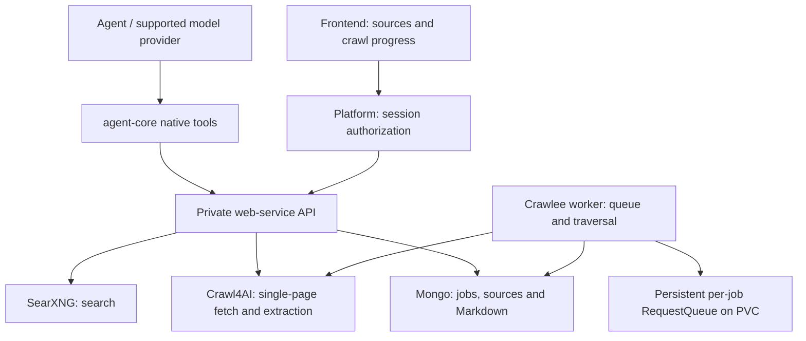

# WebSearch, WebRead and WebCrawl implementation plan

Status: WebSearch, stateless WebRead and durable WebCrawl are implemented on `feat/searxng-websearch`; see [Search](WEBSEARCH.md), [Read](WEBREAD.md) and [Crawl](WEBCRAWL.md) for the shipped contracts, setup and verification. The broader design below remains a proposal where it differs: the initial crawl release uses a private filesystem volume and one locked worker, rather than Mongo/GridFS; helpers remain disabled. Prepared 2026-10-04 after reviews of the harness, platform/UI and official product documentation.

## Objective and recommended architecture

Introduce three first-party, provider-independent tools using the selected products:

| Product name | Model-callable function | Engine   | Responsibility                                                                   |
| ------------ | ----------------------- | -------- | -------------------------------------------------------------------------------- |
| WebSearch    | `web_search`            | SearXNG  | Find relevant URLs and return ranked snippets with provenance.                   |
| WebRead      | `web_read`              | Crawl4AI | Read one page into clean Markdown, with bounded chunks and source metadata.      |
| WebCrawl     | `web_crawl`             | Crawlee  | Run a bounded background crawl with persistent URL queues, retries and progress. |

Register these through the existing native dynamic-tool mechanism in agent-core. A private TypeScript `web-service/` package owns vendor adapters, URL policy, result storage and crawl execution. Run its API and crawl worker as separate processes/images or deployment roles. Browser work stays in the separate Crawl4AI container.

For crawling, use **Crawlee BasicCrawler**, whose request handler calls the same Crawl4AI adapter used by WebRead. Extract links from that response and enqueue eligible URLs. Crawlee owns traversal; Crawl4AI owns page loading/extraction. Avoid a PlaywrightCrawler that downloads a page and then asks Crawl4AI to download it again. Disable Crawl4AI deep crawling in this adapter.

Assumptions for the first release: self-hosted services, public HTML/JavaScript pages, existing MongoDB, modest per-job limits and one crawl worker with persistent storage. Authenticated sites, PDF/binary extraction, browser interaction, recursive crawling through Crawl4AI, scheduled monitoring and large-scale shared queues are later work. No changes to `vendor/codex` or generated protocol files are required.

## Findings from the current repository

- `agent-core/src/business-runtime.ts` already registers dynamic tools through `thread/start` and dispatches tool execution. Its current document-availability check precedes every dynamic-tool call: web dispatch must be separated from that guard.
- `agent-core/src/manager.ts` handles `item/tool/call` but rejects every dynamic call from helper threads. Helpers need a narrow, verified research allowlist and trusted parent-context resolution before they can research independently.
- Native hosted web search is configured through `ModelDocument.webSearch` and `platform/src/service.ts`. The gateway adapters drop hosted search while already translating ordinary function tools for Chat Completions, Anthropic and Gemini. New functions therefore fit the existing gateway architecture, subject to integration tests.
- Dynamic tools are registered at thread creation. The checked-in resume protocol has no dynamic-tool registration field. Initial rollout must target **new conversations**, show actual availability and preserve capability/version state on resume and fork.
- `platform/src/public.ts` currently labels almost every dynamic tool as a document request. Web-specific public projections and frontend rendering must be added. `frontend/components/chat-messages.tsx` filters raw item entries, so changing `runtime-item.tsx` alone is insufficient.
- Auth, tenant databases and session ownership exist in current code despite stale documentation saying otherwise. Reuse `platform/src/access.ts` and session read/write checks.
- There is no existing durable crawl-job framework. ConversationFiles is local runtime storage with a 1 MB per-file limit and 25 MB conversation budget; it cannot serve as the crawl corpus store. The S3 and Redis documents describe proposed work, not available infrastructure.

## Tool contracts

Keep product names in the UI and short snake_case function names for models. Use flat JSON schemas compatible with all adapters, reject unknown fields, and validate action-specific requirements in server code. Tenant/user/session identities, infrastructure URLs and credentials are never model arguments.

| Function     | Proposed input                                                                                                                                                                      | Bounded output                                                                                                     |
| ------------ | ----------------------------------------------------------------------------------------------------------------------------------------------------------------------------------- | ------------------------------------------------------------------------------------------------------------------ |
| `web_search` | `query`, optional `limit`, `language`, `timeRange`, `domains`                                                                                                                       | Ranked `{sourceId, url, title, snippet, engines}` entries; retrieval time, cache state and warnings.               |
| `web_read`   | Either `url` for a fetch or `sourceId` plus `cursor` for an existing snapshot; optional `refresh`, `maxChars`                                                                       | Requested/final URL, title, retrieval time, Markdown chunk, hash, truncation/continuation and extraction warnings. |
| `web_crawl`  | `action: start/status/results/cancel`; start accepts `startUrls`, `maxPages`, `maxDepth`, narrower `allowedHosts` and path filters; other actions accept `jobId`, optional `cursor` | Job status/counters/limits, paginated source manifest, bounded previews and authenticated download handles.        |

These are three model-facing tools, with crawl lifecycle operations inside WebCrawl. Internal REST endpoints can remain separate: `POST /search`, `POST /read`, `POST /crawl-jobs`, `GET /crawl-jobs/:id`, `GET /crawl-jobs/:id/results`, and `POST /crawl-jobs/:id/cancel`.

WebRead continuation reads an immutable stored snapshot rather than fetching the live page again. Crawl result pages expose source IDs; use WebRead to inspect selected pages. Search result IDs identify discovery records: the first WebRead of a search result uses its URL and creates a fetched-page snapshot. Preserve requested and final URLs, fetched time, extraction profile/version and content hash. Search snippets establish discovery provenance; they do not establish that the assistant read the page.

Use typed errors such as `INVALID_ARGUMENT`, `BLOCKED_URL`, `OUT_OF_SCOPE`, `ROBOTS_DENIED`, `TIMEOUT`, `RATE_LIMITED`, `ENGINE_UNAVAILABLE`, `EXTRACTION_FAILED`, `LIMIT_REACHED` and `NOT_FOUND`. Distinguish no results from search failure and partial search from total engine failure. Never fabricate a successful result on provider failure.

## Provider adapters and configuration

**SearXNG:** call `/search` with `q` and `format=json`. Enable JSON in `search.formats` during deployment; otherwise the API can return 403. Use a curated engine configuration, explicit timeout, bounded pagination and normalized URLs. Domain filtering must be honest: normalize/filter returned hosts; query operators alone do not guarantee a domain restriction. Report insufficient matches instead of inventing results. Engine support for language/time filters varies.

**Crawl4AI:** use the authenticated self-hosted `POST /crawl` API with one URL and a server-selected browser/extraction profile. Pin the image digest and contract-test the request/response schema, since documentation and release examples can differ. Current self-host docs describe Bearer token authentication. Check per-page success, target status, empty output and extraction errors, not just the service HTTP status. Configure a deterministic pruning filter, return filtered Markdown when available and fall back to raw Markdown with a warning. Preserve headings, tables, code blocks and usable links. No extraction LLM is required in the initial release.

**Harness configuration:** introduce a tenant web policy and agent settings that may narrow it. Keep deployment flags (`WEB_TOOLS`, with per-tool gates) separate from the existing provider `webSearch` property. When the new research path is enabled for a conversation, deliberately disable hosted search to avoid competing implementations. Do not silently reinterpret existing profile settings or mutate saved model profiles. Availability reflects registration, permissions and current service readiness.

**Helpers:** initially integrate the main-conversation path, then allow WebSearch/WebRead and crawl status/results only for verified helpers whose root is mapped by ThreadManager. Inherit the root's policy, identity and budgets. Keep crawl start/cancel with the main agent. Unknown helpers remain denied. Test actual tool inheritance using the pinned runtime before advertising helper research.

## Persistence and crawl lifecycle

Use existing MongoDB for durable job/source metadata and **GridFS for full Markdown snapshots and bounded exports**. This is a proposed new storage implementation, not an existing repository facility. Store data in tenant databases or equivalent enforced tenant namespaces, with session ownership checks on every lookup/download. This avoids coupling the first release to the separate S3 migration.

- `web_jobs`: tenant/session/creator, originating turn, effective policy snapshot, seed URLs, scope, limits, state, counters, deadline, idempotency key, worker ownership/lease/epoch, queue name and retention deadline.
- `web_sources`: immutable snapshot metadata, requested/final URL, hash, source kind, extraction version, GridFS reference and optional job ID.
- `web_crawl_pages`: canonical URL, fetch attempts/state, source reference, discovered eligible links, enqueue checkpoint and failure details. Unique `(jobId, canonicalUrl)` within the tenant prevents duplicate logical page records.
- Index jobs by session/time, runnable state/lease and idempotency key; index source/page ownership and retention. A cleanup worker must remove GridFS bytes and queue storage explicitly; Mongo TTL deletion alone does not remove these artifacts.

Start returns a persisted job handle promptly. States include `queued`, `running`, `cancelling`, `completed`, `partial`, `failed` and `cancelled`; include a terminal reason such as page/depth/time/byte limit. Results from successful pages remain accessible after partial failure or cancellation.

Each job gets a named Crawlee RequestQueue and isolated Configuration. Set `purgeOnStart: false`, `persistStorage: true` and an explicit persistent storage directory; do not mutate global settings while jobs run. Mount a PVC/Compose volume. Default memory/disk offloading and periodic state persistence are **not** an exactly-once guarantee.

First release: one crawl worker owns the queues. Use a Mongo lease/ownership epoch, bounded drain and recovery logic, but do not allow active workers to share a local queue on a shared filesystem. Deployment must ensure the old owner is stopped before a replacement opens its storage. Multi-worker deployment later partitions job ownership onto stable storage owners or adopts a separately validated shared storage client.

The page handler:

1. Checks cancellation, deadline, robots policy, target/scope and remaining budget.
2. Reserves a page/fetch slot atomically; acquires service-wide browser capacity.
3. Calls Crawl4AI once for that attempt and validates the normalized result.
4. Persists page content/provenance and discovered eligible links idempotently.
5. Enqueues normalized child URLs with depth and deduplication keys, then completes the checkpoint/request.
6. Retries eligible transient failures with a bounded attempt/elapsed-time/byte budget; records permanent failures.

On recovery, reconcile queue state against durable page records and replay unfinished link-enqueue checkpoints. This closes the crash window between saving a page and enqueueing its children. Fetches are at least once: a crash may repeat an external GET, while durable logical results remain deduplicated. Test hard termination as well as graceful shutdown; do not promise crash safety from library defaults alone.

Do not rely exclusively on `maxRequestsPerCrawl` for strict quotas; concurrent work can overshoot it. Add atomic reservations and explicit frontier, byte and elapsed-time limits. Crawlee observes Node resources, not remote browser memory, so browser backpressure belongs in the shared extraction service. Initial global crawl-worker concurrency can be two fetches, while per-host concurrency defaults to one.

## Proposed initial limits and network policy

These are conservative starting values to tune after measurement, not established production sizing:

| Limit                  | Starting value                                                                                          |
| ---------------------- | ------------------------------------------------------------------------------------------------------- |
| Search                 | 10 default results, 20 maximum; 15-second deadline                                                      |
| Read                   | 45-second deadline; 20,000-character chunks; 2 MB stored Markdown cap                                   |
| Crawl                  | 25 default pages, 100 maximum; depth 2 default, 3 maximum; 5-minute deadline                            |
| Crawl frontier / bytes | 1,000 queued URLs and 50 MB of fetched data per job                                                     |
| Concurrency / retries  | One request per host; two crawl fetches globally initially; two retries for eligible transient failures |
| Retention / cache      | 7-day source/job retention; search cache 5 minutes, read cache 15 minutes, explicit refresh supported   |

Validate seed, search-result, discovered and redirect URLs. Allow public HTTP(S) targets without credentials; block loopback, private/reserved/link-local/metadata addresses including IPv6 and mapped forms. Restrict ports and URL length. Canonicalize fragments/default ports/hosts carefully; avoid removing meaningful query parameters blindly. Limit redirect chains and query/frontier explosions. Default crawl scope is the exact seed host; subdomains or additional hosts require explicit allowed scope within tenant policy.

Enforce these rules at connection time for **browser subrequests as well as top-level navigation**, using a tested egress proxy/firewall and browser configuration. DNS validation before a fetch alone does not prevent rebinding. Crawl4AI's service has private reachability to the API but its browser egress must not reach Mongo, agent-core or metadata endpoints. Trusted infrastructure endpoints use separate configuration from public URL validation.

Honor robots policy and domain delays for read/crawl, handle 429/Retry-After and impose bounded backoff. Browser execution is restricted to public page rendering; do not expose arbitrary JavaScript, hooks, cookies, credentials, request headers or launch options. Treat page text as untrusted data. Cache keys include tenant, normalized input and extraction/policy version; scope stored handles to sessions and recheck authorization before cache access. Cached answers disclose fetch time and cache state.

Authenticate internal API calls. Build execution identity from platform-owned session configuration and ThreadManager mappings, never model arguments; recheck session/policy scope server-side. Keep service credentials in adapter/service configuration and out of the child model context. Browser requests use existing platform authentication and session access checks. Read visibility follows chat policy; start/cancel requires write authority.

## Stop, background completion and frontend behavior

Wire turn interruption to AbortControllers for Search and Read. Current tool execution has no cancellation linkage, so this is explicit implementation work. Bound timeouts even if a runtime call disconnects.

A crawl is a separate background job. Stopping the model response aborts its waiting tool calls; the crawl continues until explicitly cancelled, its deadline/limits are reached or its session is deleted. Make this visible beside the crawl card and provide Cancel. Cancellation stops scheduling, aborts in-flight browser requests where supported and preserves partial results. Session deletion cancels and cleans associated jobs.

Initial progress UI uses authenticated job snapshots and bounded polling with backoff, suspended when hidden, refreshed on reopen. Jobs persist independently of browser subscriptions. Do not splice worker events into the current session SSE stream without replay/cursor design. Later, add job-specific replayable SSE if needed.

- Search/read activity uses accurate labels and safe source metadata: title, URL/domain, retrieval time and cache state.
- Crawl cards show state, processed/failed counts, current limits, terminal reason, results/download and Cancel for authorized users.
- Answers cite direct page URLs near supporting claims. Persist source IDs so citations remain connected to retrieved snapshots.
- Public projections explicitly allow these fields; avoid forwarding raw vendor JSON, service configuration, credentials or full page text as activity.
- Fork retains capability policy and immutable source references under explicit fork authorization; an active crawl remains owned by its original conversation. Never transfer or duplicate a running job merely because a conversation is forked.

## Implementation sequence and reviewable change sets

| Phase                               | Deliverable                                                                                                                                                                       | Completion gate                                                                                                                                                  |
| ----------------------------------- | --------------------------------------------------------------------------------------------------------------------------------------------------------------------------------- | ---------------------------------------------------------------------------------------------------------------------------------------------------------------- |
| 1. Contracts and service foundation | Shared schemas/errors/policy; web-service API shell; pinned SearXNG/Crawl4AI Compose services; service auth; public-target egress controls; storage interfaces and health probes. | JSON search works and authenticated single-page extraction works on controlled fixtures; feature-off behavior and URL restrictions pass.                         |
| 2. Search and Read end to end       | Vendor adapters, source snapshots/GridFS, bounded pagination/cache, native registration/dispatch, policy markers, cancellation and direct citations.                              | New conversations execute both tools through real pinned-runtime fixtures and every supported provider adapter; source access and partial failure behavior pass. |
| 3. Durable Crawl                    | BasicCrawler worker, named persistent queues, job/page records, idempotent start, atomic quotas, scope/robots, recovery, results and cancellation.                                | Controlled site completes within limits; hard restart resumes; duplicated submissions/results are prevented; partial results survive failure/cancel.             |
| 4. Product integration              | Accurate public activity, source/crawl cards, capability health, snapshots/polling, owner access, fork/resume handling and verified helper research allowlist.                    | Reload/reconnect preserves results and job state; unsupported old conversations are accurate; safe helper/context isolation and UI permission tests pass.        |
| 5. Deployment and canary            | Build/install/dev wiring, Docker/Kubernetes private networking/PVC/resources, cleanup, metrics and runbook.                                                                       | Container, drain/restart and live vendor smoke tests pass; one internal tenant runs Search, then Read, then small Crawl jobs under measured limits.              |

Phase 2 yields the useful research MVP. Phase 3 adds crawl functionality; phases 4–5 complete user-visible behavior and operational acceptance. Each phase can be a small reviewable change set; do not enable crawling before its durability and egress gates pass. Rollback disables admission while preserving jobs/results; disabling a tool must not strand cleanup or cancellation controls.

## Expected code touchpoints

| Area              | Files / additions                                                                                                                                                                                            |
| ----------------- | ------------------------------------------------------------------------------------------------------------------------------------------------------------------------------------------------------------ |
| Shared contracts  | Add `shared/web-capabilities.ts`; extend `shared/contracts.ts`, `shared/assistant-capabilities.ts` and public activity contracts as needed.                                                                  |
| Runtime           | Add `agent-core/src/web-tools.ts` and execution context/cancellation support; update `business-runtime.ts`, `manager.ts`, `trace.ts`, marker/fork handling and capability reporting.                         |
| Platform          | Add `web-policy.ts` and session-scoped `web.ts` routes; update `service.ts`, `documents.ts`, `tenant.ts`, `agents.ts`, `store.ts`, `features.ts`, `index.ts`, `public.ts` and access integrations as needed. |
| Service / worker  | Add independently built `web-service/` with search/read adapters, URL policy, scoped storage, job API, BasicCrawler worker, recovery and cleanup.                                                            |
| Frontend          | Add `lib/web.ts`, `components/web-sources.tsx` and `web-crawl-card.tsx`; integrate assistant tools, activity, chat rendering and current shell. Read applicable local Next.js docs before frontend coding.   |
| Gateway           | Extend existing Chat/Anthropic/Gemini/Responses function-call tests; adapter changes only if compatibility tests expose a gap.                                                                               |
| Deployment / docs | Update root scripts/package commands, dev runner, env examples, Compose/Kubernetes and README/capability/validation docs. Keep infrastructure services private.                                              |

## Verification and operational acceptance

Test meaningful behavior rather than just mocked adapter success:

- Schema rejection, disabled features, thread registration, resume/fork policy and separation from document guards.
- Function-call round trips through Responses, Chat Completions, Anthropic and Gemini; real pinned Codex runtime fixture; allowed helper reads and rejected unknown/helper mutation calls.
- Tenant/session/source/job isolation, read-versus-write authority, cached results and scoped downloads.
- Redirect-to-private, DNS rebinding/IPv6, private browser subresources, out-of-scope links, robots denial, cycles/query explosions and oversized bodies.
- Static and JavaScript fixture pages, titles/tables/code/links, empty extraction, target 404/429/5xx, CAPTCHA, timeout, truncation and stable snapshot pagination.
- Worker crash at each save/enqueue checkpoint, graceful drain, stale ownership, cancellation, exact quota reservations and byte/frontier/deadline bounds.
- Public labels and safe projections, source/crawl rendering, reload, hidden-tab polling and background completion. Extend existing platform ownership/tenancy/public/http/observability suites and frontend chat/API/reducer tests.
- Real pinned SearXNG/Crawl4AI smoke tests and controlled-site crawl acceptance. Simulated model responses verify integration, not live search quality or model reasoning.

Run service tests/builds plus repository build/tests/format checks for changed packages. Run frontend tests explicitly: root `npm test` currently omits them. Run protocol/pin verification if runtime integration changes warrant it, without hand-editing generated types.

Track per-tool latency/error/timeout, engine availability, extraction success, cache hits, queue depth, retries, pages/bytes per job, cancellation/recovery lag, browser utilization and retained bytes. Redact query strings and page content from routine logs. Crawl4AI resource examples are a starting point only: measure browser memory/shared-memory needs and verify deployment health with an authenticated extraction probe, not `/health` alone.

## Official references checked

- [SearXNG Search API](https://docs.searxng.org/dev/search_api.html)
- [SearXNG container installation](https://docs.searxng.org/admin/installation-docker.html)
- [Crawl4AI self-hosting and HTTP API](https://docs.crawl4ai.com/core/self-hosting/)
- [Crawl4AI result fields and Markdown variants](https://docs.crawl4ai.com/api/crawl-result/)
- [Crawlee BasicCrawler](https://crawlee.dev/js/api/basic-crawler/class/BasicCrawler)
- [Crawlee BasicCrawler options and limits](https://crawlee.dev/js/api/basic-crawler/interface/BasicCrawlerOptions)
- [Crawlee request storage](https://crawlee.dev/js/docs/guides/request-storage)
- [Crawlee configuration and persistence](https://crawlee.dev/js/api/core/class/Configuration)
- [Crawlee parallel execution guide](https://crawlee.dev/js/docs/guides/parallel-scraping)

Pinned version selection and runtime schema verification belong to phase 1. Avoid taking a floating image tag or documentation's latest-version label as compatibility evidence.
