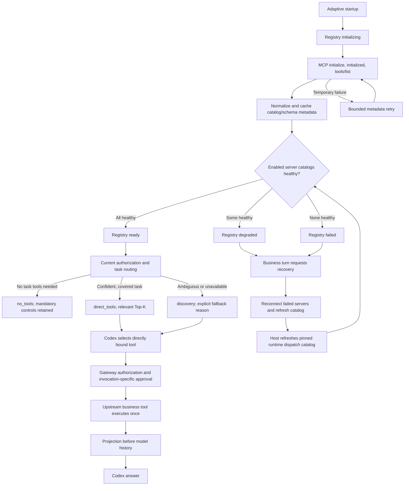

# Adaptive correctness fix: implementation and live acceptance

The local hydration, recovery, dispatch and routing fixes are implemented. **Live acceptance is still blocked:** fresh Qlik MCP initialization establishes TLS but receives no HTTP response headers. There is no new successful five-turn business benchmark, and no new token-savings claim.

## Observed cause

The timeout occurs inside HTTP `initialize`, before response headers. Consequently `notifications/initialized`, `tools/list` and retrieval of upstream schemas are not reached. Empty local normalization/binding bookkeeping still runs, without usable upstream tools. Node fetch, Node HTTPS, curl and the actual pinned Codex Rust catalog probe reproduce the failure. Changing the initial protocol proposal or replaying the captured Rust request shape did not restore it.

The internal service/reverse-proxy cause is unknown: this workspace has no identified Qlik service-admin or log access. Client-side evidence does not establish a particular server-side error. There is no configured SSH host, Kubernetes target or Qlik deployment runbook; an unmapped cloud credential profile is not evidence of access to this service. See the [service access audit](service-access-audit.json).

Separately, the previous implementation cached failed hydration as a healthy empty registry, conflated the local proxy's four tools with downstream readiness, cached authorization exclusions with metadata, and omitted complementary app-explanation tools. Those local defects are corrected. Startup and business-action timeout budgets remain 30 and 120 seconds.

Evidence: [investigation before changes](ROOT_CAUSE.md), [catalog readiness and stage events](catalog-readiness.json), [final catalog recheck](catalog-readiness-recheck.json), [pinned Rust catalog-only probe](direct-rust-catalog-health.json).

## Registry and execution lifecycle



`ready` with zero upstream tools is invalid when an enabled attached MCP is expected to provide tools. A session with no enabled MCP attachment may legitimately be ready with an empty MCP catalog. The local fallback proxy's readiness is recorded separately.

Hydration retry settings are configurable: `maxAttempts`, `retryDelayMs`, `hydrationTimeoutMs`. Defaults are two metadata attempts and a 100 ms delay; each attempt remains bounded by the existing startup budget. Recovery never automatically retries a business invocation whose completion is uncertain.

Metadata/schema caches contain no authorization decisions. Reconnect, schema/configuration changes, disablement and invalidation refresh the catalog. Exposure and execution evaluate current permissions. A changed catalog must be loaded into the pinned runtime before newly selected schemas can reach the model. The host uses its existing authorized thread-resume path; a missing refresh callback blocks exposure explicitly.

## Minimal changes

| File                                                     | Change and purpose                                                                                                                                             |
| -------------------------------------------------------- | -------------------------------------------------------------------------------------------------------------------------------------------------------------- |
| `agent-core/src/mcp-transport-v2.ts`                     | Stage-level connection/catalog timing and classified errors; bounded cancellation; nonblocking SSE cleanup after a valid matched result.                       |
| `agent-core/src/adaptive-mcp-gateway-v2.ts`              | Explicit registry health, metadata-only retries/recovery, cache independence from permissions, fresh catalog fingerprint, direct bindings and safe projection. |
| `agent-core/src/tool-router-v2.ts`                       | Task-aware app routing, configurable Top-K/confidence checks, coverage/failure diagnostics, and contextual named-app follow-ups.                               |
| `agent-core/src/adaptive-session-v2.ts`                  | Recovery before relevant turns, dispatch refresh barrier, compact successful-result routing hints, fresh permission-grant handling and observer isolation.     |
| `agent-core/src/adaptive-model-boundary-v2.ts`           | `no_tools` mode and native identity matching by namespace plus name; preserve mandatory controls and dynamic pruning.                                          |
| `agent-core/test/adaptive-mcp-gateway-v2.test.ts`        | Hydration state, retry/recovery, caching, authorization, projection and binding regressions.                                                                   |
| `agent-core/test/mcp-transport-v2.test.ts`               | Transport timeout/stage, HTTP status and stale-session/catalog regressions.                                                                                    |
| `agent-core/test/adaptive-correctness-security.test.ts`  | Namespace-specific native authorization, observer isolation and stalled matched-SSE cleanup regressions.                                                       |
| `agent-core/test/tool-router-v2.test.ts`                 | Exact Qlik listing/explanation, task coverage, contextual routing and confidence fallback regressions.                                                         |
| `agent-core/test/adaptive-session-v2.test.ts`            | Recovery-to-execution integration, dispatch refresh, duplicate identifiers, projection, approvals and fresh permission grants.                                 |
| `agent-core/test/adaptive-model-boundary-v2.test.ts`     | Prevent stale MCP exposure in `no_tools` and verify namespace-sensitive permissions.                                                                           |
| `platform/scripts/benchmark-five-message-mcp-v2.ts`      | Reuse the same sequential five-message harness with the real Adaptive session and runtime catalog refresh; new capture directory and live provenance.          |
| `platform/scripts/report-five-message-mcp-v2.ts`         | Logical tool bindings, evidence-based answer checks and correctness-gated performance claims.                                                                  |
| `platform/scripts/verify-adaptive-correctness.ts`        | Offline live-capture provenance, configuration, actual business evidence and parity gate.                                                                      |
| `platform/scripts/trace-adaptive-correctness-routing.ts` | Offline routing demonstration using the captured actual Qlik catalog; no inference or business execution.                                                      |
| `platform/scripts/check-adaptive-catalog.ts`             | Read-only live initialization/catalog check with stage events; no provider or business calls.                                                                  |
| `platform/scripts/diagnose-mcp-hydration.ts`             | Independent authenticated client/protocol comparison with redacted timing evidence.                                                                            |
| `platform/scripts/diagnose-codex-mcp-protocol.ts`        | Local capture of the actual pinned runtime initialization request; no inference.                                                                               |
| `platform/scripts/diagnose-direct-codex-mcp.ts`          | Actual pinned Rust direct catalog health check; no inference.                                                                                                  |

New reports and diagnostic artifacts live in this directory. Historical benchmark artifacts remain intact. Pre-existing workspace changes outside this list are not part of this fix.

## Routing, security and projection

The platform routes before inference, using normalized metadata and compact state rather than another model call. Tools are tenant/attachment scoped and authorized before selection. Retrieval uses server/vendor, tool name, description and tags; scores are deterministic retrieval scores, not correctness probabilities. Thresholds and candidate reasons are captured in traces. Similar complementary tools can be exposed together, within configured Top-K, while ambiguity across systems uses discovery.

`no_tools` applies to greetings and unrelated general questions while retaining mandatory runtime controls. `direct_tools` supplies relevant schemas and hidden upstream bindings. `discovery` retains the four Omni tools, with `registry_unavailable` distinguished from semantic ambiguity or missing task coverage. Registry failure cannot silently classify a Qlik business request as requiring no tools.

The actual captured Qlik catalog supplies these app-explanation capabilities: `get_apps`, `get_app_details`, `get_app_script`, `get_lineage`, `get_app_sheets`. The router selects a bounded complementary bundle when the task/server is clear and authorized coverage is sufficient. It never invents an upstream tool. Missing or denied capabilities, an insufficient Top-K budget, or additional uncovered tasks trigger explicit fallback.

Recognized explanation tasks also perform a bounded metadata retrieval expansion: the original query plus the resolved server and `app details`. The same retriever and current authorized catalog supply the observed `get_app_details` anchor score; no synthetic confidence is assigned. Original and expanded queries/scores are traced. The anchor must meet the configured threshold before the complementary bundle is exposed. Tests verify both passing scores and strict/low-confidence custom-retriever fallback. The unchanged default threshold/margin are 0.85/0.025; these local fixtures do not establish production calibration.

Unique tools keep native-looking names. Collisions use deterministic namespacing and a hidden `exposedName → serverId/upstreamToolName/schema/policy` binding. Confidence does not grant execution rights. The gateway checks current permission and required invocation-specific approval before upstream dispatch. Explicitly read-only, non-destructive tools may execute automatically under the existing policy; this exception does not apply to unannotated Qlik tools. Default prompt behavior remains; unannotated Qlik reads do not acquire automatic approval merely from their names.

Projection occurs inside the gateway before the result reaches model history. Deterministic app-list projection retains names, GUIDs, streams and pagination. Required identifiers and pagination survive; no missing values are manufactured. `fields: ["*"]` preserves a full-result escape hatch when platform-owned narrowing is not required. Simple app-list turns retain the platform projection even if the model supplies `["*"]`; an explicit user request for raw/full fields disables that narrowing. Projection needs no mandatory extra model call. An action timeout is not converted into fabricated evidence or automatic action replay.

Local integration tests exercise actual HTTP dispatch to the local gateway with controlled upstream fixtures. They verify separate GUIDs for duplicate app names and fresh approval for every invocation. **Those fixtures demonstrate implementation behavior, not live Qlik task completion.**

The [captured-catalog routing trace](captured-catalog-routing-trace.md) and its [full JSON](captured-catalog-routing-trace.json) show candidate scores, binding names and selected schemas for all five exact prompts. With those historical healthy descriptors, the sequence selects 0, 0, 1, 0 and 5 MCP schemas. The list request selects `get_apps`; the explanation selects the five real catalog capabilities. This offline trace has zero inference, network and business calls and does not claim current execution success or token usage.

## Live correctness and performance

The first fixed-gateway readiness check started at 2026-10-03 10:07:22 UTC and ended at 10:08:26 UTC. Its two initialization attempts took approximately 30,005 and 30,002 ms. The final recheck at 10:19:33–10:20:35 UTC reproduced the failure after two bounded attempts. Both returned `registry.state = failed`, `upstreamToolCount = 0`, `error.stage = initialize`, `error.kind = timeout`. Model calls: 0. Business calls: 0. Normalization of the empty failed catalog took less than 1 ms; it was not the 30-second bottleneck.

A final read-only HTTP status check found that `https://quality.ktern.com/` responds **200** in approximately 0.71 seconds, while an unauthenticated HEAD to `/qlik-mcp/` completes TLS but receives no response headers within 10 seconds. The shared origin is responsive; the MCP path is still unresponsive to this probe. This does not establish the worker status or explain its authenticated initialization failure. See [HTTP status evidence](service-http-status.json).

No service restart or production configuration change was attempted. Restoring the connector requires the identified service owner/admin to inspect ingress and application logs for these initialization requests, confirm the worker is running and accepting requests, and establish why a TLS-accepted request produces no HTTP response. This workspace cannot determine whether restoration is possible without that evidence/access.

| Metric                                                    |     Historical Direct |     Historical Omni | Historical Adaptive | Fixed implementation live replay |
| --------------------------------------------------------- | --------------------: | ------------------: | ------------------: | -------------------------------- |
| Reported input tokens                                     |               122,167 |              99,772 |              25,602 | Not measured                     |
| Reported output tokens                                    |                 1,701 |                 436 |                 691 | Not measured                     |
| Provider calls                                            |                     9 |                  11 |                   7 | Not measured                     |
| Equivalent Qlik evidence                                  | Partial real evidence |                  No |                  No | Unverified                       |
| Per-turn latency/schema/history/result/projection metrics |   Historical captures | Historical captures | Historical captures | Not measured                     |

Historical output totals are provider-reported and include anomalous zero-token tool-use reports; they are not independently validated billing totals. The historical lower Adaptive input is not an equivalent-task optimization result. Direct's technical explanation was also partial: script, lineage and sheet requests timed out, and the reply overclaimed a second script attempt and confirmed sheet absence.

The [new correctness gate](live/CORRECTNESS_GATE.md) provides the exact five prompts and per-turn input/output/call table, presently marked **not run**. The [historical report](../five-message-mcp-v2/comparison.md) retains previous turn totals and full inputs/outputs/raw payloads. These are separate evidence sets.

Before claiming parity, fresh Direct and Adaptive captures must show actual Qlik execution, equivalent app names/GUIDs/streams, page size and pagination/total count. The named-app explanation must identify the same real application alternatives and retrieve sufficient real metadata/technical evidence. A generic answer or timeout is not evidence. The verifier then permits performance comparison; absent usage remains unknown, and bytes are not represented as exact token charges.

## Reproduce once Qlik catalog health is restored

```sh
platform/node_modules/.bin/tsx platform/scripts/check-adaptive-catalog.ts
# Continue only after ready:true with the expected nonempty catalog.
platform/node_modules/.bin/tsx platform/scripts/benchmark-five-message-mcp-v2.ts --mode direct --out docs/adaptive-correctness-fix/live/direct
platform/node_modules/.bin/tsx platform/scripts/benchmark-five-message-mcp-v2.ts --mode omni --out docs/adaptive-correctness-fix/live/omni
platform/node_modules/.bin/tsx platform/scripts/benchmark-five-message-mcp-v2.ts --mode adaptive --out docs/adaptive-correctness-fix/live/adaptive
platform/node_modules/.bin/tsx platform/scripts/verify-adaptive-correctness.ts --dir docs/adaptive-correctness-fix/live
platform/node_modules/.bin/tsx platform/scripts/report-five-message-mcp-v2.ts --dir docs/adaptive-correctness-fix/live
```

Each mode retains the identical model, messages, MCP startup/action budgets, approval behavior and sequential same-thread interaction. Turns are awaited before sending the next message. New captures retain raw Codex input, boundary input, provider input/output events and tool results, redacting credentials. No production default changes: Direct remains the default.

## Verification and limits

Final verification counts and commands are recorded in [validation.json](validation.json). AgentCore, platform and model-gateway TypeScript builds use temporary output directories. Strict standalone script checks include the benchmark, reporter, verifier and diagnostics. All changed source/test/script files pass targeted formatting and `git diff --check`.

| Suite / check                                          |  Passed | Failed | Skipped | Result                               |
| ------------------------------------------------------ | ------: | -----: | ------: | ------------------------------------ |
| AgentCore, full suite with serial test-file execution  |     302 |      0 |       0 | Pass                                 |
| Platform                                               |     152 |      0 |       0 | Pass                                 |
| Model gateway                                          |      64 |      0 |       0 | Pass                                 |
| **Total final test runs**                              | **518** |  **0** |   **0** | **Pass**                             |
| AgentCore / platform / model-gateway TypeScript builds |       — |      — |       — | All pass                             |
| Strict standalone changed tests and experiment scripts |       — |      — |       — | Pass                                 |
| Targeted formatting and `git diff --check`             |       — |      — |       — | Pass                                 |
| Repository-wide formatting                             |       — |      — |       — | 58 unchanged pre-existing violations |
| Live Qlik correctness gate                             |       — |      — |       — | Blocked                              |

Repository-wide formatting currently reports 58 pre-existing unrelated files. They were not reformatted. The first parallel AgentCore run had five temporary-directory cleanup races (`ENOTEMPTY`); the affected pinned-runtime tests and full suite pass serially without changing their teardown code.

The pinned Codex checkout remains unchanged at revision `4a942885c8b4745757a9f86ad2075e16c42483c5`. Baseline hashes verify historical captures, Direct/Omni source and unrelated existing workspace files remain unchanged. No production environment file was edited. Diagnostic Mongo access is read-only; this fix does not write production database records.

Remaining limits: upstream internal failure is unresolved; live app-list and named-app parity, final answer correctness, new model-call/token totals and live latency/projection measurements are unverified. Production confidence calibration and any history compaction remain separate work. This task's live definition of done has not yet been met.

## Subsequent live rerun — October 3, 2026

At the user's request, all three modes were rerun with the exact five messages. All 15 responses finished, but no mode retrieved Qlik business evidence. Reported input/output/provider calls: Direct 67,195/476/8; Omni 81,032/554/9; Adaptive 26,154/587/7. Fresh Direct startup also failed with the same configured 30-second budget. Adaptive spent approximately 60 seconds recovering before each Qlik turn. The live correctness gate remains unsuccessful, and no successful-task savings claim is made.

[New per-turn results and insights](rerun-20261003123245/RUN_RESULT.md) · [Full raw-payload report](rerun-20261003123245/comparison.md). Earlier tables above remain the pre-rerun snapshot.

The benchmark launch requires PROJECT_ROOT=/Users/ashok/truex-plan because the existing schema loader resolves a relative root otherwise. This was set only in the benchmark process environment. No benchmark/runtime source change was needed.
