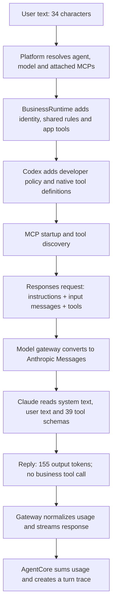

# Complete message and token analysis — Research Agent

Generated: 2026-10-03T00:22:32.913Z. Model: `claude-sonnet-5`. Message: **Hello i am ashok what is your name**.

This report follows the message through the platform configuration builder, BusinessRuntime, the pinned Codex app-server, the model gateway, the actual Anthropic-compatible provider request, and the AgentCore trace. It includes the full input and output contents in [the captured payloads](agent-token-request-payloads.md), with structured evidence in [the capture JSON](agent-token-request-details.json). Credentials and authorization headers are omitted.

**The full runtime call with Qlik ready used 9,700 input tokens and 155 output tokens, for 9,855 total. The user typed only 34 characters. Most input is instructions and tool schemas.**

## 1. Measurement types — read this before adding numbers

| Label | Meaning | Can it be used for the live total? |
| --- | --- | --- |
| Measured usage | Returned by the provider for a generated response and checked against AgentCore. | Yes, as reported by this custom provider. It is not an independently verified invoice. |
| Count-only estimate | Returned by the provider’s /messages/count_tokens endpoint for a hypothetical request. | No. This endpoint disagrees with generation usage in these runs. |
| Visible-size estimate | ceil(UTF-16 character length / 4), applied to text or compact JSON. | No. It only compares payload size; it is not Claude’s tokenizer. |
| Not reported | The provider did not return this breakdown. | Keep unknown separate from zero. |

Count-only sections below use ordered cumulative requests. Subtracting consecutive counts estimates the extra size of a group; shared tool framing is allocated to the first group. Group ordering and provider behavior can affect the estimate. Never add these estimates to measured input/output.

## 2. The exact user message and configuration

```text
Hello i am ashok what is your name
```

| Item | Value | Where it is used / token relevance |
| --- | --- | --- |
| User text | 34 characters; 9 tokens by the visible-size estimate | Included as user content. The count-only endpoint reports 19 tokens for the minimal message plus API framing. |
| Agent role | You are senior consultant | Included in system instructions under Agent role. |
| Agent display name / handle | Research Agent / researchagent | UI and configuration selection; these values were not inserted into the captured system/user text. |
| Identity / persona | Default: Truex assistant | Automatically included because the agent has no persona override. |
| Scope | Business, by default | Controls runtime instructions; no explicit scope was supplied. |
| Model profile | 6ab96fa2077a84a32b05b738 → claude-sonnet-5 | Selects endpoint, adapter, credentials and model. |
| MCP connector | qlik | Connector policy and available schemas can enter model input; endpoint/auth configure the MCP client. |
| Skill IDs | Empty | No configured skill body is included. |
| Previous chat messages | None; fresh diagnostic threads | No accumulated conversation-history cost in these runs. |
| Uploaded documents / returned Qlik data | None | No document contents or Qlik business records were sent. |
| Agent look / tint / description / builtin | UI/configuration metadata | Not part of the captured message or tool definitions. |
| Sandbox / approval settings | read-only / on-request | Become runtime policy; the injected permission text does contribute input tokens. |
| API keys and MCP auth header | Authentication only; not shown | Not user/system content. Stored and used by infrastructure, not counted as prompt text here. |

**Attachment detail:** current platform code selects MCP profiles by `scope` and `agentIds`; it does not use the legacy agent `mcpProfileIds` field. These diagnostic runs explicitly supplied the Qlik profile to the production configuration builder and normalized it as an attached tenant connector. This tests the supplied scenario, without proving that your stored agent is correctly attached in every tenant. `autoConnect` in the supplied document is not mapped by the current MCP configuration builder. See [the attachment query](../platform/src/service.ts) and [MCP configuration conversion](../platform/src/mcp.ts).

## 3. Every processing level



| Level | What happens | What reaches the LLM | Token category |
| --- | --- | --- | --- |
| 1 — UI / platform API | Accepts and associates the user text with a session/agent. | The text itself; ordinary HTTP/DB operations are not additional model calls. | User input. |
| 2 — Platform configuration | Loads role, model profile, skills and connector attachments. | Custom role and MCP instructions; the rest configures infrastructure. | System input. |
| 3 — BusinessRuntime | Adds Truex identity, business rules, visual/suggestion instructions and 12 application tools. | Those instruction strings and application function schemas. | System + tool-schema input. |
| 4 — Codex runtime | Adds permission guidance and native plan/question/helper/goal tools. | One developer policy message plus 10 additional native function schemas. | System + tool-schema input. |
| 5 — MCP discovery | Initializes Qlik and retrieves tools. | After readiness: 14 Qlik schemas plus 3 MCP resource helper schemas. | Tool-schema input; tools/list is not a Qlik business-data query. |
| 6 — Responses wire | Sends instructions, input, tool namespaces, model settings and streaming options. | Prompt content and definitions. Some namespaces contain several function schemas. | Input plus provider-specific framing. |
| 7 — Anthropic adapter | Merges leading developer text into system; flattens function namespaces. | One combined system block, one user message and 39 function tools. | Actual provider prompt. |
| 8 — Model response | Returns the greeting and capability explanation. | Generated answer, including suggestions when present. | Output. |
| 9 — Gateway / AgentCore | Maps usage, emits runtime usage updates, sums calls into the trace. | No extra generation caused by collecting Observability. | Accounting, not extra prompt content. |

If the model calls a tool, its arguments are output tokens. The result returns as input to the next model call, which also rereads the applicable instructions, schemas and history. That repeated input can outweigh the original user message. These greetings made exactly one generation call each and no model-requested tool calls.

## 4. Measured usage at the complete runtime boundary

| Scenario | Function definitions sent to Claude | Input — measured | Output — measured | Total — measured | Gateway duration ms | Time to first text ms |
| --- | --- | --- | --- | --- | --- | --- |
| No Qlik | 22 | 7,335 | 66 | 7,401 | 4,533 | 3,481 |
| Qlik attached | 25 | 7,956 | 116 | 8,072 | 3,530 | 1,910 |
| Qlik ready before turn | 39 | 9,700 | 155 | 9,855 | 7,573 | 3,976 |

Waiting until Qlik is ready changes input from **7,335 to 9,700 (+2,365)** compared with no Qlik, and output from **66 to 155 (+89)**. The complete total rises by **2,454**. Output text is stochastic, so the output delta is not a fixed Qlik fee.

The immediate-start Qlik request had only 25 function definitions: the 22 baseline functions plus 3 MCP resource helpers. Its actual request did not include the 14 Qlik data schemas. A separate startup-only diagnostic verified the server reached `ready` and exposed all 14 tools. Waiting for that readiness before sending produced the 39-tool request. This is evidence of startup timing; do not interpret the earlier small increase as the steady cost of a ready Qlik connector.

## 5. Complete input split — Qlik ready

These are **provider count-only estimates**, not a subdivision of the measured 9,700. The ordered breakdown sums to the count endpoint’s 11,088-token estimate.

| Input component | Count-only incremental tokens | Share of count-only total | Tools in group | What this contains |
| --- | --- | --- | --- | --- |
| User message + API framing | 19 | 0.2% | 0 | Count-only request containing this user message; includes API framing. |
| Combined system instructions | 2,862 | 25.8% | 0 | Truex instructions, custom role, MCP policy and runtime permission block. |
| Planning and clarification tools | 584 | 5.3% | 2 | Schema definitions only; no tool execution. |
| Helper-agent tools | 2,506 | 22.6% | 5 | Schema definitions only; no tool execution. |
| Goal tools | 667 | 6.0% | 3 | Schema definitions only; no tool execution. |
| Document, visualization and workspace tools | 2,014 | 18.2% | 12 | Schema definitions only; no tool execution. |
| MCP resource tools | 430 | 3.9% | 3 | Schema definitions only; no tool execution. |
| Qlik data tools | 2,006 | 18.1% | 14 | Schema definitions only; no tool execution. |
| Count-only total | 11,088 | 100.0% | 39 | Planning estimate; measured generation input was 9,700. |

| Reconciliation | No Qlik | Qlik immediate | Qlik ready |
| --- | --- | --- | --- |
| Full count-only estimate | 8,368 | 9,082 | 11,088 |
| Generation input actually reported | 7,335 | 7,956 | 9,700 |
| Count-only minus generation | 1,033 | 1,126 | 1,388 |

The mismatch is observed behavior of this custom provider/proxy; its cause was not established. No exact billable token attribution per instruction or per tool was returned. The estimates identify large components, while measured usage is the generation total.

## 6. System-message content, layer by layer

| Instruction layer | Characters | Visible-size estimated tokens | What to inspect |
| --- | --- | --- | --- |
| Identity / persona | 75 | 19 | `instructionSources.defaultPersona` in the capture JSON |
| Shared business/runtime rules | 4,009 | 1,003 | `instructionSources.businessInstructions` in the capture JSON |
| Visualization rules | 2,381 | 596 | `instructionSources.visualizationInstructions` in the capture JSON |
| Follow-up suggestion rules | 887 | 222 | `instructionSources.suggestionInstructions` in the capture JSON |
| Custom agent role | 25 | 7 | `instructionSources.agentRole` in the capture JSON |
| Attached Qlik connector instructions | 1,347 | 337 | Policy text and exact server name `qlik`. |
| Runtime permission instructions | 3,882 | 971 | Injected developer message; merged into Claude system text. |
| Separators, section labels and other framing | 18 | Not independently tokenized | Includes section heading and newline separators. |
| Complete Claude system text | 12,624 | 3,156 | Total; above rows are components, not extra tokens. |

The full-runtime system message contains your short consultant role, several thousand characters of Truex guidance, and a long permission block injected by the runtime. The permission block discusses shell escalation even though this business runtime disables shell/unified execution. That is a concrete optimization candidate to review. The 14 Qlik tools do not live in this system text; their descriptions and schemas are sent separately in `tools`.

The full combined system text is included in [the exact captured payloads](agent-token-request-payloads.md). Instruction source strings and complete wire/provider requests are in [the JSON capture](agent-token-request-details.json).

## 7. Every tool definition sent to Claude — ranked by visible size

There are **39** function definitions in the ready scenario: 12 application tools, 10 runtime plan/question/helper/goal tools, 3 MCP resource helpers and 14 Qlik data tools. An asterisk in the fields column means that argument is required. Each row includes the complete compact JSON size of the provider tool definition, including description and schema; estimated tokens use characters / 4.

| Tool name at provider | Group | JSON characters | Visible-size estimated tokens | Arguments (* = required) | Description excerpt |
| --- | --- | --- | --- | --- | --- |
| multi_agent_v1__spawn_agent | Helper-agent tools | 6,746 | 1,687 | fork_context (boolean), items (array), message (string), model (string), reasoning_effort (string), service_tier (string) | Available model overrides (optional; inherited parent model is preferred): |
| update_goal | Goal tools | 1,909 | 478 | status* (string) | Update the existing goal. |
| multi_agent_v1__send_input | Helper-agent tools | 1,579 | 395 | interrupt (boolean), items (array), message (string), target* (string) | Send a message to an existing agent. Use interrupt=true to redirect work immediately. You should reuse the agent by send_input … |
| request_user_input | Planning and clarification tools | 1,335 | 334 | questions* (array) | Request user input for one to three short questions and wait for the response. This tool is only available in Default or Plan m… |
| create_document | Document, visualization and workspace tools | 1,192 | 298 | format* (string), name* (string), paragraphs (array), sheets (array), slides (array), sourceId (string), title (string) | Create a downloadable document, or revised content as a new version. Does not preserve original Office/PDF formatting. For pdf/… |
| mcp__qlik__get_app_variables | Qlik data tools | 925 | 232 | app_id* (string), case_sensitive (boolean), created_in_script (string), limit (integer), offset (integer), search_number (string), search_string (string) | Return variables split by source (script/ui) with pagination and wildcard search. |
| mcp__qlik__get_connections | Qlik data tools | 850 | 213 | app_id* (string), lib_path* (string) | Get the data connection for a specific lib:// path in a Qlik Sense app via the Engine API (GetConnections). Strips the 'lib://'… |
| mcp__qlik__get_app_field | Qlik data tools | 834 | 209 | app_id* (string), case_sensitive (boolean), field_name* (string), limit (integer), offset (integer), search_number (string), search_string (string) | Return values of a single field from app with pagination and wildcard search (supports * and %). |
| search_files | Document, visualization and workspace tools | 787 | 197 | glob (string), ignore_case (boolean), literal (boolean), path (string), pattern* (string) | Workspace paths are relative POSIX paths (e.g. src/zreport.abap) inside this conversation's private workspace. Files persist ac… |
| edit_file | Document, visualization and workspace tools | 755 | 189 | new_string* (string), old_string* (string), path* (string), replace_all (boolean) | Workspace paths are relative POSIX paths (e.g. src/zreport.abap) inside this conversation's private workspace. Files persist ac… |
| write_file | Document, visualization and workspace tools | 745 | 187 | content* (string), path* (string) | Workspace paths are relative POSIX paths (e.g. src/zreport.abap) inside this conversation's private workspace. Files persist ac… |
| create_goal | Goal tools | 729 | 183 | objective* (string), token_budget (integer) | Create a goal only when explicitly requested by the user or system/developer instructions; do not infer goals from ordinary tas… |
| multi_agent_v1__wait_agent | Helper-agent tools | 721 | 181 | targets* (array), timeout_ms (number) | Wait for agents to reach a final status. Completed statuses may include the agent's final message. Returns empty status when ti… |
| update_plan | Planning and clarification tools | 702 | 176 | explanation (string), plan* (array) | Updates the task plan. |
| mcp__qlik__get_apps | Qlik data tools | 693 | 174 | limit (integer), name (string), offset (integer), published (string), stream (string) | Get list of Qlik Sense applications with essential fields and filters (name, stream, published) and pagination. |
| list_mcp_resource_templates | MCP resource tools | 686 | 172 | cursor (string), server (string) | Lists resource templates provided by MCP servers. Parameterized resource templates allow servers to share data that takes param… |
| read_file | Document, visualization and workspace tools | 656 | 164 | limit (integer), offset (integer), path* (string) | Workspace paths are relative POSIX paths (e.g. src/zreport.abap) inside this conversation's private workspace. Files persist ac… |
| append_file | Document, visualization and workspace tools | 644 | 161 | content* (string), path* (string) | Workspace paths are relative POSIX paths (e.g. src/zreport.abap) inside this conversation's private workspace. Files persist ac… |
| create_visualization | Document, visualization and workspace tools | 604 | 151 | description* (string), html* (string), mode (string), sourceId (string), title* (string) | Create an interactive visual inside the conversation. Provide self-contained HTML/CSS/JavaScript with inline data, accessible c… |
| export_workspace_file | Document, visualization and workspace tools | 604 | 151 | name (string), path* (string) | Workspace paths are relative POSIX paths (e.g. src/zreport.abap) inside this conversation's private workspace. Files persist ac… |
| list_mcp_resources | MCP resource tools | 597 | 150 | cursor (string), server (string) | Lists resources provided by MCP servers. Resources allow servers to share data that provides context to language models, such a… |
| multi_agent_v1__close_agent | Helper-agent tools | 533 | 134 | target* (string) | Close an agent and any open descendants when they are no longer needed, and return the target agent's previous status before sh… |
| list_files | Document, visualization and workspace tools | 497 | 125 | path (string) | Workspace paths are relative POSIX paths (e.g. src/zreport.abap) inside this conversation's private workspace. Files persist ac… |
| read_mcp_resource | MCP resource tools | 495 | 124 | server* (string), uri* (string) | Read a specific resource from an MCP server given the server name and resource URI. |
| mcp__qlik__engine_get_visualization_data | Qlik data tools | 494 | 124 | app_id* (string), object_id* (string) | Get actual data from a visualization object (chart, KPI, table, filter pane, etc.). Returns dimension values, measure values, a… |
| mcp__qlik__get_upstream_lineage | Qlik data tools | 494 | 124 | app_id* (string) | Fetch the load script of a Qlik Sense app and identify all upstream data dependencies using AWS Bedrock AI. Returns a textual r… |
| mcp__qlik__get_lineage | Qlik data tools | 492 | 123 | app_id* (string) | Get complete data lineage for a Qlik Sense app. Returns the origin and flow of data including LOAD/STORE statements, external c… |
| mcp__qlik__get_app_details | Qlik data tools | 481 | 121 | app_id (string), name (string) | Get compact application info with filters by guid or name (case-insensitive). Returns metainfo, tables/fields list, master item… |
| mcp__qlik__get_qvd_app_id | Qlik data tools | 475 | 119 | qvd_path* (string) | Extract the creator application ID from a QVD file by reading the CreatorDoc tag from the file header. This tool reads the QVD … |
| delete_file | Document, visualization and workspace tools | 426 | 107 | path* (string) | Workspace paths are relative POSIX paths (e.g. src/zreport.abap) inside this conversation's private workspace. Files persist ac… |
| read_conversation_file | Document, visualization and workspace tools | 412 | 103 | id* (string), offset (integer) | Read text from a conversation file by its id. PDF text extraction does not include OCR. Office extraction does not preserve vis… |
| mcp__qlik__get_app_object | Qlik data tools | 352 | 88 | app_id* (string), object_id* (string) | Get specific object layout by calling GetObject and GetLayout sequentially via WebSocket. |
| mcp__qlik__get_app_sheet_objects | Qlik data tools | 334 | 84 | app_id* (string), sheet_id* (string) | Get list of objects from specific sheet with object ID, type and description. |
| mcp__qlik__get_app_field_statistics | Qlik data tools | 302 | 76 | app_id* (string), field_name* (string) | Get comprehensive statistics for a field |
| multi_agent_v1__resume_agent | Helper-agent tools | 299 | 75 | id* (string) | Resume a previously closed agent by id so it can receive send_input and wait_agent calls. |
| get_goal | Goal tools | 250 | 63 | No parameters | Get the current goal for this thread, including status, budgets, token and elapsed-time usage, and remaining token budget. |
| mcp__qlik__get_app_sheets | Qlik data tools | 246 | 62 | app_id* (string) | Get list of sheets from application with title and description. |
| conversation_files | Document, visualization and workspace tools | 213 | 54 | No parameters | List uploaded files and generated documents available in this conversation. |
| mcp__qlik__get_app_script | Qlik data tools | 205 | 52 | app_id* (string) | Get load script from app |

The `multi_agent_v1__spawn_agent` schema is particularly large because it includes detailed subagent guidance and parameter descriptions. Tools can consume input tokens even when never invoked. Your message required none of these functions, but all available definitions in the ready request were still sent.

The three MCP resource helpers were sent even though the supplied Qlik capabilities advertise resources=false. No resource helper was invoked. In these captures the profile’s capabilities flags did not remove those runtime helper definitions.

Full untruncated descriptions and input schemas for every tool are available in the payload Markdown and JSON. Tool names at the Responses boundary may be inside namespaces; the gateway flattens them for Claude, which is why the count of top-level Responses entries can differ from the number of Claude function definitions.

## 8. Output split and the complete answers

| Scenario | Measured total output | Visible reply characters | Reply visible-size estimate | Answer without suggestion block chars | Answer size estimate | Suggestion block chars | Suggestions size estimate | Tool calls | Reasoning tokens |
| --- | --- | --- | --- | --- | --- | --- | --- | --- | --- |
| No Qlik | 66 | 276 | 69 | 276 | 69 | 0 | 0 | 0 | Not reported separately |
| Qlik attached | 116 | 472 | 118 | 472 | 118 | 0 | 0 | 0 | Not reported separately |
| Qlik ready before turn | 155 | 614 | 154 | 441 | 111 | 171 | 43 | 0 | Not reported separately |

Visible-size estimates above do not reconcile to provider output totals and are not additional tokens to charge. The provider returned `output_tokens`, without a separate reasoning counter. AgentCore stores reasoningOutputTokens=0 through its defaulting path, so that zero is not independent proof that thinking cost was zero. These turn traces recorded only a reply step, with no tool or helper activity.

The ready call’s actual response:

```text
Hi Ashok, I'm your Truex assistant. I can help with things like:

- Answering questions and summarizing documents you share with me
- Pulling and analyzing business data through our connected systems (currently I have access to Qlik)
- Researching current information via web search
- Creating downloadable documents (PDF, Word, Excel, PowerPoint)
- Building interactive charts or visualizations when helpful

What can I help you with today?

[truex-suggestions]
- What Qlik apps or data can you access?
- Can you summarize a document I upload?
- Can you create a report or spreadsheet for me?
[/truex-suggestions]
```

The suggestion marker text and three questions are model-generated content, so they contribute to output. The shared suggestion instructions say to omit the block for a greeting/trivial message, but this run still returned it. Following that instruction more reliably would reduce some output. The reply also advertises web search, although this non-Responses profile disables the hosted web-search tool and no equivalent web function appears in the captured definitions. Treat capability claims as model output, not proof that a tool is available. The larger saving for this case remains the instructions/tool schemas, because input is 98.4% of measured usage.

## 9. Provider controls — which values affect limits or input?

| Field | Captured value | Meaning for tokens |
| --- | --- | --- |
| model | claude-sonnet-5 | Model alias sent to the custom endpoint. |
| max_tokens | 64,000 | Output ceiling, not 64,000 tokens consumed or reserved. The actual output was 155. |
| stream | 1 | Transport mode; streaming itself does not mean multiple generation calls. |
| tool_choice | {"type":"auto"} | Tools are optional; auto still sends their definitions. |
| thinking | {"type":"adaptive","display":"summarized"} | Adaptive thinking was requested. Separate reasoning usage was not returned. |
| cache_control | {"type":"ephemeral"} | Ephemeral caching was requested; cache-read/write token counts were absent. |
| Responses store | 0 | Runtime manages/sends its history; do not assume the provider remembers omitted context. |
| Responses parallel_tool_calls | 1 | Allows eligible tool calls; no call happened. |
| reasoning summary | {"summary":"auto"} | Runtime output preference, not a separate user message. |
| API authorization / MCP x-api-qlik-key | Omitted from artifacts | Transport authentication, not natural-language prompt content. |

## 10. What Observability recorded at each level

| Observed field | Ready-call value | Source and interpretation |
| --- | --- | --- |
| Generation HTTP status | 200 | Upstream provider response. |
| Gateway input_tokens | 9,700 | Normalized provider count; gateway supports combining Anthropic ordinary/cache input categories when supplied. |
| Gateway output_tokens | 155 | Provider output count. |
| AgentCore inputTokens | 9,700 | Sum of last-model-call usage updates for this turn. One call here. |
| AgentCore outputTokens | 155 | Same output count; cross-check agrees. |
| AgentCore totalTokens | 9,855 | Input + output, once. |
| AgentCore cachedInputTokens | 0 | Raw provider cache counts were absent; displayed zero comes from defaulting. |
| AgentCore reasoningOutputTokens | 0 | Provider reasoning breakdown absent; do not assume provider-confirmed zero. |
| Helper-agent usage | None | No helper spawned. |
| Tool execution steps | 0 | Only the model reply step appears in the trace. |
| Context used / context window | 9,700 / 258,400 (3.75%) | Latest model call input, not the sum of an arbitrary multi-call turn. |
| Time to first byte/text | 3975 / 3976 ms | Gateway timing. |
| Turn status | completed | Runtime reached a completed trace. |
| App conversation / Mongo session | Not created | Used fresh isolated runtime threads. The runtime trace is saved in this report/JSON, but not the platform UI’s persistent sessions. |

Provider usage, gateway access logs and AgentCore usage are three observations of the same tokens. **Do not add their totals together.** Cached input is a subset of input, and reasoning—when reported—is a subset of output. Source: [gateway usage normalization](../model-gateway/src/adapters/anthropic.ts), [runtime turn accounting](../agent-core/src/trace.ts), [UI token categories](../frontend/lib/observability.ts).

## 11. Optimization priorities based on this actual message

| Priority | Component | Evidence from count-only breakdown | Proposed change / trade-off |
| --- | --- | --- | --- |
| 1 | Native helper-agent definitions | 2,506 tokens; spawn-agent schema is the biggest individual definition. | Review whether helper tools need to be exposed on simple chat turns. Use a distinct lightweight mode or capability set; retain delegation for tasks that need it. |
| 2 | Shared runtime / permission guidance | 2,862 tokens for system content beyond the minimal user prompt. | Remove duplicated or irrelevant instructions carefully. Review shell-escalation text in a runtime where shell tools are disabled. Preserve required guardrails. |
| 3 | 12 document/visualization/workspace tools | 2,014 tokens. | Offer a narrower capability set for chat-only agents or defer schemas until the task needs them. Repeated workspace descriptions are candidates for shortening. |
| 4 | 14 Qlik data tools | 2,006 tokens; actual ready-vs-no-Qlik input increase was 2,365 including connector policy/resource helpers. | Expose connector schemas when required by the task. Discovery or routing adds complexity and may require another model call; measure the whole task after changing it. |
| 5 | Goals, planning and clarification tools | 667 + 584 tokens. | Keep these tools for appropriate long tasks/explicit goals. Consider omitting irrelevant capability groups on lightweight requests. |
| 6 | MCP resource helpers | 430 tokens; supplied server exposes no resources. | Review whether these three schemas are needed for tools-only connectors. |
| 7 | Output verbosity / suggestion markers | 155 measured output vs 9,700 input. | Use a brief greeting and omit follow-up blocks for trivial messages. Output savings here are much smaller than input savings. |
| 8 | Repeated context and cache visibility | No previous history in this test; cache counters absent. | For real multi-turn tasks, control history/results growth and confirm actual cache usage. A cache option alone is not evidence of cache savings. |

These are optimization candidates, not implemented changes or promises that every estimated token is removable. Disable tools only when the application can still serve the intended tasks; changing the instruction prefix may affect existing cache reuse. Compare the same full-runtime message and task after one change, with MCP readiness held constant. Track input/output, number of model calls, actual tool success and cache counters together.

## 12. Earlier direct-provider results — retained for context

| Earlier test | Input | Output | Total | Tools offered | Measurement boundary |
| --- | --- | --- | --- | --- | --- |
| Direct, no Qlik | 3,519 | 96 | 3,615 | 12 | Manually assembled Truex/application-tool request; skipped Codex’s native policy/tools. |
| Direct, all Qlik tools explicitly attached | 5,513 | 152 | 5,665 | 26 | Manually assembled request with 12 app tools + 14 Qlik tools. |
| Complete runtime, no Qlik | 7,335 | 66 | 7,401 | 22 | Includes Codex permission policy and native tools. |
| Complete runtime, Qlik ready | 9,700 | 155 | 9,855 | 39 | Includes native tools, resource helpers and all 14 Qlik data tools. |

**Correction to the earlier report:** its 3,519/5,513 input totals were real direct-provider results, but they were not full app-runtime totals. They should not be used as the complete runtime baseline. The full-runtime captures above resolve that missing level.

## 13. Scope, evidence and limits

- The runs used the production platform configuration builder, BusinessRuntime, the project-local pinned Codex binary, gateway adapter and live model profile. A temporary local capture relay observed JSON bodies at the Responses and provider boundaries.
- The supplied agent scenario and explicit Qlik attachment were constructed in memory. Model/MCP credentials were read from existing stored profiles. No stored agent/model/connector documents were changed, and no business-data tool was executed.
- Diagnostic threads used isolated temporary runtime homes and were stopped/removed afterward. No platform session was inserted. The JSON retains the complete measured AgentCore traces and credential-free message/tool payloads.
- Per-component/provider count-only estimates are distinct from live usage. The observed estimate mismatch is recorded, rather than silently forced to reconcile.
- No price schedule or invoice was returned for this custom model alias, so a trustworthy dollar cost is unavailable. Compute money only after obtaining the provider’s rates and reliable cache/billing categories.
- The normalized cached/reasoning counters can default to zero when upstream detail is absent. This report marks the raw uncertainty explicitly.
