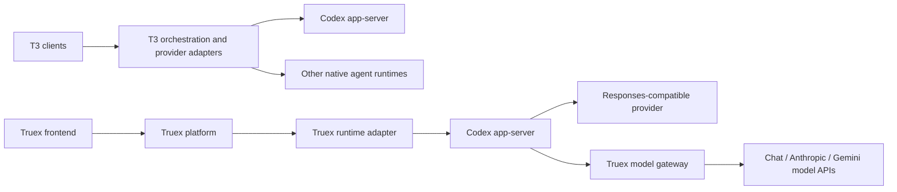

# T3 Code and Truex: architecture comparison and improvement scope

Date: 6 October 2026  
Branch: `agent-core-update-v2`  
Truex revision: `e44b79e9c5eea2b5de000a0cfca6ffff8a5821ec`  
T3 Code revision: `cf3e714b0f58e29c8fa8660db50d2187e3263b65`

This report records the earlier comparative audit, with key references and failure fixtures rechecked against this branch. The earlier audit used three GPT-6.1-Sol sub-agents for runtime architecture, UX/performance, and operations/security. This branch was clean before the report was added and does not contain the uncommitted caching implementation examined during that audit. Recommendations below apply to the code available here.

This is a source review with focused local experiments. Production behavior, browser performance, live provider recovery, and deployed storage configuration remain unverified. Application source was unchanged.

## Recommendation

Keep the current Codex runtime and model gateway. Adopt T3's bounded lifecycle transitions, recoverable command receipts, bounded history delivery, and selective rendering incrementally.

Truex already provides steering, goals, helper agents, persistent conversations, replay/resynchronization, durable result handoff, ownership checks, document tools, and interactive artifacts. The next improvements should make those capabilities responsive and truthful through interruptions, reconnections, crashes, and long-running conversations.

## Architecture: what each harness owns

Both products drive Codex app-server; Codex owns the inner model/tool loop. Truex starts `codex app-server --listen stdio://`, initializes it, and routes native requests and events through its manager. See [client.ts](/Users/ashok/truex-plan/agent-core/src/client.ts:110). This boundary agrees with the [official OpenAI app-server documentation](https://developers.openai.com/siwc/token-sharing-open-source/codex-app-server).

T3's [provider registry](/Users/ashok/t3code/apps/server/src/orchestration-v2/builtInProviderAdapterDrivers.ts:33) adapts different native agent runtimes, including Codex and Claude Code. Truex's [gateway adapter contract](/Users/ashok/truex-plan/model-gateway/src/adapter.ts:37) translates model APIs while retaining Codex as its agent runtime.

Claude models through Truex's gateway and native Claude Code through T3 are different capabilities. A native runtime adapter is justified when customers need that runtime's distinct tools, session behavior, or account integration.

| Area | T3 pattern | Truex implementation | Improvement scope |
|---|---|---|---|
| Runtime abstraction | Native driver registry and explicit capabilities | Codex business runtime plus model API gateway | Describe supported behavior explicitly; add native drivers for demonstrated demand |
| Durable work | Command receipt, events, projections, and effect outbox committed together | Pending message before dispatch; durable result spool afterward | Recoverable submission receipts and reconciliation |
| Stop/recovery | Bounded completion waits and terminal-state gates | Manual Stop awaits an event; watchdog independently marks idle | One bounded stop/reconcile transition |
| History | Recent-window snapshots and cursor paging | Full runtime reconciliation and all Mongo messages on open | Bounded recent history, incremental recovery, older-history paging |
| Rendering | Memoized virtual timeline and selective state updates | Main-page state and full transcript grouping/rendering | Isolate composer, memoize settled rows, index history, then virtualize |
| Operations | Durable workers and aggregate metrics | Polling ingestion, request IDs, and turn timings | Fair active scheduling, persistence-lag metrics, consistent deadlines |
| Product | Coding workspace, Git, terminal, remote clients | Business connectors, documents, goals, and visuals | Transfer interaction quality while retaining the business product |

## Priority 1: correctness and recovery

### 1. Unify Stop and watchdog recovery — High

[Manual Stop](/Users/ashok/truex-plan/agent-core/src/manager.ts:704) sets the thread to `interrupting`, disables the watchdog, and relies on a native terminal event. If interruption is acknowledged but that event never arrives, subsequent Stop calls return success, resume returns the loaded state, and new messages remain blocked.

The [watchdog](/Users/ashok/truex-plan/agent-core/src/manager.ts:379) does the opposite: it requests interruption without awaiting confirmation and immediately marks the thread idle. A failed interruption can therefore permit another turn while the previous native execution remains uncertain.

**Rechecked on this branch with a fake runtime:**

- Missing terminal event: state remained `interrupting`; watchdog absent; resume issued no native resume; next send rejected with `INTERRUPTING`.
- Watchdog interruption rejected with `CAPACITY`: thread remained loaded, became idle, and a second `turn/start` was admitted.

These fixtures establish the host-state problem, not duplicate production side effects.

**Smallest change:** use one interruption transition for both paths, add a completion deadline, reconcile native state, and keep admission closed while execution remains uncertain. Show an explicit recovery state.

**Acceptance:** missing, delayed, or duplicate completion events; rejected interrupts; helper interruption; and runtime restart cannot permanently block a thread or admit new work before prior execution is settled.

T3 references: [bounded Codex interruption](/Users/ashok/t3code/apps/server/src/orchestration-v2/Adapters/CodexAdapterV2.ts:5894), [terminal-state gate](/Users/ashok/t3code/apps/server/src/orchestration-v2/ProviderTurnControlService.ts:220).

### 2. Recover submission intent across persistence and dispatch — High

[Message submission](/Users/ashok/truex-plan/platform/src/service.ts:1418) inserts a pending message before calling the runtime. A crash between those operations leaves a saved message without a native counterpart. Duplicate handling returns the result only for accepted messages and otherwise rejects retry.

The same path returns the original accepted result if a client ID is reused with different text. A client bug can silently lose the new text. The command path already has stronger payload comparison.

The earlier mocked experiment reproduced both cases; this branch's control flow was rechecked:

- Pending-after-crash retry returned `DUPLICATE_MESSAGE`, dispatched zero turns, and left delivery pending.
- Accepted client ID with different text returned the original turn with `duplicate: true`.

**Smallest change:** extend the current message record into a receipt with payload identity, execution/claim state, native acceptance, and reconciliation ownership. Reject changed payloads for the same ID and inspect duplicate receipts before resume/configuration work.

Durable claims alone do not solve a crash after native acceptance. Automatic retry needs a durable runtime receipt or proof that execution never began. Keep ambiguous operations explicitly uncertain.

**Acceptance:** crash injection before dispatch, after dispatch, and after acceptance results in one execution or recoverable ambiguity, never blind duplicate execution or permanently stuck undispatched work.

T3's [EventSink](/Users/ashok/t3code/apps/server/src/orchestration-v2/EventSink.ts:518) demonstrates recording intent and effects atomically before provider work. This does not require adopting full event sourcing or Effect.

### 3. Preserve provider terminal semantics — High for answer correctness

[Chat translation](/Users/ashok/truex-plan/model-gateway/src/adapters/chat.ts:238) treats any truthy finish reason as completion. [Gemini](/Users/ashok/truex-plan/model-gateway/src/adapters/gemini.ts:311) classifies `MAX_TOKENS` as normal completion. [Anthropic](/Users/ashok/truex-plan/model-gateway/src/adapters/anthropic.ts:494) drops held unfinished calls on `max_tokens` but still emits completion.

Direct fixtures rerun on this branch produced:

| Adapter | Provider finish | Gateway terminal event/status |
|---|---|---|
| Chat | stop | response.completed / completed |
| Chat | length | response.completed / completed |
| Chat | content_filter | response.completed / completed |
| Gemini | MAX_TOKENS | response.completed / completed |

**Smallest change:** distinguish success, token exhaustion, refusal/filtering, malformed tool calls, and transport failure. Retain useful partial text while reporting truncation; never emit an unfinished tool call as executable. Specify safe continuation behavior.

The pinned Codex parser treats `response.incomplete` as a stream error. Merely changing the emitted event can induce retries. Validate the chosen mapping through the pinned runtime and verify both retry count and final product status.

**Acceptance:** provider-specific fixtures assert user-visible outcome, partial text, tool safety, retry count, and usage. Token exhaustion or filtering cannot silently appear as a complete business answer.

### 4. Preserve live approvals when reply admission fails — Medium

[CodexClient.write](/Users/ashok/truex-plan/agent-core/src/client.ts:264) rejects saturated stdin with `CAPACITY`. [Approval settlement](/Users/ashok/truex-plan/agent-core/src/manager.ts:1900) catches response-write failure, removes the pending request, and the answer method reports success.

**Rechecked fixture:** response writing threw `CAPACITY`; the result was `{ok:true}`, pending count became zero, and the durable resolution reason was `runtime-unavailable`.

**Smallest change:** keep pending state for recoverable admission failures and return an actionable retryable error. Distinguish unsubmitted replies, uncertain delivery, and confirmed resolution. Review dynamic-tool replies and remembered grants under the same rule.

**Acceptance:** pipe saturation, runtime death, duplicate answers, expiry, and restart cannot falsely acknowledge a delivered reply or lose a live request.

## Priority 2: experience and performance

### 5. Bound conversation opening and reconnection — High as histories grow

[History](/Users/ashok/truex-plan/platform/src/service.ts:1574) fetches a runtime snapshot, ingests records, reconciles every runtime history page with sequential message writes, then returns all Mongo messages. The frontend [reloads the transcript on stream snapshots](/Users/ashok/truex-plan/frontend/app/page.tsx:473), repeating recovery work during reconnect.

**Smallest change:** return bounded recent persisted history promptly, perform incremental reconciliation with a watermark/cursor, and page older messages. Reserve full reconciliation for detected gaps or migrations. Batch writes where ordering and idempotency permit.

T3 references: [history page policy](/Users/ashok/t3code/apps/server/src/orchestration-v2/threadHistoryPaging.ts:13), [bounded snapshot loader](/Users/ashok/t3code/packages/client-runtime/src/state/boundedThreadSnapshotHttp.ts:21). Understand large-turn handling before copying numeric budgets.

**Acceptance:** compare 100-, 1,000-, and 10,000-message conversations. Initial response size and database work remain bounded. Paging preserves live updates, replay aliases, approvals, and scroll position. Measure p95 open/reconnect latency, payload bytes, query count, memory, and reconciliation lag.

### 6. Reduce transcript work during typing and streaming — High for long chats

[ChatMessages](/Users/ashok/truex-plan/frontend/components/chat-messages.tsx:68) scans/groups entries, renders all groups, and renders historical Markdown again. Composer text lives in the same page. Every [stream event](/Users/ashok/truex-plan/frontend/app/page.tsx:454) updates several state domains. React may batch setters within one callback; this does not establish four renders per event.

**Smallest sequence:**

1. Isolate composer state and memoize settled rows with stable props.
2. Replace repeated transcript scans with indexed lookup.
3. Batch ordered deltas in a bounded short window, flushing terminal/error/approval boundaries promptly.
4. Virtualize long histories after verifying anchors and accessibility.

T3 references: [memoized timeline](/Users/ashok/t3code/apps/web/src/components/chat/MessagesTimeline.tsx:504), [virtual list](/Users/ashok/t3code/apps/web/src/components/chat/MessagesTimeline.tsx:1340), [batch state reduction](/Users/ashok/t3code/packages/client-runtime/src/state/threads.ts:538).

The earlier audit benchmarked the actual [historyEntries helper](/Users/ashok/truex-plan/frontend/lib/chat.ts:112), using alternating synthetic user/assistant messages and the median of seven iterations:

| Messages | Assembly CPU time |
|---|---|
| 1,000 | 3.4 ms |
| 5,000 | 54.6 ms |
| 10,000 | 140.8 ms |

These are prior local helper measurements, not a benchmark rerun during report recreation or measured browser/production latency.

**Acceptance:** profile typing/streaming at those sizes. Settled rows do not rerender on composer keystrokes; virtualized mounted rows remain bounded; important events appear promptly; reading older content preserves the scroll anchor.

### 7. Clarify drafts, sending, synchronization, and available controls — Medium

[Sending](/Users/ashok/truex-plan/frontend/app/page.tsx:756) clears text before acceptance and uses a nonreactive ref guard; visible `canSend` does not include that guard. The page holds one draft rather than a draft per conversation. EventSource opening is labeled connected before asynchronous transcript reconciliation has completed.

**Smallest change:** identity-scoped in-memory drafts keyed by conversation; reactive sending/checking-delivery states; retention of uncertain submissions and their client IDs; and a syncing indicator until history recovery finishes.

T3 references: [composer draft store](/Users/ashok/t3code/apps/web/src/composerDraftStore.ts:89), [synchronization phases](/Users/ashok/t3code/apps/web/src/threadSync.ts:5). Persistent business drafts need an explicit local-content retention policy.

Model settings expose a raw identifier and fixed effort choices. Gateway Chat translation does not map requested reasoning effort. Add a profile-specific capability matrix, validate selections, and disclose unavailable controls instead of making them appear applied.

**Acceptance:** switching conversations restores the correct draft; visible send state matches delivery uncertainty; connection and synchronization status remain accurate; unsupported settings cannot silently appear successful.

### 8. Schedule ingestion fairly — Medium now, High at scale

[Polling](/Users/ashok/truex-plan/platform/src/service.ts:1647) sequentially scans active tenants and non-dead sessions every two seconds. A slow owner can delay all later tenants. Local transport permits 35 seconds per call; AgentCore permits 150 seconds.

**Smallest change:** bounded concurrency with per-tenant fairness, active/backlog tracking, idle backoff, and cursor-based ingestion. Add durable cross-replica claims when multiple workers are deployed. Preserve persist-before-ack and deduplication.

**Acceptance:** 1,000 idle and 100 active sessions with one stalled tenant retain a defined healthy-tenant persistence-lag SLO and bounded in-flight work. Measure invocation counts, queue age, p95/p99 lag, CPU, and memory. This audit establishes no AWS cost savings.

## Priority 3: deployment and authenticated-rollout gates

These are conditional risks, not claims of a compromised deployment.

| Risk | Evidence | Smallest improvement and validation |
|---|---|---|
| **High: existing-stream revocation** | [SSE admission](/Users/ashok/truex-plan/platform/src/index.ts:645) authorizes once; relay does not revalidate membership/session authority | Track streams by session/user/tenant; close on revocation; bounded authoritative revalidation across replicas. Test logout, member removal, tenant disablement, and visibility narrowing |
| **High: tenant-specific gateway authority** | [Tokens](/Users/ashok/truex-plan/shared/gateway-token.ts:6) do not expire; tenant is attribution, while gateway checks shared profile authority | Add revocable tenant/session authority generations with a freshness bound. Revoking one tenant must preserve another tenant's access to the shared model |
| **High, deployment dependent: durable storage readiness** | [Image](/Users/ashok/truex-plan/Dockerfile:78) creates a writable state directory; [health](/Users/ashok/truex-plan/agent-core/src/index.ts:66) reports writability without proving the intended durable mount | Validate the production storage contract after mounts arrive. Test runtime replacement/restore, artifact integrity, and missing/corrupt storage |
| **Medium: inconsistent cold-start deadlines** | [Startup](/Users/ashok/truex-plan/agent-core/src/agentcore-services.ts:50) allows 60 seconds; [forwarding](/Users/ashok/truex-plan/agent-core/src/agentcore.ts:149) adds 120 seconds; [platform](/Users/ashok/truex-plan/platform/src/runtime-transport.ts:83) allows 150 seconds total | Carry one remaining deadline through preparation and admission. Reconcile late acceptance; measure cold preparation separately from model work |
| **Medium: cumulative records and observability** | Session approval/timing arrays grow; existing logs/traces cover individual requests | Bound or paginate cumulative records; add persistence lag, ambiguous delivery, interrupt recovery, saturation, and active-runtime metrics |

T3 socket revocation was not proven by the earlier audit; do not assume that it completely solves long-lived authorization. The live Truex managed mount was also not inspected. Existing authentication and ownership controls should be preserved.

## Maintainability and scope boundaries

- Retain pinned Codex source/generated protocol, restricted business tools, generation fences, serialized turns, admission bounds, durable result handoff, ownership/CSRF/auth checks, document tools, and visualizations.
- Keep provider differences at adapter boundaries. Prefer a small explicit capability contract to provider checks scattered through orchestration and UI.
- Extract focused lifecycle/submission/history functions while changing those behaviors. Large files alone do not justify an unrelated architecture rewrite.
- Truex's [SSE relay already honors writable backpressure](/Users/ashok/truex-plan/platform/src/public.ts:811). Measure before replacing SSE with WebSocket. T3's [stream item/byte budgets](/Users/ashok/t3code/apps/server/src/orchestration-v2/LiveStreamBudget.ts:39) are a pattern to evaluate.
- Avoid adopting Effect, full event sourcing, or a new broker solely to resemble T3.
- Additional caching should target measured repeat work and preserve authorization freshness. The earlier uncommitted cache implementation and its benchmark report are not present on this branch; their benefits are not attributed to this branch.
- Native runtime adapters, mobile, and desktop expansion should follow customer workflows. Business users benefit first from predictable delivery, recoverable work, and clear saved artifacts.

## Suggested implementation order and acceptance measures

1. **Trust and recovery:** unified Stop/watchdog transition; truthful provider endings; approval transport errors; payload conflicts; recoverable submission receipts.
2. **Daily responsiveness:** bounded history and incremental reconciliation; indexed assembly; composer isolation and settled-row memoization; draft/sending/sync states.
3. **Growth and deployment:** fair ingestion; one deadline; mount/recovery validation; stream/token revocation; aggregate reliability metrics.
4. **Optional expansion:** native runtime interface and a second adapter once a customer workflow requires it.

Before/after measurements should include send-to-acceptance, first visible output, cold/warm conversation open, Stop-to-settled time, persistence lag, payload bytes, Mongo/runtime call counts, typing latency, and browser long tasks. Choose numeric SLOs from the actual baseline and product expectations.

Important failures to test include duplicate requests, process crashes around dispatch, interrupted streams, late provider success, expired authority, a stalled tenant, saturated transport, corrupt storage, and large conversations.

## Verification and limits

Rechecked while writing this report on `agent-core-update-v2`:

- **24/24 existing gateway tests passed:** Chat, Anthropic, and Gemini.
- Direct adapter fixtures reproduced the completion-status table above.
- Fake-runtime checks reproduced missing Stop completion, rejected watchdog interruption, and false approval success.
- Key source references were refreshed for this branch; local file links were checked.
- Final diff/whitespace review covers the documentation addition.

Earlier-audit evidence retained with attribution:

- Mocked platform cases reproduced pending-message crash recovery and changed-payload duplicate handling; their corresponding branch code was rechecked.
- The history helper benchmark and frontend findings came from the earlier audit. Its 27 frontend tests included caching files unavailable on this branch, so that result is not claimed as current-branch validation.

This report changes documentation only. The identified application defects remain open. Full suites, production load, browser rendering, live providers, deployed storage, and cross-replica revocation were not verified.

