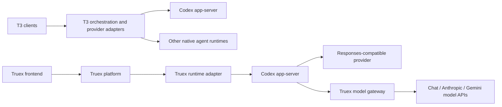

# T3 Code and Truex: implementation comparison and improvement scope

Reviewed 6 October 2026. T3 checkout: `cf3e714b0f58e29c8fa8660db50d2187e3263b65`. Truex HEAD: `e44b79e9c5eea2b5de000a0cfca6ffff8a5821ec`, including the existing uncommitted application/cache work. Three GPT-6.1-Sol sub-agents reviewed runtime, UX/performance, and operations/security; the primary agent checked key findings and ran additional fixtures.

This is a source audit with focused local experiments. It is not a production-readiness certification or a measured comparison of the two running UIs. No application source was changed, production services contacted, provider credentials used, or browsers/dev servers started.

## Main recommendation

Keep Truex's Codex runtime and model gateway. Borrow T3's bounded lifecycle transitions, durable submission receipts, bounded history delivery, and selective rendering. These address the largest observable gaps without a framework or application rewrite.

Your implementation already goes well beyond a thin chat wrapper. It has serialized turns, steering, goals, helper agents, replay/resync, a durable completion spool, persist-before-ack ingestion, tenant/ownership checks, model API translation, document tools, and interactive artifacts. The most useful next work is making those features stay responsive and truthful through interruption, reconnection, crashes, and long histories.

## What each harness owns

Both applications drive Codex app-server; Codex owns the inner model/tool loop. Truex explicitly starts `codex app-server --listen stdio://`, initializes it, and routes native requests/events through its manager. See [client.ts](/Users/ashok/truex-plan/agent-core/src/client.ts:110). This boundary agrees with [official OpenAI app-server documentation](https://developers.openai.com/siwc/token-sharing-open-source/codex-app-server).

T3's [driver registry](/Users/ashok/t3code/apps/server/src/orchestration-v2/builtInProviderAdapterDrivers.ts:33) adapts distinct agent runtimes, including Codex and Claude Code. Truex's [gateway contract](/Users/ashok/truex-plan/model-gateway/src/adapter.ts:37) translates model APIs while retaining Codex's orchestration. Claude model support through this gateway is consequently different from native Claude Code support.

| Area | T3 pattern | Current Truex | Transferable improvement |
|---|---|---|---|
| Runtime abstraction | Native driver registry and explicit capabilities | Codex-centered business runtime plus model gateway | Advertise actual supported behavior; add native drivers only for demonstrated demand |
| Durable work | Command receipt, event/projection, and effect outbox committed together | Pending message before dispatch; durable result spool after runtime work | Recoverable submission receipts and reconciliation |
| Stop/recovery | Bounded native completion waits and terminal-state gates | Manual Stop waits for an event; watchdog separately marks idle | One bounded stop/reconcile transition |
| History | Recent-window snapshots plus cursor paging | Full runtime reconciliation and all Mongo messages on open | Recent history immediately; incremental recovery and older-history paging |
| Rendering | Memoized virtual timeline, granular selectors, batch reduction | Page-level state and whole transcript grouping/rendering | Stable settled rows, composer isolation, then virtualization |
| Operations | Durable workers and aggregate observability | Polling ingestion, request IDs, timings and cache metrics | Fair active scheduling, persistence-lag metrics, consistent deadlines |
| Product fit | Developer workspace, Git, terminal, remote clients | Business connectors, documents, goals and visualizations | Adopt interaction quality while retaining the business-specific product |

## Highest-priority correctness and reliability work

### 1. Make Stop and the inactivity watchdog share a bounded recovery path — High

[Manual Stop](/Users/ashok/truex-plan/agent-core/src/manager.ts:700) sets `interrupting`, disables the watchdog, and waits for native completion. If the RPC succeeds but the terminal event is missing, another Stop reports success, resume returns the existing loaded state, and future sends reject with `INTERRUPTING`.

The [watchdog](/Users/ashok/truex-plan/agent-core/src/manager.ts:392) has the opposite problem: it sends an interrupt without awaiting confirmation and immediately marks the thread idle, even if interruption fails. A retry can be admitted while native execution remains uncertain.

**Local fake-runtime evidence:** missing terminal event left `interrupting`, no watchdog, no reissued resume, and rejected the next send. A rejected watchdog interrupt left the thread loaded/idle and permitted a second `turn/start`. This verifies host state behavior, not duplicate production side effects.

**Smallest change:** centralize interruption, add a completion deadline, and reconcile native state before admitting another turn. Show an explicit recovery state when stopping remains uncertain. Keep “reply failed” separate from “execution confirmed stopped.”

**Acceptance:** missing/late/duplicate terminal events, rejected interrupts, helper interruption, and runtime restart cannot leave permanent stopping state or admit new work before the prior execution is settled. T3's [bounded Codex interruption](/Users/ashok/t3code/apps/server/src/orchestration-v2/Adapters/CodexAdapterV2.ts:5894) and [terminal-state gate](/Users/ashok/t3code/apps/server/src/orchestration-v2/ProviderTurnControlService.ts:220) are useful reference patterns.

### 2. Recover message intent across the persistence/dispatch boundary — High

[Message submission](/Users/ashok/truex-plan/platform/src/service.ts:1498) inserts a pending user message before invoking the runtime. A crash between those steps leaves a message with no native counterpart. [Duplicate handling](/Users/ashok/truex-plan/platform/src/service.ts:1511) rejects retry unless the stored message is already accepted.

The same path also accepts a reused client ID with different text by returning the old accepted result. The [command path](/Users/ashok/truex-plan/platform/src/service.ts:1817) already demonstrates payload comparison.

**Mocked evidence:** pending-after-crash retry returned `DUPLICATE_MESSAGE`, performed zero dispatches, and left the message pending. An accepted ID reused with different text returned the original turn and ignored the new text.

**Smallest change:** evolve the current message record into a receipt with payload identity, submission/claim state, native acceptance, and reconciliation ownership. Check duplicates before resume/configuration side effects. Reject payload mismatch. Durable claims alone do not solve a crash after native acceptance: automatic retry also needs a runtime receipt or proof that the work was never submitted.

**Acceptance:** fault injection before dispatch, after dispatch, and after native acceptance produces one execution or explicit recoverable ambiguity. Never blindly replay an ambiguous operation. T3's [EventSink](/Users/ashok/t3code/apps/server/src/orchestration-v2/EventSink.ts:518) illustrates committing intent before effects; adopting full event sourcing or Effect is unnecessary.

### 3. Preserve provider completion semantics — High for answer correctness

[Chat translation](/Users/ashok/truex-plan/model-gateway/src/adapters/chat.ts:245) treats every truthy finish reason as success. [Gemini](/Users/ashok/truex-plan/model-gateway/src/adapters/gemini.ts:310) includes `MAX_TOKENS` among normal finishes. [Anthropic](/Users/ashok/truex-plan/model-gateway/src/adapters/anthropic.ts:483) drops held incomplete calls on `max_tokens` but still completes the response. The latter behavior is explicitly asserted by an [existing test](/Users/ashok/truex-plan/model-gateway/test/anthropic.test.ts:512).

**Direct fixture evidence:**

| Adapter | Provider finish | Emitted terminal event/status |
|---|---|---|
| Chat | stop | response.completed / completed |
| Chat | length | response.completed / completed |
| Chat | content_filter | response.completed / completed |
| Gemini | MAX_TOKENS | response.completed / completed |

**Smallest change:** normalize success, token exhaustion, refusal/filtering, malformed tools, and transport failure separately. Preserve useful partial text while reporting truncation. Never expose an unfinished tool call as executable. Define safe continuation policy explicitly.

The [pinned Codex parser](/Users/ashok/truex-plan/vendor/codex/codex-rs/codex-api/src/sse/responses.rs:453) treats `response.incomplete` as a stream error. Merely changing the SSE event may induce retries. Validate terminal mapping and retry behavior through the real pinned runtime before choosing the wire representation.

**Acceptance:** cross-provider fixtures assert final user-visible outcome, partial content, tool safety, retry count, and usage. A provider limit/filter cannot silently appear as a complete business answer.

### 4. Do not resolve approvals when transport admission fails — Medium

[Pipe saturation](/Users/ashok/truex-plan/agent-core/src/client.ts:264) can throw `CAPACITY`. [Approval settlement](/Users/ashok/truex-plan/agent-core/src/manager.ts:1913) catches response-write failure, removes the request, and [answer](/Users/ashok/truex-plan/agent-core/src/manager.ts:1887) returns success.

**Fake-runtime evidence:** response threw `CAPACITY`; API returned `{ok:true}`, pending count became zero, and the durable resolution recorded `runtime-unavailable`.

**Smallest change:** keep pending state on a recoverable admission failure and return an actionable error. Distinguish unsubmitted, uncertain delivery, and runtime resolution. Apply the same rule to dynamic-tool replies and remembered grants.

**Acceptance:** saturated stdin, dead runtime, duplicate answers, expiry, and restart do not falsely acknowledge delivery or lose a live question.

## Experience and performance work

### 5. Bound conversation open/reconnect work — High as histories grow

[History](/Users/ashok/truex-plan/platform/src/service.ts:1641) fetches a runtime snapshot, ingests records, reconciles every runtime history page with sequential per-message writes, and materializes all Mongo messages. The frontend [reloads the transcript on stream snapshots](/Users/ashok/truex-plan/frontend/app/page.tsx:473), adding this work to reconnection.

**Smallest change:** return a bounded recent persisted transcript promptly, reconcile incrementally using a watermark/cursor, and page older history. Trigger full reconciliation only when a detected gap or migration requires it. Use batched writes where ordering/idempotency permits.

T3's [page policy](/Users/ashok/t3code/apps/server/src/orchestration-v2/threadHistoryPaging.ts:9) and [bounded loader](/Users/ashok/t3code/packages/client-runtime/src/state/boundedThreadSnapshotHttp.ts:21) are references; its turn boundaries and exceptional large-turn behavior should be understood before copying numeric budgets.

**Acceptance:** measure open/reconnect with 100, 1,000, and 10,000 messages; opening transfers bounded history and does bounded database work; paging preserves live messages, approvals, aliases, and scroll position. Track bytes, query count, p95 latency, memory, and reconciliation lag.

### 6. Reduce transcript work during typing and streaming — High for long chats

[ChatMessages](/Users/ashok/truex-plan/frontend/components/chat-messages.tsx:68) scans/groups the entries, renders every group, and reparses historical Markdown. Composer state lives in the same main page. Each [stream frame](/Users/ashok/truex-plan/frontend/app/page.tsx:454) updates several state domains. React may batch setters within one callback; this does not prove four renders per event.

**Smallest sequence:** isolate composer state; memoize settled rows with stable props; replace repeated transcript scans with indexed lookup; batch ordered deltas in a bounded short window; virtualize long histories once anchor/accessibility behavior is verified. T3's [memoized timeline](/Users/ashok/t3code/apps/web/src/components/chat/MessagesTimeline.tsx:504), [virtual list](/Users/ashok/t3code/apps/web/src/components/chat/MessagesTimeline.tsx:1340), and [batch reduction](/Users/ashok/t3code/packages/client-runtime/src/state/threads.ts:538) show these patterns.

A local benchmark of the actual [historyEntries helper](/Users/ashok/truex-plan/frontend/lib/chat.ts:112), alternating synthetic user/assistant messages, seven iterations, gave these medians:

| Messages | Assembly CPU time |
|---:|---:|
| 1,000 | 3.4 ms |
| 5,000 | 54.6 ms |
| 10,000 | 140.8 ms |

These are helper measurements from this machine, not browser or production latency.

**Acceptance:** profile typing and streaming at the same history sizes and event rates; settled rows do not rerender on composer keystrokes; mounted rows stay bounded for virtualized histories; completion/error/approval events flush promptly; older-reading users retain their scroll anchor.

### 7. Clarify drafts, send state, synchronization, and available controls — Medium

[Sending](/Users/ashok/truex-plan/frontend/app/page.tsx:756) clears text before acceptance and uses a ref guard, while [visible canSend](/Users/ashok/truex-plan/frontend/app/page.tsx:1169) omits that guard. The page holds a single draft rather than a draft per conversation. [Connected](/Users/ashok/truex-plan/frontend/lib/transport.ts:117) means the SSE socket opened, although transcript reconciliation is still asynchronous.

**Smallest change:** identity-scoped in-memory drafts keyed by conversation; reactive “Sending” and “Checking delivery” states; preserve uncertain submissions/client IDs; show “Syncing conversation” until recovery finishes. T3's [draft store](/Users/ashok/t3code/apps/web/src/composerDraftStore.ts:89) and [sync labels](/Users/ashok/t3code/apps/web/src/threadSync.ts:14) are useful references. Persisting business drafts locally needs an explicit retention decision.

[Model settings](/Users/ashok/truex-plan/frontend/components/quick-tools.tsx:55) currently accept a raw model identifier and a fixed effort list. [Chat gateway translation](/Users/ashok/truex-plan/model-gateway/src/adapters/chat.ts:34) does not map the requested reasoning effort. Advertise profile-specific supported controls, validate selections, and report when a requested control is unavailable. Capability flags should describe real semantics rather than a universal feature checklist.

**Acceptance:** switching conversations restores the right draft; send status matches acceptance uncertainty; reconnect never implies synchronized history before it is; unsupported model/reasoning controls cannot silently appear applied.

### 8. Schedule persistence ingestion fairly — Medium now, High at scale

[Polling](/Users/ashok/truex-plan/platform/src/service.ts:1735) scans active tenants and non-dead sessions sequentially every two seconds. One local owner call can consume 35 seconds, or an [AgentCore call](/Users/ashok/truex-plan/platform/src/runtime-transport.ts:83) 150 seconds, delaying later tenants. Existing single-flight ingestion coalesces same-process work but does not provide fairness.

**Smallest change:** bounded concurrency with per-tenant fairness, explicit active/backlog tracking, idle backoff, cursor-based consumption, and cross-replica claims when multiple ingestion workers are deployed. Preserve persist-before-ack and deduplication.

**Acceptance:** 1,000 idle and 100 active sessions, including one stalled tenant, retain a defined healthy-tenant persistence-lag SLO with bounded in-flight calls. Compare idle invocations, queue age, p95/p99 lag, CPU and memory. No AWS savings claim is established by this source review.

## Deployment and authenticated-rollout gates

These are conditional scope items, not claims that the current deployment has been compromised.

- **High: long-lived stream revocation.** [SSE admission](/Users/ashok/truex-plan/platform/src/index.ts:649) checks access once, then relays without membership/session revalidation. Register streams by user/session/tenant, close on revocation, and authoritatively revalidate on a bounded interval across replicas. Test logout, member removal, visibility narrowing, and tenant disablement. T3 socket revocation was not established by this audit, so it is not evidence that this problem is solved there.
- **High: tenant-specific model authority at the gateway.** [Tokens](/Users/ashok/truex-plan/shared/gateway-token.ts:6) intentionally do not expire; tenant ID is attribution only. [Gateway admission](/Users/ashok/truex-plan/model-gateway/src/server.ts:131) checks shared profile authority, not later tenant entitlement changes. Add revocable tenant/session authority generations with a documented freshness bound; one tenant's revocation should not require disabling a shared model or rotating everyone's secret.
- **High, deployment dependent: storage readiness and recovery.** The [image creates /mnt/state](/Users/ashok/truex-plan/Dockerfile:78), so a missing managed mount can still be writable. [Health](/Users/ashok/truex-plan/agent-core/src/index.ts:70) reports writability but bases its status on draining. Validate the production storage contract after mounts become available and test replacement/restore, not merely same-session writability. The live mount configuration was not inspected.
- **Medium: one end-to-end deadline.** [Startup](/Users/ashok/truex-plan/agent-core/src/agentcore-services.ts:50) permits 60 seconds, followed by a [120-second invocation timer](/Users/ashok/truex-plan/agent-core/src/agentcore.ts:149), while platform transport permits 150 seconds total. Carry the remaining deadline through initialization and dispatch, and reconcile late acceptance. Measure cold preparation separately from model latency.
- **Medium: bound cumulative session records and add operational metrics.** [Session approval/timing updates](/Users/ashok/truex-plan/platform/src/store.ts:427) can accumulate within one Mongo document. Establish retention/caps or paginated collections. Add persistence lag, ambiguous delivery, interrupt recovery, active runtime count, and admission saturation metrics to the existing request IDs, traces, and usage reporting. T3's [metrics](/Users/ashok/t3code/apps/server/src/observability/Metrics.ts:14) provide examples.
- Before wider release, recheck the dependency advisories already recorded in the [existing cache verification report](/Users/ashok/truex-plan/verification-reports/2026-10-06-application-cache.md:42). This review did not rerun a dependency audit.

## What to retain, and what to defer

Retain Truex's pinned source/generated protocol, restricted business tools, runtime generation fences, per-thread serialization/admission bounds, persist-before-ack spool, scoped caching, CSRF/ownership/auth checks, and document/visualization workflows.

The [existing cache report](/Users/ashok/truex-plan/verification-reports/2026-10-06-application-cache.md:57) reports local catalog warm-L1 p95 falling from 12.704 ms to 0.663 ms and Mongo commands from 512 to zero for its stated workload. Those are prior fixture results, not measurements rerun here. The browser metadata [allow-list](/Users/ashok/truex-plan/frontend/lib/query-cache.ts:158) excludes private history, so it does not fix transcript size or rendering.

Defer an SSE-to-WebSocket rewrite, a wholesale migration to Effect/event sourcing, additional cache layers without measured demand, and native provider/mobile/desktop expansion until user requirements justify them. Truex's relay [already honors writable backpressure](/Users/ashok/truex-plan/platform/src/public.ts:804). T3's [item/byte budgets](/Users/ashok/t3code/apps/server/src/orchestration-v2/LiveStreamBudget.ts:39) are useful additions to evaluate rather than evidence that SSE is inherently the bottleneck.

For a business product, prioritize an obvious path from prompt to verified result: draft → submitted → accepted → working/waiting → completed/partial/failed → saved artifact. Keep detailed agent activity expandable. Native provider choice is valuable only when customers need the differing runtimes.

## Suggested order and measurable release criteria

1. **Trust and recovery:** Stop/watchdog unification; truthful provider endings; approval transport errors; payload conflicts; recoverable receipts. Gate on fault-injection tests.
2. **Daily responsiveness:** bounded history/reconciliation; indexed transcript assembly; memoized settled rows and composer isolation; reactive drafts/sending/sync states. Gate on large-history browser profiling.
3. **Growth and deployment:** fair ingestion, deadline propagation, persistence/mount validation, stream/token revocation, aggregate reliability metrics. Gate on stalled-tenant, cross-replica, and replacement-storage tests.
4. **Optional expansion:** a native runtime capability interface and second native adapter only after a concrete customer workflow demonstrates value.

Establish baselines for send-to-acceptance, first visible output, cold/warm conversation open, stop-to-settled duration, persistence lag, payload bytes, Mongo/runtime call counts, keystroke latency, and long-task/frame behavior. Use the same datasets and injected failures before/after. Numeric SLOs should be chosen from those baselines and product expectations; this audit does not invent a production speedup.

## Verification and limits

- **24/24 existing gateway adapter tests passed:** Chat, Anthropic, Gemini.
- **27/27 existing frontend tests passed:** chat, query-cache, transport.
- Additional fake-runtime checks reproduced missing Stop completion, watchdog interrupt rejection, and false approval success. Primary agent reran those checks successfully with the repository's schema root.
- Additional direct adapter fixtures reproduced token-limit/filter success translation. An in-memory platform experiment reproduced pending-message crash recovery and changed-payload duplicate handling.
- No application behavior was changed, so these findings remain open. Full build/test suites, real provider recovery, production load, browser rendering, deployment storage, and cross-replica revocation were not verified.

